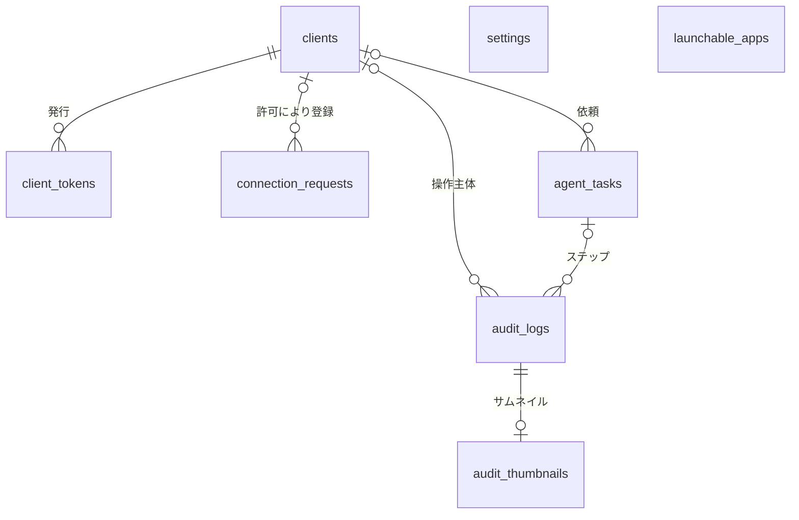
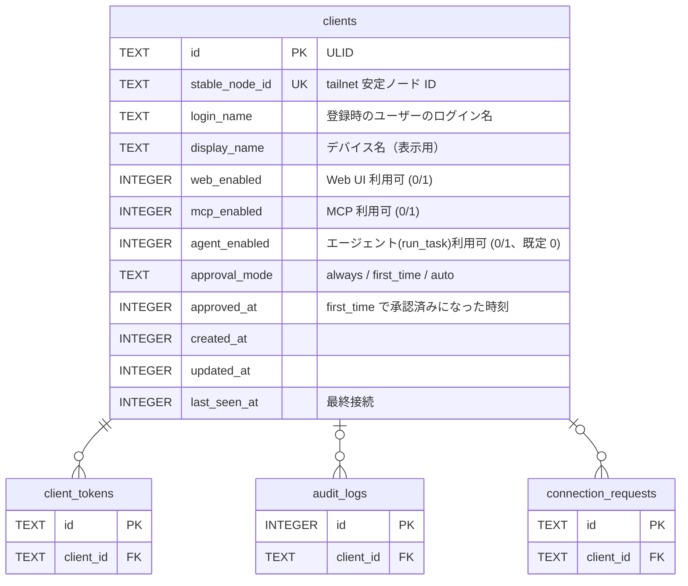
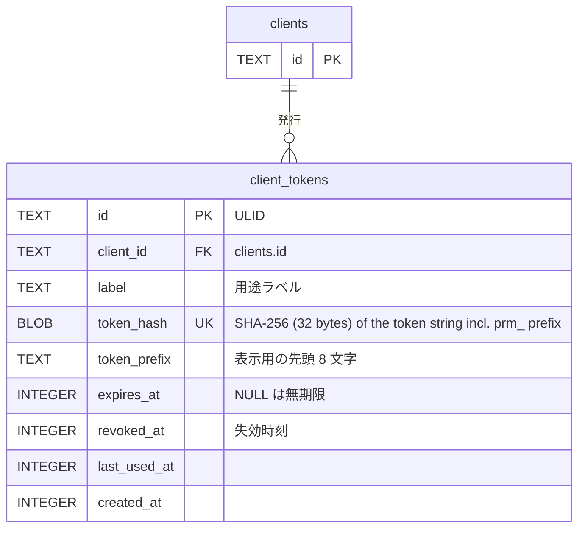
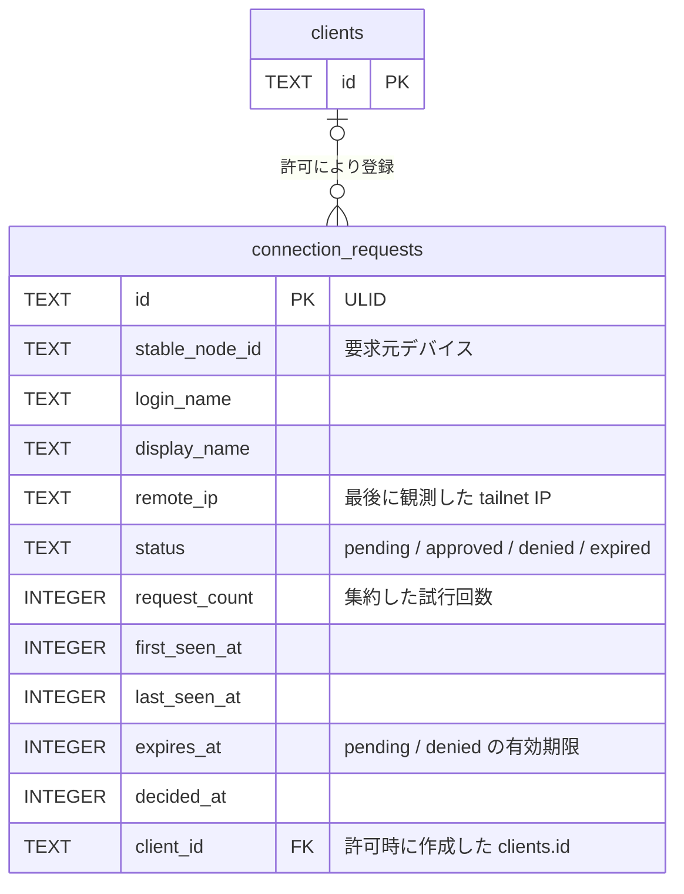
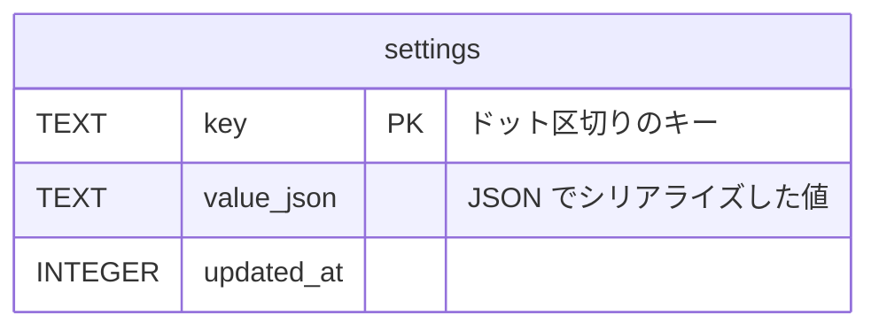
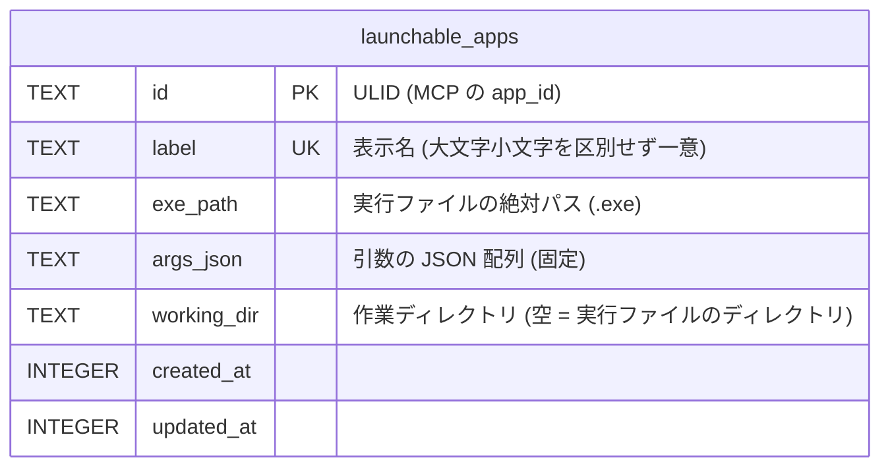
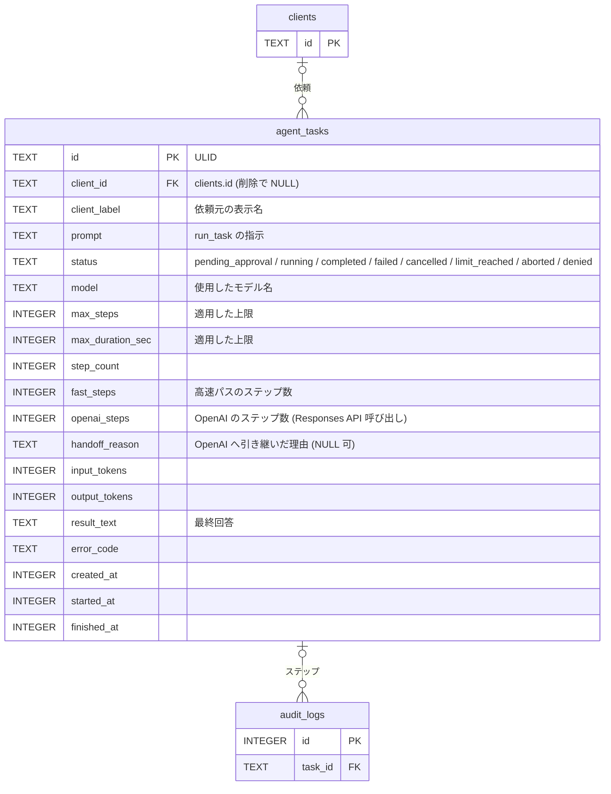
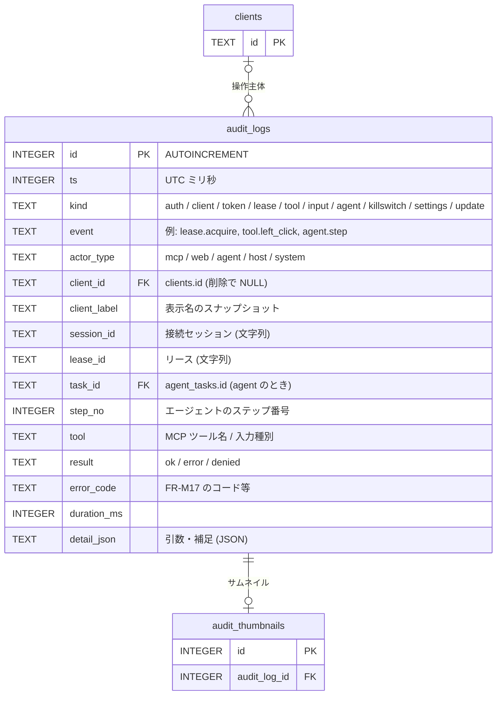
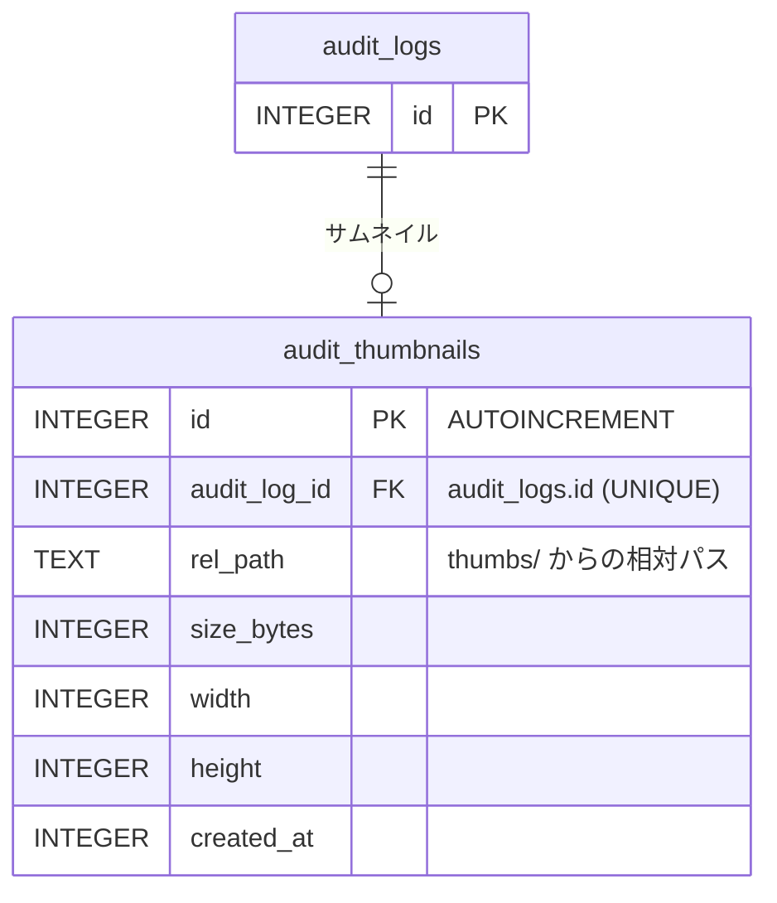

# ER / データモデル

ホスト 1 台のローカル SQLite（`%LOCALAPPDATA%\puppet-remo\puppet-remo.db`）に保存するデータの定義。技術選定は [アーキテクチャ設計](overview.md)、要件は [機能要件](../requirements/functional.md) を参照。

## 方針

| 項目 | 内容 |
|------|------|
| DB | SQLite（`modernc.org/sqlite`、純 Go）。起動時に `PRAGMA journal_mode=WAL; foreign_keys=ON; busy_timeout=5000; synchronous=NORMAL` を設定する |
| マイグレーション | 埋め込み SQL をバージョン順に適用（[NFR-O05](../requirements/non-functional.md)）。適用済みバージョンはマイグレーションライブラリの管理テーブルに保持する（本書の対象外） |
| ID | クライアント・トークン・接続要求は **ULID**（時系列ソート可能な 26 文字、アプリ側で生成）。`audit_logs` / `audit_thumbnails` は `INTEGER PRIMARY KEY AUTOINCREMENT` |
| 時刻 | UTC の Unix ミリ秒（`INTEGER`）。表示時にローカル時刻へ変換する |
| 真偽値 | `INTEGER`（0 / 1）。`CHECK (col IN (0, 1))` を付ける |
| 列挙値 | `TEXT` + `CHECK (col IN (...))` |
| 永続化しないもの | **リース**（[NFR-A01](../requirements/non-functional.md)）、**接続中セッション**（監査ログに `session_id` を文字列として記録するのみ）、承認待ち要求、WhoIs キャッシュ、Web UI の閲覧設定（モニター・品質・FPS はブラウザセッション単位）、**エージェントの実行状態**（ループ・会話。タスクの記録のみ `agent_tasks` に持つ。[NFR-A08](../requirements/non-functional.md)） |
| サムネイル | 画像は**ファイル**として `%LOCALAPPDATA%\puppet-remo\thumbs\` に保存し、DB にはパスとサイズを持つ |
| 改ざん検知 | 設けない（同一ユーザー権限の悪意あるプロセスは脅威モデル外） |
| シークレット | **OpenAI API キーと TypeSafe API キーは DB に保存しない**。Windows 資格情報マネージャーにのみ置く（TypeSafe のターゲット名は `puppet-remo/typesafe`。[NFR-S14](../requirements/non-functional.md)）。`settings`・ログ・監査ログにも値を書かない |

## 全体 ER 図

## テーブル一覧

| テーブル | 用途 | 主な参照元 |
|---------|------|-----------|
| `clients` | 許可リスト（tailnet デバイス + ユーザー）と、クライアント別の利用可否・承認モード | FR-A04, A09, H04, L07 |
| `client_tokens` | MCP 用 Bearer トークン（ハッシュのみ） | FR-A05, A08 |
| `connection_requests` | 未登録デバイスからの接続要求 | FR-A06, A07 |
| `agent_tasks` | 内蔵エージェントのタスク（指示、状態、使用トークン、最終回答、高速パスのステップ数・OpenAI へ引き継いだ理由）。ステップは `audit_logs` に `task_id` で紐づく | FR-G02, G03, G09, G15, G16〜G24, H10 |
| `settings` | アプリ設定、キルスイッチ状態、エージェント設定（高速パスを含む。キー・値） | FR-S01〜S19, FR-H06, FR-H11 |
| `launchable_apps` | 起動許可リスト（`launch_app` で起動してよいアプリ。表示名・実行ファイルのパス・固定の引数・作業ディレクトリ）。ホスト GUI だけが書く。他の表への外部キーは無い | FR-M18, M19, H12, AU06 |
| `audit_logs` | 監査ログ | FR-AU01〜AU05 |
| `audit_thumbnails` | 監査ログに紐づく縮小スクリーンショットのメタ情報 | FR-AU02, AU04 |

## テーブル定義

### clients

許可済みクライアント。tailnet の安定ノード ID（`StableNodeID`）で識別し、登録時のログイン名と照合する。

| カラム | 型 | NULL | 既定値 | 説明 |
|--------|----|------|--------|------|
| `id` | TEXT | NO | — | PK。ULID |
| `stable_node_id` | TEXT | NO | — | tailnet の安定ノード ID。UNIQUE |
| `login_name` | TEXT | NO | — | 登録時のログイン名。リクエスト時の WhoIs 結果と一致しない場合は未登録として扱い、接続要求を作る（再認証でユーザーが変わったデバイスへの権限の持ち越しを防ぐ） |
| `display_name` | TEXT | NO | — | デバイス名。GUI の表示用 |
| `web_enabled` | INTEGER | NO | 1 | Web UI の利用可否 |
| `mcp_enabled` | INTEGER | NO | 1 | MCP の利用可否 |
| `agent_enabled` | INTEGER | NO | 0 | 内蔵エージェント（`run_task`）の利用可否。**既定は無効**（FR-A09）。M1 でも GUI・API から保存・編集できるが、M1 では参照せず効果はない（`run_task` は M4 から） |
| `approval_mode` | TEXT | NO | `'always'` | `always` / `first_time` / `auto`（FR-L07）。M1 は承認なしでリースを取得するため参照せず、既定値 `always` で保存するだけ。承認モードの適用・選択・設定は M3 |
| `approved_at` | INTEGER | YES | NULL | `first_time` で一度承認された時刻。NULL なら未承認（承認の取り消しは NULL に戻す）。`approval_mode` を変更したときも NULL に戻す。M3 から使う |
| `created_at` | INTEGER | NO | — | 登録時刻 |
| `updated_at` | INTEGER | NO | — | 更新時刻 |
| `last_seen_at` | INTEGER | YES | NULL | 最終に認可を通過した時刻 |

制約: `UNIQUE (stable_node_id)`、`CHECK (approval_mode IN ('always','first_time','auto'))`、`CHECK (web_enabled IN (0,1))`、`CHECK (mcp_enabled IN (0,1))`、`CHECK (agent_enabled IN (0,1))`。

インデックス: UNIQUE 制約による `stable_node_id` のインデックスのみ（行数は最大 50。NFR-C01）。

再許可: 登録済みデバイスのログイン名が変わると同じ `stable_node_id` の接続要求ができる。ホスト所有者が許可したときは、既存の行を削除（`client_tokens` は CASCADE）して新しい行を同一トランザクションで作り（権限・トークンは引き継がない）、`client.replace` を監査に記録する。

### client_tokens

MCP 用 Bearer トークン。1 クライアントに複数発行でき（用途別のラベル）、個別に失効できる。平文は保存しない。形式（`prm_` + base64url の 32 バイト乱数）と保存・照合の定義は [NFR-S04](../requirements/non-functional.md)。

| カラム | 型 | NULL | 既定値 | 説明 |
|--------|----|------|--------|------|
| `id` | TEXT | NO | — | PK。ULID |
| `client_id` | TEXT | NO | — | FK → `clients.id`。`ON DELETE CASCADE`（クライアント削除でトークンも消える） |
| `label` | TEXT | NO | — | 用途ラベル（例: `claude-code`）。同一クライアント内で重複不可 |
| `token_hash` | BLOB | NO | — | 接頭辞 `prm_` を含むトークン文字列（UTF-8）の SHA-256（32 バイト）。UNIQUE。照合は、提示された文字列の SHA-256 と保存済みハッシュの定数時間比較（NFR-S04） |
| `token_prefix` | TEXT | NO | — | 表示用にトークン文字列の先頭 8 文字（例: `prm_Ab12`）。識別用で認証には使わない |
| `expires_at` | INTEGER | YES | NULL | 有効期限。既定の発行時指定は 90 日後（FR-A08）。NULL は無期限 |
| `revoked_at` | INTEGER | YES | NULL | 失効時刻。NULL でなければ無効 |
| `last_used_at` | INTEGER | YES | NULL | 最終使用時刻 |
| `created_at` | INTEGER | NO | — | 発行時刻 |

制約: `UNIQUE (token_hash)`、`UNIQUE (client_id, label)`、`CHECK (length(token_hash) = 32)`（SHA-256 の 32 バイトであること。M1 の実装で追加）。

有効なトークンの条件: `revoked_at IS NULL AND (expires_at IS NULL OR expires_at > now) AND clients.mcp_enabled = 1`、かつ要求元の `stable_node_id` がトークンの `client_id` のクライアントと一致すること（FR-A05）。

インデックス: UNIQUE 制約で `token_hash`、`(client_id, label)` を網羅。

### connection_requests

未登録デバイスからの接続要求。1 デバイスにつき `pending` は 1 件に集約する。

| カラム | 型 | NULL | 既定値 | 説明 |
|--------|----|------|--------|------|
| `id` | TEXT | NO | — | PK。ULID |
| `stable_node_id` | TEXT | NO | — | 要求元デバイスの安定ノード ID |
| `login_name` | TEXT | NO | — | 要求元ユーザーのログイン名 |
| `display_name` | TEXT | NO | — | デバイス名 |
| `remote_ip` | TEXT | NO | — | 最後に観測した接続元 tailnet IP |
| `status` | TEXT | NO | `'pending'` | `pending`（承認待ち）/ `approved`（許可済み）/ `denied`（拒否）/ `expired`（失効） |
| `request_count` | INTEGER | NO | 1 | 集約した試行回数（スパム対策の目安。GUI に出す通知は増やさない） |
| `first_seen_at` | INTEGER | NO | — | 最初の観測時刻 |
| `last_seen_at` | INTEGER | NO | — | 最後の観測時刻 |
| `expires_at` | INTEGER | NO | — | `pending`: 作成から 24 時間後。`denied`: 拒否から 24 時間後（この間は同デバイスから新しい要求を作らない） |
| `decided_at` | INTEGER | YES | NULL | 許可・拒否した時刻 |
| `client_id` | TEXT | YES | NULL | 許可により作成したクライアント。FK → `clients.id`、`ON DELETE SET NULL` |

制約: `CHECK (status IN ('pending','approved','denied','expired'))`。`stable_node_id` について `status = 'pending'` の行は 1 件のみ（部分 UNIQUE インデックス）。

インデックス:

| 名称 | 対象 | 種別 | 目的 |
|------|------|------|------|
| `ux_connreq_pending_node` | `(stable_node_id) WHERE status = 'pending'` | UNIQUE（部分） | 1 デバイス 1 件への集約（FR-A06） |
| `ix_connreq_status_expires` | `(status, expires_at)` | 通常 | 失効処理、`denied` の再要求抑止の判定 |

保守: `last_seen_at` から 7 日を過ぎた行を定期削除する。`pending` で `expires_at` を過ぎた行は `expired` に更新する。レート制限（FR-A07）は件数カウントをメモリで行うため、DB には持たない。

M1 の実装の補足: 期限切れの `pending` は、保守で `expired` にする前でも一覧（`ListPending`）に含めず、許可もできない（許可は conflict）。同じデバイスの `pending` を 5 秒以内に更新済みなら、`last_seen_at` と `request_count` を DB に書かない（連続リクエストによる書き込みの抑止）。同じデバイスの期限切れの `pending` は、新しい要求を作る前に `expired` にする。

### settings

キー・値形式の設定。型検証はサービス層で行う（キーごとのスキーマはコードで定義）。キルスイッチの状態もここに置く（[NFR-S07](../requirements/non-functional.md)）。

| カラム | 型 | NULL | 既定値 | 説明 |
|--------|----|------|--------|------|
| `key` | TEXT | NO | — | PK。キー名 |
| `value_json` | TEXT | NO | — | JSON 値。`json_valid(value_json)` を `CHECK` で確認する |
| `updated_at` | INTEGER | NO | — | 更新時刻 |

キー一覧（行が無ければ既定値を使う）:

| キー | 型 | 既定値 | 対応する要件 |
|------|----|--------|-------------|
| `server.port` | number | 8765 | FR-S01 |
| `killswitch.hotkey` | string | `"Ctrl+Alt+Shift+K"` | FR-S02 |
| `killswitch.state` | object `{active, triggered_at, source}` | `{"active": false}` | FR-H06、NFR-S07 |
| `screenshot.max_dimension` | number | 1568 | FR-S03 |
| `lease.idle_timeout_sec` | number | 300 | FR-S04 |
| `viewer.default_quality` | number | 70 | FR-S06 |
| `viewer.default_fps` | number | 10 | FR-S06 |
| `audit.thumbnails_enabled` | boolean | true | FR-AU02 |
| `audit.record_text` | boolean | false | FR-AU03 |
| `audit.retention_days` | number | 30 | FR-AU04 |
| `audit.thumbs_max_bytes` | number | 1073741824 | FR-AU04 |
| `update.apply_mode` | string `"confirm"` / `"auto_idle"` | `"confirm"` | FR-S09 |
| `update.last_checked_at` | number | なし | FR-H09 |
| `log.level` | string | `"info"` | NFR-O01 |
| `agent.enabled` | boolean | false | FR-S10、FR-G14 |
| `agent.consent_at` | number（UTC ミリ秒） | なし | FR-G14（OpenAI へのスクリーンショット送信への同意の日時。有効化時に記録し、無効化で削除） |
| `agent.model` | string | `"gpt-6.1-sol"` | FR-S11 |
| `agent.max_steps` | number | 50 | FR-S12 |
| `agent.max_duration_sec` | number | 600 | FR-S12 |
| `agent.deny_processes` | array of string | `["KeePass.exe","KeePassXC.exe","1Password.exe","Bitwarden.exe"]` | FR-S13 |
| `agent.approve_processes` | array of string | `[]` | FR-S13 |
| `agent.keep_screenshots` | number | 3 | FR-S19、FR-G24（OpenAI へ再送する履歴に残す直近のスクリーンショット枚数。それ以前は文字のプレースホルダーに置換する） |
| `agent.fastpath.enabled` | boolean | false | FR-S14、FR-G22（高速パスの有効化。エージェントの有効化とは別のスイッチ） |
| `agent.fastpath.consent_at` | number（UTC ミリ秒） | なし | FR-G22（TypeSafe へのデータ送信への同意の日時。有効化時に記録し、無効化で削除。`agent.consent_at` とは独立。NFR-PR04） |
| `agent.fastpath.model` | string | `"jev-1.13"` | FR-S15 |
| `agent.fastpath.min_confidence` | number（0〜1） | 0.7 | FR-S16、FR-G18 |
| `agent.fastpath.max_steps` | number | 15 | FR-S17、FR-G19（高速ステップも `agent.max_steps` と `agent.max_duration_sec` に数える） |
| `agent.fastpath.excluded_labels` | array of string | `["delete","remove","send","submit","purchase","buy","pay","close","quit","exit","uninstall","format","erase","削除","送信","購入","支払い","閉じる","終了","アンインストール","初期化"]` | FR-S18、FR-G17（ラベルへの大文字小文字を区別しない部分一致で候補から除外する） |

ログオン時の自動起動（FR-S08）の有効・無効は OS（スタートアップ登録）が真実の源であり、DB には持たない。クライアント別の承認モード（FR-S05）は `clients.approval_mode`、エージェント利用許可（FR-A09）は `clients.agent_enabled` に持つ。OpenAI API キーと TypeSafe API キーは `settings` にも置かない（資格情報マネージャーのみ。FR-G22）。高速パスは有効化・キー・同意の 3 つがそろわなければ静かにスキップされ、タスクは OpenAI のみで実行される（`agent.fastpath.enabled` が true でもキーまたは `agent.fastpath.consent_at` が無ければ使わない）。TypeSafe が 401 を返したときはキー無効として `agent.fastpath.enabled` を false に更新する（FR-G21）。

### launchable_apps

MCP の `launch_app` が起動できるアプリの許可リスト（M1.5。[FR-M18・M19・H12](../requirements/functional.md)）。**書き込みはホスト GUI（`service.AppRegistry`）だけ**で、リモートの経路（MCP・Web UI）からは書かない。`id` は MCP の `app_id` として公開する唯一の値で、`exe_path` / `args_json` / `working_dir` は MCP・リモートルーターのどの応答にも出さない（出すのは `id` と `label`）。

| カラム | 型 | NULL | 既定値 | 説明 |
|--------|----|------|--------|------|
| `id` | TEXT | NO | — | PK。ULID（アプリ側で生成）。MCP の `app_id`。編集しても変わらず、削除すると無効になり再利用されない |
| `label` | TEXT | NO | — | 表示名（1〜64 文字。前後の空白は `domain` が除く）。`COLLATE NOCASE` で UNIQUE。**NOCASE の畳み込みは ASCII のみ**（`A`〜`Z`）で、全角英字・Unicode の大文字小文字は別の値として扱う（正規化列は設けない。重複の判定は ASCII の大文字小文字を無視した一致）。MCP の `list_launchable_apps` が返す |
| `exe_path` | TEXT | NO | — | 実行ファイルの絶対パス。ローカルドライブの `.exe` で、UNC・デバイスパス（`\\?\`・`\\.\`）・相対パス・`..` を含むパス、ドライブ指定以外の `:`（代替データストリーム）、`<>"\|?*`、制御文字（C0 と DEL）、予約デバイス名（`CON`・`PRN`・`AUX`・`NUL`・`COM1`〜`COM9`・`LPT1`〜`LPT9`、上付き数字の `COM¹`・`COM²`・`COM³`・`LPT¹`・`LPT²`・`LPT³`。拡張子付き・ディレクトリの要素でも）を含むパス、32,766 文字（UTF-16。終端の NUL を含めて 32,767）を超えるパスは保存しない（検証は `domain`、存在確認は登録・更新時に `platform.AppLauncher`。FR-H12）。`CreateProcess` の `lpApplicationName` にそのまま使う |
| `args_json` | TEXT | NO | `'[]'` | 起動引数。文字列の JSON 配列（最大 32 個・合計 8,192 文字）。引数の連結（Windows のコマンドライン規則に沿った引用）は起動時に `platform` が行い、DB にはコマンドライン文字列を持たない（引用後の全体が 32,766 UTF-16 ユニット（終端の NUL を含めて 32,767）を超えると起動しない）。登録時に固定し、`launch_app` から変更できない。手で書き換えられて「文字列の配列」として読めない行は、読み出し側が `Corrupt`（引数は空）として返し、一覧・削除は成功するが、起動は `app_not_found` で拒否する |
| `working_dir` | TEXT | NO | `''` | 作業ディレクトリの絶対パス（既存のディレクトリ。`exe_path` と同じパスの規則）。空文字は「実行ファイルのあるディレクトリ」 |
| `created_at` | INTEGER | NO | — | 登録時刻 |
| `updated_at` | INTEGER | NO | — | 更新時刻 |

制約: `UNIQUE (label COLLATE NOCASE)`（ASCII のみの大文字小文字無視。上記）、`CHECK (length(label) BETWEEN 1 AND 64)`、`CHECK (length(exe_path) > 0)`、`CHECK (json_valid(args_json) AND json_type(args_json) = 'array')`。登録数の上限 50（NFR-C06）はサービス層が、件数の確認と挿入を同じトランザクションで行って守る（DB の制約にはしない。NFR-C01 と同様）。

インデックス: UNIQUE 制約による `label` のインデックスのみ（行数は最大 50）。

起動時の扱い: `launch_app` は `id` の行を読み、`domain` の検証規則（パスの形・引数の数と長さ）を**起動のたびに**再度確認し、満たさなければ `app_not_found` で拒否する（fail closed。行が手で書き換えられても、規則外のパスは起動しない）。実行ファイルが消えていても行は残り、起動時に `launch_failed`（`file_missing`）になる。クライアントの削除・無効化・トークン失効は許可リストに影響しない（許可リストはホスト全体のもので、クライアント別ではない）。

### agent_tasks

内蔵エージェントの 1 回の実行（[FR-G02〜G24](../requirements/functional.md)）。ステップ（アクション・Judge の判定・安全チェック・サムネイル・高速パスの選択）は `audit_logs` に `kind = 'agent'`、`task_id`、`step_no` で保存し、ここには集計だけを持つ。

| カラム | 型 | NULL | 既定値 | 説明 |
|--------|----|------|--------|------|
| `id` | TEXT | NO | — | PK。ULID。`run_task` が返す `task_id` |
| `client_id` | TEXT | YES | NULL | 依頼したクライアント。FK → `clients.id`、`ON DELETE SET NULL` |
| `client_label` | TEXT | NO | — | 依頼元の表示名のスナップショット |
| `prompt` | TEXT | NO | — | 指示本文（10,000 文字まで。NFR-S09）。タスクの記録として常に保存する（FR-AU03） |
| `status` | TEXT | NO | `'pending_approval'` または `'running'` | FR-G03 の状態 |
| `model` | TEXT | NO | — | 使用したモデル名（開始時の `agent.model`） |
| `max_steps` | INTEGER | NO | — | 適用した上限（`run_task` の指定は設定値以下） |
| `max_duration_sec` | INTEGER | NO | — | 適用した上限 |
| `step_count` | INTEGER | NO | 0 | 実行したステップの**総数**（`fast_steps + openai_steps`。`agent.max_steps` の判定対象。FR-G19）。高速パス導入前の定義（Responses API 呼び出しの数）を、高速パスのステップを含む総数に広げた。既存列を残して総数の意味に統一し、読み取り側（一覧・`get_task` の既存フィールド）を変えない |
| `fast_steps` | INTEGER | NO | 0 | 高速パス（Jev）で実行したステップの数（FR-G19、FR-G23）。高速パスが無効・スキップされたタスクは 0。上限は `agent.fastpath.max_steps` |
| `openai_steps` | INTEGER | NO | 0 | OpenAI（computer ツールのループ、Responses API 呼び出し）で実行したステップの数（FR-G23）。高速パスなしのタスクでは従来の `step_count` と同じ値 |
| `handoff_reason` | TEXT | YES | NULL | 高速パスから OpenAI へ引き継いだ理由（FR-G20、FR-G23）。`abstain` / `low_confidence` / `no_candidates` / `invalid_choice` / `no_progress` / `goal_maybe_done` / `fast_step_limit` / `chooser_unavailable`。引き継ぎが起きなかったとき（高速パスが無効、または高速パス中にキャンセル・失敗で終了）は NULL。一度引き継いだタスクは最後まで OpenAI で続ける（v1 では戻さない）ため、1 タスクにつき理由は 1 つ |
| `input_tokens` / `output_tokens` | INTEGER | NO | 0 | 使用トークンの累計（金額上限は設けない。FR-G09） |
| `result_text` | TEXT | YES | NULL | 最終回答（10,000 文字で切り詰め）。`completed` はモデルの申告（FR-G13） |
| `error_code` | TEXT | YES | NULL | 失敗の理由。`input_blocked` / `judge_denied` / `approval_denied` / `safety_check_denied` / `unsupported_action` / `openai_error` など（FR-M17、FR-G） |
| `created_at` | INTEGER | NO | — | `run_task` の受付時刻 |
| `started_at` | INTEGER | YES | NULL | `running` になった時刻（承認拒否の `denied` は NULL） |
| `finished_at` | INTEGER | YES | NULL | 終了状態になった時刻 |

制約: `CHECK (status IN ('pending_approval','running','completed','failed','cancelled','limit_reached','aborted','denied'))`、`CHECK (status IN ('pending_approval','running') OR finished_at IS NOT NULL)`（終了状態は `finished_at` が必須）、`CHECK (step_count >= 0 AND fast_steps >= 0 AND openai_steps >= 0 AND input_tokens >= 0 AND output_tokens >= 0)`、`CHECK (step_count = fast_steps + openai_steps)`（総数と内訳の整合。3 列はサービス層が同じトランザクションで更新する）、`CHECK (handoff_reason IS NULL OR handoff_reason IN ('abstain','low_confidence','no_candidates','invalid_choice','no_progress','goal_maybe_done','fast_step_limit','chooser_unavailable'))`。

インデックス:

| 名称 | 対象 | 種別 | 目的 |
|------|------|------|------|
| `ix_task_created` | `(created_at DESC)` | 通常 | タスク一覧（FR-H10）、保持期間の削除 |
| `ix_task_client_created` | `(client_id, created_at DESC)` | 通常 | クライアント別の一覧、`get_task` の所有確認 |
| `ix_task_active` | `(status) WHERE status IN ('pending_approval','running')` | 部分 | 起動時の `aborted` 更新（NFR-A08）、実行中の確認 |

同時に実行できるタスクは 1 件（NFR-C05）。これは排他リースがメモリ上で保証し、DB では制約にしない。

### audit_logs

すべての監査イベント（[FR-AU01](../requirements/functional.md)）。クライアントが削除されても履歴が残るよう、操作主体の表示名を行に複製して持つ。**M1 は、認証失敗・リース・ツール実行を追記するところまで**（閲覧 UI・全イベントの記録・サムネイル（`audit_thumbnails`）は M3）。

| カラム | 型 | NULL | 既定値 | 説明 |
|--------|----|------|--------|------|
| `id` | INTEGER | NO | AUTOINCREMENT | PK |
| `ts` | INTEGER | NO | — | 発生時刻（UTC ミリ秒） |
| `kind` | TEXT | NO | — | 分類: `auth`（接続要求・認証失敗）/ `client`（登録・変更・削除）/ `token` / `lease` / `tool`（MCP ツール呼び出し）/ `input`（Web UI からの入力操作）/ `agent`（タスクのライフサイクル・各ステップ・安全チェック・Judge の判定・エージェントと高速パスの有効化と同意）/ `killswitch` / `settings` / `update` |
| `event` | TEXT | NO | — | イベント名（例: `lease.acquire`、`lease.revoke`、`tool.left_click`、`auth.bearer_failed`、`agent.task_start`、`agent.step`、`agent.safety_check`、`agent.judge`、`agent.consent`、`agent.fastpath.enable`、`agent.fastpath.disable`）。高速パスの有効化・無効化（`agent.consent` とは別イベント）は `kind = 'agent'`、有効化は `agent.fastpath.consent_at` の記録と同時に書く。401 によるシステム側の無効化は `actor_type = 'system'` で `agent.fastpath.disable`（`error_code` に `typesafe_unauthorized` を入れる） |
| `actor_type` | TEXT | NO | — | `mcp` / `web` / `agent`（内蔵エージェント）/ `host`（ホスト GUI 操作）/ `system` |
| `client_id` | TEXT | YES | NULL | FK → `clients.id`、`ON DELETE SET NULL`。ホスト操作・システム・未登録デバイスは NULL。追記時にクライアントが既に無い場合（削除直後の `client.delete`・`lease.release` など）も NULL で保存し、`client_label` を残す |
| `client_label` | TEXT | NO | — | 表示名のスナップショット。未登録デバイスはデバイス名、ホスト操作は `(host)` |
| `session_id` | TEXT | YES | NULL | 接続セッション ID（メモリ上の ID を文字列で記録） |
| `lease_id` | TEXT | YES | NULL | リース ID（メモリ上の ID を文字列で記録） |
| `task_id` | TEXT | YES | NULL | FK → `agent_tasks.id`、`ON DELETE SET NULL`。エージェントのステップ・タスクのイベントで設定する |
| `step_no` | INTEGER | YES | NULL | タスク内のステップ番号（1 始まり）。ステップ内のアクションは `detail_json` に順序付きで持つ |
| `tool` | TEXT | YES | NULL | ツール名（`left_click` 等）。`input` では `mouse` / `key` 等、`agent` ではアクション種別（`click` / `type` など） |
| `result` | TEXT | NO | — | `ok` / `error` / `denied` |
| `error_code` | TEXT | YES | NULL | FR-M17 のエラーコード等 |
| `duration_ms` | INTEGER | YES | NULL | 所要時間 |
| `detail_json` | TEXT | YES | NULL | 引数・補足（JSON）。`type` の本文とクリップボードは既定では文字数のみ（FR-AU03）。トークンと API キーは含めない。エージェントのステップの内容は下記 |

制約: `CHECK (result IN ('ok','error','denied'))`、`CHECK (actor_type IN ('mcp','web','agent','host','system'))`、`CHECK (detail_json IS NULL OR json_valid(detail_json))`。

M1.5 のアプリ起動の監査（FR-AU06）。新しい `kind` は作らず、既存の `tool` / `settings` をイベント名で区別する。

| event | kind | actor_type | result | `detail_json` |
|-------|------|------------|--------|---------------|
| `tool.launch_app` | `tool` | `mcp` | `ok` / `denied`（キルスイッチ・リース・`app_not_found`）/ `error`（`launch_failed`） | `{ "app_id", "label", "pid"（ok のみ）, "reason"（error のみ: `file_missing` / `access_denied` / `elevation_required` / `other`） }`。`app_id` が許可リストに無いとき `label` は無く、受け取った `app_id` は 64 文字までに切り詰めて記録する。`error_code` は FR-M17 のコード |
| `tool.list_launchable_apps` | `tool` | `mcp` | `ok` | `{ "count" }` |
| `settings.launchable_app.create` | `settings` | `host` | `ok` | `{ "app_id", "label", "exe_path", "arg_count" }` |
| `settings.launchable_app.update` | `settings` | `host` | `ok` | `{ "app_id", "label", "exe_path", "arg_count", "changed": ["label", "exe_path", "args", "working_dir"] }`。`changed` は変わった項目だけ。更新前の行が読めない行（`Corrupt`）のときは、壊れていた引数が破棄されたことを残すため `args` を必ず含める |
| `settings.launchable_app.delete` | `settings` | `host` | `ok` | `{ "app_id", "label" }` |

**引数（`args_json`）と作業ディレクトリは、どのイベントにも記録しない**（件数 `arg_count` だけ。FR-AU03・NFR-S13）。`exe_path` は許可を変える登録系イベントにだけ記録し、`tool.launch_app` には記録しない。クライアントが削除済みのときの `client_id` は NULL（既存の規則）。

エージェントのステップ（`event = 'agent.step'`）の `detail_json`（FR-G19、FR-G23）。**入力した本文（`type` のテキスト）と要素の値は、どちらの経路でも記録しない**。

| キー | 経路 | 内容 |
|------|------|------|
| `route` | 両方 | `fast`（高速パス）/ `openai` |
| `candidate_count` | `fast` | 候補表のアクション候補数（`reobserve`・`abstain` を除く） |
| `dropped_count` | `fast` | 上限 24 を超えて落とした候補数 |
| `chosen_id` | `fast` | Jev が選んだ候補 ID（`reobserve` / `abstain` を含む）。検証で拒否された場合は受け取った値の長さ制限付き文字列 |
| `confidence` | `fast` | Jev の `confidence`（0〜1） |
| `goal_maybe_done` | `fast` | Noul の確率（0〜1） |
| `handoff_reason` | `fast` | OpenAI へ引き継ぐと決めたステップだけに入れる（`agent_tasks.handoff_reason` と同じ列挙値） |
| `actions` | 両方 | 実行したアクションの順序付き配列（種別・座標等。FR-AU03 に従い本文は文字数のみ） |

インデックス:

| 名称 | 対象 | 目的 |
|------|------|------|
| `ix_audit_ts` | `(ts DESC)` | 時系列一覧、保持期間による削除 |
| `ix_audit_client_ts` | `(client_id, ts DESC)` | クライアント別の絞り込み（FR-AU05） |
| `ix_audit_kind_ts` | `(kind, ts DESC)` | 種別の絞り込み |
| `ix_audit_result_ts` | `(result, ts DESC)` | 結果（失敗のみ）の絞り込み |
| `ix_audit_session` | `(session_id)` | セッション単位のドリルダウン |
| `ix_audit_task_step` | `(task_id, step_no)` | タスク詳細でのステップ一覧（FR-H10） |

### audit_thumbnails

監査ログに紐づく縮小スクリーンショット（JPEG、長辺 320 px、品質 60。FR-AU02）。画像本体は `thumbs/` 配下のファイル。

| カラム | 型 | NULL | 既定値 | 説明 |
|--------|----|------|--------|------|
| `id` | INTEGER | NO | AUTOINCREMENT | PK |
| `audit_log_id` | INTEGER | NO | — | FK → `audit_logs.id`、`ON DELETE CASCADE`。UNIQUE（1 ログにつき 0 または 1 枚） |
| `rel_path` | TEXT | NO | — | `thumbs/` 配下の相対パス（例: `2026/10/28/01HX….jpg`）。絶対パスは保存しない |
| `size_bytes` | INTEGER | NO | — | ファイルサイズ。容量集計に使う |
| `width` / `height` | INTEGER | NO | — | 画像サイズ（px） |
| `created_at` | INTEGER | NO | — | 保存時刻 |

制約: `UNIQUE (audit_log_id)`、`CHECK (size_bytes >= 0)`。

インデックス: `ix_thumb_created (created_at)`（容量超過時に古い順に削除）。

## データの保守

| 処理 | 契機 | 内容 |
|------|------|------|
| 保持期間の削除 | 起動時と 1 時間ごと | `audit_logs.ts` が `audit.retention_days` を超えた行を削除する。`audit_thumbnails` は `CASCADE` で消え、対応するファイルを削除する |
| 容量の削除 | サムネイル保存の都度、起動時 | `SUM(size_bytes)` が `audit.thumbs_max_bytes` を超えたら `created_at` の古い順にサムネイルのファイルと行を削除する（ログ行は残す） |
| 孤児ファイルの掃除 | 起動時 | `thumbs/` にあって DB に行がないファイル、行はあるのにファイルがない行を削除する |
| 接続要求の整理 | 1 時間ごと | `pending` の失効、`last_seen_at` から 7 日を過ぎた行の削除 |
| タスクの保持期間 | 起動時と 1 時間ごと | `agent_tasks.finished_at` が `audit.retention_days` を超えた行を削除する（`audit_logs.task_id` は `SET NULL`）。実行中・承認待ちの行は削除しない |
| 異常終了したタスクの回収 | 起動時 | 状態が `pending_approval` / `running` のまま残った行を `aborted`（`finished_at` を設定）に更新する。自動では再開しない（[NFR-A08](../requirements/non-functional.md)） |
| 整合性チェック | 起動時 | `PRAGMA quick_check`。失敗時は DB を隔離（リネーム）して空 DB で起動し GUI に通知（[NFR-A06](../requirements/non-functional.md)） |
| ファイル削除と DB 削除の順序 | 常時 | DB 行を先に削除（トランザクション）してからファイルを削除する。途中で落ちても残るのは孤児ファイルで、起動時の掃除で回収できる |

## 改訂履歴

| 版 | 日付 | 変更内容 | 変更理由 |
|---|------|---------|---------|
| 1.0 | 2026-10-28 | 初版作成 | — |
| 1.1 | 2026-10-29 | 内蔵エージェント向けに `agent_tasks` を追加、`clients.agent_enabled`、`audit_logs.task_id` / `step_no` / `actor_type = 'agent'` / `kind = 'agent'`、エージェントの設定キー、保守処理（タスクの保持期間・異常終了の回収）を追加。API キーは DB に置かない旨を明記。`tool.click` の例を `tool.left_click` に更新 | ホスト内蔵エージェントを主役にする決定 |
| 1.2 | 2026-10-29 | 高速パス（Jev）に対応: `agent_tasks` に `fast_steps` / `openai_steps` / `handoff_reason`（8 値の CHECK、NULL 可）を追加し、`step_count` を両者の総数（`CHECK (step_count = fast_steps + openai_steps)`）と定義、設定キー `agent.fastpath.*`（enabled / consent_at / model / min_confidence / max_steps / excluded_labels）と `agent.keep_screenshots` を追加、TypeSafe API キーも資格情報マネージャーのみ（`puppet-remo/typesafe`）と明記、監査ステップの `detail_json`（route・candidate_count・dropped_count・chosen_id・confidence・goal_maybe_done・handoff_reason）と `agent.fastpath.enable` / `agent.fastpath.disable` イベントを追加 | 未決事項の決定 |
| 1.3 | 2026-10-29 | PR #2 のレビュー対応: `client_tokens.token_hash` を「接頭辞 `prm_` を含むトークン文字列（UTF-8）の SHA-256」に明記し、形式・照合の定義を NFR-S04 の参照に統一。`audit_logs` の M1（追記のみ）/ M3（閲覧・サムネイル）の段階を明記 | M1 の実装者が迷わない仕様にするためのレビュー指摘の解消 |
| 1.4 | 2026-10-29 | `clients.approval_mode` / `approved_at` は M1 では参照せず、M3 から使うと明記 | PR #2 のレビュー対応（方針 5） |
| 1.5 | 2026-10-30 | ログイン名変更後の再許可（既存クライアントの置き換え）と、削除済みクライアントの監査（`client_id` を NULL で保存）を明記 | M1 統合レビューの指摘（再許可が UNIQUE で失敗する・監査が FK で落ちる） |
| 1.6 | 2026-10-30 | `clients.agent_enabled` が M1 でも保存・編集できるが、効果は M4 から（M1 では参照しない）と明記 | M1 の実装と FR-A09 の食い違いの解消（オーナー決定） |
| 1.7 | 2026-10-30 | M1 の実装に合わせて、`client_tokens.token_hash` の `CHECK (length(token_hash) = 32)` と、接続要求の期限切れ・5 秒以内の更新を DB に書かない扱いを追記 | M1 の実装との差分の文書化（オーナー決定） |
| 1.8 | 2026-10-30 | 起動許可リスト `launchable_apps`（M1.5）を追加: 全体 ER 図・テーブル一覧・テーブル定義（`UNIQUE (label COLLATE NOCASE)`、`args_json` は JSON 配列、起動のたびに検証規則を再確認）、`audit_logs` のアプリ起動・許可リスト変更のイベント（`tool.launch_app` ほか。引数・作業ディレクトリは記録しない） | M1.5 の仕様追記（#16。オーナー決定 8 件） |
| 1.9 | 2026-10-30 | `launchable_apps.label` の `COLLATE NOCASE` が ASCII のみの畳み込みであることを明記 | #16 のレビュー指摘 |
| 1.10 | 2026-10-30 | `launchable_apps` の `exe_path` / `working_dir` のパスの規則（代替データストリーム・使えない文字・制御文字・予約デバイス名・32,767 文字）と、読めない `args_json` の行（`Corrupt`。一覧・削除は成功、起動は拒否）を追記 | #16 の独立レビュー指摘 |
| 1.11 | 2026-10-30 | `launchable_apps` の予約デバイス名に上付き数字を追加、パスの上限を終端の NUL を含めて 32,767（32,766 文字）に訂正、`settings.launchable_app.update` の `changed` が読めない行の更新で `args` を必ず含むことを追記 | #16 の再レビュー指摘 |
