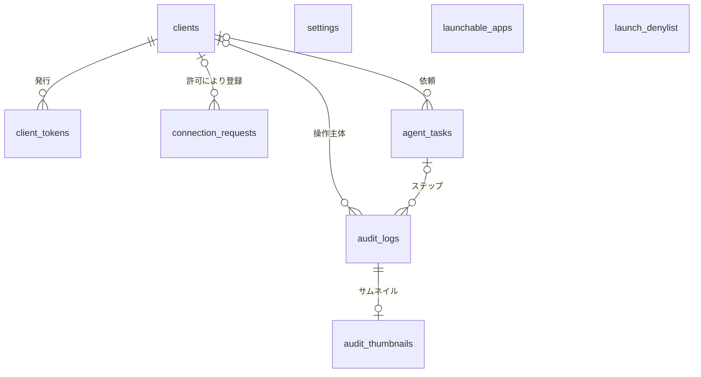
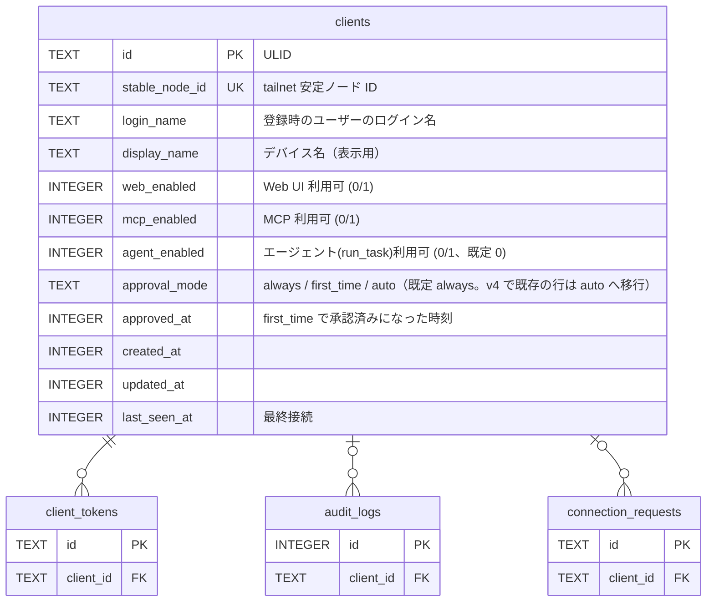
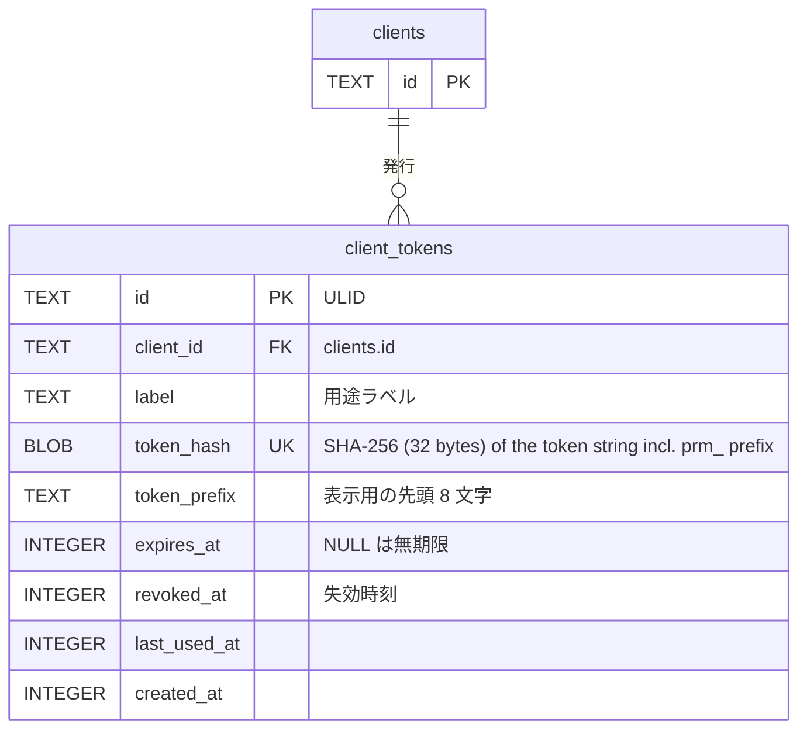
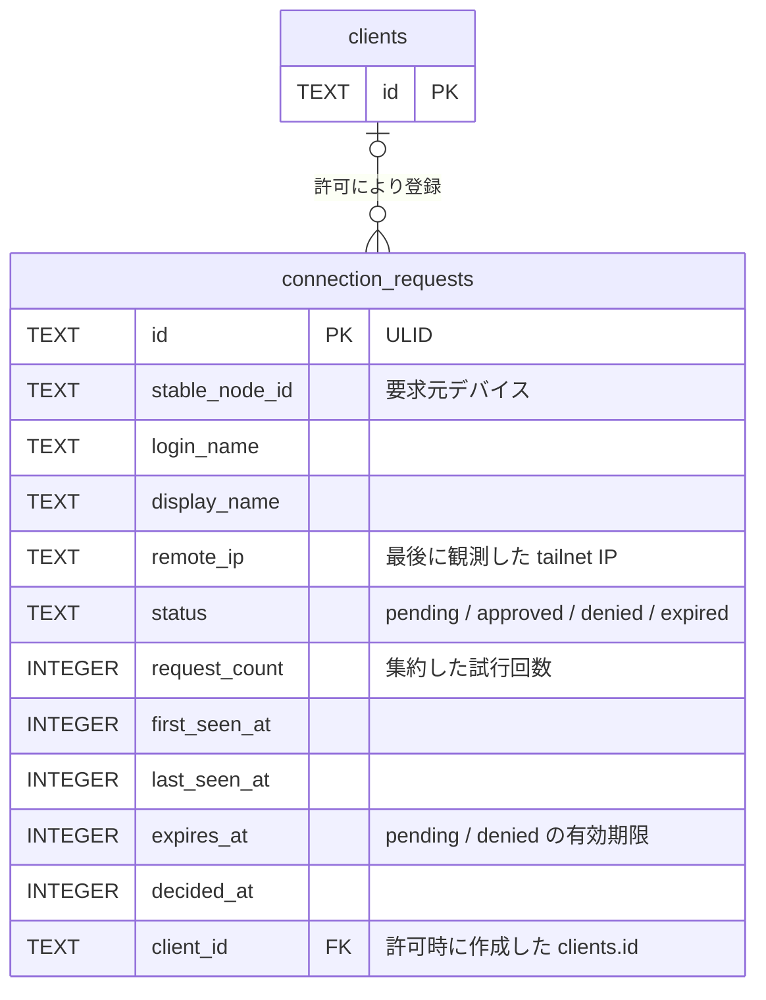
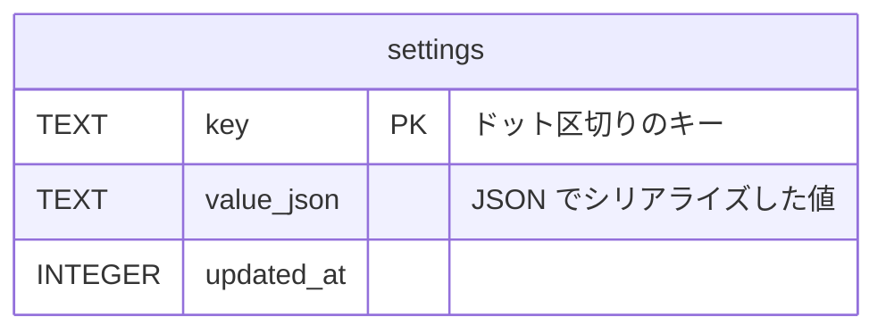
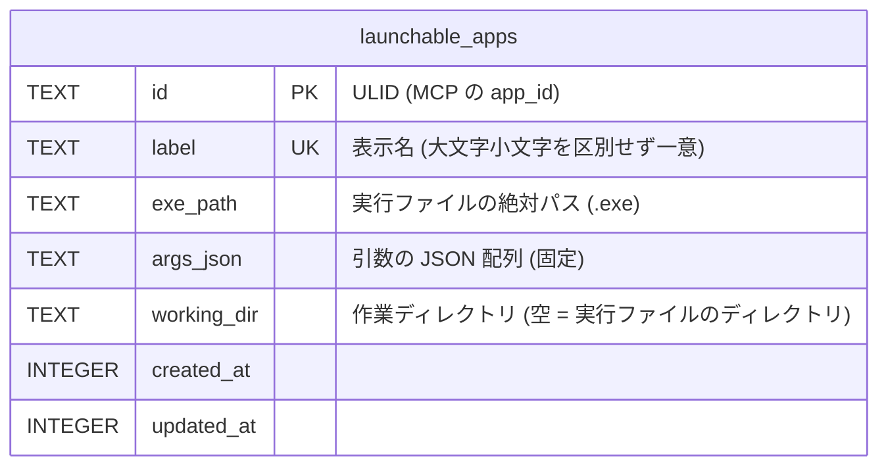
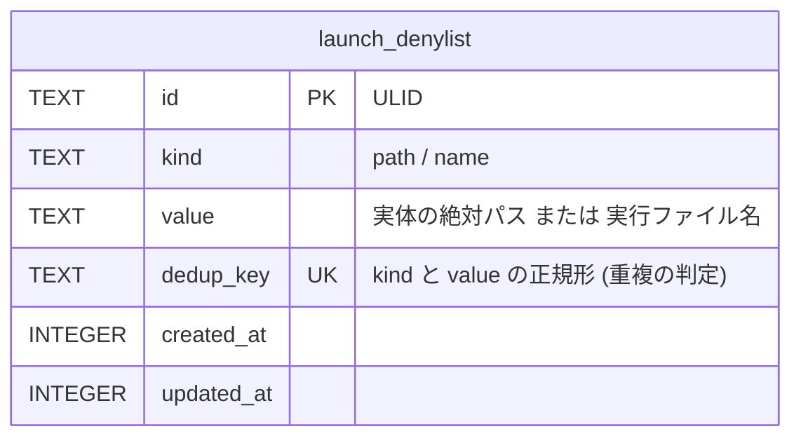
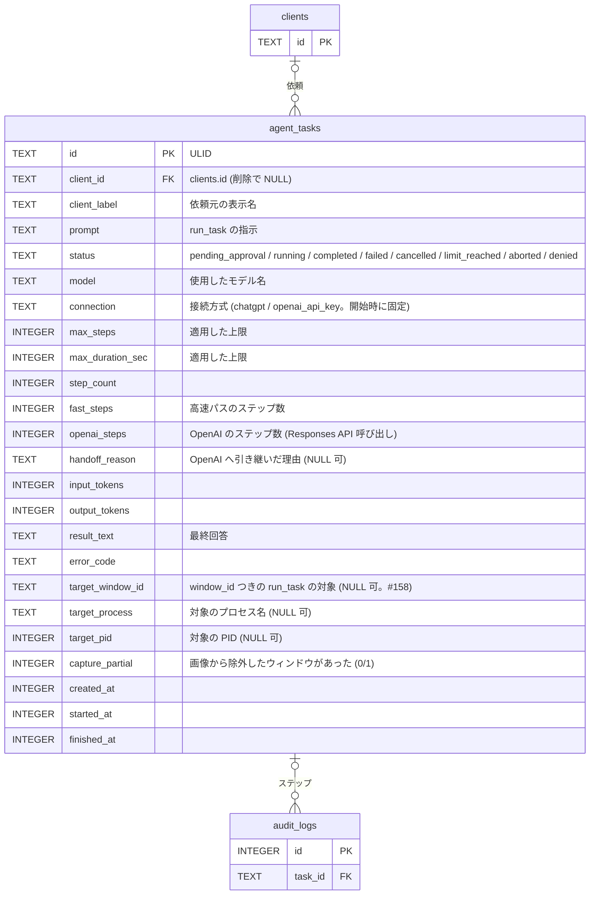
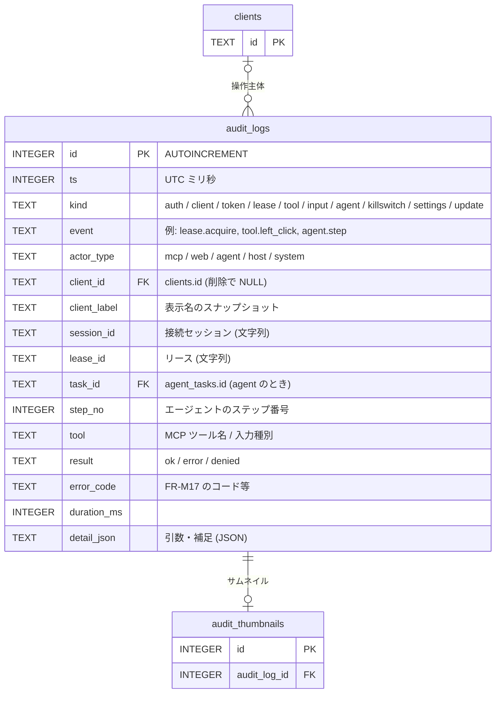
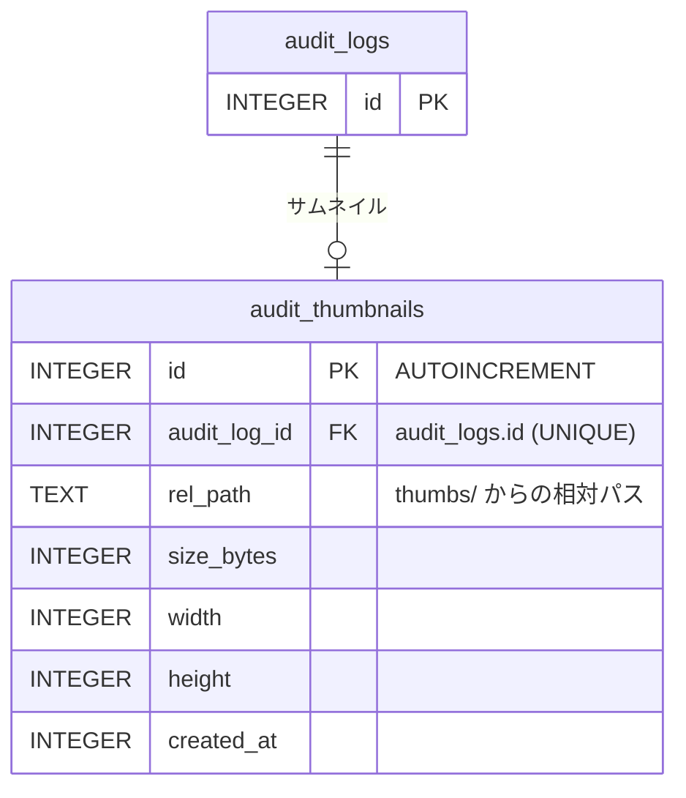

# ER / データモデル

ホスト 1 台のローカル SQLite（`%LOCALAPPDATA%\puppet-remo\puppet-remo.db`）に保存するデータの定義。技術選定は [アーキテクチャ設計](overview.md)、要件は [機能要件](../requirements/functional.md) を参照。

## 方針

| 項目 | 内容 |
|------|------|
| DB | SQLite（`modernc.org/sqlite`、純 Go）。起動時に `PRAGMA journal_mode=WAL; foreign_keys=ON; busy_timeout=5000; synchronous=NORMAL` を設定する |
| マイグレーション | 埋め込み SQL をバージョン順に適用（[NFR-O05](../requirements/non-functional.md)）。適用済みバージョンはマイグレーションライブラリの管理テーブルに保持する（本書の対象外） |
| ID | クライアント・トークン・接続要求は **ULID**（時系列ソート可能な 26 文字、アプリ側で生成）。`audit_logs` / `audit_thumbnails` は `INTEGER PRIMARY KEY AUTOINCREMENT` |
| 時刻 | UTC の Unix ミリ秒（`INTEGER`）。表示時にローカル時刻へ変換する |
| 真偽値 | `INTEGER`（0 / 1）。`CHECK (col IN (0, 1))` を付ける |
| 列挙値 | `TEXT` + `CHECK (col IN (...))` |
| 永続化しないもの | **リース**（[NFR-A01](../requirements/non-functional.md)）、**接続中セッション**（監査ログに `session_id` を文字列として記録するのみ）、承認待ち要求、WhoIs キャッシュ、Web UI の閲覧設定（モニター・品質・FPS はブラウザセッション単位）、**エージェントの実行状態**（ループ・会話。タスクの記録のみ `agent_tasks` に持つ。[NFR-A08](../requirements/non-functional.md)） |
| サムネイル | 画像は**ファイル**として `%LOCALAPPDATA%\puppet-remo\thumbs\` に保存し、DB にはパスとサイズを持つ |
| 改ざん検知 | 設けない（同一ユーザー権限の悪意あるプロセスは脅威モデル外） |
| シークレット | **OpenAI API キー・TypeSafe API キー・ChatGPT の OAuth トークンは DB に保存しない**。Windows 資格情報マネージャーにのみ置く（ターゲット名は TypeSafe が `puppet-remo/typesafe:puppet-remo`、OpenAI が `puppet-remo/openai:puppet-remo`、ChatGPT の OAuth トークン〔アクセス・リフレッシュ・ID トークン・期限・scope をまとめた 1 件〕が `puppet-remo/chatgpt:puppet-remo`。[NFR-S14](../requirements/non-functional.md)）。`settings`・ログ・監査ログにも値を書かない。秘密ではない識別子（`agent.chatgpt.host_id`・`agent.chatgpt.client_id`・`agent.chatgpt.account_sub`・`agent.chatgpt.account_email`）は `settings` に置く |

## 全体 ER 図

## テーブル一覧

| テーブル | 用途 | 主な参照元 |
|---------|------|-----------|
| `clients` | 許可リスト（tailnet デバイス + ユーザー）と、クライアント別の利用可否・承認モード | FR-A04, A09, H04, L07 |
| `client_tokens` | MCP 用 Bearer トークン（ハッシュのみ） | FR-A05, A08 |
| `connection_requests` | 未登録デバイスからの接続要求 | FR-A06, A07 |
| `agent_tasks` | 内蔵エージェントのタスク（指示、状態、使用トークン、最終回答、高速パスのステップ数・OpenAI へ引き継いだ理由）。ステップは `audit_logs` に `task_id` で紐づく | FR-G02, G03, G09, G15, G16〜G24, H10 |
| `settings` | アプリ設定、キルスイッチ状態、エージェント設定（高速パスを含む。キー・値） | FR-S01〜S19, FR-H06, FR-H11 |
| `launchable_apps` | 起動許可リスト（`launch_app` を `app_id` で起動してよいアプリ。表示名・実行ファイルのパス・固定の引数・作業ディレクトリ）。ホワイトリスト方式（既定）で起動できるのはこのリストのアプリだけ。ホスト GUI だけが書く。他の表への外部キーは無い | FR-M18, M19, H12, AU06 |
| `launch_denylist` | 起動の拒否リスト（ブラックリスト方式のときだけ効く。実体のパスまたは実行ファイル名の 1 件ずつ。上限 200）。起動の方式そのもの（`launch.mode`）は `settings` に持つ。ホスト GUI だけが書く。他の表への外部キーは無い | FR-M18, M19, H12, AU06 |
| `audit_logs` | 監査ログ | FR-AU01〜AU05 |
| `audit_thumbnails` | 監査ログに紐づく縮小スクリーンショットのメタ情報 | FR-AU02, AU04 |

## テーブル定義

### clients

許可済みクライアント。tailnet の安定ノード ID（`StableNodeID`）で識別し、登録時のログイン名と照合する。

| カラム | 型 | NULL | 既定値 | 説明 |
|--------|----|------|--------|------|
| `id` | TEXT | NO | — | PK。ULID |
| `stable_node_id` | TEXT | NO | — | tailnet の安定ノード ID。UNIQUE |
| `login_name` | TEXT | NO | — | 登録時のログイン名。リクエスト時の WhoIs 結果と一致しない場合は未登録として扱い、接続要求を作る（再認証でユーザーが変わったデバイスへの権限の持ち越しを防ぐ） |
| `display_name` | TEXT | NO | — | デバイス名。GUI の表示用 |
| `web_enabled` | INTEGER | NO | 1 | Web UI の利用可否 |
| `mcp_enabled` | INTEGER | NO | 1 | MCP の利用可否 |
| `agent_enabled` | INTEGER | NO | 0 | 内蔵エージェント（`run_task`）の利用可否。**既定は無効**（FR-A09）。GUI・API から保存・編集でき、`run_task` の可否に効く（FR-G01。M4）。M1 では参照しない |
| `approval_mode` | TEXT | NO | `'always'` | `always` / `first_time` / `auto`（FR-L07）。M1・M2 は承認なしでリースを取得するため参照せず、既定値 `always` で保存するだけだった。M3 から適用し、選択・変更は GUI（FR-H03・FR-H04）。**v4 のマイグレーション（`0004_existing_clients_auto_approval.sql`）**: M1・M2 の間に登録された既存のクライアントは `always` で保存されており、承認ダイアログはホストの手元でしか押せないため、そのままだと外からの操作がすべて 60 秒で拒否される。そこで v4 は、適用時点の `always` の行を `auto`（自動許可）へ移す（`first_time` の行・`approved_at` は変えない。列の既定値 `always` は変えないので、v4 の後に登録する新しいクライアントは承認モードを選ばなければ `always`（常時承認）。マイグレーションは 1 度だけ適用されるので、あとから `always` に戻した行は書き換わらない）。移行したクライアントを承認制に戻すときは、クライアントのカードで承認モードを変える |
| `approved_at` | INTEGER | YES | NULL | `first_time` で一度承認された時刻。NULL なら未承認（承認の取り消しは NULL に戻す）。`approval_mode` を変更したときも NULL に戻す。M3 から使う: `first_time` のクライアントのリース取得がホストに許可されたとき `LeaseManager` が `repository.Clients.MarkApproved` で記録し（`always`・`auto` では記録しない。拒否・タイムアウト・取り下げでも記録しない）、承認の取り消しは `repository.Clients.ResetApproval`（NULL に戻す。承認モードは変えない）。承認が要るかの判定は `domain.NeedsApproval`（`first_time` は NULL のときだけ要る） |
| `created_at` | INTEGER | NO | — | 登録時刻 |
| `updated_at` | INTEGER | NO | — | 更新時刻 |
| `last_seen_at` | INTEGER | YES | NULL | 最終に認可を通過した時刻 |

制約: `UNIQUE (stable_node_id)`、`CHECK (approval_mode IN ('always','first_time','auto'))`、`CHECK (web_enabled IN (0,1))`、`CHECK (mcp_enabled IN (0,1))`、`CHECK (agent_enabled IN (0,1))`。

インデックス: UNIQUE 制約による `stable_node_id` のインデックスのみ（行数は最大 50。NFR-C01）。

再許可: 登録済みデバイスのログイン名が変わると同じ `stable_node_id` の接続要求ができる。ホスト所有者が許可したときは、既存の行を削除（`client_tokens` は CASCADE）して新しい行を同一トランザクションで作り（権限・トークンは引き継がない）、`client.replace` を監査に記録する。

### client_tokens

MCP 用 Bearer トークン。1 クライアントに複数発行でき（用途別のラベル）、個別に失効できる。平文は保存しない。形式（`prm_` + base64url の 32 バイト乱数）と保存・照合の定義は [NFR-S04](../requirements/non-functional.md)。

| カラム | 型 | NULL | 既定値 | 説明 |
|--------|----|------|--------|------|
| `id` | TEXT | NO | — | PK。ULID |
| `client_id` | TEXT | NO | — | FK → `clients.id`。`ON DELETE CASCADE`（クライアント削除でトークンも消える） |
| `label` | TEXT | NO | — | 用途ラベル（例: `claude-code`）。同一クライアント内で重複不可 |
| `token_hash` | BLOB | NO | — | 接頭辞 `prm_` を含むトークン文字列（UTF-8）の SHA-256（32 バイト）。UNIQUE。照合は、提示された文字列の SHA-256 と保存済みハッシュの定数時間比較（NFR-S04） |
| `token_prefix` | TEXT | NO | — | 表示用にトークン文字列の先頭 8 文字（例: `prm_Ab12`）。識別用で認証には使わない |
| `expires_at` | INTEGER | YES | NULL | 有効期限。既定の発行時指定は 90 日後（FR-A08）。NULL は無期限 |
| `revoked_at` | INTEGER | YES | NULL | 失効時刻。NULL でなければ無効 |
| `last_used_at` | INTEGER | YES | NULL | 最終使用時刻 |
| `created_at` | INTEGER | NO | — | 発行時刻 |

制約: `UNIQUE (token_hash)`、`UNIQUE (client_id, label)`、`CHECK (length(token_hash) = 32)`（SHA-256 の 32 バイトであること。M1 の実装で追加）。

有効なトークンの条件: `revoked_at IS NULL AND (expires_at IS NULL OR expires_at > now) AND clients.mcp_enabled = 1`、かつ要求元の `stable_node_id` がトークンの `client_id` のクライアントと一致すること（FR-A05）。

インデックス: UNIQUE 制約で `token_hash`、`(client_id, label)` を網羅。

### connection_requests

未登録デバイスからの接続要求。1 デバイスにつき `pending` は 1 件に集約する。

| カラム | 型 | NULL | 既定値 | 説明 |
|--------|----|------|--------|------|
| `id` | TEXT | NO | — | PK。ULID |
| `stable_node_id` | TEXT | NO | — | 要求元デバイスの安定ノード ID |
| `login_name` | TEXT | NO | — | 要求元ユーザーのログイン名 |
| `display_name` | TEXT | NO | — | デバイス名 |
| `remote_ip` | TEXT | NO | — | 最後に観測した接続元 tailnet IP |
| `status` | TEXT | NO | `'pending'` | `pending`（承認待ち）/ `approved`（許可済み）/ `denied`（拒否）/ `expired`（失効） |
| `request_count` | INTEGER | NO | 1 | 集約した試行回数（スパム対策の目安。GUI に出す通知は増やさない） |
| `first_seen_at` | INTEGER | NO | — | 最初の観測時刻 |
| `last_seen_at` | INTEGER | NO | — | 最後の観測時刻 |
| `expires_at` | INTEGER | NO | — | `pending`: 作成から 24 時間後。`denied`: 拒否から 24 時間後（この間は同デバイスから新しい要求を作らない） |
| `decided_at` | INTEGER | YES | NULL | 許可・拒否した時刻 |
| `client_id` | TEXT | YES | NULL | 許可により作成したクライアント。FK → `clients.id`、`ON DELETE SET NULL` |

制約: `CHECK (status IN ('pending','approved','denied','expired'))`。`stable_node_id` について `status = 'pending'` の行は 1 件のみ（部分 UNIQUE インデックス）。

インデックス:

| 名称 | 対象 | 種別 | 目的 |
|------|------|------|------|
| `ux_connreq_pending_node` | `(stable_node_id) WHERE status = 'pending'` | UNIQUE（部分） | 1 デバイス 1 件への集約（FR-A06） |
| `ix_connreq_status_expires` | `(status, expires_at)` | 通常 | 失効処理、`denied` の再要求抑止の判定 |
| `ix_connreq_first_seen` | `(first_seen_at DESC, id DESC)` | 通常 | 接続要求の履歴（GUI。FR-H03）を新しい順にページ分けして読む（v3 のマイグレーション `0003_connreq_history_index.sql`） |

履歴: 許可・拒否した要求は行を削除せず、`status`（結果）と `decided_at`（処理した日時）を保ったまま残す（v1 から同じ。履歴のために列は足さない）。ホスト GUI の接続要求の履歴は、この表を `first_seen_at DESC, id DESC` の順に `LIMIT` / `OFFSET` で読む（1 ページ 20 件）。1 行は 1 回の要求のまとまり（FR-A06 の集約の単位）で、同じデバイスの許可・拒否・失効のあとに来た新しい要求は別の行になる。履歴に見えるのは保守で削除されるまでの行で、保持期間は次の保守のとおり。これは監査ログ（`audit_logs`。FR-AU01、M3 の閲覧 UI）とは別のもので、履歴は要求の現在の結果を見るためのもの。

保守: `last_seen_at` から 7 日を過ぎた行を定期削除する。`pending` で `expires_at` を過ぎた行は `expired` に更新する。レート制限（FR-A07）は件数カウントをメモリで行うため、DB には持たない。

**接続要求の履歴の保持期間（決定事項。#52）**: 7 日・固定とする。設定項目にしない。許可・拒否・失効・`pending` のどの状態も同じ基準（`last_seen_at` から 7 日を過ぎたら削除。ちょうど 7 日の行は残す）で、処理済みだけを長く残す別扱いはしない。履歴の件数が増えないため、ページの上限（1 ページ 20 件）と索引（マイグレーション 0003）は変えない。`Expire` の実装も変えず、`TestConnRequestsExpireDeletesEveryStatusAfterSevenDays` が全状態を 7 日で消すことを確かめる。FR-A06（1 デバイス 1 件の集約）は変わらない。長期の記録は監査ログ（`audit_logs`。FR-AU01）が担う。

M1 の実装の補足: 期限切れの `pending` は、保守で `expired` にする前でも一覧（`ListPending`）に含めず、許可もできない（許可は conflict）。同じデバイスの `pending` を 5 秒以内に更新済みなら、`last_seen_at` と `request_count` を DB に書かない（連続リクエストによる書き込みの抑止）。同じデバイスの期限切れの `pending` は、新しい要求を作る前に `expired` にする。

### settings

キー・値形式の設定。型検証はサービス層で行う（キーごとのスキーマはコードで定義）。キルスイッチの状態もここに置く（[NFR-S07](../requirements/non-functional.md)）。

| カラム | 型 | NULL | 既定値 | 説明 |
|--------|----|------|--------|------|
| `key` | TEXT | NO | — | PK。キー名 |
| `value_json` | TEXT | NO | — | JSON 値。`json_valid(value_json)` を `CHECK` で確認する |
| `updated_at` | INTEGER | NO | — | 更新時刻 |

キー一覧（行が無ければ既定値を使う）:

| キー | 型 | 既定値 | 対応する要件 |
|------|----|--------|-------------|
| `server.port` | number | 8765 | FR-S01 |
| `killswitch.hotkey` | string | `"Ctrl+Alt+Shift+K"` | FR-S02 |
| `killswitch.state` | object `{active, triggered_at, source}` | `{"active": false}` | FR-H06、NFR-S07 |
| `screenshot.max_dimension` | number | 1568 | FR-S03 |
| `lease.idle_timeout_sec` | number | 300 | FR-S04 |
| `viewer.default_quality` | number | 70 | FR-S06 |
| `viewer.default_fps` | number | 10 | FR-S06 |
| `audit.thumbnails_enabled` | boolean | true | FR-AU02 |
| `audit.record_text` | boolean | false | FR-AU03 |
| `audit.retention_days` | number | 30 | FR-AU04 |
| `audit.thumbs_max_bytes` | number | 1073741824 | FR-AU04 |
| `update.apply_mode` | string `"confirm"` / `"auto_idle"` | `"confirm"` | FR-S09 |
| `update.channel` | string `"stable"` / `"nightly"` | `"stable"` | FR-S09（更新のチャネル。#74） |
| `update.last_checked_at` | number（UTC ミリ秒） | なし | FR-H09（最後に更新を確認した時刻。成功・失敗を問わず確認のたびに `service.Updater` が保存する。#74） |
| `log.level` | string | `"info"` | NFR-O01 |
| `launch.mode` | string（`"allowlist"` / `"denylist"`） | `"allowlist"`（行が無いとき。読めない値・定義外の値も `allowlist` として扱う〔fail closed〕。v5 のマイグレーションは行を書かないので、既存のインストールは `allowlist` のまま） | FR-M18・M19・H12、NFR-S20（`launch_app` の起動の方式。`allowlist` = ホワイトリスト方式〔既定。`launchable_apps` のアプリだけを `app_id` で起動〕、`denylist` = ブラックリスト方式〔`launch_denylist` に当たらない固定ディスク上の `.exe` を `path` でも起動できる〕。**ホスト GUI の `/apps` だけが変更できる**（MCP・Web UI には経路が無い）。`denylist` への切り替えは確認モーダルを経る。変わるときだけ `settings.launch_mode.update` を監査する） |
| `agent.enabled` | boolean | false | FR-S10、FR-G14 |
| `agent.consent_at` | number（UTC ミリ秒） | なし | FR-G14（OpenAI へのスクリーンショット送信への同意の日時。有効化時に記録し、無効化で削除） |
| `agent.connection` | string（`"chatgpt"` / `"openai_api_key"`） | `"chatgpt"`（ただし未設定のまま起動したとき、OpenAI API キーが登録済みなら `"openai_api_key"` を一度だけ保存する） | FR-S20、FR-G25（内蔵エージェントの接続方式。ホスト GUI のみで変更。`openai_api_key` への変更は確認モーダルを経る。FR-G30、NFR-S22） |
| `agent.chatgpt.model` | string | `"gpt-6.1-terra"`（候補） | FR-S21、FR-G26（ChatGPT のプラン経路のモデル。アカウントごとの `GET /v1/models` の `slug`） |
| `agent.chatgpt.host_id` | string | なし（最初のサインインの前に作る） | FR-G28（`ext_agent_host_id`。`urn:uuid:` + UUIDv4。端末ごとに不変で、サインアウト・再サインイン・アカウントの切り替えでも変えない。メール・ユーザー ID を含めない。認証の資格情報ではない） |
| `agent.chatgpt.client_id` | string | なし | FR-G28・G29（発行済みの OAuth クライアント ID。`dynamic_agent_client` は保存しない。新規登録のコールバックで得て、再サインインで使う。「別のアカウントでサインインする」の解除と `invalid_client` で削除） |
| `agent.chatgpt.account_sub` | string | なし | FR-G28（検証した ID トークンの `sub`。再サインインでアカウントの一致を確かめる。ログ・監査には出さない。NFR-S13） |
| `agent.chatgpt.account_email` | string | なし | FR-G28・H11（サインインしたアカウントのメール。`login_hint` と、エージェント設定画面の本人の確認用の表示にだけ使う。ログ・監査には出さない。NFR-S13） |
| `agent.chatgpt.welcome_shown` | boolean | false | FR-G28 (7)（初回のサインイン後の確認を出したか） |
| `agent.model` | string | `"gpt-6.1-sol"` | FR-S11 |
| `agent.max_steps` | number | 50 | FR-S12 |
| `agent.max_duration_sec` | number | 600 | FR-S12 |
| `agent.deny_processes` | array of string | `["KeePass.exe","KeePassXC.exe","1Password.exe","Bitwarden.exe"]` | FR-S13 |
| `agent.approve_processes` | array of string | `[]` | FR-S13 |
| `agent.keep_screenshots` | number | 3 | FR-S19、FR-G24（OpenAI へ再送する履歴に残す直近のスクリーンショット枚数。それ以前は文字のプレースホルダーに置換する） |
| `agent.fastpath.enabled` | boolean | false | FR-S14、FR-G22（高速パスの有効化。エージェントの有効化とは別のスイッチ） |
| `agent.fastpath.consent_at` | number（UTC ミリ秒） | なし | FR-G22（TypeSafe へのデータ送信への同意の日時。有効化時に記録し、無効化で削除。`agent.consent_at` とは独立。NFR-PR04） |
| `agent.fastpath.model` | string | `"jev-1.13"` | FR-S15 |
| `agent.fastpath.min_confidence` | number（0〜1） | 0.7 | FR-S16、FR-G18 |
| `agent.fastpath.max_steps` | number | 15 | FR-S17、FR-G19（高速ステップも `agent.max_steps` と `agent.max_duration_sec` に数える） |
| `agent.fastpath.excluded_labels` | array of string | `["delete","remove","send","submit","purchase","buy","pay","close","quit","exit","uninstall","format","erase","削除","送信","購入","支払い","閉じる","終了","アンインストール","初期化"]` | FR-S18、FR-G17（ラベルへの大文字小文字を区別しない部分一致で候補から除外する） |

ログオン時の自動起動（FR-S08）の有効・無効は OS（スタートアップ登録）が真実の源であり、DB には持たない。クライアント別の承認モード（FR-S05）は `clients.approval_mode`、エージェント利用許可（FR-A09）は `clients.agent_enabled` に持つ。OpenAI API キーと TypeSafe API キーは `settings` にも置かない（資格情報マネージャーのみ。FR-G22）。高速パスは有効化・キー・同意の 3 つがそろわなければ静かにスキップされ、タスクは OpenAI のみで実行される（`agent.fastpath.enabled` が true でもキーまたは `agent.fastpath.consent_at` が無ければ使わない）。TypeSafe が 401 を返したときはキー無効として `agent.fastpath.enabled` を false に更新する（FR-G21）。

### launchable_apps

MCP の `launch_app` が起動できるアプリの許可リスト（M1.5。[FR-M18・M19・H12](../requirements/functional.md)）。起動の方式（設定 `launch.mode`）が**ホワイトリスト方式（既定）**のときは、このリストのアプリだけが `app_id` で起動できる（`launch_app` は `path` を受け付けず、`invalid_argument` で拒否する）。ホスト所有者が GUI で選ぶ**ブラックリスト方式**では、登録済みのアプリを `app_id` で起動できるほか、[`launch_denylist`](#launch_denylist) に当たらない固定ディスク上の `.exe` を `path` でも起動できる（このリストのアプリも拒否リストの照合を通る）。**書き込みはホスト GUI（`service.AppRegistry`）だけ**で、リモートの経路（MCP・Web UI）からは書かない。`id` は MCP の `app_id` として公開する唯一の値で、`exe_path` / `args_json` / `working_dir` は MCP・リモートルーターのどの応答にも出さない（出すのは `id` と `label`）。

| カラム | 型 | NULL | 既定値 | 説明 |
|--------|----|------|--------|------|
| `id` | TEXT | NO | — | PK。ULID（アプリ側で生成）。MCP の `app_id`。編集しても変わらず、削除すると無効になり再利用されない |
| `label` | TEXT | NO | — | 表示名（1〜64 文字。前後の空白は `domain` が除く）。`COLLATE NOCASE` で UNIQUE。**NOCASE の畳み込みは ASCII のみ**（`A`〜`Z`）で、全角英字・Unicode の大文字小文字は別の値として扱う（正規化列は設けない。重複の判定は ASCII の大文字小文字を無視した一致）。MCP の `list_launchable_apps` が返す |
| `exe_path` | TEXT | NO | — | 実行ファイルの絶対パス。ローカルドライブの `.exe` で、UNC・デバイスパス（`\\?\`・`\\.\`）・相対パス・`..` を含むパス、ドライブ指定以外の `:`（代替データストリーム）、`<>"\|?*`、制御文字（C0 と DEL）、予約デバイス名（`CON`・`PRN`・`AUX`・`NUL`・`COM1`〜`COM9`・`LPT1`〜`LPT9`、上付き数字の `COM¹`・`COM²`・`COM³`・`LPT¹`・`LPT²`・`LPT³`、コンソールの `CONIN$`・`CONOUT$`。拡張子付き・ディレクトリの要素でも）を含むパス、32,766 文字（UTF-16。終端の NUL を含めて 32,767）を超えるパスは保存しない（検証は `domain`、存在確認は登録・更新時に `platform.AppLauncher`。FR-H12）。`CreateProcess` の `lpApplicationName` にそのまま使う |
| `args_json` | TEXT | NO | `'[]'` | 起動引数。文字列の JSON 配列（最大 32 個・合計 8,192 文字）。引数の連結（Windows のコマンドライン規則に沿った引用）は起動時に `platform` が行い、DB にはコマンドライン文字列を持たない（引用後の全体が 32,766 UTF-16 ユニット（終端の NUL を含めて 32,767）を超えると起動しない）。登録時に固定し、`launch_app` から変更できない。手で書き換えられて「文字列の配列」として読めない行は、読み出し側が `Corrupt`（引数は空）として返し、一覧・削除は成功するが、起動は `app_not_found` で拒否する |
| `working_dir` | TEXT | NO | `''` | 作業ディレクトリの絶対パス（既存のディレクトリ。`exe_path` と同じパスの規則）。空文字は「実行ファイルのあるディレクトリ」 |
| `created_at` | INTEGER | NO | — | 登録時刻 |
| `updated_at` | INTEGER | NO | — | 更新時刻 |

制約: `UNIQUE (label COLLATE NOCASE)`（ASCII のみの大文字小文字無視。上記）、`CHECK (length(label) BETWEEN 1 AND 64)`、`CHECK (length(exe_path) > 0)`、`CHECK (json_valid(args_json) AND json_type(args_json) = 'array')`。登録数の上限 50（NFR-C06）はサービス層が、件数の確認と挿入を同じトランザクションで行って守る（DB の制約にはしない。NFR-C01 と同様）。

インデックス: UNIQUE 制約による `label` のインデックスのみ（行数は最大 50）。

起動時の扱い: `launch_app` は `id` の行を読み、`domain` の検証規則（パスの形・引数の数と長さ）を**起動のたびに**再度確認し、満たさなければ `app_not_found` で拒否する（fail closed。行が手で書き換えられても、規則外のパスは起動しない）。実行ファイルが消えていても行は残り、起動時に `launch_failed`（`file_missing`）になる。クライアントの削除・無効化・トークン失効は許可リストに影響しない（許可リストはホスト全体のもので、クライアント別ではない）。

ブラックリスト方式（`launch.mode` = `denylist`）では、`app_id` で起動する登録済みのアプリも、実体のパス（`platform.AppLauncher.Resolve` の結果）を `launch_denylist` と照合し、当たれば `app_denied`（403）で拒否する（拒否が優先。ホワイトリストに載っていても起動しない）。ホワイトリスト方式では拒否リストを参照しない。

### launch_denylist

起動の拒否リスト（#88。[FR-M18・M19・H12](../requirements/functional.md)）。**ブラックリスト方式（`settings` の `launch.mode` = `denylist`）のときだけ効く**。ホワイトリスト方式（既定）では参照せず、行があっても起動の可否に影響しない。**書き込みはホスト GUI（`service.AppRegistry` の `CreateDenied` / `UpdateDenied` / `DeleteDenied`）だけ**で、リモートの経路（MCP・Web UI）からは書かない。**中身は MCP・リモートルーターのどの応答にも出さない**（`list_launchable_apps` は方式と登録済みのアプリだけを返す）。他の表への外部キーは無い。v5 のマイグレーション（`0005_launch_denylist.sql`）で作る。方式は `settings` の `launch.mode`（行が無ければ `allowlist`）に持ち、マイグレーションは行を書かないので、既存のインストールはホワイトリスト方式のまま動く。

| カラム | 型 | NULL | 既定値 | 説明 |
|--------|----|------|--------|------|
| `id` | TEXT | NO | — | PK。ULID（アプリ側で生成）。編集しても変わらない |
| `kind` | TEXT | NO | — | `path`（パスで照合）/ `name`（実行ファイル名で照合）。`CHECK (kind IN ('path','name'))` |
| `value` | TEXT | NO | — | `kind = path`: 絶対パスのローカルの `.exe`（`launchable_apps.exe_path` と同じパスの規則）。登録時にファイルが固定ディスクにあれば**解決した実体のパス**（シンボリックリンク・ジャンクション・8.3 短縮名を解決。`\\?\` は付けない）で保存し、無い・固定ディスクに無い・解決できないときは入力の綴りの区切りを正規化（`/` → `\`、連続する区切りを 1 つに）して保存する（まだ置かれていないファイルや別のドライブのファイルも持てる）。`kind = name`: フォルダーを含まない `.exe` の名前（例: `cmd.exe`。255 文字以内。入力のまま保存し、照合は大文字小文字を区別しない）。GUI の入力欄は 1 つ（「パスまたは実行ファイル名」）で、`\`・`/`・`:` のどれかを含めばパス、含まなければ名前として分ける（検証は `domain.ClassifyDenied`）。`CHECK (length(value) > 0)`。登録時に解決できなかった項目（ファイルがまだ無い等）も、起動のたびに再解決して照合する（あとから置かれたリンクの先を取りこぼさない） |
| `dedup_key` | TEXT | NO | — | 重複の判定。`domain.DeniedKey(kind, value)` = `kind` と、小文字にした `value`（`path` は区切りを `\` にそろえたもの）をつなげた正規形。UNIQUE。同じ `kind` で大文字小文字・区切りの違いだけの値は重複として拒否し、`kind` が違えば同じ綴りでも別の登録 |
| `created_at` | INTEGER | NO | — | 登録時刻 |
| `updated_at` | INTEGER | NO | — | 更新時刻 |

制約: `CHECK (kind IN ('path','name'))`、`CHECK (length(value) > 0)`、`UNIQUE (dedup_key)`。登録数の上限 200（`domain.MaxDeniedApps`）はサービス層（`repository.LaunchDenylist.Create(limit)`）が、件数の確認と挿入を同じトランザクションで行って守る（DB の制約にはしない。満杯は `conflict`）。一覧は `kind`・`value`（大文字小文字を区別しない）の昇順。

インデックス: UNIQUE 制約による `dedup_key` のインデックスのみ（行数は最大 200）。

照合（起動のたび。`domain.MatchDenied`）: 起動しようとする実行ファイルを `platform.AppLauncher.Resolve` で**実体のパス**（シンボリックリンク・ジャンクション・8.3 短縮名を解決した、固定ディスク上のドライブ文字つきの絶対パス）にして比べる。`path` の行は実体のパスと一致（大文字小文字・区切りの違いを無視）すれば当たり、登録の綴りと違っても、解決した実体が同じなら当たる。`name` の行は、実体のファイル名**と**呼び出し側が指定した綴りのファイル名のどちらかと一致（大文字小文字を無視）すれば当たる（どのフォルダーにあっても当たる。fail closed）。当たれば `app_denied`（HTTP 403。監査は `result = denied`。メッセージにパス・拒否リストの中身は含めない）。**既知の限界**: 拒否した実行ファイルの**名前を変えたコピー**は検出しない（`name` は名前だけ、`path` は実体のパスだけを比べるため）。`cmd.exe`・`powershell.exe` などのインタープリターは任意のコードを実行できるので、ブラックリスト方式ではホスト所有者が拒否リストに入れない限り起動できる。

### agent_tasks

内蔵エージェントの 1 回の実行（[FR-G02〜G30](../requirements/functional.md)）。ステップ（アクション・Judge の判定・安全チェック・サムネイル・高速パスの選択）は `audit_logs` に `kind = 'agent'`、`task_id`、`step_no` で保存し、ここには集計だけを持つ。

| カラム | 型 | NULL | 既定値 | 説明 |
|--------|----|------|--------|------|
| `id` | TEXT | NO | — | PK。ULID。`run_task` が返す `task_id` |
| `client_id` | TEXT | YES | NULL | 依頼したクライアント。FK → `clients.id`、`ON DELETE SET NULL` |
| `client_label` | TEXT | NO | — | 依頼元の表示名のスナップショット |
| `prompt` | TEXT | NO | — | 指示本文（10,000 文字まで。NFR-S09）。タスクの記録として常に保存する（FR-AU03） |
| `status` | TEXT | NO | `'pending_approval'` または `'running'` | FR-G03 の状態 |
| `model` | TEXT | NO | — | 使用したモデル名（開始時の、接続方式 `openai_api_key` は `agent.model`、`chatgpt` は `agent.chatgpt.model`） |
| `connection` | TEXT | NO | `'openai_api_key'`（#49 のマイグレーションで既存の行に入る値。番号は実装時に採番する〔v5 は #88 の `launch_denylist` が使用済み〕。#49 より前のタスクはすべて OpenAI API キー経路。新しい行は開始時の `agent.connection` を必ず書く） | 接続方式。`CHECK (connection IN ('chatgpt','openai_api_key'))`。タスクの開始時に固定し、終了まで変えない（FR-G25）。ChatGPT のトークン・アカウントは持たない |
| `max_steps` | INTEGER | NO | — | 適用した上限（`run_task` の指定は設定値以下） |
| `max_duration_sec` | INTEGER | NO | — | 適用した上限 |
| `step_count` | INTEGER | NO | 0 | 実行したステップの**総数**（`fast_steps + openai_steps`。`agent.max_steps` の判定対象。FR-G19）。高速パス導入前の定義（Responses API 呼び出しの数）を、高速パスのステップを含む総数に広げた。既存列を残して総数の意味に統一し、読み取り側（一覧・`get_task` の既存フィールド）を変えない |
| `fast_steps` | INTEGER | NO | 0 | 高速パス（Jev）で実行したステップの数（FR-G19、FR-G23）。高速パスが無効・スキップされたタスクは 0。上限は `agent.fastpath.max_steps` |
| `openai_steps` | INTEGER | NO | 0 | OpenAI（computer ツールのループ、Responses API 呼び出し。接続方式 `chatgpt` も Responses API 呼び出し 1 回を 1 に数える）で実行したステップの数（FR-G23）。高速パスなしのタスクでは従来の `step_count` と同じ値 |
| `handoff_reason` | TEXT | YES | NULL | 高速パスから OpenAI へ引き継いだ理由（FR-G20、FR-G23）。`abstain` / `low_confidence` / `no_candidates` / `invalid_choice` / `no_progress` / `goal_maybe_done` / `fast_step_limit` / `chooser_unavailable`。引き継ぎが起きなかったとき（高速パスが無効、または高速パス中にキャンセル・失敗で終了）は NULL。一度引き継いだタスクは最後まで OpenAI で続ける（v1 では戻さない）ため、1 タスクにつき理由は 1 つ |
| `input_tokens` / `output_tokens` | INTEGER | NO | 0 | 使用トークンの累計（金額上限は設けない。FR-G09） |
| `result_text` | TEXT | YES | NULL | 最終回答（10,000 文字で切り詰め）。`completed` はモデルの申告（FR-G13） |
| `error_code` | TEXT | YES | NULL | 失敗の理由。`input_blocked` / `judge_denied` / `approval_denied` / `safety_check_denied` / `unsupported_action` / `openai_error` / `invalid_coordinates`（モデルが縮小画像の外の座標を返した）/ `lease_held_by_other`（リース取得の競合負け）/ ChatGPT のプラン経路の `chatgpt_usage_limit`（使用量の上限）・`chatgpt_unauthorized`（認可切れ）・`chatgpt_error`（その他）など（FR-M17、FR-G、FR-G29・G30）。リースの喪失（剥奪・アイドルタイムアウト）と ChatGPT の解除による中断（`chatgpt_signout`）は `failed` ではなく `cancelled`（`error_code` なし） |
| `target_window_id` / `target_process` / `target_pid` | TEXT / TEXT / INTEGER | YES | NULL | `run_task` の `window_id`（#158。マイグレーション `0006_agent_task_target.sql`）で選んだ対象ウィンドウの ID・プロセス名・PID。スコープなしのタスクは NULL（従来どおり）。**ウィンドウのタイトルは持たない**。`target_pid` は `NULL` か 0 以上（`CHECK`）。既存の行は NULL のまま（再計算しない）。なお #49 の `connection` 列のマイグレーションは、v6 を #158 が使うので v7 以降の番号で採番する |
| `capture_partial` | INTEGER | NO | 0 | 所有関係を確かめられず、モデルへ渡す画像から除外したウィンドウがあったタスクで 1（通知 `capture_partial` の記録。停止の理由ではない。`CHECK (capture_partial IN (0,1))`）。`Update` が書き換えられる（実行中に初めて除外が起きたとき） |
| `created_at` | INTEGER | NO | — | `run_task` の受付時刻 |
| `started_at` | INTEGER | YES | NULL | `running` になった時刻（承認拒否の `denied` は NULL） |
| `finished_at` | INTEGER | YES | NULL | 終了状態になった時刻 |

制約: `CHECK (status IN ('pending_approval','running','completed','failed','cancelled','limit_reached','aborted','denied'))`、`CHECK (status IN ('pending_approval','running') OR finished_at IS NOT NULL)`（終了状態は `finished_at` が必須）、`CHECK (step_count >= 0 AND fast_steps >= 0 AND openai_steps >= 0 AND input_tokens >= 0 AND output_tokens >= 0)`、`CHECK (step_count = fast_steps + openai_steps)`（総数と内訳の整合。3 列はサービス層が同じトランザクションで更新する）、`CHECK (handoff_reason IS NULL OR handoff_reason IN ('abstain','low_confidence','no_candidates','invalid_choice','no_progress','goal_maybe_done','fast_step_limit','chooser_unavailable'))`、`CHECK (connection IN ('chatgpt','openai_api_key'))`（FR-G25）。

インデックス:

| 名称 | 対象 | 種別 | 目的 |
|------|------|------|------|
| `ix_task_created` | `(created_at DESC)` | 通常 | タスク一覧（FR-H10）、保持期間の削除 |
| `ix_task_client_created` | `(client_id, created_at DESC)` | 通常 | クライアント別の一覧、`get_task` の所有確認 |
| `ix_task_active` | `(status) WHERE status IN ('pending_approval','running')` | 部分 | 起動時の `aborted` 更新（NFR-A08）、実行中の確認 |

同時に実行できるタスクは 1 件（NFR-C05）。これは排他リースがメモリ上で保証し、DB では制約にしない。

### audit_logs

すべての監査イベント（[FR-AU01](../requirements/functional.md)）。クライアントが削除されても履歴が残るよう、操作主体の表示名を行に複製して持つ。**M1 は、認証失敗・リース・ツール実行を追記するところまで**（閲覧 UI・全イベントの記録・サムネイル（`audit_thumbnails`）は M3）。

| カラム | 型 | NULL | 既定値 | 説明 |
|--------|----|------|--------|------|
| `id` | INTEGER | NO | AUTOINCREMENT | PK |
| `ts` | INTEGER | NO | — | 発生時刻（UTC ミリ秒） |
| `kind` | TEXT | NO | — | 分類: `auth`（接続要求・認証失敗）/ `client`（登録・変更・削除）/ `token` / `lease` / `tool`（MCP ツール呼び出し）/ `input`（Web UI からの入力操作）/ `agent`（タスクのライフサイクル・各ステップ・安全チェック・Judge の判定・エージェントと高速パスの有効化と同意）/ `killswitch` / `settings` / `update` |
| `event` | TEXT | NO | — | イベント名（例: `lease.acquire`、`lease.revoke`、`tool.left_click`、`auth.bearer_failed`、`agent.task_start`、`agent.step`、`agent.launch_attempt`、`agent.safety_check`、`agent.judge`、`agent.consent`、`agent.fastpath.enable`、`agent.fastpath.disable`）。高速パスの有効化・無効化（`agent.consent` とは別イベント）は `kind = 'agent'`、有効化は `agent.fastpath.consent_at` の記録と同時に書く。401 によるシステム側の無効化は `actor_type = 'system'` で `agent.fastpath.disable`（`error_code` に `typesafe_unauthorized` を入れる） |
| `actor_type` | TEXT | NO | — | `mcp` / `web` / `agent`（内蔵エージェント）/ `host`（ホスト GUI 操作）/ `system` |
| `client_id` | TEXT | YES | NULL | FK → `clients.id`、`ON DELETE SET NULL`。ホスト操作・システム・未登録デバイスは NULL。追記時にクライアントが既に無い場合（削除直後の `client.delete`・`lease.release` など）も NULL で保存し、`client_label` を残す |
| `client_label` | TEXT | NO | — | 表示名のスナップショット。未登録デバイスはデバイス名、ホスト操作は `(host)` |
| `session_id` | TEXT | YES | NULL | 接続セッション ID（メモリ上の ID を文字列で記録） |
| `lease_id` | TEXT | YES | NULL | リース ID（メモリ上の ID を文字列で記録） |
| `task_id` | TEXT | YES | NULL | FK → `agent_tasks.id`、`ON DELETE SET NULL`。エージェントのステップ・タスクのイベントで設定する |
| `step_no` | INTEGER | YES | NULL | タスク内のステップ番号（1 始まり）。ステップ内のアクションは `detail_json` に順序付きで持つ |
| `tool` | TEXT | YES | NULL | ツール名（`left_click` 等）。`input` では `mouse` / `key` 等、`agent` ではアクション種別（`click` / `type` など） |
| `result` | TEXT | NO | — | `ok` / `error` / `denied` |
| `error_code` | TEXT | YES | NULL | FR-M17 のエラーコード等 |
| `duration_ms` | INTEGER | YES | NULL | 所要時間 |
| `detail_json` | TEXT | YES | NULL | 引数・補足（JSON）。`type` の本文とクリップボードは既定では文字数のみ（FR-AU03。設定 `audit.record_text` が true のときだけ `text` に本文も入る。下記）。トークンと API キーは、どの設定でも含めない。エージェントのステップの内容は下記 |

制約: `CHECK (result IN ('ok','error','denied'))`、`CHECK (actor_type IN ('mcp','web','agent','host','system'))`、`CHECK (detail_json IS NULL OR json_valid(detail_json))`。

強制剥奪の監査（M2。FR-L06）。`kind = lease`、`event = lease.revoke`、`result = ok`、`lease_id` は剥奪されたリースの ID。`actor_type` / `client_id` / `client_label` / `session_id` は**剥奪した側**（ホスト GUI からは `host`・`(host)`）で、`detail_json` に剥奪された保持者を `{ "holder_kind", "holder_client_id", "holder_label" }` で残す。剥奪は `lease.release` とは別に記録する（同じ遷移を二重に記録しない）。保持者がいないときの剥奪は記録しない。

入力スコープの監査（#156。FR-L09〜L14）。`lease.target_set` / `lease.target_resumed` は `kind = lease`、`result = ok`、`lease_id` は対象を束縛したリース、`actor_type` / `client_id` / `client_label` / `session_id` は保持者。`detail_json` は `{ "window_id", "process", "pid", "members" }`（束縛した時点の T の ID・プロセス名・PID と、G のメンバー数）。`input.target_halted` は `kind = input`、`result = denied`、`error_code = input_blocked`、`detail_json` は `{ "reason", "window_id", "process", "pid", "members", "target_window_id" }`（`reason` は停止の理由〔API 仕様 §3.4〕、`window_id`・`process`・`pid` は停止の原因のウィンドウ〔なければ T〕、`target_window_id` は T）。停止中の拒否は新しい `input.target_halted` を重ねない。**どちらもウィンドウのタイトル・入力した文字を記録しない**。

M1.5 のアプリ起動の監査（FR-AU06）。新しい `kind` は作らず、既存の `tool` / `settings` をイベント名で区別する。

| event | kind | actor_type | result | `detail_json` |
|-------|------|------------|--------|---------------|
| `tool.launch_app` | `tool` | `mcp` | `ok` / `denied`（キルスイッチ・リース・`app_not_found`・`app_denied`・`invalid_argument`〔`app_id` と `path` の同時指定・どちらも無い・ホワイトリスト方式での `path`・`path` の形の不備。入力スキーマ違反を含む〕）/ `error`（`launch_failed`・`audit_unavailable`） | `{ "app_id"（指定があったとき）, "path"（指定があり、形の検査〔絶対パスのローカルの `.exe`〕を通ったときだけ。呼び出し側が渡した綴りのまま 1,024 文字までに切り詰める）, "label"（許可リストの行を引けたとき）, "launch_mode": "denylist"（ブラックリスト方式のときだけ。ホワイトリスト方式は従来どおり記録しない）, "pid"（ok のみ）, "reused_existing_window"（ok のみ。起動後に既存のウィンドウが前に出ただけと見られるか。FR-M19。前面のウィンドウのタイトル・id は記録しない）, "reason"（error のみ: `file_missing` / `access_denied` / `elevation_required` / `other`） }`。`path` で起動したときは `app_id` と `label` は無い。`app_id` が許可リストに無いとき `label` は無く、受け取った `app_id` は 64 文字までに切り詰めて記録する。`error_code` は FR-M17 のコード（`app_denied` は拒否リストに当たった起動）。形の検査を通らない `path` は未検証の入力なので記録しない。入力スキーマ違反（SDK が実行前に拒否。mcp の受信ミドルウェアが記録）は `detail` なし・`error_code = invalid_argument`。試行の行が書けず起動しなかったときは `error` / `audit_unavailable`。**結果の行は、書けなくても起動を取り消さない**（非同期のキュー。運用ログに Warn の `audit entry dropped` / `audit append failed`）。`launch_app` 以外のツールのスキーマ違反は記録しない（FR-AU01 の範囲外。#38） |
| `tool.launch_app.attempt` | `tool` | `mcp` | `ok` | 起動の**「試行」**の行（#37。fail-closed）。`Control.Launch` が、キルスイッチ・リース・起動の方式と対象の検査（許可リスト、ブラックリスト方式では拒否リストの照合を含む）を通ってプロセスを作る**直前**に、呼び出しのスレッドで同期に追記する。書けなければ起動せず、`audit_unavailable`（503）を返す（結果の行 `tool.launch_app` は `error` / `audit_unavailable` で書こうとするが、監査ログが書けない状態なので残らないことがある）。`result = ok` は「起動を試みることを記録した」の意味で、起動の成否は結果の行が持つ。`{ "app_id", "path", "label", "launch_mode" }` だけ（結果の行の `detail` のうち、指定と方式の部分集合。入る条件は結果の行と同じで、`pid`・`reason` は入らない）。`duration_ms` は無い。結果の行とは別の行で、どちらも追記だけ（更新しない）。要求の形の不備（`app_id` と `path` の同時指定・どちらも無い・ホワイトリスト方式での `path`）、拒否リストに当たる起動（`app_denied`）、実在しない・固定ディスクに無いパスは、試行の行の前に拒否するので試行の行は無い |
| `tool.list_launchable_apps` | `tool` | `mcp` | `ok` | `{ "count" }` |
| `settings.launchable_app.create` | `settings` | `host` | `ok` | `{ "app_id", "label", "exe_path", "arg_count" }` |
| `settings.launchable_app.update` | `settings` | `host` | `ok` | `{ "app_id", "label", "exe_path", "arg_count", "changed": ["label", "exe_path", "args", "working_dir"] }`。`changed` は変わった項目だけ。更新前の行が読めない行（`Corrupt`）のときは、壊れていた引数が破棄されたことを残すため `args` を必ず含める |
| `settings.launchable_app.delete` | `settings` | `host` | `ok` | `{ "app_id", "label" }` |
| `settings.launch_mode.update` | `settings` | `host` | `ok` | `{ "from", "to" }`（`allowlist` / `denylist`）。**方式が実際に変わったときだけ**記録する（同じ値への切り替えは記録しない）。切り替えはホスト GUI の `/apps` だけ。`settings.launchable_app.*` と同じ扱い |
| `settings.launch_denylist.create` | `settings` | `host` | `ok` | `{ "id", "kind", "value" }` |
| `settings.launch_denylist.update` | `settings` | `host` | `ok` | `{ "id", "kind", "value", "before_kind", "before_value" }` |
| `settings.launch_denylist.delete` | `settings` | `host` | `ok` | `{ "id", "kind", "value" }` |

**引数（`args_json`）と作業ディレクトリは、どのイベントにも記録しない**（件数 `arg_count` だけ。FR-AU03・NFR-S13。`launch_app` は `path` 指定でも引数・作業ディレクトリを受け取らない）。登録済みのアプリの `exe_path` は許可を変える登録系イベントにだけ記録し、`tool.launch_app` には記録しない（`path` で起動したときだけ、形の検査を通った `path` を上記のとおり記録する）。拒否リストの `value` は、許可を変える登録系イベント（`settings.launch_denylist.*`）にだけ記録する。クライアントが削除済みのときの `client_id` は NULL（既存の規則）。

**イベントのカタログ（M3・#71。FR-AU01）**。ソースが追記するイベント名と FR-AU01（agent 以外）の対応で、`service.AuditCatalog` が持つ。網羅テスト（`audit_catalog_test.go`）が、ソースの追記・`AuditCatalog`・この表の食い違いを検出する。新しいイベントを足すときは、この表と `AuditCatalog` も足す。

| FR-AU01 の項目 | `kind` | event | 操作主体（`actor_type`） |
|----------------|--------|-------|------------------------|
| 接続要求の作成 | `auth` | `auth.connreq_create`（`result = ok`。`client_label` はデバイス名。`detail_json` は `{ "request_id", "stable_node_id", "login_name", "remote_ip" }`。同じデバイスの pending への集約は記録しない） | `system` |
| 接続要求の許可・拒否 | `auth` | `auth.connreq_approve` / `auth.connreq_deny` | `host` |
| 認証失敗・過多 | `auth` | `auth.bearer_failed` / `auth.rate_limited`（Bearer）、`auth.connreq_rate_limited`（接続要求の作成の超過。窓ごとに 1 回） | `mcp` / `system` |
| トークンの発行・失効 | `token` | `token.issue` / `token.revoke` | `host` |
| クライアントの変更 | `client` | `client.replace` / `client.update` / `client.delete` | `host` |
| リースの取得・解放・剥奪 | `lease` | `lease.acquire`（取得の失敗は `denied`）/ `lease.release` / `lease.revoke` | 保持者（剥奪は剥奪した側） |
| リースの対象ウィンドウ（入力スコープ。#156） | `lease` / `input` | `lease.target_set`（スコープ付きのリースの束縛。`lease.acquire` の直後。`kind = lease`）/ `lease.target_resumed`（保持者の明示的な再開。`kind = lease`）/ `input.target_halted`（入力の検証の失敗・撮影の失敗による停止。`kind = input`、`result = denied`、`error_code = input_blocked`） | 保持者 |
| リースの取得要求・承認・拒否（承認モード） | `lease` | `approval.requested`（idle → pending_approval）/ `approval.granted`（pending_approval → held。続けて `lease.acquire`）/ `approval.denied`（ホストの拒否）/ `approval.timeout`（60 秒の失効）/ `approval.withdrawn`（キルスイッチ・切断・クライアントの削除・要求側の取り下げ。`detail.reason` に理由）/ `approval.reset`（承認済みの取り消し。ホスト GUI） | 承認を求めたセッション（`approval.reset` は `host`） |
| MCP ツール呼び出し | `tool` | `tool.<ツール名>`（`tool.left_click`・`tool.type`・`tool.launch_app` など） | `mcp` |
| Web UI からの入力操作 | `input` | `tool.<入力種別>`（`tool.mouse_down`・`tool.mouse_up`・`tool.wheel`・`tool.key_down`・`tool.key_up`・`tool.type`・`tool.clipboard_read` など。`PointerMove` は記録しない） | `web` |
| キルスイッチの発動・解除 | `killswitch` | `killswitch.trigger` / `killswitch.release` | `host` |
| 設定変更 | `settings` | `settings.update`（変えたキー名の配列）、`settings.launchable_app.create` / `.update` / `.delete`、`settings.launch_mode.update`、`settings.launch_denylist.create` / `.update` / `.delete` | `host` |
| 更新の確認・適用 | `update` | `update.detected`（署名を検証できた新版の検出。`result = ok`）/ `update.verify_failed`（署名・版の束縛・取得の失敗、公開鍵の未設定。`result = denied`、`error_code` に理由: `signature_invalid`・`signature_missing`・`version_mismatch`・`key_unset`・`download_failed`・`verify_error`）/ `update.downgrade_rejected`（現行より古い版・同じ版。`result = denied`）/ `update.apply_started`（インストーラを起動する。`result = ok`）/ `update.apply_failed`（起動に失敗。`result = error`、`error_code` は `start_failed`・`installer_not_found`・`canceled`）。`detail_json` は `{ "version", "tag", "current", "channel", "reason"? }` だけで、URL・署名・パス・OS のエラー文は記録しない。同じ版・理由の `detected` / `verify_failed` / `downgrade_rejected` は繰り返し記録しない | `host`（GUI の「今すぐ確認」「更新する」）/ `system`（定期確認・`auto_idle` の自動適用） |
| エージェントの起動の試行 | `agent` | `agent.launch_attempt`（`Control.Launch` が、`actor_type = agent` の `launch_app` で、プロセスを作る**直前**に同期で 1 行。MCP の `tool.launch_app.attempt` と同じ規則。書けなければ起動しない。`tool = launch_app`、`task_id` は `Actor.SessionID`、`step_no` は `service.WithAgentStep` の値。`detail_json` は `tool.launch_app.attempt` と同じ `{ "app_id", "path", "label", "launch_mode" }` だけ（入る条件も同じ）。タスク詳細（`TaskAdmin`）のステップには出さない。書けず起動しなかったときは、結果の行 `agent.step` が `error` / `audit_unavailable`） | `agent` |
| エージェントの各ステップ | `agent` | `agent.step`（`Control.Do` / `Control.Launch` が、`actor_type = agent` のアクション 1 件ごとに 1 行。成功も拒否・失敗も記録する。`tool` はツール名（`left_click` など。MCP と同じ名前で、イベント名に `tool.` は付けない）、`task_id` は `Actor.SessionID`、`step_no` と `detail_json.route` は呼び出し側が `service.WithAgentStep` で渡す。`result = denied` は Judge・InputGuard・リース・キルスイッチ・承認の拒否と、`launch_app` の `app_denied`・`invalid_argument`。Judge の拒否は `error_code = judge_denied`）。`detail_json` は下記「エージェントのステップ」。`tool = launch_app` の行は、`tool.launch_app` と同じ `detail`（`app_id`・`path`・`label`・`launch_mode`・`pid` など）を持つ | `agent` |
| Judge の判定 | `agent` | `agent.judge`（Judge が `allow` 以外を返したときだけ、判定の直後（承認待ちの前）に 1 行。`result = ok`（`require_approval`）/ `denied`（`deny`。`error_code = judge_denied`）。`detail_json` は `{ "judge", "judge_reason", "processes", "route"? }`。`allow` の判定は個別の行にせず、`agent.step` の `detail_json.judge` に残す） | `agent` |
| エージェントの有効化と同意 | `agent` | `agent.consent`（`detail_json.state` が `granted`（有効化。`consent_at` を同時に記録）/ `revoked`（無効化・OpenAI キーの削除。`reason` に `api_key_deleted`。OpenAI の HTTP 401 による無効化は `actor_type = system`・`result = error`・`error_code = openai_unauthorized`・`reason = openai_unauthorized`。NFR-S16）。キーの値は入れない） | `host` / `system` |
| ChatGPT のプラン経路のサインイン・解除・認可 | `agent` | `agent.chatgpt.signin_start`（開始。`host`）/ `agent.chatgpt.signin`（結果。`host`。`result` が `ok` / `denied`（`reason` = `access_denied`〔同意されなかった〕・`cancelled`〔「中止」〕）/ `error`（`reason` = `timeout`・`registration_incomplete`・`token_exchange_failed`・`id_token_invalid`・`account_mismatch`・`plan_use_not_granted`）。`ok` の `detail` は `new_registration`〔新規登録か〕だけ。サインインの拒否・失敗の分類は `detail.reason` に統一し、`error_code` 列は使わない。`agent.chatgpt.reauth_required` と `agent.chatgpt.usage_limit` は API・更新が返したコードそのものなので `error_code` 列に入れる）/ `agent.chatgpt.signout`（解除。`host`。`detail`: `revoked`・`forget_account`・`cancelled_task`）/ `agent.chatgpt.resume`（`usage_limited` の解除。`host`）/ `agent.chatgpt.reauth_required`（認可切れの確認。`system`。`result = error`、`error_code` は更新・呼び出しが返したコード〔`invalid_grant`・`unauthorized` など〕、`detail.source` は `refresh` / `request`）/ `agent.chatgpt.usage_limit`（使用量の上限。`system`。`result = denied`、`error_code = subscription_sharing_usage_limit_exceeded`、`task_id`）。**トークン・認可コード・ID トークン・`state`・`nonce`・PKCE の値・メール・`sub`・`client_id` は入れない**（FR-AU01、NFR-S13）。接続方式 `chatgpt` のタスクの `agent.task_end` は、`reason` に `chatgpt_signout`（解除による中断）を取りうる。`result` は `chatgpt_usage_limit` の失敗が `denied`、`chatgpt_unauthorized`・`chatgpt_error` が `error` | `host` / `system` |
| 内蔵エージェントの接続方式の変更 | `agent` | `agent.connection`（`detail`: `from`・`to`・`reason`〔`usage_limit`＝使用量の上限のあとの承認による切り替え / `manual`〕。ホスト GUI の確認モーダルの確定だけが記録する。FR-G30、NFR-S22） | `host` |
| 高速パスの有効化・無効化 | `agent` | `agent.fastpath.enable`（`agent.fastpath.consent_at` の記録と同時）/ `agent.fastpath.disable`（設定での無効化・TypeSafe キーの削除は `host`。TypeSafe の HTTP 401 による無効化は `system`・`result = error`・`error_code = typesafe_unauthorized`。FR-G21）。`agent.consent` とは別のイベント | `host` / `system` |
| エージェントのタスクの受付・終了 | `agent` | `agent.task_start`（`Agent.Start` が受け付けたとき。`result = ok`。`detail_json` は `{ "prompt_len", "model", "connection", "max_steps", "max_duration_sec" }` で、指示の本文は入れない: FR-AU03）/ `agent.task_end`（タスクごとに終了で 1 行。`task_id` を設定。`detail_json` は `{ "status", "step_count", "fast_steps", "openai_steps", "input_tokens", "output_tokens", "reason"?, "handoff_reason"?, "result_len"? }` で、最終回答の本文は入れず、完了のときだけ文字数 `result_len` を入れる。`reason` は中断の理由: `host`（ホスト GUI の中断）/ `cancel_task`（MCP の `cancel_task`）/ `kill_switch` / `lease_<リースの解放の理由>`（`lease_revoked` など）/ `client_disabled` / `client_deleted` / `client_replaced` / `agent_disabled` / `api_key_deleted` / `shutdown`。`result` は、拒否・ブロック（`denied` 状態、`input_blocked`・`judge_denied`・`approval_denied`・`approval_timeout`・`kill_switch_active`・`lease_required`・`lease_held_by_other`・`lease_revoked`・`safety_check_denied` の失敗）が `denied`、それ以外の失敗が `error`、完了・中断・上限（`limit_reached`）が `ok`。`error_code` は `agent_tasks.error_code` と同じ）。`duration_ms` は開始からの時間 | `agent` |
| OpenAI の安全チェック | `agent` | `agent.safety_check`（OpenAI が返した `pending_safety_checks` をホストの承認に出した結果。1 ステップにつき 1 行。`step_no` はそのステップの番号。`detail_json` は `{ "result", "count", "codes", "route": "openai" }`。`result` は `allowed`（`result = ok`）/ `denied`・`timeout`・`unavailable`（承認の窓口が無い。いずれも `result = denied`、`error_code = safety_check_denied`）/ `canceled`（待っている間にタスクが中断された。`result = error`）。`codes` は OpenAI の安全チェックのコードだけで、文面（ホストの承認ダイアログに出す `code: message`）は監査には入れない。承認ダイアログの文面は制御文字・連続する空白を取り、秘密の形を伏せ、500 文字に切る） | `agent` |
| エージェントのバッチの中断（#158） | `agent` | `agent.batch_yielded`（`window_id` つきの `run_task` で、1 回の応答の途中に対象グループのメンバーが増減し、残りのアクションを実行せずに新しい画像から計画し直したとき。`task_id`・`step_no` を設定、`result = ok`。`detail_json` は `{ "step", "executed", "not_executed", "reason": "group_changed", "added", "removed" }`（操作の途中で中断したときは `partially_executed: 1` も付く。件数は `actions[]` を Op に写した数。メンバーの数だけ。**ウィンドウのタイトル・入力文字は入れない**）。失敗ではない。中断された Op の `agent.step` の行は `result = ok`・`error_code` なし・`detail.reason = group_changed`）。`agent.task_start` / `agent.task_end` の `detail_json` には、スコープ付きのタスクで `target`（`{ "window_id", "process", "pid" }`）、`agent.task_end` には `block_reason`（`input_blocked` で失敗したときの reason: `target_moved` など）と `capture_partial` が付く | `agent` |
| タスクの中断（ホスト GUI） | `agent` | `agent.task_cancel`（タスク画面・ダッシュボードの中断ボタン。`actor_type = host`、`task_id` を設定、`result = ok`。`detail_json` は `{ "task_id", "status" }`（中断の結果の状態）。MCP の `cancel_task` は `agent.task_end` の `reason = cancel_task` だけで、この行は書かない） | `host` |

承認の監査（M3・#66）。`kind = lease`、`lease_id` は承認待ちのリースの ID。`approval.requested` / `.granted` / `.withdrawn` は `result = ok`、`approval.denied` / `.timeout` は `result = denied`（`error_code` は `approval_denied` / `approval_timeout`）。`detail_json` は `{ "client_id", "lease_id", "holder_kind", "holder_label", "reason" }` だけで（`reason` は解放の理由: `approval_denied` / `approval_timeout` / `kill_switch` / `disconnect` / `withdrawn`。`approval.requested` は無し）、資格情報・パス・引数は入れない。`approval.reset` は `actor_type = host`・`client_label` は対象クライアント名・`detail_json` は `{ "client_id", "approved_at" }`（取り消した時刻。UTC ミリ秒）。拒否・タイムアウトの直後 30 秒の取得は承認を求めず、`lease.acquire`（`result = denied`・`error_code = approval_denied`・`detail_json` は `{ "cooldown": true }`）だけを記録する（`approval.requested` は記録しない）。

`type` の本文とクリップボードの本文（M3・#71。FR-AU03、FR-S07）。`key` の表示できる 1 文字のキー（`a`・`7`・`!`・`shift+a`）も同じ扱いで、`keys` は `[char]`（`shift+[char]`）、`text_len` は 1、本文は下記の `text` に入る（`enter`・`tab`・`f5` などの名前つきのキーと修飾キーの名前は `keys` に残す。エージェントの行は `text` を入れない）。設定 `audit.record_text`（既定 false）が false のあいだは、`detail_json` に文字数 `text_len` だけを入れる（M1 から同じ）。true のとき、`type` / `input.text`（`tool.type`）、クリップボードの書き込み（`tool.clipboard_write`）・読み取りの結果（`tool.clipboard_read`）の `detail_json` に `text`（本文）を足す（`text_len` は残す）。本文の中のトークン（`prm_…`）・`Bearer …` の形は、先に `[REDACTED]` に置き換える（切り詰めの境界をまたぐ秘密を残さないため。トークンと API キーは設定にかかわらず記録しない）。置き換えたあとの本文が 4,096 文字（ルーン）を超えるときは、4,096 文字までに切り詰めて `"text_truncated": true` を付ける（`text_len` は元の長さ）。キーの名前（`key_down` / `key_up` の `code`・`key`）は、この設定でも記録しない。設定が読めない・真偽値でないときは記録しない側に倒す。

縮小スクリーンショットの保存（M3・#71。FR-AU02）。縮小・符号化は純粋関数 `service.NewThumbnail`（アスペクト比を保って長辺 320 px。拡大しない。短辺は最小 1 px。JPEG 品質 60。`golang.org/x/image/draw` の `CatmullRom`・`image/jpeg`。cgo なし）。保存は `Audit` の書き込み goroutine が 1 件ずつ、`Append` → `ThumbStore.Save`（`YYYY/MM/DD/<ULID>.jpg`。日付はイベントの `ts` の UTC）→ `AttachThumb` → 容量の確認（`Maintenance.PurgeThumbsOverCap`）の順に行う。`Record` は呼び出しを遅らせない（キューが満杯・`Close` 後は、これまでどおりエントリごと捨てて運用ログに残す）。キューにあるサムネイルの件数には別の上限（既定 32）があり、超えた分は画像だけを捨ててエントリは追記する（画像のバイト列でメモリが増え続けない）。`Save` / `AttachThumb` / 容量の確認の失敗は運用ログに残すだけで、ログ行と `Control.Do` の結果は変わらない（`AttachThumb` に失敗したら保存したファイルを消す）。`audit.thumbnails_enabled`（既定 true）は保存のたびに読み、false か真偽値でない値なら保存しない。

**操作の直後のサムネイル（`Control` への結線。M3・#71）**: `Control` は、`result = ok` で画面を変える操作（MCP: クリック・ドラッグ・`scroll`・`key`・`type`・`focus_window`・`launch_app`。Web: ボタンの `down` / `up`・`wheel`・キー・文字入力・ショートカット送信）の直後に、非同期で `Monitors` → `Grab` → `NewThumbnail` を行い、**撮影のあとに**その操作の監査エントリを `Audit.RecordWithThumb` で記録する（`Append` → `Save` → `AttachThumb` → 容量の確認は上のとおり）。エントリを撮影のあとに 1 回だけ記録するので、画像は必ずその操作の行に付き、`Control.Do` は撮影を待たない（`ts` は操作の時刻）。撮らないもの: カーソルの移動だけ（`mouse_move`・Web の `move`）、クリップボード、`get_ui_tree`、`wait`、拒否・失敗した操作。撮るモニターは、`monitor` を明示した操作はそれ、座標のある操作はその座標を含むモニター、座標もモニターも無い操作と Web 入力はプライマリ。Web 入力は全体で 1 秒に 1 枚まで（間引かれた入力はサムネイル無しで記録）。撮影・符号化・保存の失敗は運用ログだけで、操作の結果もログ行も変えない。

エージェントのステップ（`event = 'agent.step'`）の `detail_json`（FR-G19、FR-G23）。**1 行は 1 アクション**（`Control.Do` / `Control.Launch` が記録する）。OpenAI の 1 ステップが複数のアクションを返したときは、同じ `step_no` の行がアクションの順に並ぶ。アクションの引数の要約（座標・ボタン・回数・`text_len` など。MCP の `tool.<名前>` と同じキー）は `detail_json` の直下に入り、呼び出し側が `service.WithAgentStep` の `ExtraDetail` で渡す高速パスのキー（下表）も同じ階層に入る（`route`・`judge`・`judge_reason`・`approval` と引数のキーは `ExtraDetail` では上書きできない）。**入力した本文（`type` のテキスト。`audit.record_text` が true でも）・キーの名前・要素の値は、どちらの経路でも記録しない**。

| キー | 経路 | 内容 |
|------|------|------|
| `route` | 両方 | `fast`（高速パス）/ `openai` |
| `candidate_count` | `fast` | 候補表のアクション候補数（`reobserve`・`abstain` を除く） |
| `dropped_count` | `fast` | 上限 24 を超えて落とした候補数 |
| `chosen_id` | `fast` | Jev が選んだ候補 ID（`reobserve` / `abstain` を含む）。検証で拒否された場合は受け取った値の長さ制限付き文字列 |
| `confidence` | `fast` | Jev の `confidence`（0〜1） |
| `goal_maybe_done` | `fast` | Noul の確率（0〜1） |
| `handoff_reason` | `fast` | OpenAI へ引き継ぐと決めたステップだけに入れる（`agent_tasks.handoff_reason` と同じ列挙値）。`no_progress`・`fast_step_limit` の行は、最後の観測の `candidate_count`・`dropped_count` を持つ。毎ステップの先頭で高速パスの同意・設定・キーが無くなっていた場合の `chooser_unavailable` は候補数 0 |
| `pass` | `fast` | `true`: アクションを実行しないパス（引き継ぎ・reobserve）。**行の `step_no` は直前に実行したステップの番号**（まだ実行していなければ NULL）で、次に実行するステップ（`fast`・`openai`）と番号が重ならない。実行したステップの行（`tool` あり）には付けない。ステップ数（`step_count`）に数えるのは `tool` のある行だけ。`agent.judge`・`agent.safety_check` の行は、その後に実行するアクションと同じ `step_no` を持つ補助の行で、タスクの詳細では番号を出さずに種類を示す |
| アクションの引数 | 両方 | 実行したアクションの引数の要約（`tool` 列がアクション種別。座標・ボタン・回数・`text_len` など。FR-AU03 に従い本文は文字数のみ） |
| `judge` | 両方 | Judge の判定: `allow` / `require_approval` / `deny`（`Control` が書く。Judge を通る前に拒否された行（キルスイッチ・リース・InputGuard）には無い） |
| `judge_reason` | 両方 | Judge の理由のコード（`deny_process` / `approve_process` / `judge_error` / `judge_timeout` / `judge_unconfigured` / `judge_invalid_verdict`。`allow` には無い。プロセス名・本文は入れない） |
| `approval` | 両方 | `require_approval` のときの承認の結果: `granted` / `denied` / `timeout` / `canceled` / `unavailable`（承認の窓口が無い） |

インデックス:

| 名称 | 対象 | 目的 |
|------|------|------|
| `ix_audit_ts` | `(ts DESC)` | 時系列一覧、保持期間による削除 |
| `ix_audit_client_ts` | `(client_id, ts DESC)` | クライアント別の絞り込み（FR-AU05） |
| `ix_audit_kind_ts` | `(kind, ts DESC)` | 種別の絞り込み |
| `ix_audit_result_ts` | `(result, ts DESC)` | 結果（失敗のみ）の絞り込み |
| `ix_audit_session` | `(session_id)` | セッション単位のドリルダウン |
| `ix_audit_task_step` | `(task_id, step_no)` | タスク詳細でのステップ一覧（FR-H10） |

### audit_thumbnails

監査ログに紐づく縮小スクリーンショット（JPEG、長辺 320 px、品質 60。FR-AU02）。画像本体は `thumbs/` 配下のファイル。

| カラム | 型 | NULL | 既定値 | 説明 |
|--------|----|------|--------|------|
| `id` | INTEGER | NO | AUTOINCREMENT | PK |
| `audit_log_id` | INTEGER | NO | — | FK → `audit_logs.id`、`ON DELETE CASCADE`。UNIQUE（1 ログにつき 0 または 1 枚） |
| `rel_path` | TEXT | NO | — | `thumbs/` 配下の相対パス（例: `2026/10/28/01HX….jpg`）。絶対パスは保存しない |
| `size_bytes` | INTEGER | NO | — | ファイルサイズ。容量集計に使う |
| `width` / `height` | INTEGER | NO | — | 画像サイズ（px） |
| `created_at` | INTEGER | NO | — | 保存時刻 |

制約: `UNIQUE (audit_log_id)`、`CHECK (size_bytes >= 0)`。

インデックス: `ix_thumb_created (created_at)`（容量超過時に古い順に削除）。

## データの保守

| 処理 | 契機 | 内容 |
|------|------|------|
| 保持期間の削除 | 起動時と 1 時間ごと | `audit_logs.ts` が `audit.retention_days` を超えた行を削除する。`audit_thumbnails` は `CASCADE` で消え、対応するファイルを削除する |
| 容量の削除 | サムネイル保存の都度、起動時 | `SUM(size_bytes)` が `audit.thumbs_max_bytes` を超えたら `created_at` の古い順にサムネイルのファイルと行を削除する（ログ行は残す） |
| 孤児ファイルの掃除 | 起動時 | `thumbs/` にあって DB に行がないファイル、行はあるのにファイルがない行を削除する |
| 接続要求の整理 | 1 時間ごと | `pending` の失効、`last_seen_at` から 7 日を過ぎた行の削除 |
| タスクの保持期間 | 起動時と 1 時間ごと | `agent_tasks.finished_at` が `audit.retention_days` を超えた行を削除する（`audit_logs.task_id` は `SET NULL`）。実行中・承認待ちの行は削除しない |
| 異常終了したタスクの回収 | 起動時 | 状態が `pending_approval` / `running` のまま残った行を `aborted`（`finished_at` を設定）に更新する。自動では再開しない（[NFR-A08](../requirements/non-functional.md)） |
| 整合性チェック | 起動時 | `PRAGMA quick_check`。失敗時は DB を隔離（リネーム）して空 DB で起動し GUI に通知（[NFR-A06](../requirements/non-functional.md)） |
| ファイル削除と DB 削除の順序 | 常時 | DB 行を先に削除（トランザクション）してからファイルを削除する。途中で落ちても残るのは孤児ファイルで、起動時の掃除で回収できる |

**M3 の実装（#70。`service.Maintenance`・`repository.Audit`・`repository.ThumbStore`）**: 保持期間・容量・孤児の 3 つを上の表どおりに実装した。`audit.retention_days`（既定 30）と `audit.thumbs_max_bytes`（既定 1073741824）は保守のたびに `settings` から読み、値が 1 以上の整数でない（0 以下・小数・数値以外）・保持期間が 36500 日超・容量が 2^53 超なら既定値を使って警告する（削除を止める値は持たない。許容範囲は設定画面（#73）でも同じ値を使う。範囲・単位は所有者の確認待ちで、設定画面は単位をバイトのまま表示する）。`audit_logs` の削除は `ts < 現在 - 保持期間`（境界は残す）、容量の削除は `audit_thumbnails.created_at`（同じなら `id`）の古い順で、行だけを消してログ行は残す（詳細はサムネイルなしで開く）。どちらも同じトランザクションで対象の `rel_path` を集めて行を消し、ファイルはそのあとに消す（失敗しても続け、残ったファイルは次の起動の孤児の掃除が消す）。孤児の掃除は起動時だけで、行はあるのにファイルが無い行を消し、続けて行が無いファイルを消す。ただし更新から 1 分以内のファイルは（保存の直後で行が未作成かもしれないので）消さず、ファイルの有無を確かめられない失敗のときは行を消さない。`rel_path` は `thumbs/` からの `/` 区切りの相対パスで、絶対パスは保存しない。閲覧（`Query`）は `ix_audit_ts`・`ix_audit_client_ts`・`ix_audit_kind_ts`・`ix_audit_result_ts` を使い、カーソル（直前の最後の `id`）は `(ts, id)` の降順の比較で、`detail_json` は `Get` だけが読む。

## 改訂履歴

| 版 | 日付 | 変更内容 | 変更理由 |
|---|------|---------|---------|
| 1.0 | 2026-10-28 | 初版作成 | — |
| 1.1 | 2026-10-29 | 内蔵エージェント向けに `agent_tasks` を追加、`clients.agent_enabled`、`audit_logs.task_id` / `step_no` / `actor_type = 'agent'` / `kind = 'agent'`、エージェントの設定キー、保守処理（タスクの保持期間・異常終了の回収）を追加。API キーは DB に置かない旨を明記。`tool.click` の例を `tool.left_click` に更新 | ホスト内蔵エージェントを主役にする決定 |
| 1.2 | 2026-10-29 | 高速パス（Jev）に対応: `agent_tasks` に `fast_steps` / `openai_steps` / `handoff_reason`（8 値の CHECK、NULL 可）を追加し、`step_count` を両者の総数（`CHECK (step_count = fast_steps + openai_steps)`）と定義、設定キー `agent.fastpath.*`（enabled / consent_at / model / min_confidence / max_steps / excluded_labels）と `agent.keep_screenshots` を追加、TypeSafe API キーも資格情報マネージャーのみ（`puppet-remo/typesafe`）と明記、監査ステップの `detail_json`（route・candidate_count・dropped_count・chosen_id・confidence・goal_maybe_done・handoff_reason）と `agent.fastpath.enable` / `agent.fastpath.disable` イベントを追加 | 未決事項の決定 |
| 1.3 | 2026-10-29 | PR #2 のレビュー対応: `client_tokens.token_hash` を「接頭辞 `prm_` を含むトークン文字列（UTF-8）の SHA-256」に明記し、形式・照合の定義を NFR-S04 の参照に統一。`audit_logs` の M1（追記のみ）/ M3（閲覧・サムネイル）の段階を明記 | M1 の実装者が迷わない仕様にするためのレビュー指摘の解消 |
| 1.4 | 2026-10-29 | `clients.approval_mode` / `approved_at` は M1 では参照せず、M3 から使うと明記 | PR #2 のレビュー対応（方針 5） |
| 1.5 | 2026-10-30 | ログイン名変更後の再許可（既存クライアントの置き換え）と、削除済みクライアントの監査（`client_id` を NULL で保存）を明記 | M1 統合レビューの指摘（再許可が UNIQUE で失敗する・監査が FK で落ちる） |
| 1.6 | 2026-10-30 | `clients.agent_enabled` が M1 でも保存・編集できるが、効果は M4 から（M1 では参照しない）と明記 | M1 の実装と FR-A09 の食い違いの解消（オーナー決定） |
| 1.7 | 2026-10-30 | M1 の実装に合わせて、`client_tokens.token_hash` の `CHECK (length(token_hash) = 32)` と、接続要求の期限切れ・5 秒以内の更新を DB に書かない扱いを追記 | M1 の実装との差分の文書化（オーナー決定） |
| 1.8 | 2026-10-30 | 起動許可リスト `launchable_apps`（M1.5）を追加: 全体 ER 図・テーブル一覧・テーブル定義（`UNIQUE (label COLLATE NOCASE)`、`args_json` は JSON 配列、起動のたびに検証規則を再確認）、`audit_logs` のアプリ起動・許可リスト変更のイベント（`tool.launch_app` ほか。引数・作業ディレクトリは記録しない） | M1.5 の仕様追記（#16。オーナー決定 8 件） |
| 1.9 | 2026-10-30 | `launchable_apps.label` の `COLLATE NOCASE` が ASCII のみの畳み込みであることを明記 | #16 のレビュー指摘 |
| 1.10 | 2026-10-30 | `launchable_apps` の `exe_path` / `working_dir` のパスの規則（代替データストリーム・使えない文字・制御文字・予約デバイス名・32,767 文字）と、読めない `args_json` の行（`Corrupt`。一覧・削除は成功、起動は拒否）を追記 | #16 の独立レビュー指摘 |
| 1.11 | 2026-10-30 | `launchable_apps` の予約デバイス名に上付き数字を追加、パスの上限を終端の NUL を含めて 32,767（32,766 文字）に訂正、`settings.launchable_app.update` の `changed` が読めない行の更新で `args` を必ず含むことを追記 | #16 の再レビュー指摘 |
| 1.12 | 2026-11-01 | `connection_requests` に接続要求の履歴の読み方（新しい順・ページ分け・保持期間）と索引 `ix_connreq_first_seen`（マイグレーション v3）を追加。結果と処理日時の列は v1 からあるため足さない | #44 |
| 1.13 | 2026-11-01 | `tool.launch_app` の `detail` に `reused_existing_window`（ok のみ）を追加 | #46 |
| 1.14 | 2026-11-01 | 監査イベント `lease.revoke`（M2。操作主体は剥奪した側、`detail_json` に剥奪された保持者）を追記 | #58 |
| 1.15 | 2026-11-02 | 「データの保守」に M3 の実装の補足（設定値の検証と既定値、削除の基準と順序、孤児の掃除の猶予、`Query` の索引とカーソル）を追記 | #70 |
| 1.16 | 2026-11-02 | `clients.approved_at` の使われ方（`first_time` の承認時の記録と取り消し。`repository.Clients.MarkApproved` / `ResetApproval`）を追記。承認系の監査イベント名（取得要求・拒否・タイムアウト）は未決のため追記しない（`pending_approval → held` は `lease.acquire`） | #66 |
| 1.17 | 2026-11-02 | 監査イベントのカタログ（FR-AU01 との対応。`auth.connreq_create` を追加）、`audit.record_text` の記録の形（`text`・4,096 文字・`text_truncated`）、サムネイルの保存の流れを追記 | #71 |
| 1.18 | 2026-11-02 | 「データの保守」の M3 の実装の補足を、設定画面（#73）が同じ範囲を使うこと・範囲と単位が所有者の確認待ちであることに更新 | #73 |
| 1.19 | 2026-11-02 | `audit.record_text` の本文は、トークンの形を伏せてから 4,096 文字に切り詰める順序を明記（境界をまたぐ秘密を残さない） | #75 |
| 1.20 | 2026-11-02 | 「操作の直後のサムネイル」（`Control` への結線: 撮る操作・モニター・撮影のあとに記録する順序・Web 入力の 1 秒 1 枚）を追記 | #71 |
| 1.21 | 2026-11-02 | 監査イベントのカタログに承認系の 6 イベント（`approval.requested` / `.granted` / `.denied` / `.timeout` / `.withdrawn` / `.reset`。`kind = lease`）を追加し、`detail_json` の形・拒否後 30 秒のクールダウンの記録（`lease.acquire` の `denied` + `cooldown`）を追記。1.16 の「未決」を解消 | #66 |
| 1.22 | 2026-11-02 | 設定キー `update.channel`（`stable` / `nightly`）と `update.last_checked_at`（UTC ミリ秒。成功・失敗を問わず保存）、監査イベント `update.*` の 5 件（`kind = update`。`error_code` の理由と `detail_json`）をカタログに追記 | #74 |
| 1.23 | 2026-11-02 | `clients.approval_mode` に v4 のマイグレーション（`0004_existing_clients_auto_approval.sql`）を追記: M1・M2 の間に登録された既存のクライアントを `always` から `auto`（自動許可）へ移す。新しいクライアントの既定は `always` のまま | M3 の続き（所有者の決定） |
| 1.24 | 2026-11-02 | 監査イベントのカタログに agent の 4 行（`agent.step`: `Control` が agent のアクション 1 件ごとに記録・`tool.` は付けない・Judge の拒否は `error_code = judge_denied` / `agent.judge` / `agent.consent` / `agent.fastpath.enable`・`.disable`）を追加し、エージェントのステップの `detail_json` に `judge`・`judge_reason`・`approval` と「1 行は 1 アクション」の規則を追記 | #19（service の M4） |
| 1.25 | 2026-11-02 | 監査イベントのカタログの「エージェントのタスク・安全チェック」の予告行を、実装した `agent.task_start`・`agent.task_end`・`agent.safety_check`・`agent.task_cancel` の 4 イベント（`detail_json` の形・`result` の決め方・中断の `reason`）に置き換えた | #19 |
| 1.26 | 2026-11-02 | `agent.consent` の `system`（OpenAI 401）・`openai_unauthorized`、`error_code` に `invalid_coordinates`、`agent.step` の `pass` と行動しないパスの `step_no` の規則、`agent_enabled` の説明の訂正 | #19 のレビュー指摘 |
| 1.27 | 2026-11-02 | 資格情報のターゲット名を実装の実名（OpenAI は `puppet-remo/openai:puppet-remo`、TypeSafe は `puppet-remo/typesafe:puppet-remo`。go-keyring の `service:user`）に統一した。要件・実装は変えない | #19 |
| 1.28 | 2026-11-02 | `key` の監査の `keys` を、表示できる 1 文字のキーは `[char]` に伏せる規則を追記 | #19 |
| 1.29 | 2026-11-02 | 接続要求の履歴の保持期間を 7 日・固定（設定項目にしない。全状態を `last_seen_at` から 7 日で削除。ページ上限・索引 0003・`Expire`・FR-A06 は変えない）と決定事項に明記 | #52（所有者の決定） |
| 1.30 | 2026-11-02 | 起動の監査を fail-closed の「試行」と「結果」の 2 行に改めた（`tool.launch_app.attempt` / `agent.launch_attempt` を追加。試行の行は起動の前に同期で書き、書けなければ起動しない。結果の行が書けなくても起動は取り消さない）。`launch_app` 以外のスキーマ違反は記録しない（FR-AU01 の範囲外）と明記 | #37・#38 |
| 1.31 | 2026-11-02 | 内蔵エージェントの接続方式（ChatGPT のプラン〔既定〕/ OpenAI API キー。#49）に対応: 方針のシークレット（ChatGPT の OAuth トークン `puppet-remo/chatgpt:puppet-remo`。識別子は設定）、`settings` に `agent.connection`・`agent.chatgpt.model`・`agent.chatgpt.host_id`・`agent.chatgpt.client_id`・`agent.chatgpt.account_sub`・`agent.chatgpt.account_email`・`agent.chatgpt.welcome_shown`、`agent_tasks` に `connection`（#49 のマイグレーション。番号は実装時に採番〔v5 は #88 の `launch_denylist` が使用済み〕。既存の行は `openai_api_key`）と `error_code`・`openai_steps` の追記、監査イベントのカタログに ChatGPT のサインイン・解除・認可切れ・使用量の上限と接続方式の変更 | #49 |
| 1.32 | 2026-11-02 | `agent_tasks` に `CHECK (connection IN ('chatgpt','openai_api_key'))`、`agent.task_start` の `detail_json` に `connection`、`agent.chatgpt.signin` の分類は `detail.reason` に統一（`reauth_required`・`usage_limit` は `error_code`）と明記 | #49（レビュー指摘） |
| 1.33 | 2026-11-03 | 起動の方式（ホワイトリスト〔既定〕/ ブラックリスト）を追加: `settings` のキー `launch.mode`（行が無い・不正な値は `allowlist`）、拒否リスト `launch_denylist`（v5 のマイグレーション `0005_launch_denylist.sql`。`path` / `name`・`dedup_key`・上限 200・ホスト GUI だけが書く・照合の規則と既知の限界）を全体 ER 図・テーブル一覧・テーブル定義に追加し、`launchable_apps` の起動時の扱いを方式別に更新。監査イベント `settings.launch_mode.update`・`settings.launch_denylist.create` / `.update` / `.delete` をカタログに追加し、`tool.launch_app`・`tool.launch_app.attempt`・`agent.launch_attempt`・`agent.step` の `detail` に `path`・`launch_mode`（`app_id` は path 起動では無し）を追記 | #88 |
| 1.34 | 2026-11-08 | 監査イベント `lease.target_set` / `lease.target_resumed`（`kind = lease`）・`input.target_halted`（`kind = input`）をカタログと説明に追加 | #156（A-1） |
| 1.35 | 2026-11-09 | `agent_tasks` に `target_window_id` / `target_process` / `target_pid` / `capture_partial`（`0006_agent_task_target.sql`。#158）、監査 `agent.batch_yielded`（`step`・`executed`・`not_executed`・`reason`・`added`・`removed`。タイトル・入力文字なし）と、`agent.task_start` / `agent.task_end` の `detail.target`・`block_reason`・`capture_partial` を追加 | #158 |
