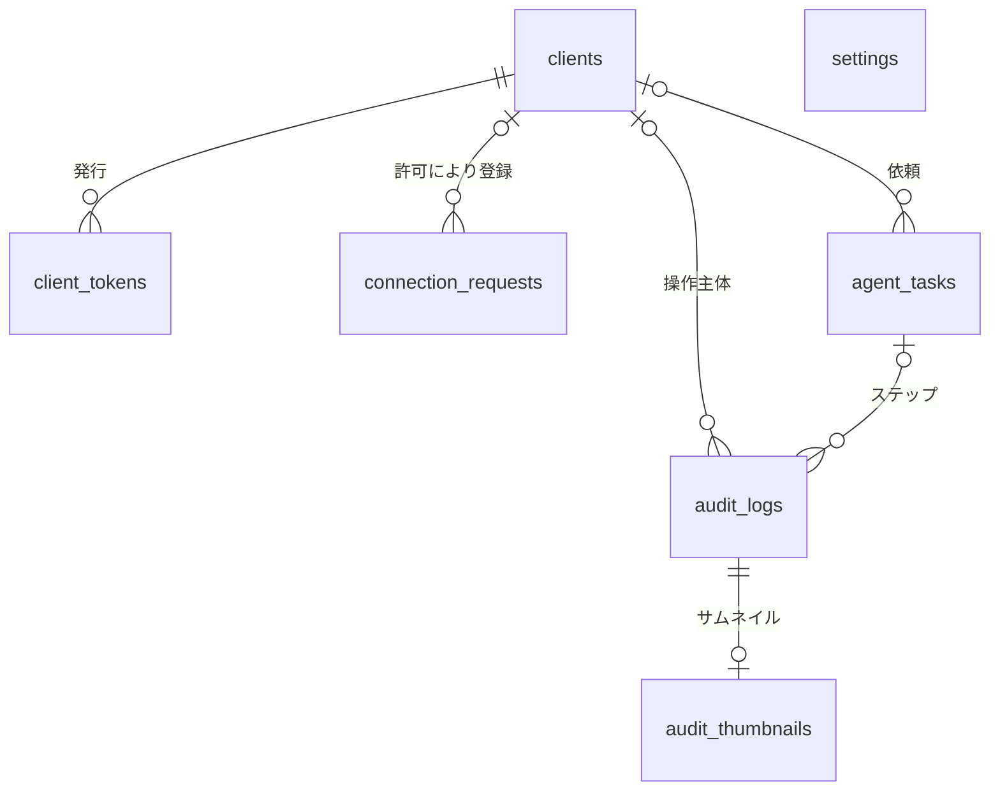
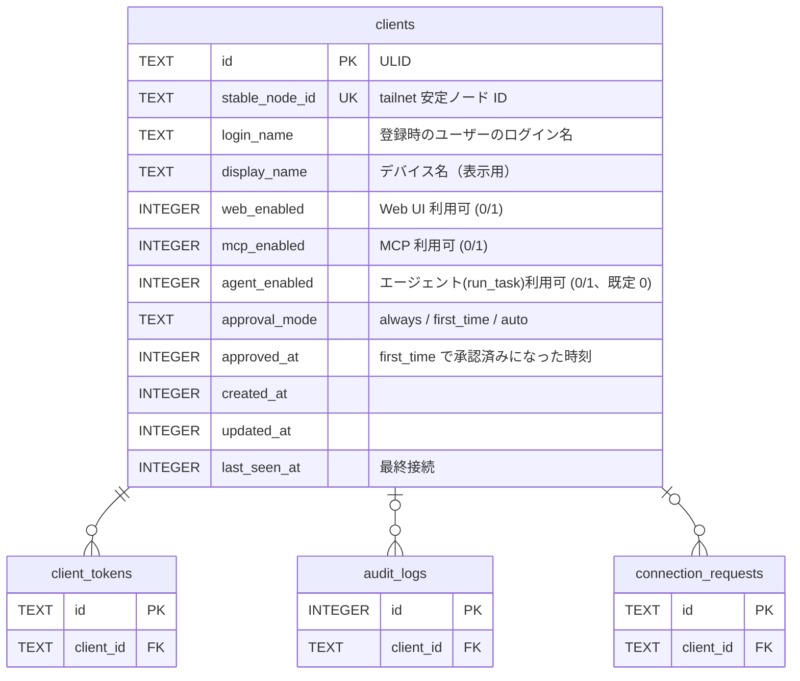
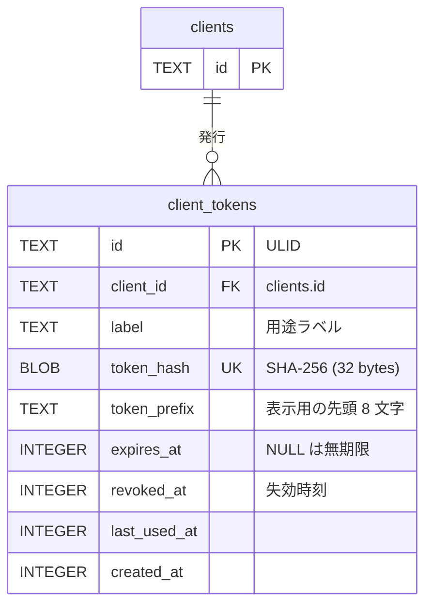
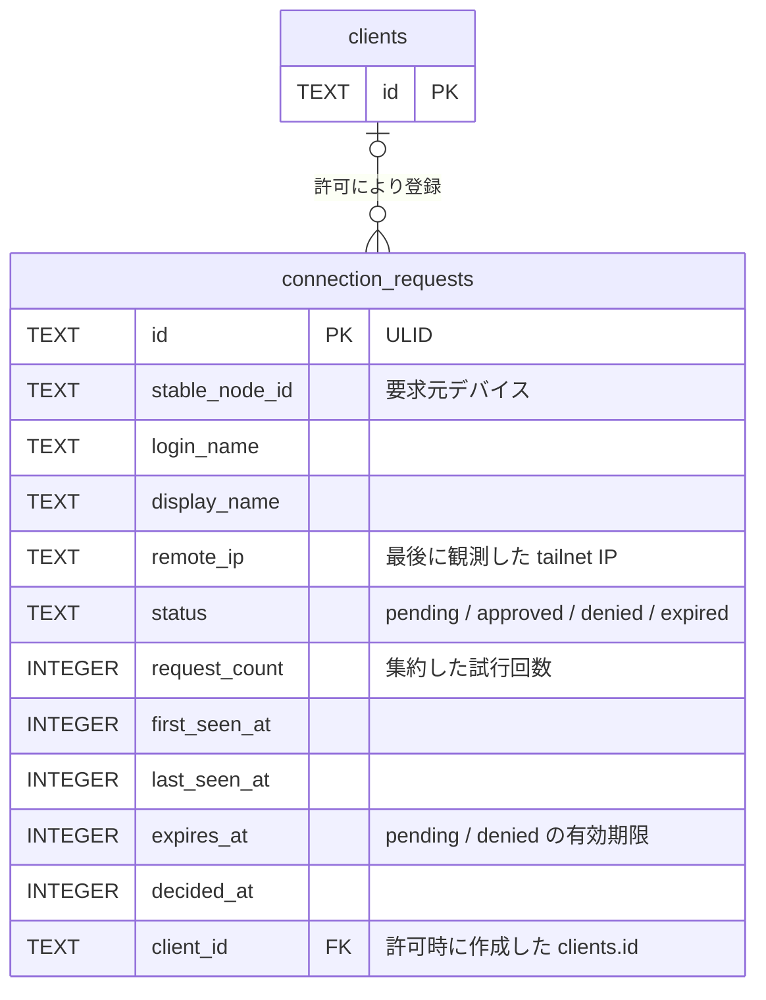
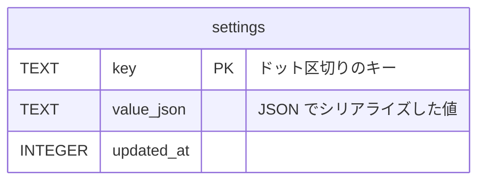
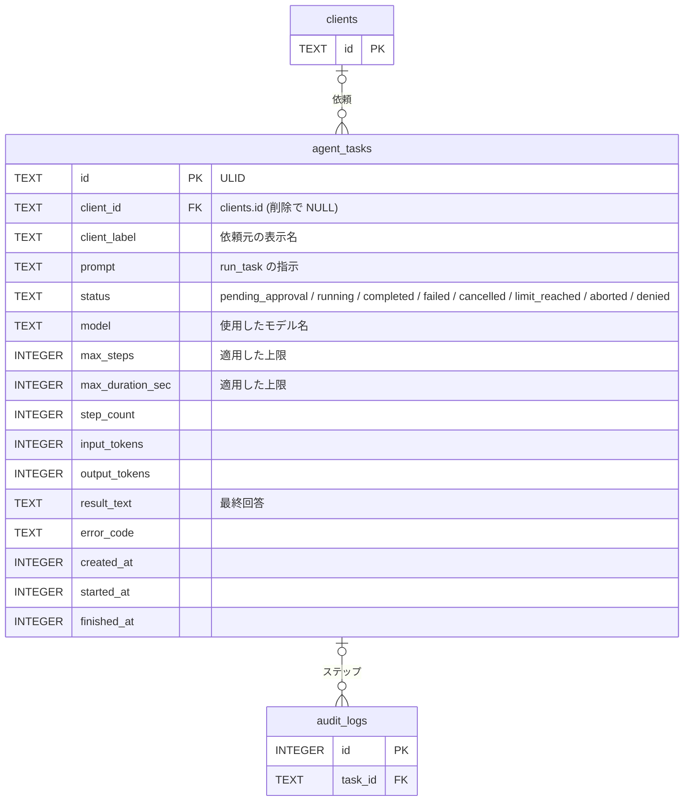
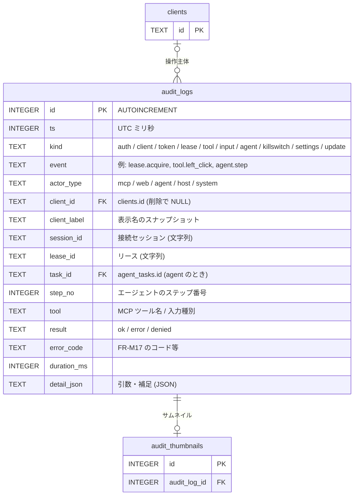
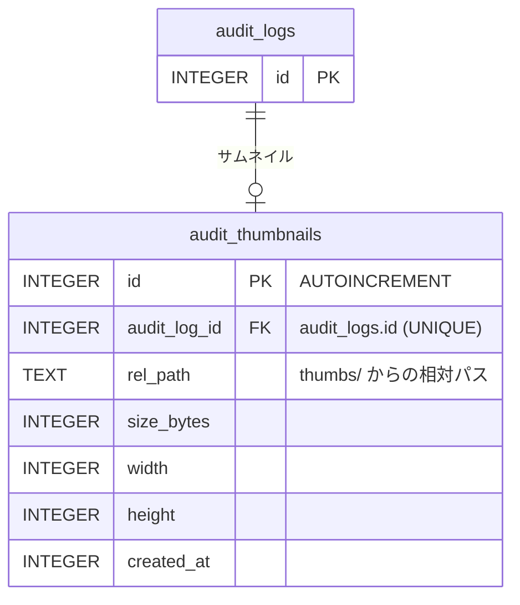

# ER / データモデル

ホスト 1 台のローカル SQLite（`%LOCALAPPDATA%\puppet-remo\puppet-remo.db`）に保存するデータの定義。技術選定は [アーキテクチャ設計](overview.md)、要件は [機能要件](../requirements/functional.md) を参照。

## 方針

| 項目 | 内容 |
|------|------|
| DB | SQLite（`modernc.org/sqlite`、純 Go）。起動時に `PRAGMA journal_mode=WAL; foreign_keys=ON; busy_timeout=5000; synchronous=NORMAL` を設定する |
| マイグレーション | 埋め込み SQL をバージョン順に適用（[NFR-O05](../requirements/non-functional.md)）。適用済みバージョンはマイグレーションライブラリの管理テーブルに保持する（本書の対象外） |
| ID | クライアント・トークン・接続要求は **ULID**（時系列ソート可能な 26 文字、アプリ側で生成）。`audit_logs` / `audit_thumbnails` は `INTEGER PRIMARY KEY AUTOINCREMENT` |
| 時刻 | UTC の Unix ミリ秒（`INTEGER`）。表示時にローカル時刻へ変換する |
| 真偽値 | `INTEGER`（0 / 1）。`CHECK (col IN (0, 1))` を付ける |
| 列挙値 | `TEXT` + `CHECK (col IN (...))` |
| 永続化しないもの | **リース**（[NFR-A01](../requirements/non-functional.md)）、**接続中セッション**（監査ログに `session_id` を文字列として記録するのみ）、承認待ち要求、WhoIs キャッシュ、Web UI の閲覧設定（モニター・品質・FPS はブラウザセッション単位）、**エージェントの実行状態**（ループ・会話。タスクの記録のみ `agent_tasks` に持つ。[NFR-A08](../requirements/non-functional.md)） |
| サムネイル | 画像は**ファイル**として `%LOCALAPPDATA%\puppet-remo\thumbs\` に保存し、DB にはパスとサイズを持つ |
| 改ざん検知 | 設けない（同一ユーザー権限の悪意あるプロセスは脅威モデル外） |
| シークレット | **OpenAI API キーは DB に保存しない**。Windows 資格情報マネージャーにのみ置く（[NFR-S14](../requirements/non-functional.md)）。`settings`・ログ・監査ログにも値を書かない |

## 全体 ER 図

## テーブル一覧

| テーブル | 用途 | 主な参照元 |
|---------|------|-----------|
| `clients` | 許可リスト（tailnet デバイス + ユーザー）と、クライアント別の利用可否・承認モード | FR-A04, A09, H04, L07 |
| `client_tokens` | MCP 用 Bearer トークン（ハッシュのみ） | FR-A05, A08 |
| `connection_requests` | 未登録デバイスからの接続要求 | FR-A06, A07 |
| `agent_tasks` | 内蔵エージェントのタスク（指示、状態、使用トークン、最終回答）。ステップは `audit_logs` に `task_id` で紐づく | FR-G02, G03, G09, G15, H10 |
| `settings` | アプリ設定、キルスイッチ状態、エージェント設定（キー・値） | FR-S01〜S13, FR-H06 |
| `audit_logs` | 監査ログ | FR-AU01〜AU05 |
| `audit_thumbnails` | 監査ログに紐づく縮小スクリーンショットのメタ情報 | FR-AU02, AU04 |

## テーブル定義

### clients

許可済みクライアント。tailnet の安定ノード ID（`StableNodeID`）で識別し、登録時のログイン名と照合する。

| カラム | 型 | NULL | 既定値 | 説明 |
|--------|----|------|--------|------|
| `id` | TEXT | NO | — | PK。ULID |
| `stable_node_id` | TEXT | NO | — | tailnet の安定ノード ID。UNIQUE |
| `login_name` | TEXT | NO | — | 登録時のログイン名。リクエスト時の WhoIs 結果と一致しない場合は未登録として扱い、接続要求を作る（再認証でユーザーが変わったデバイスへの権限の持ち越しを防ぐ） |
| `display_name` | TEXT | NO | — | デバイス名。GUI の表示用 |
| `web_enabled` | INTEGER | NO | 1 | Web UI の利用可否 |
| `mcp_enabled` | INTEGER | NO | 1 | MCP の利用可否 |
| `agent_enabled` | INTEGER | NO | 0 | 内蔵エージェント（`run_task`）の利用可否。**既定は無効**（FR-A09） |
| `approval_mode` | TEXT | NO | `'always'` | `always` / `first_time` / `auto`（FR-L07） |
| `approved_at` | INTEGER | YES | NULL | `first_time` で一度承認された時刻。NULL なら未承認（承認の取り消しは NULL に戻す）。`approval_mode` を変更したときも NULL に戻す |
| `created_at` | INTEGER | NO | — | 登録時刻 |
| `updated_at` | INTEGER | NO | — | 更新時刻 |
| `last_seen_at` | INTEGER | YES | NULL | 最終に認可を通過した時刻 |

制約: `UNIQUE (stable_node_id)`、`CHECK (approval_mode IN ('always','first_time','auto'))`、`CHECK (web_enabled IN (0,1))`、`CHECK (mcp_enabled IN (0,1))`、`CHECK (agent_enabled IN (0,1))`。

インデックス: UNIQUE 制約による `stable_node_id` のインデックスのみ（行数は最大 50。NFR-C01）。

### client_tokens

MCP 用 Bearer トークン。1 クライアントに複数発行でき（用途別のラベル）、個別に失効できる。平文は保存しない。

| カラム | 型 | NULL | 既定値 | 説明 |
|--------|----|------|--------|------|
| `id` | TEXT | NO | — | PK。ULID |
| `client_id` | TEXT | NO | — | FK → `clients.id`。`ON DELETE CASCADE`（クライアント削除でトークンも消える） |
| `label` | TEXT | NO | — | 用途ラベル（例: `claude-code`）。同一クライアント内で重複不可 |
| `token_hash` | BLOB | NO | — | トークン文字列の SHA-256（32 バイト）。UNIQUE。照合は定数時間比較（NFR-S04） |
| `token_prefix` | TEXT | NO | — | 表示用にトークン文字列の先頭 8 文字（例: `prm_Ab12`）。識別用で認証には使わない |
| `expires_at` | INTEGER | YES | NULL | 有効期限。既定の発行時指定は 90 日後（FR-A08）。NULL は無期限 |
| `revoked_at` | INTEGER | YES | NULL | 失効時刻。NULL でなければ無効 |
| `last_used_at` | INTEGER | YES | NULL | 最終使用時刻 |
| `created_at` | INTEGER | NO | — | 発行時刻 |

制約: `UNIQUE (token_hash)`、`UNIQUE (client_id, label)`。

有効なトークンの条件: `revoked_at IS NULL AND (expires_at IS NULL OR expires_at > now) AND clients.mcp_enabled = 1`、かつ要求元の `stable_node_id` がトークンの `client_id` のクライアントと一致すること（FR-A05）。

インデックス: UNIQUE 制約で `token_hash`、`(client_id, label)` を網羅。

### connection_requests

未登録デバイスからの接続要求。1 デバイスにつき `pending` は 1 件に集約する。

| カラム | 型 | NULL | 既定値 | 説明 |
|--------|----|------|--------|------|
| `id` | TEXT | NO | — | PK。ULID |
| `stable_node_id` | TEXT | NO | — | 要求元デバイスの安定ノード ID |
| `login_name` | TEXT | NO | — | 要求元ユーザーのログイン名 |
| `display_name` | TEXT | NO | — | デバイス名 |
| `remote_ip` | TEXT | NO | — | 最後に観測した接続元 tailnet IP |
| `status` | TEXT | NO | `'pending'` | `pending`（承認待ち）/ `approved`（許可済み）/ `denied`（拒否）/ `expired`（失効） |
| `request_count` | INTEGER | NO | 1 | 集約した試行回数（スパム対策の目安。GUI に出す通知は増やさない） |
| `first_seen_at` | INTEGER | NO | — | 最初の観測時刻 |
| `last_seen_at` | INTEGER | NO | — | 最後の観測時刻 |
| `expires_at` | INTEGER | NO | — | `pending`: 作成から 24 時間後。`denied`: 拒否から 24 時間後（この間は同デバイスから新しい要求を作らない） |
| `decided_at` | INTEGER | YES | NULL | 許可・拒否した時刻 |
| `client_id` | TEXT | YES | NULL | 許可により作成したクライアント。FK → `clients.id`、`ON DELETE SET NULL` |

制約: `CHECK (status IN ('pending','approved','denied','expired'))`。`stable_node_id` について `status = 'pending'` の行は 1 件のみ（部分 UNIQUE インデックス）。

インデックス:

| 名称 | 対象 | 種別 | 目的 |
|------|------|------|------|
| `ux_connreq_pending_node` | `(stable_node_id) WHERE status = 'pending'` | UNIQUE（部分） | 1 デバイス 1 件への集約（FR-A06） |
| `ix_connreq_status_expires` | `(status, expires_at)` | 通常 | 失効処理、`denied` の再要求抑止の判定 |

保守: `last_seen_at` から 7 日を過ぎた行を定期削除する。`pending` で `expires_at` を過ぎた行は `expired` に更新する。レート制限（FR-A07）は件数カウントをメモリで行うため、DB には持たない。

### settings

キー・値形式の設定。型検証はサービス層で行う（キーごとのスキーマはコードで定義）。キルスイッチの状態もここに置く（[NFR-S07](../requirements/non-functional.md)）。

| カラム | 型 | NULL | 既定値 | 説明 |
|--------|----|------|--------|------|
| `key` | TEXT | NO | — | PK。キー名 |
| `value_json` | TEXT | NO | — | JSON 値。`json_valid(value_json)` を `CHECK` で確認する |
| `updated_at` | INTEGER | NO | — | 更新時刻 |

キー一覧（行が無ければ既定値を使う）:

| キー | 型 | 既定値 | 対応する要件 |
|------|----|--------|-------------|
| `server.port` | number | 8765 | FR-S01 |
| `killswitch.hotkey` | string | `"Ctrl+Alt+Shift+K"` | FR-S02 |
| `killswitch.state` | object `{active, triggered_at, source}` | `{"active": false}` | FR-H06、NFR-S07 |
| `screenshot.max_dimension` | number | 1568 | FR-S03 |
| `lease.idle_timeout_sec` | number | 300 | FR-S04 |
| `viewer.default_quality` | number | 70 | FR-S06 |
| `viewer.default_fps` | number | 10 | FR-S06 |
| `audit.thumbnails_enabled` | boolean | true | FR-AU02 |
| `audit.record_text` | boolean | false | FR-AU03 |
| `audit.retention_days` | number | 30 | FR-AU04 |
| `audit.thumbs_max_bytes` | number | 1073741824 | FR-AU04 |
| `update.apply_mode` | string `"confirm"` / `"auto_idle"` | `"confirm"` | FR-S09 |
| `update.last_checked_at` | number | なし | FR-H09 |
| `log.level` | string | `"info"` | NFR-O01 |
| `agent.enabled` | boolean | false | FR-S10、FR-G14 |
| `agent.consent_at` | number（UTC ミリ秒） | なし | FR-G14（OpenAI へのスクリーンショット送信への同意の日時。有効化時に記録し、無効化で削除） |
| `agent.model` | string | `"gpt-6.1-sol"` | FR-S11 |
| `agent.max_steps` | number | 50 | FR-S12 |
| `agent.max_duration_sec` | number | 600 | FR-S12 |
| `agent.deny_processes` | array of string | `["KeePass.exe","KeePassXC.exe","1Password.exe","Bitwarden.exe"]` | FR-S13 |
| `agent.approve_processes` | array of string | `[]` | FR-S13 |

ログオン時の自動起動（FR-S08）の有効・無効は OS（スタートアップ登録）が真実の源であり、DB には持たない。クライアント別の承認モード（FR-S05）は `clients.approval_mode`、エージェント利用許可（FR-A09）は `clients.agent_enabled` に持つ。OpenAI API キーは `settings` にも置かない（資格情報マネージャーのみ）。

### agent_tasks

内蔵エージェントの 1 回の実行（[FR-G02〜G15](../requirements/functional.md)）。ステップ（アクション・Judge の判定・安全チェック・サムネイル）は `audit_logs` に `kind = 'agent'`、`task_id`、`step_no` で保存し、ここには集計だけを持つ。

| カラム | 型 | NULL | 既定値 | 説明 |
|--------|----|------|--------|------|
| `id` | TEXT | NO | — | PK。ULID。`run_task` が返す `task_id` |
| `client_id` | TEXT | YES | NULL | 依頼したクライアント。FK → `clients.id`、`ON DELETE SET NULL` |
| `client_label` | TEXT | NO | — | 依頼元の表示名のスナップショット |
| `prompt` | TEXT | NO | — | 指示本文（10,000 文字まで。NFR-S09）。タスクの記録として常に保存する（FR-AU03） |
| `status` | TEXT | NO | `'pending_approval'` または `'running'` | FR-G03 の状態 |
| `model` | TEXT | NO | — | 使用したモデル名（開始時の `agent.model`） |
| `max_steps` | INTEGER | NO | — | 適用した上限（`run_task` の指定は設定値以下） |
| `max_duration_sec` | INTEGER | NO | — | 適用した上限 |
| `step_count` | INTEGER | NO | 0 | 実行したステップ（Responses API 呼び出し）の数 |
| `input_tokens` / `output_tokens` | INTEGER | NO | 0 | 使用トークンの累計（金額上限は設けない。FR-G09） |
| `result_text` | TEXT | YES | NULL | 最終回答（10,000 文字で切り詰め）。`completed` はモデルの申告（FR-G13） |
| `error_code` | TEXT | YES | NULL | 失敗の理由。`input_blocked` / `judge_denied` / `approval_denied` / `safety_check_denied` / `unsupported_action` / `openai_error` など（FR-M17、FR-G） |
| `created_at` | INTEGER | NO | — | `run_task` の受付時刻 |
| `started_at` | INTEGER | YES | NULL | `running` になった時刻（承認拒否の `denied` は NULL） |
| `finished_at` | INTEGER | YES | NULL | 終了状態になった時刻 |

制約: `CHECK (status IN ('pending_approval','running','completed','failed','cancelled','limit_reached','aborted','denied'))`、`CHECK (status IN ('pending_approval','running') OR finished_at IS NOT NULL)`（終了状態は `finished_at` が必須）、`CHECK (step_count >= 0 AND input_tokens >= 0 AND output_tokens >= 0)`。

インデックス:

| 名称 | 対象 | 種別 | 目的 |
|------|------|------|------|
| `ix_task_created` | `(created_at DESC)` | 通常 | タスク一覧（FR-H10）、保持期間の削除 |
| `ix_task_client_created` | `(client_id, created_at DESC)` | 通常 | クライアント別の一覧、`get_task` の所有確認 |
| `ix_task_active` | `(status) WHERE status IN ('pending_approval','running')` | 部分 | 起動時の `aborted` 更新（NFR-A08）、実行中の確認 |

同時に実行できるタスクは 1 件（NFR-C05）。これは排他リースがメモリ上で保証し、DB では制約にしない。

### audit_logs

すべての監査イベント（[FR-AU01](../requirements/functional.md)）。クライアントが削除されても履歴が残るよう、操作主体の表示名を行に複製して持つ。

| カラム | 型 | NULL | 既定値 | 説明 |
|--------|----|------|--------|------|
| `id` | INTEGER | NO | AUTOINCREMENT | PK |
| `ts` | INTEGER | NO | — | 発生時刻（UTC ミリ秒） |
| `kind` | TEXT | NO | — | 分類: `auth`（接続要求・認証失敗）/ `client`（登録・変更・削除）/ `token` / `lease` / `tool`（MCP ツール呼び出し）/ `input`（Web UI からの入力操作）/ `agent`（タスクのライフサイクル・各ステップ・安全チェック・Judge の判定・有効化と同意）/ `killswitch` / `settings` / `update` |
| `event` | TEXT | NO | — | イベント名（例: `lease.acquire`、`lease.revoke`、`tool.left_click`、`auth.bearer_failed`、`agent.task_start`、`agent.step`、`agent.safety_check`、`agent.judge`、`agent.consent`） |
| `actor_type` | TEXT | NO | — | `mcp` / `web` / `agent`（内蔵エージェント）/ `host`（ホスト GUI 操作）/ `system` |
| `client_id` | TEXT | YES | NULL | FK → `clients.id`、`ON DELETE SET NULL`。ホスト操作・システム・未登録デバイスは NULL |
| `client_label` | TEXT | NO | — | 表示名のスナップショット。未登録デバイスはデバイス名、ホスト操作は `(host)` |
| `session_id` | TEXT | YES | NULL | 接続セッション ID（メモリ上の ID を文字列で記録） |
| `lease_id` | TEXT | YES | NULL | リース ID（メモリ上の ID を文字列で記録） |
| `task_id` | TEXT | YES | NULL | FK → `agent_tasks.id`、`ON DELETE SET NULL`。エージェントのステップ・タスクのイベントで設定する |
| `step_no` | INTEGER | YES | NULL | タスク内のステップ番号（1 始まり）。ステップ内のアクションは `detail_json` に順序付きで持つ |
| `tool` | TEXT | YES | NULL | ツール名（`left_click` 等）。`input` では `mouse` / `key` 等、`agent` ではアクション種別（`click` / `type` など） |
| `result` | TEXT | NO | — | `ok` / `error` / `denied` |
| `error_code` | TEXT | YES | NULL | FR-M17 のエラーコード等 |
| `duration_ms` | INTEGER | YES | NULL | 所要時間 |
| `detail_json` | TEXT | YES | NULL | 引数・補足（JSON）。`type` の本文とクリップボードは既定では文字数のみ（FR-AU03）。トークンは含めない |

制約: `CHECK (result IN ('ok','error','denied'))`、`CHECK (actor_type IN ('mcp','web','agent','host','system'))`、`CHECK (detail_json IS NULL OR json_valid(detail_json))`。

インデックス:

| 名称 | 対象 | 目的 |
|------|------|------|
| `ix_audit_ts` | `(ts DESC)` | 時系列一覧、保持期間による削除 |
| `ix_audit_client_ts` | `(client_id, ts DESC)` | クライアント別の絞り込み（FR-AU05） |
| `ix_audit_kind_ts` | `(kind, ts DESC)` | 種別の絞り込み |
| `ix_audit_result_ts` | `(result, ts DESC)` | 結果（失敗のみ）の絞り込み |
| `ix_audit_session` | `(session_id)` | セッション単位のドリルダウン |
| `ix_audit_task_step` | `(task_id, step_no)` | タスク詳細でのステップ一覧（FR-H10） |

### audit_thumbnails

監査ログに紐づく縮小スクリーンショット（JPEG、長辺 320 px、品質 60。FR-AU02）。画像本体は `thumbs/` 配下のファイル。

| カラム | 型 | NULL | 既定値 | 説明 |
|--------|----|------|--------|------|
| `id` | INTEGER | NO | AUTOINCREMENT | PK |
| `audit_log_id` | INTEGER | NO | — | FK → `audit_logs.id`、`ON DELETE CASCADE`。UNIQUE（1 ログにつき 0 または 1 枚） |
| `rel_path` | TEXT | NO | — | `thumbs/` 配下の相対パス（例: `2026/10/28/01HX….jpg`）。絶対パスは保存しない |
| `size_bytes` | INTEGER | NO | — | ファイルサイズ。容量集計に使う |
| `width` / `height` | INTEGER | NO | — | 画像サイズ（px） |
| `created_at` | INTEGER | NO | — | 保存時刻 |

制約: `UNIQUE (audit_log_id)`、`CHECK (size_bytes >= 0)`。

インデックス: `ix_thumb_created (created_at)`（容量超過時に古い順に削除）。

## データの保守

| 処理 | 契機 | 内容 |
|------|------|------|
| 保持期間の削除 | 起動時と 1 時間ごと | `audit_logs.ts` が `audit.retention_days` を超えた行を削除する。`audit_thumbnails` は `CASCADE` で消え、対応するファイルを削除する |
| 容量の削除 | サムネイル保存の都度、起動時 | `SUM(size_bytes)` が `audit.thumbs_max_bytes` を超えたら `created_at` の古い順にサムネイルのファイルと行を削除する（ログ行は残す） |
| 孤児ファイルの掃除 | 起動時 | `thumbs/` にあって DB に行がないファイル、行はあるのにファイルがない行を削除する |
| 接続要求の整理 | 1 時間ごと | `pending` の失効、`last_seen_at` から 7 日を過ぎた行の削除 |
| タスクの保持期間 | 起動時と 1 時間ごと | `agent_tasks.finished_at` が `audit.retention_days` を超えた行を削除する（`audit_logs.task_id` は `SET NULL`）。実行中・承認待ちの行は削除しない |
| 異常終了したタスクの回収 | 起動時 | 状態が `pending_approval` / `running` のまま残った行を `aborted`（`finished_at` を設定）に更新する。自動では再開しない（[NFR-A08](../requirements/non-functional.md)） |
| 整合性チェック | 起動時 | `PRAGMA quick_check`。失敗時は DB を隔離（リネーム）して空 DB で起動し GUI に通知（[NFR-A06](../requirements/non-functional.md)） |
| ファイル削除と DB 削除の順序 | 常時 | DB 行を先に削除（トランザクション）してからファイルを削除する。途中で落ちても残るのは孤児ファイルで、起動時の掃除で回収できる |

## 改訂履歴

| 版 | 日付 | 変更内容 | 変更理由 |
|---|------|---------|---------|
| 1.0 | 2026-10-28 | 初版作成 | — |
| 1.1 | 2026-10-29 | 内蔵エージェント向けに `agent_tasks` を追加、`clients.agent_enabled`、`audit_logs.task_id` / `step_no` / `actor_type = 'agent'` / `kind = 'agent'`、エージェントの設定キー、保守処理（タスクの保持期間・異常終了の回収）を追加。API キーは DB に置かない旨を明記。`tool.click` の例を `tool.left_click` に更新 | ホスト内蔵エージェントを主役にする決定 |
