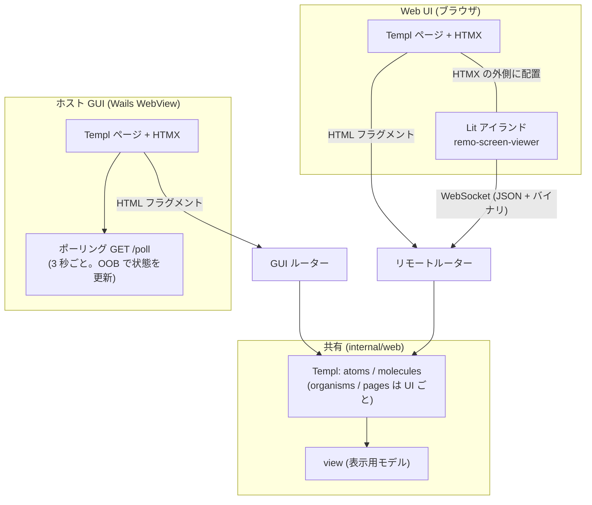
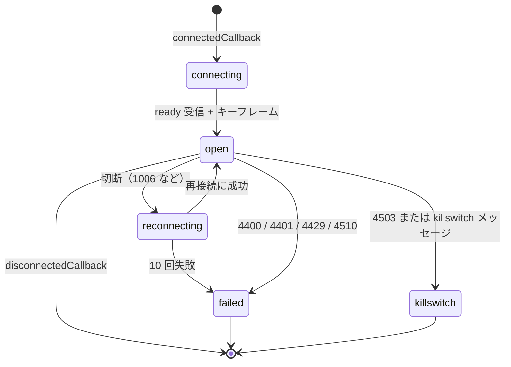
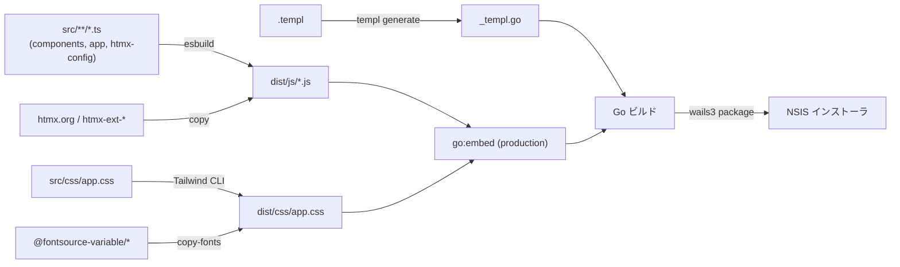

# フロントエンドアーキテクチャ設計（HALT）

全体構成は [アーキテクチャ設計](overview.md)、ルートとプロトコルは [API 仕様](../api/endpoints.md)、パッケージの責務は [コンポーネント設計](../components/overview.md) を参照。本書はフロントエンドを **HALT（HTMX + Atomic Design + Lit + Templ）** で作るための規約を定める。HALT 標準のリファレンスをベースにし、本プロジェクト固有の差分は §2 にまとめる。

## 1. 概要

### 1.1 設計思想

バックエンドファースト。判断に迷ったらサーバー側に寄せる。

- フロントエンドはアプリ（Go のプロセス）の中で動く。**SPA は作らない**
- サーバーが UI を制御し、HTMX がハイパーメディア駆動のインタラクションを担う
- リッチな操作が必要な箇所（ライブ画面）だけ Lit の Web Component で拡張する
- テンプレートは Atomic Design で構造化する
- クライアント側の状態とロジックは最小限にする。状態はサーバーが持つ
- **状態駆動レンダリング（HATEOAS）**: サーバーが現在の状態と権限に基づいて、利用可能なアクションだけを HTML に含める。ボタンが見えるなら押せる。見えないなら存在しない。`hidden` / `disabled` で隠さず、レンダリングしない。判定は Go 側で行う

### 1.2 技術スタック

| レイヤー | 技術 | 役割 |
|---------|------|------|
| サーバー | Go + Gin | ルーティングと SSR |
| JSON API | Huma | `/api/v1` の OpenAPI 3.1 生成と入出力検証（読み取り専用の小さな API のみ） |
| テンプレート | Templ | 型安全な Go の HTML テンプレート |
| インタラクション | HTMX 2.x + 拡張 `response-targets`（両 UI）。ホスト GUI の状態の更新は `GET /poll` のポーリング（§5.3） | サーバー駆動の DOM 更新 |
| リッチ UI | Lit（Web Components） | ライブ画面ビューア `<remo-screen-viewer>` のみ |
| スタイル | Tailwind CSS | Templ にはユーティリティクラス、Lit には Shadow DOM 内の `css` |
| ビルド | esbuild（TypeScript）、Tailwind CLI | 成果物を `static/dist/` に出力し、本番は `go:embed` で同梱 |
| シェル | Wails v3 | ホスト GUI の WebView。GUI ルーターを `AssetOptions.Handler` に渡す |

### 1.3 2 つの UI

同じ Templ の atoms / molecules を共有するが、**ハンドラと配信経路は共有しない**（ホスト専用の操作がリモートに露出しないことを構造で保証する）。

| UI | 利用者 | 配信経路 | 認可 | HTMX 拡張 |
|----|-------|---------|------|-----------|
| **ホスト GUI** | ホスト所有者（ホスト PC の Wails WebView） | GUI ルーター（プロセス内。ソケットなし） | プロセス内到達のみ | `response-targets` |
| **Web UI（ビューア）** | tailnet 上の別端末のブラウザ | リモートルーター（tailnet IP） | WhoIs + 許可リスト（API 仕様 §1） | `response-targets` |



## 2. HALT 標準からの差分

| HALT 標準 | 本プロジェクト | 理由 |
|-----------|--------------|------|
| Cookie セッション + CSRF トークン（meta タグ） | **Cookie を使わない**。識別は WhoIs、CSRF 対策は Host / Origin 検証 + カスタムヘッダー `X-Puppet-Remo: 1`（`<body hx-headers>` で全 HTMX リクエストに付与） | tailnet 上の ID が真実の源で、Cookie の認証が無い（NFR-S03） |
| 単一の HTTP サーバー | **GUI ルーター（プロセス内）とリモートルーター（tailnet）に分離** | ホスト専用の操作を構造でネットワークから隔離する |
| HTMX 拡張は最小限 | ホスト GUI は拡張を `response-targets` だけにし、状態の更新は `GET /poll` のポーリング（`hx-trigger="every 3s"` + OOB）にする。`sse` 拡張は読み込まない | 承認要求・リース・接続要求を GUI へ反映する（NFR-P06）。Wails v3.0.0 の Windows の AssetServer は応答をバッファして SSE が届かないため（§5.3）。Web UI は WebSocket で足りる |
| Lit は編集系のリッチ UI | ライブ画面ビューア 1 つのみ | 要件が 1 画面に限られる |
| Huma で JSON API（アクションも含む） | `/api/v1/*` は読み取り専用（状態・モニター・リース）のみ。**アクションはすべて HTML を返す HTMX のルート**。MCP と WebSocket は Huma の対象外 | 状態を変更する操作の利用者は HTMX だけ。JSON の変更 API は不要 |
| 静的ファイルは Gin の `Static`、本番は `max-age=31536000` | `go:embed` した `dist/` を両ルーターで配信し、**`Cache-Control: no-cache` + `ETag`（ビルド ID）**。開発は `!production` ビルドでディスクから配信（**ユーザー承認済み**） | 単一バイナリ配布。ファイル名にハッシュを付けないため、アプリの更新後に利用者のブラウザが古い JS を長期保持する事故を避ける |
| 開発は `air` + `templ generate --watch` + `bun run dev` | **`wails3 dev`**（Go の再ビルドと再起動は Wails が行う）+ `templ generate --watch` + `frontend:dev`（esbuild のウォッチ + `WAILS_VITE_PORT` での待ち受け、Tailwind のウォッチ。§8.3） | Wails の開発サーバーとホットリロードが二重にならないようにする。`wails3 dev` は `frontend:dev` が待ち受けることを前提にする（§8.3） |
| `lib/api.ts` を共通ライブラリに含める | **初版では作らない**（**ユーザー承認済み**）。Lit から HTTP を呼ぶ箇所が無いため。必要になった時点で追加する（§6.1） | 呼び出し元が無い共通コードは持たない |
| CSP は任意（HALT 標準は規定なし） | **両ルーターの全 HTML レスポンスに CSP ヘッダーを付ける**（`script-src 'self'` / `style-src 'self'`。インラインのスクリプト・スタイル・イベント属性は禁止。§7.1。NFR-S19） | API キーの入力画面を持つホスト GUI が主な対象。共有テンプレートなので Web UI も同じ規約にする |
| `lib/ws.ts` は JSON メッセージ前提 | **バイナリフレーム（画面）と JSON テキストフレーム（制御・入力）の両方を扱う**（§6.2） | `/ws/screen` の形式（API 仕様 §5） |

## 3. ディレクトリ構成

```
internal/web/
├── view/                     # Templ に渡す表示用モデル（domain から handler が組み立てる）
├── handler/
│   ├── gui/                  # GUI ルーター用: dashboard, requests, clients, tokens, approvals,
│   │                         #   apps, tasks, agent, audit, settings, update, poll(OOB), events(SSE)
│   └── remote/               # リモートルーター用: viewer, lease, clipboard, keys
├── middleware/               # csp, hostcheck, csrfheader, whois, allowlist, bearer, killswitch
├── atoms/                    # 共有: button, input, textarea, select, checkbox, badge, spinner, toast, icon, kbd, range
├── molecules/                # 共有: card, modal, form_field, lease_badge, status_pill, token_reveal, empty_state
├── organisms/
│   ├── gui/                  # server_status_panel, session_list, lease_panel, task_panel,
│   │                         #   killswitch_button, connection_request_list, client_list, client_detail,
│   │                         #   token_list, approval_body, audit_table, audit_filter_form, settings_form,
│   │                         #   agent_settings_form, update_panel, app_list, app_form, header, sidebar
│   └── remote/               # viewer_toolbar, lease_panel, clipboard_panel, key_menu
├── pages/
│   ├── gui/                  # dashboard, requests, clients, client_detail, approval, audit, audit_detail,
│   │                         #   settings, update, tasks, task_detail, agent, apps
│   └── remote/               # viewer, pending (接続要求待ち), denied, error
└── layout/                   # gui, remote（<head>・ヘッダー・`hx-headers`・スクリプトの読み込み）

static/
├── package.json              # esbuild, tailwindcss, lit, htmx.org, htmx-ext-*, @fontsource-variable/{jetbrains-mono,noto-sans-jp,sora}, subset-font, @open-wc/testing, @web/test-runner, @playwright/test
├── playwright.config.ts      # E2E の設定（Chromium のみ。テスト専用サーバーをビルドして起動する webServer。§9）
├── esbuild.config.mjs
├── src/
│   ├── components/
│   │   ├── screen-viewer/    # remo-screen-viewer.ts（+ テスト）
│   │   └── lib/              # ws.ts, logger.ts
│   ├── app/                  # htmx-config.ts（classic スクリプト）, app.ts（グローバルのエラーリスナー・トークンのコピー）
│   └── css/app.css           # Tailwind のエントリーポイント
├── dist/                     # ビルド成果物（go:embed。.gitignore）
└── e2e/                      # Playwright の E2E（§9。*.spec.ts・制御エンドポイントのクライアントと CSP 監視の helpers.ts）
```

- `atoms` / `molecules` は 2 つの UI で**共有**し、`organisms` / `pages` は UI ごとに分ける。共有側は UI 固有の URL を持たない（URL は props で受ける）
- `handler/gui` と `handler/remote` は互いを import しない。ハンドラが使えるのは `service` と `domain`（`repository` / `platform` / `tailnet` は不可。`scripts/check-imports.sh` が検査する。[コンポーネント設計](../components/overview.md) §6・§13.1）
- `view` は Templ 用の表示モデル（例: `LeasePanelView`、`ClientRowView`）。Templ は `domain` / `service` を import せず、`view` だけを受け取る
- `go:embed` は `static/dist` を対象にする。開発ビルド（`!production`）はディスクから読む（§8.3）

## 4. Templ（Atomic Design）

### 4.1 層

| 層 | 責務 | 例 |
|----|------|----|
| atoms | 最小の UI 要素。単一の責務 | button, input, badge, spinner, toast |
| molecules | atoms の組み合わせ | form_field, modal, lease_badge, token_reveal |
| organisms | 機能単位。HTMX の `hx-*` を持つ | lease_panel, client_list, viewer_toolbar |
| pages | ページ全体 | viewer, dashboard, clients |
| layout | `<html>`・`<head>`・共通ヘッダー・スクリプト | gui, remote |

### 4.2 コンポーネントの規約

- 単純なコンポーネント（引数 3 個以下）は直接パラメータ、複雑なものは `Props` 構造体にする
- バリエーションは `const` + 独自型で型安全にする（`ButtonVariant` など）
- 子要素は `templ.Component` のスロット（`{ children... }`）で受ける
- HTML 属性のパススルーは `Attrs templ.Attributes`
- 状態の分岐・権限の判定は**ハンドラが行い、`view` に結果として渡す**。テンプレートは `if` で描画の有無を決めるだけで、権限のロジックを持たない

### 4.3 状態駆動レンダリングの例（リースパネル）

```go
// internal/web/organisms/remote/lease_panel.templ
type LeasePanelView struct {
    State     string // "idle" | "pending_approval" | "held"
    Holder    *HolderView // 種別（mcp / web / agent）・名前・タスクの要約（agent のときだけ。状態・ステップ数 / 上限・経過時間と上限・開始時刻・依頼元。指示と最終回答は出さない。FR-W08）
    Mine      bool
    CanAcquire, CanRelease, CanRevoke bool // ハンドラが LeaseManager の状態から決める。pending_approval（M3）はすべて false（承認待ちの表示だけ。操作を持たない）
}

templ LeasePanel(v LeasePanelView) {
    <section id="lease-panel"
             hx-get="/viewer/lease"
             hx-trigger="remo:lease-changed from:#viewer-root"
             hx-swap="outerHTML">
        @molecules.LeaseBadge(v.State, v.Holder)
        if v.CanAcquire {
            @atoms.Button("操作権を取得", atoms.ButtonPrimary, hx.Post("/viewer/lease/acquire"), hx.Target("#lease-panel"))
        }
        if v.CanRelease {
            @atoms.Button("解放", atoms.ButtonSecondary, hx.Post("/viewer/lease/release"), hx.Target("#lease-panel"))
        }
        if v.CanRevoke {
            @atoms.Button("強制剥奪", atoms.ButtonDanger, hx.Post("/viewer/lease/revoke"), hx.Target("#lease-panel"))
        }
    </section>
}
```

- リースが `idle` なら「取得」だけ、他者の保持中なら「強制剥奪」だけ、自分が保持なら「解放」だけを描画する
- 保持者が `agent` のとき（M4）は、実行中のタスクの要約（`[data-lease-task]`）を添える。`handler/remote` は狭い読み取りのインターフェース `TaskSummaries`（`Running(ctx)`。実体は `service.TaskAdmin`）から取り、`view.ViewerTask` に写す。ビューアはタスクの依頼元とは別のクライアントなので、写すのは状態・ステップ数と上限・経過時間と上限・開始時刻・依頼元の表示名だけで、`prompt`・`result_text` は `view` に持たない
- キルスイッチ中は操作系を一切描画しない（そもそもリモートのページは 503 になる。ホスト GUI は解除ボタンだけを描画する）
- `hx.Post(...)` などは `hx-*` 属性を組み立てる補助関数（`atoms` に置く）。URL はハンドラ側（または view）が持つ文字列で、JS には書かない

## 5. HTMX パターン

### 5.1 ルートの 3 パターン

| パターン | 例 | `HX-Request` | 返却 | 登録先 |
|---------|----|-------------|------|--------|
| ページルート | `GET /viewer`、GUI の `GET /clients` | で分岐する | フルページ（`layout` 込み）またはフラグメント | Gin |
| アクションルート | `POST /viewer/lease/acquire`、`PATCH /clients/{id}`、`GET /viewer/lease` | しない | **常にフラグメント** | Gin |
| API ルート | `GET /api/v1/status` | しない | JSON（problem+json のエラー） | Huma |

- **Web UI・GUI のルートは常に HTML**。`HX-Request` の有無で JSON に切り替えない（JSON を返すのは `/api/v1` と MCP のみ。API 仕様 §1）
- 同じ URL をブラウザが直接開いても、HTMX が部分更新しても動く（ページルート）。ページルートの分岐の実装は次のとおり。

```go
func (h *Handler) Clients(c *gin.Context) {
    v := h.clientsView(c.Request.Context())
    if c.GetHeader("HX-Request") != "" {
        organisms.ClientList(v).Render(c.Request.Context(), c.Writer)
    } else {
        pages.Clients(v).Render(c.Request.Context(), c.Writer)
    }
}
```

- 状態変更のルートは `X-Puppet-Remo: 1` を必須にする（リモートのみ。API 仕様 §1 の連鎖の 2。ホスト GUI のルーターには付けない — ソケットを開かずプロセス内の WebView だけが到達できるため。前提は API 仕様 §7 の冒頭）。`<body hx-headers='{"X-Puppet-Remo":"1"}'>` で全リクエストに付与する
- ビューアのページには `X-Viewer-Id` も付ける: `<main id="viewer-root" hx-headers={ templ.JSONString(map[string]string{"X-Viewer-Id": id}) }>`（`hx-headers` は子孫へ継承され、親の値とマージされる）

### 5.2 OOB（Out of Band）スワップ

1 レスポンスで複数の DOM を更新する。**副作用の反映だけ**に使い、メインの更新には使わない。3 箇所以上の同時更新は設計の見直しのサインとする。

| 場面 | メイン（`hx-target`） | OOB |
|------|---------------------|-----|
| 接続要求を許可・拒否（GUI） | 要求の一覧 | ヘッダーの件数バッジ、トースト |
| トークンを失効（GUI） | トークン一覧 | トースト |
| キルスイッチを発動・解除（GUI） | ダッシュボード | ヘッダーの状態バッジ |
| 設定を保存（GUI） | フォーム | トースト |
| 強制剥奪（GUI）の確定 | リースの表示 | モーダルを閉じる、トースト |
| 強制剥奪（Web）の確定 | リースパネル | モーダルを閉じる、ビューアの操作部（`#viewer-ops`）。トーストは返さない |

### 5.3 状態の更新: ポーリング `GET /poll`（ホスト GUI のみ）

**決定**: ホスト GUI の状態（サーバー状態・セッション・リース・キルスイッチ・接続要求の件数と一覧・トースト）は、レイアウトが `GET /poll` を 3 秒ごとに呼び、応答の OOB（`hx-swap-oob`）で差し替える。SSE（`GET /events`）は GUI のレイアウトから購読しない。

理由: Wails v3.0.0 の Windows の AssetServer は、`AssetOptions.Handler` の応答をハンドラが返るまでバッファし、`http.Flusher` を持たない（`internal/assetserver/webview/responsewriter_windows.go`）。ホスト GUI は `AssetOptions.Handler` でしか配信しないため、開いたままの SSE の応答は WebView に届かない。

```html
<body hx-ext="response-targets" hx-headers=...>
  <section id="server-status">…</section>
  <section id="sessions">…</section>
  <section id="lease">…</section>
  ...
  <div id="live-poll" hx-get="/poll" hx-trigger="every 3s" hx-swap="none" hx-include="[data-poll-rev]"></div>
</body>
```

- `GET /poll` は 1 回の応答に、いま更新すべき領域の OOB のフラグメントを並べる。API 仕様 §7.4 の対応表と同じ領域・同じ描画（`ServerStatusBody` など、SSE の `data` と共通のコンポーネント）を使い、描画のロジックを二重に持たない
- `hx-swap="none"` でも OOB の差し替えは行われる。`#live-poll` は `#main` の外にあるため、ページ遷移（`hx-boost`）で消えない
- **表示中の領域だけを更新する**: 一覧・パネルのように作り直す領域（接続要求の一覧、キルスイッチのパネル）は、描画した状態の版を隠し入力（`<input type="hidden" name="rev_…" data-poll-rev>`）に持つ。`hx-include="[data-poll-rev]"` がそれを `/poll` のクエリで送り返し、サーバーは**版が変わった領域だけ**を差し替える。そのページに無い領域は版が送られないため、差し込み先の無い OOB を返さない。入力中の許可フォームなどを、ポーリングで消さないための仕組み
- ヘッダーのキルスイッチのバッジとサイドバーの件数バッジは、軽い差し替え（中身だけ）で常に返す
- トーストは、`Bus` の `toast` を `gui.Handler` が `New` で購読して溜めておき、`GET /poll` が取り出して、完了の通知（`info`）は `#toast-root` に追加する OOB に、エラー（`error`）は `#alert-root` を置き換えるインラインアラートの OOB（`organisms.AlertOOB`）にする（取り出したものは次の応答に出ない。バッファは `Bus` の購読者ごとの上限 16 件で、超えた分は古いものから捨てる）
- `approval` のイベントは DOM を更新しない。承認ダイアログのウィンドウは Go 側（`app` の `approvalDialogs` が `Bus` から購読）が開き、`approval-closed`（承認待ちの終了）で閉じる（ポーリングの対象外。M3・#68）。ダイアログの残り時間（60 秒のカウントダウン）だけは、ダイアログのページ自身が HTMX の `hx-trigger="every 1s"` で `GET /approvals/{id}` を呼んで `#approval-remaining` を差し替える（`#live-poll` は使わない。専用ウィンドウにレイアウトのポーリングは無い。Lit は使わない。§6 の基準）。許可・拒否の応答の `HX-Trigger: closeWindow` は `static/src/app/app.ts` が受け、Wails のランタイム（`/wails/runtime.js`。同一オリジンの外部スクリプト）の `Window.Close` でウィンドウを閉じる（CSP を守る。インラインスクリプト・ハンドラ属性は使わない）
- `GET /events`（SSE）は仕様のまま残す。ストリームを流せる経路で GUI を配信するとき・テストのために使える。`sse` 拡張の JS（`dist/js/sse.min.js`）も配信物に残すが、レイアウトは読み込まない
- ポーリングの間隔は 3 秒。画面が隠れている間の停止は行わない（`hx-trigger` のフィルターは eval が要るため CSP の都合で使えない。§7）

### 5.4 ローディングと遷移

サーバーが真実。応答を待つのが正しい姿勢で、Optimistic UI は使わない。スケルトンスクリーンも使わない。

| 場面 | 手法 |
|------|------|
| 部分更新 | `hx-indicator` で対象にスピナー atom を表示 |
| ページ遷移（ホスト GUI のサイドバーのみ） | `hx-boost` + `#main` への差し替え。グローバルに有効化しない |
| 狭い幅のレイアウト（ホスト GUI。#51・#100） | `md`（768px）未満のサイドバーは、本文の外に出る左のドロワー（`fixed`・幅 約 78%（`w-[78%]`。デスクトップの常設ナビは `md:w-60` = 240）・`--z-drawer`）で、ヘッダーのハンバーガー（`data-nav-toggle`）で開く。スクラム（`#nav-scrim`。ナビの外に置く）・ナビのリンク・Esc で閉じ、開いたら先頭のリンクへ、Esc で閉じたらハンバーガーへフォーカスを移す。開閉の状態は `body[data-nav-open]`（`app.ts`。ナビは hx-boost で OOB に差し替わるので、状態はナビの外に置く）で、見た目は `app.css` の `.nav-drawer`・`.nav-scrim`（`reduced-motion` では移動せずフェードだけ）。`md` 以上は従来どおり左に常時見える（`md:static`）。本文の余白は `p-4`（`md` 以上は `p-6`）。360px 幅でもページ全体が横に広がらない |
| 二重送信の防止 | `hx-disabled-elt="this"` |
| 確認が要る操作（クライアント削除、トークン失効、キルスイッチ解除など） | サーバーが描画した確認のモーダル（molecule）を `hx-get` で開き、確定のボタンだけが実際のアクションを送る |
| ファイル選択（起動許可アプリの実行ファイル。M1.5） | 「参照…」のボタンが `hx-post="/apps/pick-file"`、`hx-target="closest [data-field=exe_path]"`（`exe_path` の入力欄を包む要素。`form_field`）、`hx-swap="outerHTML"` で送る（フォームの `hx-target` などの継承を上書きする）。`hx-vals` の `form_id`（フォームの要素 id。追加は `app-form-new`、編集は `app-form-{id}`）で、応答の入力欄の `id` を追加・編集のフォームごとに重ならない値にする。サーバーは `app-form-` で始まる安全な文字だけの値以外を `app-form-new` に置き換える。サーバーがネイティブのダイアログを開き、選ばれたパスを入れた入力欄を返す（キャンセルは 204 で差し替えない）。入力欄は手入力のままでも使える（ダイアログは補助）。ダイアログの表示中はボタンを `hx-disabled-elt` で無効にし、`hx-indicator` を出す。JS（Wails の `runtime.js` の `Dialogs`）は使わない |

**起動許可アプリ画面（M1.5。`/apps`）**: 一覧（`app_list` organism。表示名・実行ファイル・引数・作業ディレクトリ・編集・削除）と追加・編集のフォーム（`app_form` organism）をホスト GUI のサイドバーに加える。追加・編集のフォームは、実行ファイル・表示名・引数（`textarea`。1 行 1 引数）・作業ディレクトリの項目と、各項目の検証メッセージ（422 のフラグメントが入力値を残して再描画する。`hx-target-422`）を持つ。常時表示の注意書き（`cmd.exe`・`powershell.exe` などの登録は任意コードの実行を許す。NFR-S20）を置く。削除は確認モーダルを経る（上の表）。許可リストの変更はホスト所有者の操作でだけ起きるため `GET /poll` の対象にしない（操作の応答のフラグメントで一覧を更新する）。パスと引数は、ホスト GUI の HTML にだけ出し、リモートの UI（`organisms/remote`・`pages/remote`）と MCP には出さない（M2 の Web UI にも許可リストの画面は作らない。起動の方式の切り替えと拒否リストも同じ）。

- ルートの応答（`handler/gui/apps.go`）: `GET /apps` は `HX-Request` なら一覧（`#app-list`）、`GET /apps/new` は追加フォーム、`GET /apps/{id}/edit` は編集フォームのフラグメント（`HX-Boosted` とそれ以外はフルページ。`/apps/{id}/edit` のフルページは一覧の該当行が編集フォームになる。対象が無ければ 404）。`POST /apps` の 200 は一覧（`#app-list` を差し替え）に、追加フォームを空に戻す OOB（`#app-form-new`）とトーストを添える。`PUT /apps/{id}` の 200 は行のカード（編集フォームを差し替え）とトースト。422 はどちらもフォーム自身（`hx-target-422="this"`）を、入力値（引数は入力どおりの複数行）と項目別のメッセージ付きで再描画する。50 件到達の 409 `conflict` と、想定外のエラーはインラインアラートのフラグメント（`HX-Retarget: #alert-root`）。`DELETE /apps/{id}` の 200 は一覧に、モーダルを閉じる OOB とトーストを添える
- 引数は、入力欄の文字列をそのまま（LF・CRLF どちらも）`domain.ParseArgsLines` で 1 行 1 引数に分け、空行は捨てる。編集フォームは保存済みの引数を改行でつないで出す
- 実装は `organisms/app_list.templ`（`AppList`・`AppCard`）・`organisms/app_form.templ`（`AppForm`・`AppExePathField`）・`pages/apps.templ`・アトム `textarea`。ハンドラは `service.AppRegistry` を `gui.Deps.Apps`（利用者側のインターフェース `gui.Apps`）で受け、`platform` を import しない

**起動の方式と拒否リスト（`/apps`。#88。FR-H12）**: 同じ画面の許可リストの一覧の前後に、**起動の方式**のパネルと**拒否リスト**のセクションを加える。どちらもホスト GUI のルーターだけで、リモートの UI・MCP には作らない（切り替えはホスト GUI でだけできる。NFR-S20）。

- 「起動の方式」のパネル（`organisms/app_launch_mode.templ` の `LaunchModePanel`。`#launch-mode`）: 現在の方式を示す。ホワイトリスト方式（既定）は「一覧に登録したアプリだけが起動でき、ほかはすべて拒否する」と、**「ブラックリスト方式に切り替える…」**のボタン（`GET /apps/mode/confirm?mode=denylist` で確認モーダルを開く）。ブラックリスト方式は、拒否リストに載せたアプリ以外はリモートの AI が `launch_app` にパスを渡して何でも起動できること（登録済みのアプリも `app_id` で起動でき、拒否リストに当たるものは起動できないこと）を警告（`role="alert"`）で常時表示し、**「ホワイトリスト方式に戻す」**のボタン（`PUT /apps/mode`、`mode=allowlist`。確認モーダルは挟まない）を出す。確認モーダルは、`cmd.exe`・`powershell.exe` などのコマンドインタープリタも拒否リストに載せない限り起動できること、引数・作業ディレクトリは渡せないこと、いつでも戻せることを書き、確定ボタンが `PUT /apps/mode`（`mode=denylist`）を送る
- 「拒否リスト」のセクション（`DeniedSection`。`#denied-section`。許可リストの下）: 項目を種別（`パス` / `実行ファイル名`）と値で並べ、編集・削除（確認モーダル `GET /apps/denied/{id}/delete/confirm` を経る）と、1 つの入力欄「パスまたは実行ファイル名」の追加フォームを持つ（`\` `/` `:` を含めばパス、含まなければ実行ファイル名として扱う）。登録済みの件数 / 上限 200 件を出す。常時表示の説明: 拒否リストはブラックリスト方式のときだけ効くこと（ホワイトリスト方式のときは「いまは使われていません」を添える）、パスは実体のパス（リンク・8.3 の短い名前を解決したもの）、実行ファイル名はどのフォルダーにあっても名前で照合すること、大文字小文字は区別しないこと、ファイルを**コピーして別の名前にしたものは名前では見分けられない**こと、`cmd.exe`・`powershell.exe` などのインタープリタを載せないと任意コードの実行を許すこと
- ルートの応答（`handler/gui/apps_launchmode.go`。すべてホスト GUI のルーターだけ。リモートのルーターには無い）: `PUT /apps/mode` の 200 は方式のパネルに、拒否リストのセクションの OOB（有効・無効の表示が変わる）・確認モーダルを閉じる OOB・トーストを添える。定義外の `mode` は 422。`GET /apps/denied` は拒否リストのセクションのフラグメント（編集のキャンセルが使う）、`GET /apps/denied/{id}/edit` はその行が編集フォームのセクション（対象が無ければ 404）。`POST /apps/denied`（フォーム `value`）・`PUT /apps/denied/{id}`（フォーム `value`）・`DELETE /apps/denied/{id}` の 200 は拒否リストのセクション全体（成功も検証エラーも `#denied-section` を差し替える。422 は入力値とメッセージ付きで再描画。`hx-target-422="#denied-section"`）。200 件到達の 409 `conflict` と想定外のエラーはトーストのフラグメント
- 方式・拒否リストの変更は、許可リストと同じくホスト所有者の操作でだけ起きるため `GET /poll` の対象にしない。監査は `settings.launch_mode.update`（方式が変わったときだけ）・`settings.launch_denylist.create` / `.update` / `.delete`（API 仕様 §7.2）

**接続要求の履歴（`/requests/history`。FR-H03）**: 「接続要求」画面の「未処理」と「履歴」を `RequestsTabs` organism のタブで切り替える（どちらも `hx-boost`・`hx-target="#main"`・`hx-target-error="#main"`。サイドバーの強調は「接続要求」のまま）。履歴は `ConnectionRequestHistory` organism（`#request-history`）で、届いた日時・デバイス名・tailnet IP・ユーザー・結果（許可・拒否・失効・未処理のバッジ）・処理した日時の表を、読み取り専用で出す。件数が増えても重くならないよう、**1 ページ 20 件の固定のページ送り**にする（全件の読み込みも件数の上限による打ち切りもしない）。ページはクエリ `page` で、前へ・次へのリンクは `hx-get`・`hx-target="#request-history"`・`hx-swap="outerHTML"`・`hx-push-url="true"` で表だけを差し替える（`href` も持つため、JS なしや履歴の復元でも同じ URL でフルページが開く）。履歴は `#request-list` と違い `data-poll-rev` を持たず、`/poll` の対象にしない（表示中の表を勝手に差し替えない）。実装は `organisms/request_history.templ`・`pages/request_history.templ`

**ログ画面（`/logs`。FR-H13）**: サイドバーの「ログ」（`navItems`・`view.NavLogs`）。アプリの運用ログ（NFR-O01。ファイル）を、日時・レベル（`atoms.Badge`。ERROR は danger・WARN は warn・INFO は ok・DEBUG は neutral）・内容（メッセージと属性の `キー 値`）の表で新しい順に出す。`AppLog` organism（`#app-log`）が、レベルの絞り込み（「すべて」「WARN 以上」「ERROR のみ」のリンク。クエリ `level`）・表・ページ送り（クエリ `page`。1 ページ 50 件の固定。「接続要求の履歴」と同じ理由）を持ち、リンクは `hx-get`・`hx-target="#app-log"`・`hx-swap="outerHTML"`・`hx-push-url="true"` で `#app-log` だけを差し替えて URL を更新する（絞り込みのリンクはページを 1 に戻し、ページ送りは `level` を保つ）。ログファイルのパスと「ログフォルダーを開く」ボタンはページ（`pages/logs.templ`）の見出しの下に並べて出す（フラグメントには含めない。絞り込み・ページ送りで差し替わらない）。ボタン（`atoms.Button` の secondary。`data-log-open-folder`）は `hx-post="/logs/open-folder"`・`hx-swap="none"`・`hx-disabled-elt="this"` で、本文もパラメーターも送らず、応答の OOB のトースト（成功は「ログフォルダーを開きました。」、失敗は固定の文言のインラインアラート。`HX-Retarget: #alert-root`。パス・OS のエラー文は出さない）だけを反映する（Issue #54）。**開く場所の安全性は「パスを引数にしない」ことで保つ**: `gui.Logs.OpenFolder(ctx)` に引数は無く、実体の `app.LogReader` が常に `filepath.Dir(Path())`（ログフォルダー）を `platform.FolderOpener` へ渡す。URL・フォーム・クエリからパスを受ける経路は無く、任意のパスを開けない。`web` は `platform` を import せず、OS 呼び出しは `service.AppLog` の背後にある（`scripts/check-imports.sh`）。ログの内容は読み取り専用で、`/poll` の対象ではない（手動の再読み込み。絞り込みのリンクのクリックでも最新になる）。ハンドラは `gui.Deps.Logs`（利用者側のインターフェース `gui.Logs`。実体は `app.LogReader`）で受ける。ログの文字列はすべて templ がエスケープする。ログに秘密が出ないこと（NFR-S13）は、書き込み側の `ReplaceAttr` と読み出し側の `redactString` で守る（[アーキテクチャ「運用ログと監査ログ」](overview.md)）

**監査ログ画面（`/audit`・`/audit/{id}`。FR-AU05、FR-H08。M3・#72）**: サイドバーの「監査ログ」（`navItems`・`view.NavAudit`）。ホスト GUI だけの読み取り専用の画面で、リモートのルーターには作らない。`organisms.AuditList`（`#audit-list`）が、絞り込みフォーム（`AuditFilters`。`molecules.FormField`・`atoms.Input` / `Select`。開始・終了日時は RFC 3339 のテキスト入力（`datetime-local` への変換はしない）・クライアント（`HostAdmin.Clients` の一覧。削除済みのクライアントの行は絞り込みの選択肢には出ず、一覧ではスナップショットの名前で出る）・種別・結果・イベント名の部分一致）・`ts` 降順の表（日時は `Location` のローカル時刻・クライアント・種別・イベント（詳細へのリンク）・結果バッジ（`ok` は ok、`denied` は warn、`error` は danger）・所要時間・サムネイルの有無）・「次へ（古いログ）」（`cursor` は前向きだけなので「前へ」は無い。戻るのはブラウザの履歴）を持つ。フォームと「次へ」は `hx-get`・`hx-target="#audit-list"`・`hx-swap="outerHTML"`・`hx-push-url="true"` で `#audit-list` だけを差し替えて URL を更新し、不正な値の 422 は `hx-target-422="#audit-list"` で同じ場所に項目別のメッセージ（`data-field-error`）付きで描き直す。`AuditDetail` organism は項目・引数のキー・値の表・サムネイル（``。CSP の `img-src 'self'` で足りる。無いときは理由の文）を出す。ポーリング（`/poll`）・SSE の対象にしない（読み取りだけで、自動更新しない）。値は `AuditReader` が秘密を伏せたものだけで、templ が HTML エスケープする。見た目の確認用の画面は `internal/router/internal/guidemo`（スクリーンショットは `docs/screenshots/m3/`）。

**設定画面の監査ログ・更新のグループ（`/settings`。FR-S07、FR-S09。M3・#73）**: `organisms.SettingsForm` に `<fieldset>` を 2 つ足した（`data-settings-group="audit"`・`"update"`）。監査ログのグループは、常に出す注意書き（`data-notice="audit-plaintext"`。サムネイルと本文は平文で保存される・BitLocker でのドライブ全体の暗号化・サムネイルの保存の無効化の案内。NFR-S11）、`audit.thumbnails_enabled` と `audit.record_text` のチェックボックス（`audit.record_text` には常に出す警告文 `data-notice="audit-record-text"`。有効にするときの確認モーダルは作らない）、`audit.retention_days`（日）と `audit.thumbs_max_bytes`（バイト。単位は未決のため換算しない）の数値入力。更新のグループは `update.channel`（正式版 `stable` が既定 / ナイトリー）と `update.apply_mode`（`confirm` が既定）の選択（どちらも `atoms.Select`。#74 で `update.channel` を足し、説明を更新の確認の間隔・自動適用の条件に更新した）。検証は既存の項目と同じくサーバーが行い、422 で入力値と項目別のメッセージ（`data-field-error`）付きにフォームを再描画する。`log.level` は未決のため出さない。

**エージェント設定画面（`/agent`。FR-H11、FR-G14、FR-G22、NFR-S14。M4・#19）**: サイドバーの「エージェント」（`view.NavAgent`）。`pages.AgentSettings` / `AgentSettingsBoosted` が説明（既定は無効。`data-notice="agent-default-off"`）と `organisms.AgentSections`（`#agent-sections`）を包む。`AgentSections` は 2 つのカード（OpenAI のエージェント、高速パス（TypeSafe））で、それぞれ `organisms.APIKeyPanel`（キーの登録）と設定フォーム（`organisms.AgentForm`・`FastpathForm`）を持つ。2 つのフォームは `id`・`hx-put`・`hx-target="this"`・`hx-target-422="this"`・`novalidate` で自身を差し替える（`SettingsForm` と同じ規約）。**同意**は 2 つが別のチェックボックスと文言（`data-consent="openai"`・`"typesafe"`）: OpenAI は「スクリーンショット（プライマリモニターの全体）と指示・操作の履歴が OpenAI に送信される」、TypeSafe は「指示・前面のウィンドウのタイトルとプロセス名・要素の ID・役割・ラベル・有効か・直近 5 件の高速ステップの説明文が送信される。スクリーンショット・要素の値・入力した文字・キー入力・API キーは送らない」（FR-G14・G18・G22、NFR-PR04）。同意済みなら日時（`data-consent-at`）を出し、チェックを入れて描画する。**キーの入力欄**（`atoms.SecretInput`）は `type="password"`・`autocomplete="off"` で、`value` 属性を持たない（props にも値を受ける欄が無い）。パネルが受け取るのは登録の有無（真偽値）と失敗の理由だけ。削除ボタンは `hx-get` で確認モーダル（`#modal-root`）を開き、確定の `DELETE` は `#agent-sections` 全体を差し替える（有効・同意も変わるため）。JavaScript は HTMX のほかに、キーの入力欄の「変更」と表示切り替えだけを `app.ts` が担う（次の段落）。

**秘密の入力欄の状態（`organisms.APIKeyPanel`・`atoms.SecretInput`。#149。ガイドの「秘密の入力欄」）**: 未登録は最初から入力欄（バッジなし）。登録済みは入力欄の代わりに「登録済み」バッジ（`atoms.BadgeSoft`: `--accent-soft` 地・`--mute-on-soft` 文字・xs12・高さ 22px・角丸 full）と「変更」ボタン（Secondary・Small。`data-secret-change`）を出し、バッジと入力欄は並べない。入力欄の側（`data-secret-edit`: 入力欄と「置き換える」ボタン）は `hidden` で描画しておき、「変更」で `app.ts` が `[data-secret-saved]` を隠して `[data-secret-edit]` を出し、空の入力欄にフォーカスする（状態は DOM の `hidden` だけで、値は持たず・戻さない）。登録の失敗（422）の再描画は、変更を押したあとの状態として入力欄（空）を見せる。入力中の値の表示切り替えは Iconoir の Eye / EyeClosed のアイコンボタン（`data-secret-toggle`・`aria-controls` で入力欄を指す）で、`type` の password ⇄ text と `aria-pressed` を `app.ts` が合わせる（ラベル「入力を表示する」は固定。アイコンの切り替えは CSS の `aria-pressed`）。`--mute-on-soft`（`color-mix(in srgb, var(--mute) 85%, var(--ink))`）は `app.css` のトークン。

**フォームのグループ（`molecules.FieldGroup`。#151。ガイドの「フォームのグループ見出し」）**: `<fieldset>` + `<legend>` は `FieldGroup(legend, class, attrs)` を使う（設定画面の監査ログ・更新、接続要求の「使える機能」）。legend は h4 の段（sm14・SemiBold・行の高さ 1.4。タグは見出しにせず legend のまま）、グループの上に `--border` 1px の線、中の項目の間隔は `--gap-field`（`gap-4`。`flex flex-col`）、`min-w-0`。fieldset を直接書かない。

**前へ／次へだけのページ送り（`molecules.Pager`。#152。ガイドの「前へ／次へだけのページ送り」）**: 件数が分からない一覧向け。ログ（`/logs`）と接続要求の履歴（`/requests/history`）が使う（監査ログ・タスクは「次へ」だけで、前のページを持たないので `Pager` ではなく、同じ Secondary・Small の「次へ」だけを出す）。`<nav aria-label="ページ送り" data-pager>` の両側にボタンを常に出し、中央に「N ページ目」（sm14・`--mute`）。端の側は `<a>` ではなく `disabled` の `<button>`（opacity .4）で、`data-pager-prev` / `data-pager-next` は両方の形に付く。ページ送りは一覧の領域ごと `outerHTML` で差し替わるので押したリンクは消えてフォーカスを失う。`app.ts` が `htmx:beforeRequest`（リクエストを起こした要素の `data-pager-*`）で押した側を覚え、`htmx:afterSwap` のあと、その側のボタンが使えればそこへ、端で `disabled` なら反対側のボタンへフォーカスを移す（キーボード操作が途切れない）。

**モバイルナビのドロワーの inert とフォーカスの閉じ込め（#132）**: ドロワー（`#sidebar-nav`）を開いている間、`app.ts` は背面（`layout.GUI` の `data-nav-background`: ヘッダー・アラート・本文の列）に `inert` を付け、Tab・クリック・読み上げの対象から外す（スクラム `#nav-scrim` は背面の外に置くので、クリックで閉じられる）。Tab はドロワーのリンクの中で循環する（末尾で Tab → 先頭、先頭で Shift+Tab → 末尾。フォーカスが外にあれば中へ戻す）。閉じる（ハンバーガー・スクラム・リンク・Esc・md 以上への拡大）と `inert` を外し、フォーカスを開く前にあった要素（無ければハンバーガー）へ戻す。ハンバーガーは md 以上では出ないので、この動作は md 未満でしか起きない（md 以上では何もしない）。

**エージェント設定画面の ChatGPT のプランのカード（`/agent`。FR-H11、FR-G25〜G30、NFR-S21・S22。M4・#49。設計のみ・実装は未着手）**: `#agent-sections` の先頭に、接続方式の選択（`chatgpt`〔既定〕/ `openai_api_key`。`PUT /agent/connection`。`openai_api_key` への変更は確認モーダル `GET /agent/connection/api-key/confirm` の確定だけが送る）と、ChatGPT のプランのカード（`#chatgpt-card`）を足す。カードは状態（`data-chatgpt-state` = `signed_out` / `signing_in` / `connected` / `reauth_required` / `usage_limited`）で描き分ける状態駆動のレンダリングで、`signed_out`・`reauth_required` は「Continue with ChatGPT」（`POST /agent/chatgpt/signin`）、`signing_in` は「中止」、`connected` はアカウント（メール。この画面にだけ出す）・「ChatGPT のプランを使用中」・「使用量を管理」（`POST /agent/chatgpt/open-usage`。開く URL は実装が固定）・モデルの選択（`GET /agent/chatgpt/models`・`PUT /agent/chatgpt`）・「解除」（`GET /agent/chatgpt/signout/confirm` の確認モーダルを経て `DELETE /agent/chatgpt`）、`usage_limited` は「ChatGPT のプランの使用量の上限に達しました」の表示と「使用量を管理」「再開」（`POST /agent/chatgpt/resume`）「API キーに切り替える…」（OpenAI キー登録済みのときだけ。確認モーダルへ）を出す。初回のサインイン後の確認（`POST /agent/chatgpt/welcome/dismiss`）はモーダルで 1 回だけ。サインインの完了・上限・認可切れの反映は `GET /poll`（`rev_chatgpt`。SSE は使わない。§5.3）で、カードを `outerHTML` で差し替える。トークン・認可コードを HTML・`data-*`・イベントに出さない。API キーへの自動切り替えを行う UI・処理は無い（確認モーダルの確定だけが接続方式を変える。NFR-S22）。高速パスのカードには、接続方式が `chatgpt` のあいだは効かない旨を表示する。

**更新画面（`/update`。FR-H09、FR-S09。M3・#74）**: サイドバーの「更新」（`navItems`・`view.NavUpdate`）。`pages.Update` / `UpdateBoosted` が `organisms.UpdatePanel`（`#update-panel`）を包む。パネルは現在の版・チャネル・適用方法・最後の確認（未確認なら「未確認」）・新版（版・公開日時・署名の検証結果のバッジ・リリースノートの要約）と、「今すぐ確認」（`hx-post="/update/check"`。`hx-target="#update-panel"`・`outerHTML`）・「更新する」（署名を検証できた新版があるときだけ。`hx-get="/update/apply/confirm"` で確認モーダルを `#modal-root` に出し、確定が `POST /update/apply`）。リリースノートは外部（GitHub の Release）由来なので、templ の自動エスケープのまま `<pre>`（`whitespace-pre-wrap`）に出す（`data-field="release-notes"`）。署名の検証に失敗した新版は「適用できません」のバッジと理由（`data-update="reject"`）を出し、「更新する」は出さない。確認の失敗は `data-update="error"`、署名鍵の未設定は `data-update="key-unset"`、`dev` ビルドは `data-update="not-updatable"` で、確認・適用のボタンを出さない。適用できない（リース保持中・接続中など）ときの 409 は、`HX-Retarget: #alert-root` のインラインアラートに理由を出す（§5.2 の失敗の経路）。確認モーダル（「更新する」）の確定が失敗しても、アラートが暗幕の背面に隠れないよう、応答はモーダルを閉じる OOB（`organisms.ModalClear`）も添える。`POST /update/check` の通知は、確認の失敗（`LastError`）と署名を確認できない新版が `#alert-root` へのインラインアラート（OOB）、それ以外（新しい版が無い・開発用のビルドの対象外・署名検証済みの新版）は完了のトースト。新版を検出したときのトーストは `Bus` の `toast`（`service.Updater` が出す）が `GET /poll` で届く。

### 5.5 HTMX 拡張の採否

| 拡張 | 採否 | 理由 |
|------|------|------|
| `response-targets` | 採用（両 UI） | エラーの表示先をステータス別に分ける |
| `sse` | **読み込まない**（`GET /events` はサーバーに残す） | Wails の AssetServer がストリームをバッファするため。状態の更新は `GET /poll`（§5.3） |
| `hx-boost` | ホスト GUI のサイドバーのみ | §5.4 |
| `preload` | 不使用 | 不要なリクエストを増やす |
| `loading-states` | 不使用 | `hx-indicator` で足りる |

### 5.6 エラーハンドリング

サーバーが UI を制御する原則はエラーにも適用する。

| 種類 | 扱い |
|------|------|
| バリデーション（422） | フォームを入力値とエラーメッセージ付きで再描画する。クライアント側のバリデーション JS は書かない。表示先は `hx-target-422` |
| ビジネスエラー（403 / 404 / 409 など。API 仕様 §2 の `code`） | エラーのフラグメント（インラインアラート `atoms.Alert`）を同じステータスで返す（`data-error-code="<code>"` を付ける）。メインの領域は現状維持にして、`HX-Retarget: #alert-root` / `HX-Reswap: innerHTML` でアラートの置き場（`#alert-root`。前のアラートは置き換わる）へ回す。トーストはエラー・検証・確認・破壊的操作には使わず、「保存しました」などの完了の短い通知だけに使う（O3）。確認モーダル（`#modal-root`。`--z-modal` は `--z-toast` より下で、暗幕がアラートの置き場を覆う）の確定が失敗したときは、アラートが暗幕の背面に隠れ、モーダルも開いたままになるので、確定（GET 以外）の失敗の応答にもモーダルを閉じる OOB（`organisms.ModalClear`）を添える（ハンドラの `failMessage`・ミドルウェアの拒否のフラグメント）。GET（確認モーダルの取得、`remo:lease-changed` の `GET /viewer/lease`）の失敗には添えない: 取得の失敗では `#modal-root` が空で閉じる意味がなく、開いている強制剥奪のモーダルを巻き込んで閉じてしまうため（承認ダイアログのウィンドウには `#modal-root` が無く、添えても無害）。アラートが差し込まれたら `app.ts` が `#alert-root` を表示領域に寄せる（`scrollIntoView({ block: "nearest" })`。縦に長い画面の下のほうで失敗しても見える。`prefers-reduced-motion` ではスクロールを滑らせない）。`app.ts` が出すエラーのアラート（`showErrorAlert`）は、同じ文言のアラートがすでに表示中（退出中の `data-leaving` を除く）なら置き換えず、寄せもしない（ちらつきと再読み上げの防止）。`clearWithFade` は、フェードアウト中に差し込まれた新しい子（`data-leaving` の付いていないもの）を取り除かずに残す |
| ページ遷移（`hx-boost`）が返した 4xx / 5xx | htmx は既定で 4xx / 5xx を差し替えないため、`hx-boost` のリンクには `hx-target-error="#main"` を付け、エラーページを `#main` に出す（`body` には付けない。アクションの失敗は `HX-Retarget` でアラートの置き場（`#alert-root`）へ回す） |
| 未登録デバイス（403 `device_not_registered`） | 接続要求の待機ページ（フルページ。FR-W02） |
| 認証・認可の失敗など、ミドルウェアが拒否したもの | ページルートはエラーページ、アクションルートはエラーのフラグメント（`HX-Retarget: #alert-root` を付ける） |
| ネットワーク障害・想定外の 5xx | クライアント側で唯一処理する。`htmx:responseError` / `htmx:sendError` のグローバルリスナーで、ページに置いた雛形（`#alert-template`。`atoms.Alert` と同じ見た目）から汎用のインラインアラートを `#alert-root` に出す |

```html
<form hx-post="/clients/01J.../tokens"
      hx-target="#token-list"
      hx-target-422="#token-form-errors"
      hx-target-5*="#global-error">
```

- `/api/v1` のエラーは problem+json（HTML にしない）。Lit のビューアは `/api/v1` を呼ばないので HTML のエラーは受けない

## 6. Lit Web Components

### 6.1 使用基準と共通ライブラリ

**Web Component を作る基準**: リアルタイム編集、複雑なドラッグ＆ドロップ、Canvas / WebGL の描画、WebSocket によるリアルタイム同期のいずれか。HTMX で足りるもの（フォーム、一覧の更新、モーダル、承認ダイアログのカウントダウンなど）には使わない。

本プロジェクトで基準に該当するのは **ライブ画面ビューアのみ**（Canvas 描画、WebSocket のバイナリフレーム、マウス・キーの捕捉）。承認ダイアログの 60 秒のカウントダウンは、サーバーが残り時間を描画した HTMX（`hx-trigger="every 1s"` での再取得）または CSS で作り、Lit にはしない。

| ライブラリ | 状態 | 内容 |
|-----------|------|------|
| `lib/ws.ts` | 初版で作る | WebSocket のラッパー（§6.4）。Lit は必ずこれ経由で WebSocket を使い、`new WebSocket()` を直接呼ばない |
| `lib/logger.ts` | 初版で作る | レベル付きのコンソールロガー。本番はエラーと警告のみ |
| `lib/api.ts` | **初版では作らない**（ユーザー承認済み） | Lit から HTTP を呼ぶ箇所が無い（画面の更新は WebSocket と HTMX）。必要になった時点で追加する。追加する場合は、`X-Puppet-Remo` と `X-Viewer-Id` を付与し、problem+json を `ApiError` に変換し、Lit は必ずここを経由する（直接 `fetch()` を使わない） |

画面座標・キーの変換（`remo-screen-viewer` 内の入力処理）は、コンポーネントと同じディレクトリに置く（共通ライブラリには出さない）。

**命名**: カスタム要素の接頭辞は `remo`（`<remo-screen-viewer>`）。

### 6.2 `<remo-screen-viewer>`

ホスト画面をライブ表示し、操作権を持つときにマウス・キーボード入力を送る。

**属性（サーバーが注入する。クライアントは URL をハードコードしない）**

| 属性 | 型 | 内容 |
|------|----|------|
| `ws-url` | string | `ws://<host>:<port>/ws/screen?viewer_id=<ULID>`。サーバーが描画時に埋め込む |
| `readonly` | boolean | 描画時にサーバーが判定した操作権の有無（持たなければ付与する）。**初期描画のヒントにすぎず、入力の可否は決めない**（下の「入力」。HTMX はコンポーネントを swap しないので、取得・解放・剥奪で更新されない） |
| `monitor` / `quality` / `fps` | number | **初期値**。接続後はサーバーの `config` メッセージが正で、HTMX のツールバー（Lit の外）からの変更はサーバー経由で反映される |

```go
// Templ（remote/pages/viewer）
<main id="viewer-root" hx-headers={ templ.JSONString(map[string]string{"X-Viewer-Id": v.ViewerID}) }>
    @organisms.ViewerToolbar(v.Toolbar)   // Lit の外。モニター・品質・FPS・クリップボード・ショートカット
    @organisms.LeasePanel(v.Lease)        // Lit の外
    <remo-screen-viewer
        ws-url={ v.WSURL }
        readonly?={ !v.Lease.Mine }
        monitor={ strconv.Itoa(v.Monitor) }
        quality={ strconv.Itoa(v.Quality) }
        fps={ strconv.Itoa(v.FPS) }>
    </remo-screen-viewer>
</main>
```

**イベント（`bubbles: true, composed: true`）**

| イベント | `detail` | 用途 |
|---------|---------|------|
| `remo:lease-changed` | WebSocket の `lease` メッセージの内容 | HTMX がリースパネルを再取得する（`hx-trigger`） |
| `remo:reselect` | なし | 停止バナーの「別のウィンドウを選ぶ」。ページ側（HTMX。`WindowReselectTrigger`）が `POST /viewer/target/release` でスコープ付きのリースを解放し、一覧を出す（#157） |
| `remo:error` | `{ code, message, reason? }` | 入力の拒否（`lease_required` / `input_blocked` など）。ページ側のハンドラ（`app.ts`）がインラインアラート（`#alert-root`）を出す。`message` はサーバーのドメインエラー文（英語。WebSocket の契約は変えない）なので、アラートの文言は `code` から日本語にする（`lease_required` / `lease_held_by_other` / `lease_revoked` / `invalid_argument` / `kill_switch_active` / `desktop_unavailable` / `input_blocked` / `internal`。文言は HTMX のアクション失敗の `failureMessages` と同じ）。表に無い `code`（`invalid_coordinates` など）はサーバーの `message` を出す |

**状態とライフサイクル**



- `connectedCallback` で `lib/ws.ts` に接続し、`disconnectedCallback` で接続・タイマー・キー押下状態を破棄する
- `connecting` / `reconnecting` / `failed` / `killswitch` の表示は、Shadow DOM 内にコンポーネント自身が描画する（HTMX は Lit の領域を swap しない）。`failed`（4401 / 4510 / 再試行の上限）と `killswitch` では、ページの再読み込みを促す文言を出す
- **再接続時はリースが失われる**（サーバーは WebSocket の切断で `web` のリースを解放する。API 仕様 §4.1）。再接続後の `ready` に現在のリース状態が入っているので、コンポーネントはそれを反映し、`remo:lease-changed` を発火して HTMX にパネルを再取得させる

**描画**

- `ready` / `config` の `width` / `height` で `canvas` のサイズを決める（ストリームの座標空間 = モニターの物理ピクセル）。CSS で表示サイズに縮小する
- バイナリフレーム（API 仕様 §5.4）を受信したら、各タイルの JPEG を `createImageBitmap` で復号し、`(x, y)` に描画する。連番（`seq`）が古い差分フレームは捨てる。キーフレーム（bit0）は全面を置き換え、連番によらず採用して連番を引き継ぐ（モニター・品質・FPS の変更でサーバーは連番を 1 から数え直すため）。復号中に新しいフレームが来ても、描画は連番の順に行う
- `width` / `height` が変わったら `canvas` を作り直し、次のキーフレームまで描画を保留する
- 閲覧のみ（非保持）でも描画は行う

**入力（操作権を持つときだけ）**

「入力が有効」とは、最後に受信した `lease`（`ready` の `lease` を含む）が `state: "held"` かつ `mine: true` であること（`pending_approval` は承認待ちの本人（`mine: true`）でも閲覧のみ。M3）。`mine: false`（他者の保持・空き・剥奪）では閲覧のみで、`mine` が `false` になった時点で押下中のキー・ボタンを送らずに捨てる（サーバーが解放する）。`readonly` 属性は描画時のサーバー判定を表す初期のヒントで、入力の可否には使わない（HTMX はコンポーネントを swap しないため、取得・解放・剥奪の後も属性は描画時のままで、これに頼ると操作権を取得しても入力が送られない）。サーバー側でも入力は常に検査される（リース・InputGuard）。

| 入力 | 送るメッセージ（API 仕様 §5.3） | 備考 |
|------|------------------------------|------|
| マウス移動 | `input.mouse` `move` | 座標は `canvas` の表示座標からストリームの物理座標へ変換（`round((clientX − rect.left) × canvas.width ÷ rect.width)`）。1 アニメーションフレームにつき最大 1 回に間引く |
| ボタン・ホイール | `input.mouse` `down` / `up` / `wheel` | `contextmenu` を抑止する。**`wheel` の `dx` / `dy` の単位は「ノッチ」**（数値。小数可。MCP `scroll.amount` と同じ単位）。ブラウザの `WheelEvent` を `deltaMode` に応じて換算する: `DOM_DELTA_PIXEL` は `delta ÷ 100`、`DOM_DELTA_LINE` は `delta ÷ 3`、`DOM_DELTA_PAGE` は `delta × 10`。符号は API 仕様の `scroll` の方向の規約に従う（`dy > 0` = 下。`WheelEvent.deltaY` と同じ）。サーバーが `ノッチ × 120`（Win32 の `WHEEL_DELTA`）を丸めて OS へ渡し、丸めの余りは次回へ繰り越す。Win32 側の符号の向きもサーバーが吸収する |
| キー | `input.key` `down` / `up`（`code`、`key`、`modifiers`） | キャンバスにフォーカスがあるときだけ捕捉し、`preventDefault` する。ブラウザが先取りするショートカットは送れない（専用メニュー。FR-W06）。フォーカスを失ったら押下中のキーすべてに `up` を送る |
| IME 確定 | `input.text` | `compositionend` の文字列を Unicode で送る。`canvas` は IME を受けないため、Shadow DOM 内の見えない `<textarea>`（`tabindex="-1"`。`css` で不可視にする）が IME とキー入力を受ける。`canvas` の `mousedown` でこの要素にフォーカスを移し（「`canvas` にフォーカスがある」とは、この要素にフォーカスがあること）、`keydown` / `keyup` / `compositionend` / `blur` はこの要素で受ける。IME の処理中のキー（`isComposing`・`keyCode` 229）は `input.key` で送らない |

#### 対象ウィンドウ（#157。FR-W10〜W14。**実機未確認** — 成立性ゲート待ち。docs/operations/smoke-windows.md §3.10）

ウィンドウ 1 枚（T）と関連するダイアログ・メニューだけを表示・操作する。サーバーの規則（FR-L09〜L14）が正で、ブラウザはその状態を表示し、停止中は入力を送らないだけ（ブラウザの検査をセキュリティの根拠にしない）。偽 platform の試験で動かしたもので、**実機の成立性ゲート（S1〜S3）を確かめたことにはならない**。

- **ウィンドウの一覧（Lit の外。HTMX）**: `organisms/window_picker.templ` の `WindowPicker`（`#window-picker`）が `GET /viewer/windows` を 3 秒ごと・更新ボタン・`remo:lease-changed` で再取得する（状態駆動・JSON は返さない）。選べない行（昇格・最小化・検証前の種類）は灰色で「選ぶ」ボタンを描画しない。「選ぶ」は `POST /viewer/target`（`window_id`・`pid`・`process_start`）。
- **配信の源は、リースに従う**: ビューアの WebSocket が、保持者としてスコープ付きのリースを得たこと（承認待ちからの許可も同じ経路）を `lease` の変化で検知すると、サーバーが源をグループ（合成画像）へ切り替えて T を前面にする（`config`・`source: "group"`）。リースを失う・解放すると、モニター源に戻る（`target` は `none`）。**表示の切り替え**: スコープ付きのリースがあるあいだ、`<remo-screen-viewer>` に「モニター表示」「ウィンドウ表示（選択中の対象に戻る）」のボタンを出し（`[data-source-bar]`）、WebSocket の `config` の `source`（`monitor` / `group`）を送る。モニター表示でもスコープ付きのリースは保たれる（D1: 画面全体の閲覧の権限は残る。モニターが 1 台のホストでも切り替えられる）。「ウィンドウ表示」は、このビューアが今もそのスコープ付きのリースを保持しているときだけサーバーが受ける（そうでなければ `error`）。モニターの変更（ツールバーのモニター選択）でもモニター源に戻る。
- **座標**: グループ源の `canvas` は合成画像の大きさで、**送る座標は合成画像内の座標**（変換式はモニター源と同じ。`origin` はサーバーが足して物理座標にする）。メニュー・ダイアログの開閉で画像の大きさが変わると、`config` で `canvas` を作り直し、座標の変換は新しい大きさに追従する。グループ源の `canvas` は等倍で表示する（`data-group`。幅を超えるときだけ縮める）。**入力は座標を読んだ画像に結びつける**: グループ源のマウス入力（`input.mouse`）に、今 `canvas` に出している画像の原点・大きさ（`ox`・`oy`・`w`・`h`）を添え、サーバーが今の画像と違えば古い座標として拒否する（`stale_frame`。停止にはしない）。グループ源の大きさ・原点の変更は、`config` を受けても `canvas` を作り直さず、次のキーフレームで作り直す（作り直しの内容消去によるちらつきを避ける）。最初の画像が来るまでは座標を送らない。**ホバーの `move` は送らない**（押下中のドラッグだけ送る。対象の外の座標の `move` は停止の理由になるため。`down` / `up` は座標を持つ）。クリックと同じフレームに持ち越した `move` は、`down` / `up` の前に捨てる（閉じたメニューの座標の移動が、対象の外の座標として届いて停止になるのを避ける）。
- **`target` メッセージと状態バナー**: Shadow DOM 内の `[data-target-banner]`。`halted` は理由コードごとの文言（`related_unverifiable` / `related_cross_process` / `unrelated_same_process` / `target_not_foreground` / `target_obscured` / `capture_unavailable` / `capture_member_unavailable` / `target_closed` など）と「再開」「別のウィンドウを選ぶ」（`reselect: true` では「再開」なし）、`capture_partial` は停止ではなく通知（ボタンなし）。**停止の理由に当たる `input_blocked` のトーストは重ねない**（バナーが示す）。撮れないとき（`capture_*`）は、グループ源のあいだ、画像の上に「対象を表示できません。画面全体の表示には切り替えません。停止は、原因を取り除いて「再開」を押すまで続きます。」の覆いを出す（バナーは覆いの上で押せる。停止は再開まで続くので、画像が撮れる状態に戻っても覆いは再開まで出す）。
- **`halted` の間の入力**: 「入力が有効」を `lease` が `held` かつ `mine` **かつ `target` が `halted` でない**ことにし、押下中のキー・ボタンの `up` も含めて何も送らない（サーバーが解放する）。Esc も送らない。「再開」だけが `target.resume` を送る。**自動では再開しない**（原因を取り除いたあとに利用者が押す）。
- **スコープ中の操作 UI（Templ。サーバー側の規則の表示）**: 送信メニューの Alt+Tab・Win+D は `disabled`、クリップボードは書き込みだけ（取得ボタンを描画しない。HTTP の `POST /viewer/clipboard/fetch` の直接の要求と `Control` の読み取りはサーバーが `clipboard_out_of_scope` で拒否する。WebSocket の `clipboard.read` は拒否専用の型で、スコープ付きリースの保持者には `clipboard_out_of_scope` の `error` を返し〔接続は維持。platform は呼ばない〕、保持者でないセッションと他の未知の `type` は閉じコード 4400）。

### 6.3 Shadow DOM とスタイル

- Lit 側は Shadow DOM 内の `css` テンプレートリテラルで書き、外部の CSS の影響を受けない。`css` は constructable stylesheets（`adoptedStyleSheets`）として適用されるため、CSP の `style-src 'self'` のままで動く（`unsafe-inline` 不要。§7.1）
- Templ 側は Tailwind のユーティリティクラス（外部ファイルの `dist/css/app.css`）
- ライト／ダークは CSS カスタム変数で切り替える（`:root` がライト、`[data-theme="dark"]` がダーク。`<html data-theme="light|dark">` で明示でき、指定が無ければ `prefers-color-scheme` に従う。§8.4）。Lit の `css` もハードコードの色を使わず `var(--ink)` などを参照する（カスタムプロパティは Shadow DOM へ継承される）

### 6.4 `lib/ws.ts`

| 項目 | 仕様 |
|------|------|
| サブプロトコル | `puppet-remo.v1` |
| `binaryType` | `arraybuffer` |
| 受信 | テキストフレームは JSON をパースして `{ kind: "text", message }`、バイナリは `{ kind: "binary", data: ArrayBuffer }` として渡す |
| 送信 | `send(obj)`（JSON）。64 KiB を超えるメッセージは送らずエラーにする（NFR-S09） |
| 再接続 | 指数バックオフ（500 ms から、上限 15 s）で最大 10 回。**再接続しない閉じコード**: 4400 / 4401 / 4429 / 4503 / 4510。再接続した後は `onOpen` が再度呼ばれる。試行の数は、接続のたびにサーバーから 1 つでもメッセージを受け取ったら 0 に戻る（接続して直ぐ閉じる繰り返しは数え続けて、上限で止まる） |
| コールバック | `onOpen`、`onMessage`、`onClose(code)`、`onGiveUp` |

## 7. セキュリティとスタイル

- Cookie と認証トークンを JS から扱わない。識別はサーバーが WhoIs で行う（§2）
- `X-Puppet-Remo` と `X-Viewer-Id` は `hx-headers` が付与する。JS が組み立てない
- トークンの平文は、トークン発行のレスポンスのフラグメントに**一度だけ**表示する（`Cache-Control: no-store`。API 仕様 §7.2）。`<input readonly>` に全選択して出す。**コピーボタン**は `app.ts` がイベント委譲（`data-copy-target` 属性を持つボタンのクリック）で処理し、**ユーザーのクリック内で `navigator.clipboard.writeText` を呼ぶ**。使えない（未定義・拒否）ときは、入力欄を全選択したまま「Ctrl+C でコピーしてください」の文言を表示するフォールバックにする。**トークンを含むフラグメントのルートの要素には `hx-history="false"`** を付ける。htmx は、文書内にこの属性があるあいだ、そのページの履歴スナップショット（`sessionStorage`）を保存しない（htmx 2.0.11 の `saveCurrentPageToHistory`）ので、平文が残らず、戻る操作で再表示されない。WebView2 は `*.localhost` を安全なコンテキストとして扱うため前者が動く想定。実機での確認は §11
- `Origin` が同一のオリジンでない状態変更は拒否される（ミドルウェア。NFR-S02）。フロントエンドは Origin を偽装できない前提で、何もしない
- Templ は既定で出力を HTML エスケープする。`templ.Raw` と `templ.JSONString` 以外の生 HTML の埋め込みは禁止する
- ライブ画面の表示は、サーバーがキャプチャから除外した自ウィンドウを含まない（承認ダイアログ・オーバーレイはビューアに写らない。NFR-S06）

### 7.1 Content Security Policy（NFR-S19）

共有テンプレートを使う両ルーターの HTML に、**ミドルウェア `csp`** が次のヘッダーを付ける（`<meta>` タグでは付けない。`frame-ancestors` が meta では効かないため）。主な理由は、API キーの入力画面を持つホスト GUI の XSS 対策。

```
Content-Security-Policy: default-src 'self'; script-src 'self'; style-src 'self'; img-src 'self' data: blob:; connect-src 'self'; object-src 'none'; base-uri 'none'; form-action 'self'; frame-ancestors 'none'
```

- **配置**: GUI ルーター・リモートルーターの両方で、ミドルウェア連鎖の**最初**に置く（`hostcheck` などが返すエラーページ、キルスイッチの 503 ページにも付くようにする）。HTML 以外（JSON、静的ファイル）に付いても害は無いため、HTML かどうかの判定はしない
- `img-src ... data: blob:` はビューアの `canvas`（`createImageBitmap`）と小さなアイコンのため。`connect-src 'self'` は同一オリジンの `fetch`（HTMX・ポーリング）・WebSocket（`ws:`）を許可する
- **待機ページ（`layout.RemoteNotice`。`Pending`・`Denied`・`Expired`・`RemoteError` の 4 種）だけが例外**。未登録デバイスには `/static/*` が 403 でスタイルを配信できないため、このページだけが最小のスタイルを**インラインの `<style>` 1 つ**（`layout.NoticeStyle`。固定の CSS）で持つ。CSP は `'unsafe-inline'` ではなく、その文字列の **SHA-256 ハッシュ**を `style-src` に置く: 待機ページを書くとき（ミドルウェアの拒否・ハンドラのエラーページ）に、応答のヘッダーを `middleware.NoticeCSPValue`（上の値との違いは `style-src` が `'self'` の代わりに `'sha256-…'` になる 1 か所だけ）に置き換える（`middleware.SetNoticeCSP`）。nonce にしないのは、CSS が固定でリクエストごとの生成が要らないため。ホスト GUI・ビューアなど他のページと、`<style>`・`style=` を禁止する規約（下の表）は変えない。待機ページは `/static` を参照しない（未登録デバイスからの `/static` へのアクセスを増やさない）。HTML の `<style>` と CSP ヘッダーのハッシュの整合は `webtest.AssertNoticeCSPCompliantHTML` が検査する

**規約（CSP の帰結）**

| 項目 | ルール |
|------|-------|
| スクリプト | インラインの `<script>` を書かない。すべて `dist/js/` の外部ファイル。Templ の `script` コンポーネント・`templ.JSFuncCall` など、インライン JS を出力する機能は使わない |
| スタイル | `<style>` 要素と `style=` 属性を書かない。Tailwind のクラスで表現する。Templ の `css` コンポーネント（`<style>` を出力する）は使わない。動的な値（進捗など）はクラスの切り替えか `data-*` 属性で表す。Lit は CSSOM（`element.style.x = …`）を使ってよい（`setAttribute("style", …)` は不可） |
| イベント属性 | `onclick=` など `on*` 属性を書かない。イベントは外部の JS（`app.ts`、Lit）で付ける |
| htmx の設定 | `static/src/app/htmx-config.ts` が `htmx.config.allowEval = false` と `htmx.config.includeIndicatorStyles = false` を設定する。`<meta name="htmx-config">` は使わない。`includeIndicatorStyles` を無効にするのは、htmx が既定でインラインの `<style>` を挿入するため。`.htmx-indicator` の表示切り替え（`opacity` 0 → 1）は `app.css` に Tailwind で定義する |
| htmx の属性 | `hx-on:*` と、`hx-vals` / `hx-headers` の `js:` 接頭辞を使わない。`hx-trigger` のイベントフィルター（`click[ctrlKey]` のような `[...]`）も eval が必要なため使わない。`hx-headers` の JSON 文字列（`{"X-Puppet-Remo":"1"}`）は**データ**であり使ってよい（`templ.JSONString` で出力する） |
| 読み込み順 | `layout` は `htmx.min.js` → `htmx-config.js`（classic スクリプト）→ 拡張 → `app.js`（`type="module"`）の順で読み込む。設定は htmx の初期化（`DOMContentLoaded`）より前に適用される必要がある |
| スワップされる HTML | フラグメントにも上記が適用される。ハンドラのテスト（§9）が、描画した HTML にインラインのスクリプト・スタイル・`on*` 属性が無いことを検査する |

- E2E（§9）は、すべてのページで `securitypolicyviolation` イベントと CSP のコンソールエラーを失敗として扱う。これにより htmx のバージョン更新時の回帰（インラインのスタイル・スクリプトの再混入）を検出する
- Wails の WebView 固有の確認（オリジン、Wails がインラインのスクリプトを注入しないか）は実機で行う（§11）

## 8. ビルド

### 8.1 パイプライン



- esbuild: エントリーポイントは各 Web Component（`screen-viewer`）と `src/app/` の 2 ファイル。出力形式は下記。本番は minify、開発は sourcemap
- Tailwind CLI: `src/css/app.css` → `dist/css/app.css`（minify）。Templ のファイルをコンテンツとして走査する。デザインガイドのトークンはここで定義する（§8.4）
- フォント: `scripts/copy-fonts.mjs` が `@fontsource-variable/*` の woff2 を `dist/fonts/` に置き（Noto Sans JP の日本語の断片は JIS X 0208 の字だけにサブセット化して書き出す。§8.5）、`src/css/fonts.generated.css`（`app.css` が `@import` する）を生成する（Tailwind より前に実行する）
- HTMX: `htmx.min.js`、`response-targets`、`sse` を `dist/js/` にコピーする（HTMX の拡張は別パッケージ）。**版の固定の手順**: 実装の着手時に `bun add htmx.org@2 htmx-ext-response-targets@2 htmx-ext-sse@2` で最新の 2.x を入れ、`bun.lock` をコミットして固定する。以降の更新は意図的に行い、E2E の CSP 違反の検査（§7.1）を通す
- esbuild の出力形式: `htmx-config.ts` は IIFE（classic スクリプト。htmx の直後に同期で読み込む）、`app.ts` と Web Component は ES モジュール。Templ の `<script>` タグは外部ファイルの参照のみ（§7.1）で、モジュールには `type="module"` を付ける
- 成果物は両ルーターが同じ `dist/` から配信する。`Cache-Control: no-cache` + `ETag`（ビルド ID。§2）

### 8.2 ビルドスクリプト（`static/package.json`）

```json
{
  "scripts": {
    "build": "bun run clean && bun run build:fonts && bun run build:css && bun run build:js && bun run copy:htmx",
    "clean": "bun scripts/clean.mjs",
    "build:fonts": "bun scripts/copy-fonts.mjs",
    "build:js": "bun esbuild.config.mjs",
    "build:css": "bun --bun tailwindcss -i src/css/app.css -o dist/css/app.css --minify",
    "copy:htmx": "bun scripts/copy-htmx.mjs",
    "dev": "bun --bun concurrently \"bun run dev:css\" \"bun run dev:js\"",
    "dev:css": "bun run build:fonts && bun --bun tailwindcss -i src/css/app.css -o dist/css/app.css --watch",
    "dev:js": "bun esbuild.config.mjs --watch",
    "test": "bun --bun web-test-runner \"src/**/*.test.ts\" --node-resolve"
  }
}
```

`esbuild.config.mjs` は `--watch` のとき、ウォッチに加えて esbuild の `serve`（`servedir: "dist"`）を、環境変数 `WAILS_VITE_PORT`（`wails3 dev` が設定。既定 9245）のポートで開始する。環境変数の展開が OS のシェルに依存しないよう、ポートはシェルではなく `esbuild.config.mjs`（`process.env`）が読む。

### 8.3 開発ワークフロー（Wails 流）

`wails3 dev` が Taskfile の `dev` タスクを実行する。Go の変更の検知・再ビルド・再起動は Wails が行うため、`air` は使わない。

| プロセス | ツール | 役割 |
|---------|-------|------|
| アプリ（Go） | `wails3 dev` | `.go` の変更で再ビルド・再起動。ホスト GUI は WebView で確認 |
| Templ 生成 | `templ generate --watch` | `.templ` の変更で `_templ.go` を再生成（Wails がそれを検知して再ビルド） |
| フロントエンド | Taskfile の `frontend:dev`（`bun run dev` = esbuild のウォッチ + `serve`、Tailwind のウォッチ） | `static/dist/` を更新し、**`WAILS_VITE_PORT` で待ち受ける**（下記） |

- 開発ビルド（`!production`）の静的ファイルはディスク（`static/dist`）から配信する。ブラウザの再読み込みで反映される。ディスクの場所はカレントから親へ辿って `static/dist` を探す（`-trimpath` でソースの位置が使えないため）。別の場所は環境変数 `PUPPET_REMO_STATIC_DIR` で指す。ビルド ID（`ETag`）は `dist` 全体の内容のハッシュ（本番は起動後の最初の 1 回、開発は毎回）本番ビルド（`-tags production`。`wails3 build` / `package` が付与）は `go:embed` を使う
- **`wails3 dev` は常に `FRONTEND_DEVSERVER_URL=http://<host>:$WAILS_VITE_PORT`（`WAILS_VITE_PORT` の既定は 9245）を設定し、アプリの起動前処理（preRun）がその URL を 500 ms 間隔で 10 回確認して、何も待ち受けていなければ致命的エラーで終了する**（Wails v3.0.0 のソースで確認）。したがってこの変数を未設定にして運用することはできない。`frontend:dev` タスクは、`WAILS_VITE_PORT` で待ち受けるプロセスを起動する必要がある。本プロジェクトでは esbuild の `serve` がその役目を担う
- esbuild の `serve` は**待ち受けの確認とライブのリビルドのためのスタブ**で、GUI のページは配信しない。開発サーバーへの転送（プロキシ）は Wails の既定の `AssetFileServer` にだけ働き、**カスタムの `AssetOptions.Handler`（本アプリの GUI ルーター = Gin）には働かない**。GUI のページ・フラグメントは常に Gin のハンドラから直接配信される
- 開発時は WebView の開始 URL のポートが開発サーバーのポート（`WAILS_VITE_PORT`）になる。ページはそのオリジンに対する相対パスで GUI ルーターへ届く。CSP の `'self'` はこのオリジンを指す（§7.1。実機での確認は §11）
- `/wails/*` は Wails のランタイム用に予約する。GUI ルーターにそのパスを登録しない（ランタイムの JS は同一オリジンで配信される）
- リモートの Web UI は、ホスト上のアプリが tailnet IP で配信する。開発時は、ホストのブラウザでそのアドレスを開いて確認する

### 8.4 デザインガイドの適用（Ousiass 共通デザインガイド）

見た目の値（色・書体・サイズ・角丸・影・モーション・z-index・表の余白）は、Ousiass 共通デザインガイド（brand-guide `73d8cf6`）のトークンで、`static/src/css/app.css` の 1 か所に定義する。Templ と Lit はトークン（Tailwind のユーティリティ `bg-bone` `text-ink` `text-mute` `bg-surface` `border-border` `bg-accent` `bg-accent-soft` `text-danger` や CSS の `var(--ink)`）だけを参照し、Tailwind 既定のパレット・ハードコードの色・ガイドに無い値を使わない（`@theme` で既定のパレット・サイズ・角丸・影を空にしてあるので、既定の `slate-*` などは生成されない）。

| 領域 | 実装 |
|------|------|
| 色・ダーク（C） | `:root`（ライト）と `[data-theme="dark"]`（ダーク。`prefers-color-scheme` でも初期値）に `--ink` `--bone` `--mute` `--surface` `--border` `--accent` `--accent-soft` `--focus` と状態色 `--success` `--warning` `--danger` `--info`。`--mute` はテーマ別で、ライト `#6b6b6e` / ダーク `#8b8b8e`（`--bone`・`--surface` 上のコントラスト比はライト 4.87・5.31、ダーク 6.00・5.42 で AA 4.5:1 を満たす。`--accent-soft` 地の上ではライト 4.29・ダーク 4.22 で AA 未満なので、そこの文字は `text-ink` にする）。`--scrim`（モーダルの暗幕）はガイドに値が無い暫定値で、大きな面なので純黒にせず `--bone`（`#050505`）系（ライト 0.4・ダーク 0.6）。状態色の枠・地は Tailwind の `/40`・`/10`（`in oklab`）ではなく、ガイドの式（`in srgb` の 40% / 10%）を `app.css` の `--color-<状態>-line`・`--color-<状態>-wash` に持たせ、`border-<状態>-line bg-<状態>-wash` で使う。フォーカスは `:focus-visible { outline: 2px solid var(--focus); outline-offset: 2px }`。フォームの入力欄・選択・複数行は枠線 `--focus` + `--ring`（このフォーム用のルールから checkbox・radio・range は除く。不正な入力欄 `aria-invalid="true"` は枠が `--danger` なので、輪も `--danger` の 40%）。チェックボックスは `--ring` の 3px（outline は透明で残す）、スライダーはつまみに `--ring` の 3px。Lit のビューアは Shadow DOM の中の入力要素にフォーカスがある間、`:host(:focus-within)` の 2px `--focus` の outline（`remo-screen-viewer.ts`）。プレースホルダーは `--mute`（`app.css` の `::placeholder`。Tailwind の既定の文字色 50% 混色にしない）。プリズム色は使わない。状態はアイコン + 文言 + 状態色（`atoms.Badge`・`atoms.Alert`。画面に常設する注意書き・同意・状態メッセージ（フォーム全体のエラー・警告・実行中の表示）の枠は `atoms.Notice`。文字は本文色 `text-ink`、状態色は左の線（3px）とアイコンだけ（下の「題なしのインラインアラート」）。状態色の文字だけの段落は使わない。Lit のビューアの接続状態オーバーレイは Shadow DOM なので、同じ印（スピナー・Iconoir の SVG）と `var(--danger)` `var(--warning)` を `css` に持つ）。`text-mute` は 1 行の補足（件数・日時など）だけで、複数文の説明には使わない（`molecules.FormField` の補足は 1 文だけ `text-xs text-mute`、複数文なら `text-sm text-ink`）。Wails のウィンドウの下地色（`internal/app/wails_windows.go`。CSS の読み込み前に見える）も `--bone` と同じ値（ライト `#f5f5f4` / ダーク `#050505`）を OS の外観に合わせて使う |
| タイポグラフィ（T） | Sora + Noto Sans JP（UI）と JetBrains Mono（コード・桁を揃える数値・文字の判読が要る識別子。表の数値列は右寄せ。表の日時の列も Mono で、左寄せのまま。ポート番号と、発行直後のトークンの平文（`atoms.InputProps.Mono`）も Mono。監査・タスク・更新パネルの詳細表示の日時・ID・所要時間・件数の値も Mono で、日本語の文章を含む値は Regular）。いずれも OFL で、`@fontsource-variable/*`（`bun.lock` で固定）の woff2 を `scripts/copy-fonts.mjs` が `dist/fonts/` にコピーし、`@font-face`（`src/css/fonts.generated.css`。Git に入れない）を生成する。外部の CDN は使わない（CSP `default-src 'self'` の範囲）。サイズはガイドのスケール（xs 12〜3xl 40。本文 16px・行間 1.8。複数文の警告・説明は `text-sm` 以上で、`text-xs` は 1 行の補足・バッジだけ。エラー文・操作のリンクは `text-sm`。指示・回答・リリースノートなど自然文を出す `<pre>` は `font-sans`、`font-mono` はコードだけ）。見出しの階層もスケールに対応させる（h1 = `text-3xl`・ページ内セクションの h2 = `text-2xl`・その下の項目（クライアント・アプリ・接続要求）の h3 = `text-xl`・見出し付きカードの題とモーダルの題 = `text-lg`・承認ダイアログ（専用ウィンドウ）の h1 = `text-lg`。カードの題・モーダルの題・インラインアラートの題の段は、下の「見出し付きカード・見出しの段・アラート・見出し構造」）。ウェイトは Regular（400）と SemiBold（600。見出しとボタンだけ。インラインアラートの題は 14px の SemiBold） |
| 形・余白・線（S） | ガイドの名前付きトークン（`--r-*`・`--s-*`・`--gap-*`・`--pad-card*`・`--menu-*`・`--toast-*`・`--icon-*`・`--table-*`）は `app.css` の `:root` に 1 か所だけ定義し（`internal/web/tokens_css_test.go` が定義の有無を検出する）、Tailwind の `@theme` の `--radius-*`・`--spacing` はこれらを `var()` で参照する（`rounded-md`・`p-6` と、ここに書くトークン名が同じ値を指す）。角丸 `rounded-sm/md/lg/xl/full` = 4 / 8 / 12 / 16 / 9999（`sm` はタグ・チェック・インラインの `<code>` 用。パネル状の枠は `md` 以上）。`app.css` の素の CSS と Lit の `css` も値を直書きせず `var(--radius-sm)`・`var(--radius-full)` で書く。余白は 4px 基準（カード `p-6`・入力の高さ `h-10`。外側のガターはモバイル 16・デスクトップ 24 = `p-4 md:p-6`。確認モーダルのスクラムも同じガター）。フォームの間隔は、ラベル→入力 8（`mb-2`。`FormField` を通らない `label`・`legend` も同じ）・入力→補足・エラー 4（`mt-1`）・項目→項目 16（`space-y-4`・並べる `grid` は `gap-4`）・カード内のまとまり同士 24（`space-y-6`・`mt-6`）。ページの h1 の下も 24（`--gap-h1`）で、ページの外枠は `space-y-6`（ダッシュボード・エラーページを含め全ページ同じ。`internal/web/spacing_scale_test.go` が検出する）。ページ内のセクションの h2（`text-2xl`）の下も 24（`--gap-h2`。セクションは `space-y-6`・h2 だけを先頭に置く枠は `mb-6`）。h2 で始まるセクション同士が並ぶ詳細ページ（タスクの詳細・監査ログの詳細）は、セクション間を 48（`--gap-section-sm`。`space-y-12`）にする。カード内の h3 の下の補足は 8（`mt-2`）。20px（`space-y-5`）・2px（`space-y-0.5`・`mt-0.5`）などスケール外の値は使わない（`internal/web/spacing_scale_test.go` が templ で検出する）。小さいカード状の枠は `p-4`、入れ子のパネルは `bg-bone`（枠線なし）で padding も `p-4`。絞り込みはチップ（`rounded-full`・選択中は `bg-accent-soft`）。影はモーダルだけ（`shadow-modal`。値はガイドの 1 値（`0 1px 2px rgba(0,0,0,.06)`）で、ライト・ダークで変えない。色は `:root` の `--shadow-modal-color` 1 か所で、`@theme inline` で変数のまま参照させる）。カード・パネルは 1px `--border`。空状態は `molecules.EmptyState`（破線・`rounded-lg`・padding 48/24・アイコン + 文言） |
| アイコン（I） | Iconoir（MIT）の regular の SVG を `atoms.Icon`（`currentColor`・線 1.5・16/20/24px）で出す。使うアイコンは `atoms/icon.templ` に path を写して足す。要素にアイコンを埋め込めない CSS（チェックボックスのチェック・select の矢印）も自作の形（`clip-path`・グラデーション）にせず、Iconoir の `check`・`nav-arrow-down` の path を `app.css` の `--icon-check`（`mask`。`--bone` で塗る）・`--select-arrow-light/dark`（`background-image`。線の色は `--mute` の値）に data URI で持つ（CSP の `img-src` は `data:` を許す） |
| モーション（M） | `--motion-fast/base/slow/fade-in/fade-out` と `--ease-*`。出現はフェードイン 320ms（`motion-fade-in`・`motion-rise-in`。確認モーダルだけは `--motion-slow`（280ms。モバイルナビのドロワー・リップルと同じ帯）の専用クラス `motion-modal-in`（スクラム。退出の `data-leaving` もこの `#modal` に付く）・`motion-modal-rise-in`（パネル）。操作の結果として現れる通知は `atoms.NoticeAnimated`、ページを開いたときから在る注意書きは静かな `atoms.Notice`）、退出は `app.ts` が `data-leaving` を付けてフェードアウト 240ms のあとに取り除く。Lit のビューアの接続状態オーバーレイは Shadow DOM のため `app.css` の `.motion-*` が届かず、同じトークン（`:root` のカスタムプロパティは Shadow DOM に継承される）で `css` に `@keyframes` を持ち、`status` が `open` に戻ると `data-leaving` を付けてフェードアウトのあとに取り除く。ボタン・クローズ（`data-ripple`）の押下はリップル（280ms）。`prefers-reduced-motion: reduce` では移動を 0 に、フェードを 100ms にし、リップルは出さない（スピナーなど処理中の表示は維持） |
| 部品・オーバーレイ（O） | 確認・破壊的操作は中央モーダル（`--z-modal`・`rounded-xl`・`shadow-modal`。外側のスクラムのクリックで閉じる。確定のボタンは破壊的な操作（削除・失効・剥奪・中断）と、許可の範囲を広げる操作（起動の方式をブラックリストへ切り替える・拒否リストから外す）だけ危険で、キルスイッチの解除・更新の適用のような破壊的でない確認は主（`view.ConfirmModal.Destructive`。既定は主（false）で、破壊的な操作だけ true にする）。強制剥奪・タスクの中断も確認モーダルを経る。キルスイッチの発動は緊急停止なので 1 クリック）。トーストは画面下中央（`--z-toast`）・ピル・3 秒・同時に 1 つ。エラーはインラインアラート（`#alert-root`）。ボタンは主 / サブ / ゴースト / 危険（SemiBold・`rounded-md`・disabled は opacity .4。危険は塗りでなく、透明地・`--danger` の文字・`--danger` 45% の枠で、ホバーは `--danger` 10% の地）。タブは下線 2px `--accent`・非選択は `--mute`・選択は `--ink`（色の変化は `motion-hover`）。入力・選択・複数行・チェックボックス・スライダーは disabled が opacity .5（`fieldClass`・`app.css`。ボタンだけ .4）。サイドナビは幅 240・項目高さ 40・間隔 8・現在は `--accent-soft` + `--ink`、ヘッダーは高さ 56。モバイル（`md` 未満）はハンバーガー + 左ドロワー（§5.4）。ページ送りのボタンは Secondary・Small（高さ 32。`molecules.Pager`。#152）。サイドバーの件数バッジは通知バッジ数（`--accent` 地 + `--bone` 字・11px Mono・最小 18px・99 超は `99+`。状態色にしない）。テキストリンクは `.link`（下線 `--mute`）。表は見出し行 SemiBold 12 `--mute` + 下線、行ホバー `--accent-soft`、padding `--table-pad-*`。スライダー（`atoms.Range`）は OS 標準にせず、トラック高さ 4・`--r-full`・未充填 `--accent-soft`・充填 `--accent`、つまみ 16 の円・`--surface` + 1px `--border`、フォーカスはつまみに `--ring` の 3px（`app.css` の `input[type="range"]`。Blink の充填は `--_v` を `app.ts` が `style.setProperty` で更新する）。スピナーは 20px・2px・1 回転 `--spinner-duration`（0.9s。`:root` の 1 か所に定義し、`.spinner` と Lit のビューアが参照する。`prefers-reduced-motion: reduce` でも止めない） |

ライト／ダークの実描画の確認は `task gui:demo`（loopback。`prefers-color-scheme` または `<html data-theme>` で切り替える）で行う。

#### 見出し付きカード・見出しの段・アラート・見出し構造（#148・#150・#154・#155）

- **見出し付きカード（`molecules.Card`。ガイド「設定画面のパーツ」1）**: 地 `--surface`・枠 `--border` 1px・角丸 `--r-lg`・影なし。題は `<h2>` で、見た目はタグの既定サイズに頼らずクラスで決める（`text-lg font-semibold leading-[1.4]` = lg 18・SemiBold・行間 1.4）。題の padding は縦 `--s-4`（`py-4`）・横 `--s-6`（`px-6`）で、題の下に `--border` 1px の線（`border-b`）。本文は padding `--s-6`（`p-6`）。題が空なら題と線は出さない（設定ページ）。ダッシュボード・更新パネル・キルスイッチなど、題付きの枠はすべてこの部品で出し、枠の直書きはしない。htmx が題ごとパネルを差し替える `#update-panel`・`#killswitch-panel` は、Card を包む `<div id>` に持たせる（差し替えの対象は題を含む）。
- **見出しの段（ガイド「アプリ内の見出しの段」）**: モーダルの題 lg 18・カードの題 lg 18・h3 base 16・h4 sm 14、いずれも SemiBold。見出しタグと表示サイズは独立で、見た目はクラスで決める。`internal/web/molecules/typography_test.go` が、題ごとにサイズ・太さの段を検査する（タグの種類では判定しない）。
- **インラインアラートの題**: sm 14・SemiBold（`atoms.Alert` の題は `<strong class="block text-sm font-semibold">`）。`#alert-root` はどの見出しの下にも出るので、`Alert` の題は見出し要素にしない（h1 → h3 の飛びを作らない。読み上げは `role="alert"`）。`molecules.TokenReveal`・`organisms.ViewerLeasePanel`（タスク実行中の注意書き）の題は、親の見出し（Card の h2・「操作権」の h2）の直下なので h3 のまま、見た目は同じ sm 14・SemiBold。
- **題なしのインラインアラート（`atoms.Notice` / `NoticeAnimated`。ガイド「設定画面のパーツ」3）**: `Alert` と同じ形（角丸 `--r-md`・padding 12 × 16・アイコン 16 + 本文 sm 14・gap 12）で、題と閉じるボタンは持たない。地は `--surface`、枠は `--border` 1px で、状態色は**左の線（3px）だけ**に使う（`-line`・`-wash` の枠・地は使わない）。アイコンは状態色・本文は `--ink`。色の使い分け: `AlertWarning` = 常設の注意書き（データの扱い・取り消せないこと・起動の方式・更新を適用できない理由・監査の入力の記録の警告など）、`AlertInfo` = 同意のチェックを入れる枠（エージェント・高速パス）・ただの補足（タスクの最終回答の注記・開発用ビルドの更新案内・ウィンドウ一覧の案内）。`AlertDanger` は、エラー・読めない設定・キルスイッチの発動中の表示に限る。`AlertSuccess` は使っていない。
- **見出し構造（#155）**: どのページ（ホスト GUI・リモート UI）も h1 が 1 つで、h1 → h3 のような飛びが無い。項目が並ぶ場所は、見せない h2（`sr-only`）を挟む（「アプリ一覧」「アプリの登録」「クライアント一覧」「接続要求の一覧」）。クライアント詳細の h1 は `ClientCard` の名前（一覧では h3、`CanOpenDetail` が false の詳細ページでは h1。見た目は同じ `text-xl`）。ビューアの h1 は `ViewerRoot` の `sr-only` の「ビューア」。設定の `<legend>` は見出しではなくフォームのグループ見出し（ガイドの h4 の段）で、このアウトラインに数えない。`internal/web/pages/headings_test.go` が全ページを描画して見出しのレベル列を検査する（`webtest.AssertHeadingOutline`。h1 が 1 つ・飛びなし）。

**承認済みの逸脱（待機ページのフォント）**: 待機ページ（§7.1）は、フォントだけ共通ガイドの Sora + Noto Sans JP ではなく**システムフォント**（`font-family: system-ui, sans-serif`。Web フォントは使わない）にする。理由: 未登録デバイスは `/static/*` が 403 で、同梱のフォント（woff2）を配信できないため。それ以外はガイドどおりで、色は `app.css` のトークンと同じ 16 進（文字 `--ink` ライト `#050505`・ダーク `#ffffff`、背景 ライト `--bone` `#f5f5f4`・ダーク `--surface` `#141414`。`prefers-color-scheme` で切り替える）、余白は 4px 基準（`--s-*`）、見出し（`h1`）は xl 24px SemiBold、本文は base 16px Regular。値は `layout.NoticeStyle` に 1 か所だけ書く。

### 8.5 Noto Sans JP のサブセット化（#130）

Noto Sans JP の同梱フォントは、Fontsource の既定（日本語の約 120 断片、約 5.4 MB）のままだと配布物と初回の読み込みが重いので、**かな・カナ・JIS X 0208 の漢字・記号・英数字**に絞る（いろは案。オーナー承認）。範囲外の字は `--font-sans` の最後の `sans-serif`（OS のフォント）で表示される（第2水準にない人名用の字 `𠮷`・`髙`・`﨑`、絵文字など）。

| 項目 | 内容 |
|------|------|
| 字種 | JIS X 0208 の 6,879 字（1〜8 区の記号・英数・かな・カナ・ギリシャ・キリル・罫線、16〜84 区の第1/第2水準漢字）に、半角カナ（U+FF61〜FF9F）と、WHATWG の EUC-JP の表が Windows 系の字（`～ ∥ － ￠ ￡ ￢`）にしている `〜 ‖ − ¢ £ ¬` の本来の字（U+301C・2016・2212・A2・A3・AC）、ダッシュ `—`（U+2014）を足したもの。ASCII・Latin-1 は元の `latin` の断片をそのまま同梱する |
| 字種の出どころ | リポジトリにデータは置かない。`scripts/copy-fonts.mjs` が、ランタイムの `TextDecoder("euc-jp")`（WHATWG Encoding Standard の JIS X 0208 の表。標準の仕様の表で、JIS X 0208 は改訂されない）で 94×94 の区点を復号して求め、6,879 字であることを検査する（違えばビルドを止める）。bun は `scripts/ci/install-bun.sh` で版を固定している |
| ツール | [`subset-font`](https://github.com/papandreou/subset-font)（MIT。HarfBuzz の wasm。`static/package.json` の devDependencies に完全一致の版で入れ、`bun.lock` で固定）。bun だけで動き、python・fonttools は要らない。同じ入力から同じバイト列を作る（連続 2 回のビルドで `dist/fonts` の全ファイルの md5 が一致することを確認した） |
| 分割 | Fontsource の `unicode-range` による分割（断片ごとの `@font-face`）は維持する。各断片の範囲と JIS X 0208 の積を取り、その字だけを残した woff2（可変の `wght` 100〜900 は維持）で書き出し、`unicode-range` も積に書き換える。積が空の断片は捨てる |
| 手順 | `cd static && bun install --frozen-lockfile && bun run build`（`build:fonts` が `dist/fonts` と `fonts.generated.css` を作る）。Noto Sans JP の版を上げたら `@fontsource-variable/noto-sans-jp` の版を `bun add -d -E` で更新し、`bun.lock` をコミットして、§8.6 の表記を作り直す |
| Reserved Font Name | Noto Sans JP の OFL の著作権表示は `(c) 2014-2021 Adobe (http://www.adobe.com/), with Reserved Font Name 'Source'`。サブセットは改変版にあたるが、family 名は `Noto Sans JP`（`name` テーブルも Fontsource の元のまま）で、予約名 `Source` は名前に使っていない。ライセンスの全文と著作権表示は §8.6 の表記に載せる |

前後の計測（`cd static && bun run build` 後の `dist/fonts`。前は develop `0d2fea3`）:

| | ファイル数 | 合計 | Noto Sans JP の日本語の断片 | latin（Noto・Sora・JetBrains Mono） |
|---|---:|---:|---|---:|
| 前 | 123 | 5,520,596 B（5.27 MiB） | 120 個・5,421,916 B | 98,680 B |
| 後 | 117 | 2,456,200 B（2.34 MiB） | 114 個・2,357,520 B | 98,680 B |

合計は 44.5%（半分以下。目安の 2.5 MB 以下）。JIS X 0208 の字を 1 つも含まない 6 つの断片（U+2xxxx の拡張漢字だけの断片など）は同梱しなくなった。豆腐（□）が出ないことの確認は、`internal/`・`static/src` のソースに書かれた非 ASCII の字のうち、生成した `unicode-range` の外にあるものを洗い出して行う（残るのは、コメント内の `≒`、デモ・テストのデータの `①〜④` と絵文字だけで、画面の文言にはない）。範囲外の字（`𠮷` など）は `font-family` の最後の `sans-serif`（OS のフォント）に落ちる。画面の文言に範囲外の字を足すときは、OS のフォントで表示されることを許容できる字かを確かめる。

### 8.6 ライセンス表記（#133）

配布物（インストーラー）とアプリ画面の両方で、同梱する第三者のソフトウェアのライセンスの全文が読める。OFL・MIT・BSD は、再配布するときに著作権表示とライセンス文を付けることを求める。

| 項目 | 内容 |
|------|------|
| 本体 | [`licenses/THIRD_PARTY_NOTICES.txt`](../../licenses/THIRD_PARTY_NOTICES.txt)（Git に入れる生成物。`licenses/licenses.go` が `go:embed` する） |
| 載せるもの | 配布物に実際に入るものだけ。フォント（Sora・Noto Sans JP・JetBrains Mono の OFL 全文と各著作権表示。各 `@fontsource-variable/*` の `LICENSE` をそのまま）、アイコン（Iconoir の MIT 全文。`static/scripts/third-party/iconoir-LICENSE`）、フロントエンドのライブラリ（htmx・拡張 2 つ・Lit 一式・Tailwind CSS。`node_modules` の `LICENSE`）、Go の標準ライブラリと、Windows の本番ビルド（`-tags production`）にリンクされる Go のモジュール（モジュールの `LICENSE`・`COPYING`）。同じ本文は 1 つにまとめて、対象を並べる |
| 作り方 | `cd static && bun install --frozen-lockfile && bun scripts/third-party-notices.mjs`。`--check` を付けると、作り直した内容が Git の内容と同じかを確かめる（CI の frontend ジョブが走らせる。依存を足したのに表記を作り直し忘れると落ちる） |
| アプリ画面 | ホスト GUI の `GET /licenses`（`handler/gui/licenses.go`。全文を `<pre>` に出す。`Card` だけで組む）。設定の画面の末尾の 1 文から開く。リモート Web UI（tailnet）には出さない（`internal/router` のテストが 404 を検査する） |
| インストーラー | `build/windows/nsis/project.nsi` が `File "..\..\..\licenses\THIRD_PARTY_NOTICES.txt"` でインストール先（`$INSTDIR`）に置く。アンインストールは `RMDir /r $INSTDIR` で一緒に消える。`makensis` の出力（`File: "THIRD_PARTY_NOTICES.txt"`）で同梱を確かめた。Release の作成は CI（`nightly.yml`・`release.yml`）だけが行い、ここでは行わない（[配信](../operations/release.md)） |
| 更新の手順 | フォント・アイコン・JS のライブラリ・Go のモジュールを足す／上げるときは、`scripts/third-party-notices.mjs` の対象（フォントは `fonts`、ライブラリは `nodeLibs`）を更新して表記を作り直し、同じコミットに入れる。Go のモジュールは `go list -deps` から自動で拾う。`licenses/licenses_test.go` が、`static/package.json` の依存（フォント・htmx・Lit・Tailwind）が表記にあることを検査する |

### 8.7 案件ガイド（承認ダイアログ・操作中オーバーレイ。#131）

Ousiass 共通ガイド（brand-guide）に収載の無い 2 つの部品の寸法・配色を、**このプロジェクトの案件ガイド**としてここに定める（共通ガイドには書かない）。値はすべて §8.4 のトークン（`app.css`）だけを使い、ガイドに無い値・色を足さない。実装は下の「実装」の列の class・定数で、値が表と一致することを Go のテストが検査する（`TestApprovalDialogMatchesModalBody`・`TestOverlayColorsMatchAppCSS`・`TestOverlayOuterInkIsAContinuousRing`）。

**承認ダイアログ**（FR-H05。Wails の専用ウィンドウに出す OS ウィンドウ上のカード。`organisms.ApprovalDialog`・`ApprovalDone`・`ApprovalGone`）。確認モーダル（`molecules.Modal`。§8.4「部品・オーバーレイ（O）」）の本体と同じ形・影・見出し・ボタンの並びにする。

| 項目 | 値 | 実装 |
|------|----|------|
| ウィンドウ | 幅 440px 固定。高さは種類別（lease 340px・safety_check / judge_action 560px）。下地と外側の余白は `--bone`・16px（`--s-4`） | `app/wails_windows.go` の `approvalWidth`・`app/windows.go` の `approvalHeight*`、`layout.Dialog` の `bg-bone p-4` |
| カード（本体） | 角丸 `--r-xl` 16px（モーダル本体と同じ。確認モーダルは `rounded-xl`、brand-guide の `.modal` も `--r-xl`）、枠 1px `--border`、地 `--surface`、影 `--shadow-modal`、内側の余白 24px（`--s-6`）、中身の縦の間隔 16px（`--s-4`） | `rounded-xl border border-border bg-surface p-6 shadow-modal`・`space-y-4` |
| 題 | lg 18px・SemiBold・`--ink`（モーダルの題と同じ。見出しのタグは `h1`） | `text-lg font-semibold text-ink` |
| 項目名・値 | sm 14px。項目名は `--mute`、値は `--ink` | `text-sm text-mute`・`text-sm text-ink` |
| 詳細の枠（safety_check・judge_action） | 地 `--bone`・角丸 `--r-md` 8px・余白 16px・sm 14px・最大高さ 128px（あふれはスクロール） | `rounded-md bg-bone p-4 text-sm max-h-32` |
| 残り時間 | sm 14px・`--ink`。数字だけ Mono | `text-sm text-ink`・`font-mono` |
| ボタン | 右寄せ・間隔 8px（`--s-2`）・本文との間は 24px（モーダルの `mt-6` と同じ）。**拒否（サブ）が左・許可（主）が右**（モーダルのキャンセルが左・確定が右と同じ並び）。ボタンの形はモーダルと共通（`atoms.Button`） | `flex justify-end gap-2 pt-2`（`space-y-4` の 16px と合わせて 24px） |
| 許可・拒否後・失効後 | 同じカード（本文 base 16px・`--ink`） | `ApprovalDone`・`ApprovalGone` も `rounded-xl border border-border bg-surface p-6 shadow-modal` |

**操作中オーバーレイ**（FR-H07。リースが保持されている間、全モニターの縁に出す。Windows の Win32 ネイティブウィンドウ（`app/wails_overlay_windows.go`）で、HTML・WebView2 は使わない（#86: 全面の WebView2 ウィンドウは透明が効かず真っ白になった）。つまり Templ・CSS ではなく、下の表の値を `app/overlay_layout.go` の定数と `overlayColorsFor`（`app.css` のトークンの 16 進を写したもの）で持つ）。色は枠・札とも不透明。装飾（色の強調・影・角丸・アニメーション）は無い。

| 項目 | 値 | 実装 |
|------|----|------|
| 枠の構成 | モニターの縁に沿う 2 重線。**外側が `--ink`、内側が `--bone`**（明るい壁紙でも暗い壁紙でも、どちらかの線が見える）。外側の線はモニターの縁からの輪で、角でも途切れない | `overlayOuterInk`（外側の範囲）・残りを内側の色で塗る |
| 枠の太さ | 合計 4 DIP = 外側 2 DIP + 内側 2 DIP（DPI に比例。100% で 4px、150% で 6px。最低 1px） | `overlayBorderDIP = 4`・`overlayOuterDIP = 2` |
| 札の位置・大きさ | 上端の中央。内側の余白は横 16 DIP・縦 4 DIP。幅の上限はモニター幅の 60%（超えた分は末尾を「…」） | `overlayLabelPadXDIP`・`overlayLabelPadYDIP`・`overlayLabelMaxWidthPercent` |
| 札の地・文字 | 地は `--surface`、文字は `--ink`。色の強調なし | `overlayColors.LabelBG`・`LabelText` |
| 札の文字の大きさ | sm 14 DIP（1 行目 SemiBold・2 行目 Regular）。フォントは Windows のシステムフォント（Segoe UI）。ネイティブウィンドウは同梱の Web フォントを使えない | `overlayFontDIP = 14`・`overlayFontFace` |
| アニメーション | なし（表示・非表示・文言の差し替えは即時） | — |

色（OS の「アプリのテーマ」に従う。ウィンドウを作るとき（リースを取って出すたび・モニター構成が変わったとき）に読み、保持者が変わるだけの文言の差し替えでは読み直さない。ウィンドウの下地色（§8.4）と同じ判定）:

| トークン | ライト | ダーク | 使う場所 |
|---------|--------|--------|---------|
| `--ink` | `#050505` | `#ffffff` | 枠の外側の線・札の文字 |
| `--bone` | `#f5f5f4` | `#050505` | 枠の内側の線 |
| `--surface` | `#ffffff` | `#141414` | 札の地 |

クリック透過・フォーカスを奪わない・最前面・キャプチャ除外（NFR-S06）と、枠・札を別々のウィンドウにして真ん中を覆わない構造（#86）は、この案件ガイドの対象外（見た目だけを定める）。実機での確認は実機スモーク（`docs/operations/smoke-windows.md` §4.12 の O1）。

## 9. テスト戦略

レイヤーごとに手法を使い分ける。HTMX のインタラクションは E2E でカバーする。CI は GitHub のランナー（`ubuntu-latest`）で動き対話デスクトップが無いため、E2E は偽の `platform` 実装で行う（[コンポーネント設計](../components/overview.md) §10）。偽の platform と偽の tailnet で OS 非依存になるため、Playwright は Linux のランナーで実行する（Chromium の導入が容易）。Windows 向けのコードは `GOOS=windows` の `go build` / `go vet` のクロスコンパイルで検査するだけで、Windows の実機は CI に使わない。実機スモークは手動のまま。Lit のテストと Playwright の E2E は、M2 の受け入れ条件には含めず、あとから CI の改善として足した（オーナーの決定。#64）。別ジョブ `e2e` で走る（下の「CI の手順」）。

| レイヤー | 手法 | 検証内容 |
|---------|------|---------|
| Go ハンドラ（GUI・リモート） | `httptest` + HTML アサーション | ページルートの `HX-Request` 分岐（フルページに `<html>` が有る / フラグメントに無い）、アクションルートが常にフラグメント、ステータスコード、`/api/v1` が JSON、ミドルウェアの拒否（Host / Origin / ヘッダー / 未登録 / キルスイッチ）、エラーのフラグメントの `data-error-code`、**すべての HTML レスポンス（エラーページ・キルスイッチの 503 を含む）に §7.1 の CSP ヘッダーが付くこと** |
| Templ | Go のテストで `Render()` → HTML 文字列のアサーション | **状態駆動レンダリング**: 権限・状態ごとに、押せないボタンが**描画されていない**こと（`CanRevoke = false` なら強制剥奪のボタンが HTML に無い）。キルスイッチ中は操作系が無い。**CSP 適合**: 描画した HTML に、`src` の無い `<script>`、`<style>`、`style=` 属性、`on*` 属性、`hx-on` 系の属性、`js:` 接頭辞、`hx-trigger` の `[...]` フィルターが無いこと |
| Lit（`<remo-screen-viewer>`・`lib/ws.ts`・`lib/logger.ts`。#63・#64） | `@open-wc/testing` + `@web/test-runner`（ヘッドレス Chromium。`bun run test`） | タイルの描画（偽の WebSocket から画像を流す）、座標変換、連番の古いフレームの破棄、キーフレームでの置換、`lease.mine` による入力の有効・無効（`readonly` 属性が付いたままでも、`mine: true` の `lease` で入力が送られること）、フォーカスを失ったときの `up` 送信、再接続の方針（再接続しない閉じコード）、`remo:lease-changed` の発火 |
| E2E（#64） | Playwright（Chromium のみ。Linux の GitHub ランナー（`ubuntu-latest`）。`bun run e2e`） | **偽の `platform` と偽の tailnet（`Watcher` / `WhoIs` / `Listener` のテスト用実装）で起動したテスト専用のサーバー**（ビルドタグ `e2e`。本番のバイナリには含めない）に対して、リモートの Web UI を操作する: 未登録デバイスの待機ページ → ホスト側で許可 → ビューアの表示 → 操作権の取得 → クリックが偽の injector に届く（座標とボタンを検査）→ 強制剥奪 → キルスイッチ（ビューアの停止と、再読み込みの 503）。登録済みデバイスは許可なしでビューアが開く。**全ページ**（テストごとの全ナビゲーション）で CSP 違反が 0 件であること: `securitypolicyviolation` イベントと、Content Security Policy に触れるコンソールのエラーの両方を失敗とする（§7.1。監視が壊れていないことは、インラインのスクリプトを足して検出されることを確かめるテストで担保する） |
| GUI ルーターの E2E | `httptest` で足りる範囲に限る | Wails のウィンドウ自体（トレイ、承認ダイアログのウィンドウ、オーバーレイ）の動作は実機スモーク（コンポーネント設計 §10） |

テスト専用サーバーは tailnet の IP ではなくループバックで Listen するが、これは**テスト用のビルドタグ（`e2e`）に限る**（NFR-S01）。本番のビルドは常に tailnet の IP だけで Listen する（ChatGPT へのサインインの間だけ開く `127.0.0.1` の OAuth コールバック受信口を除く。NFR-S01・S21。tailnet 公開面ではなく、サインインしていないときは開かない）。

**テスト専用サーバーと E2E の構成（#64。オーナーの決定）**

- **入口**: `internal/app/e2e.go`（`//go:build e2e`。`app.RunE2E`）と、それを呼ぶ `cmd/puppet-remo-e2e/main.go`（同じタグ）。`go build ./...`（タグなし）はどちらも無視するので、本番のバイナリ（`cmd/puppet-remo`）には入らない。`app.New` で本物の service・ルーター・WebSocket を組み立て、OS 依存部は `platformtest` の偽物（入力は OS に注入せず記録するだけの `FakeInput`）にする。SQLite は一時ディレクトリに作り、SIGINT・SIGTERM での終了時に消す
- **偽の tailnet と Listener**: `internal/tailnet/e2e.go`（`//go:build e2e`）の `E2EWatcher`・`E2EWhoIs`（接続元のデバイスを切り替えられる）と `LoopbackListenFunc`。Listener は本物の `tailnet.NewListener` のままで、偽の Watcher が tailnet の IPv4（`100.64.0.1`）を報告し、Listener がそこへ Listen しようとするたびに、`app.Config.ListenFunc` がソケットだけを**同じポートの `127.0.0.1`** に差し替える（対象の絞り込み・再試行・状態の報告は本番と同じ）。偽の Watcher は `127.0.0.1` も報告する。ブラウザが送る Host（`127.0.0.1:<port>`）がリモートルーターの Host 検査（NFR-S02）を通るようにするため（Listener は loopback を Listen の対象にしない）。リモートルーターのポートは設定 `server.port` と同じ値（`-port`。Host 検査はこのポートだけを通す）
- **偽のデスクトップ**（#157。`internal/app/e2e_desktop.go`）: 偽アプリ（`platformtest.FakeApp`。T・メニュー・保存ダイアログ）・背景の偽ウィンドウ（昇格など）・偽のキャプチャを使い、`/desktop/*` の制御エンドポイント（別プロセスの窓・別プロセスのダイアログ・撮れないメニュー・T を閉じる・偽アプリの状態の読み取り）でシナリオを作る。**偽 platform で、Windows 実機の成立性ゲート（S1〜S3。実機未確認）の代わりにならない**ので、成功経路の試験名には `[偽 platform の成功経路。実機の代わりにならない]` を付ける。
- **制御エンドポイント**（ホスト側の操作と、偽の injector に届いた入力の読み取り）: **e2e ビルドだけ**にあり、リモートルーターとは別のソケット（`-control`）で、**loopback の IP リテラル（`127.0.0.1`・`::1`）にだけ bind する**（それ以外のアドレスは起動を拒否する。名前・`0.0.0.0` も不可）。loopback 以外の接続元は 403。認証は無い。ホスト側の操作は本物の経路を呼ぶ（DB の行を直接書かない）: `POST /requests/allow`（`HostAdmin.ApproveRequest`。承認モードは既定で自動許可）、`POST /lease/revoke`（`LeaseManager.Revoke`（ホスト））、`POST /killswitch`・`/killswitch/release`（トレイ・ホットキーと同じ経路）。ほかに `GET /ready`（リモートルーターの待ち受け開始で 200。Playwright の `webServer` が待つ）、`POST /identity?as=registered|unregistered`（偽の WhoIs）、`GET /requests`（保留中の接続要求）、`GET /lease`、`GET /inputs`（偽の injector が受けた入力。座標とボタン）、`POST /reset`（キルスイッチ解除・リース解放・クライアント削除・入力の記録の消去・未登録に戻す。各テストの先頭で呼ぶ）。loopback だけにバインドすること・非 loopback の接続元の拒否・loopback 以外の `-control` の拒否は、Go のテスト（`-tags e2e`）で検査する
- **Playwright**: Chromium のみ。設定は `static/playwright.config.ts`。`webServer` が `go build -tags e2e` でテスト専用サーバーをビルドして起動し（`go run` は SIGTERM を子へ渡さず一時ディレクトリが残るため、ビルドしてから実行する）、`GET /ready` を待つ。状態は 1 つなので直列（`workers: 1`）。固定時間の待機は使わない（自動待機・web-first アサーション・`expect.poll`）。`static/dist`（`bun run build`）を配信する
- **Chromium の導入**: `PLAYWRIGHT_BROWSERS_PATH=$RUNNER_TEMP/ms-playwright`（ジョブ専用の領域）へ `bunx playwright install --with-deps chromium` で入れる。`--with-deps` はブラウザに要るシステムのライブラリを入れる（ubuntu-latest は sudo を使える）。手元では `--with-deps` を付けない（`task frontend:browsers`）

**CI の手順**（すべて Linux の GitHub ランナー（`ubuntu-latest`）。ジョブは `go`・`windows-cross`・`frontend`・`e2e`・`lint`）: `go` ジョブ: gofmt → `go build` / `go vet` → import 規則 → `go test`。`windows-cross` ジョブ: `GOOS=windows` の `go build` / `go vet`（と import 規則）。`frontend` ジョブ: bun の導入（`./.github/actions/setup-bun`。sudo 不要、版と SHA-256 は `scripts/ci/install-bun.sh` に固定）→ `templ generate` の差分チェック → `bun install --frozen-lockfile` → フロントエンドのビルド（`bun run build`）→ TypeScript の型検査（`bunx tsc -p .`）→ 本番ビルド（Windows 向けを含む）→ 同梱した `dist` のテスト。`e2e` ジョブ（#64。`frontend` とは別ジョブ。Lit のテストも Chromium が要るのでここで走らせる）: bun の導入 → `bun install --frozen-lockfile` → `bun run build` → E2E の型検査（`bunx tsc -p e2e`）→ `bunx playwright install chromium` → Lit のテスト（`bun run test`）→ `go build -tags e2e` / `go vet -tags e2e` → テスト専用サーバーの Go のテスト（`go test -tags e2e`）→ Playwright の E2E（`bun run e2e`）。templ はこのジョブでは再生成しない（コミット済みの `_templ.go` を使う。差分は `frontend` ジョブが検査する）。`lint` ジョブ: golangci-lint（Linux と `GOOS=windows`、`-tags e2e`）。手元では `task frontend:test`・`task test:e2e`・`task e2e`（`task ci` に含む）。

## 10. 要件とのトレース

| 要件 | 担当 |
|------|------|
| FR-W10〜W14（ウィンドウの一覧・グループ表示・停止と再開。#157。実機未確認） | `organisms/window_picker.templ`、`<remo-screen-viewer>` の `target` バナー（§6.2）、`handler/remote`（`GET /viewer/windows`・`POST /viewer/target`）、`internal/ws`（`target.go`） |
| FR-W01〜W09（Web UI） | `pages/remote`、`organisms/remote`、`<remo-screen-viewer>`、`handler/remote` |
| FR-H02〜H11（ホスト GUI） | `pages/gui`、`organisms/gui`、`handler/gui`（`GET /poll`）。M1 のダッシュボードは状態表示・キルスイッチ・接続要求・クライアント管理まで。GUI の強制剥奪ボタンは M2 で実装した（`organisms.LeasePanelBody` の `CanRevoke`。`POST /lease/revoke`）。実行中のエージェントタスクのパネルと中断ボタンは M4 で実装した（`organisms.RunningTasksPanel`・`organisms.TaskStatus`。`POST /tasks/{id}/cancel`。`GET /poll` の `rev_tasks`）。タスク画面（`/tasks`・`/tasks/{id}`。FR-H10）は `pages.Tasks` / `TaskDetail`・`organisms.TaskList` / `TaskDetail` |
| FR-G25〜G30（ChatGPT のプラン経路の GUI。#49） | `organisms`（ChatGPT のカード `#chatgpt-card`・接続方式の選択・確認モーダル 2 種〔API キーへの切り替え、解除〕・初回の確認）、`handler/gui`（`/agent/chatgpt/*`・`/agent/connection*`）、`GET /poll`（`rev_chatgpt`）。リモートの UI には作らない |
| FR-H12（起動許可アプリ。M1.5。起動の方式と拒否リスト。#88） | `pages`（`apps.templ`。設計の `pages/gui`）、`organisms`（`app_list.templ`・`app_form.templ`・`app_launch_mode.templ`〔`LaunchModePanel`・`DeniedSection`〕。設計の `organisms/gui`）、`handler/gui`（`apps.go`: `/apps`・`/apps/pick-file`、`apps_launchmode.go`: `/apps/mode`・`/apps/denied*`）、`atoms`（`textarea`）、`molecules`（`modal`・`form_field`）。リモートの UI には作らない |
| FR-H03・H04・H05・S05（承認モードと承認ダイアログ。M3・#68） | 接続要求の許可フォーム（`organisms.ConnectionRequestList`）の承認モード（常時承認（既定）・初回のみ承認・自動許可）、クライアントのカード（`organisms.ClientCard`）の承認モードの選択（`hx-patch`・`change` で送信。`approved_at` が NULL に戻る）と「初回のみ」の承認済み（日時）・未承認の表示・「承認を取り消す」（`POST /clients/{id}/approval/reset`。確認モーダルは挟まない）、承認ダイアログ（`pages.ApprovalDialog`・`organisms.ApprovalDialog`・`organisms.ApprovalRemaining`・`layout.Dialog`。サイドバー・ヘッダー・ポーリングの無い簡素な外枠） | `handler/gui/approvals.go`（`/approvals/{id}`・`allow`・`deny`。`gui.Deps.Approval`）。許可 / 拒否のボタンは `hx-disabled-elt="#approval-actions button"` で二重送信を防ぐ。表示する文字列はクライアント名・種別・要求の内容・残り時間だけ。`internal/router/internal/guidemo`（`-lease pending_approval`）で承認待ちとダイアログを確認でき、スクリーンショットは `docs/screenshots/m3/` |
| FR-L07（承認待ち。M3・#67） | `lease_panel` に `pending_approval` の表示（「承認待ち: <名前>（種別）」。本人には「ホストの承認を待っています」）。承認待ちの間は取得・解放・強制剥奪のボタンも `#viewer-ops` も出さない | リモートの `ViewerLeasePanel` と GUI のダッシュボードの `#lease`（`LeaseDisplay`）は、`view.ViewerLease.Pending`・`PendingMine` / `view.Lease.Pending` で承認待ちを描く（`molecules.LeasePendingBadge`）。`data-lease-state="pending_approval"`。GUI は強制剥奪のボタンを `held` のときだけ出す現行の動きのまま（承認待ちの剥奪は docs に無い）。拒否・タイムアウトは `POST /viewer/lease/acquire` の 403 `approval_denied`・408 `approval_timeout` のインラインアラート（`HX-Retarget: #alert-root`）。`<remo-screen-viewer>` は `state !== "held"` を入力無効として扱う |
| FR-L06（強制剥奪。M2） | `lease_panel`（リモート・GUI）の状態駆動レンダリング。GUI のリースパネル（`#lease`）は M2 から `CanRevoke`（他者の `mcp` / `web` が保持中）のときだけ強制剥奪のボタンを描画する。リモートの `lease_panel` は別の子 Issue |
| NFR-S02・S03（Host / Origin、カスタムヘッダー） | `middleware`、`layout` の `hx-headers` |
| NFR-S06（自己保護） | ビューアに自ウィンドウが写らない（キャプチャ除外）。GUI に AI の入力が届かない（InputGuard） |
| NFR-P02（表示遅延） | ビューアの描画方式（§6.2）、`lib/ws.ts` |
| NFR-S19（CSP） | `middleware/csp`、`layout`（外部スクリプトのみ）、`static/src/app/htmx-config.ts`、§7.1 の規約を検査する Templ・ハンドラ・E2E のテスト |

## 11. 実機で検証する事項

設計上の決定事項はすべて確定済み（§2・§6〜§9）。ここには、Wails の WebView や実機のブラウザでなければ確認できない**検証項目**だけを置く。結果が想定と異なった場合は、該当の節（括弧内）を改訂する。

| 項目 | 検証内容 |
|------|---------|
| Wails の GUI での CSP とオリジン（§7.1・§8.3） | 本番と `wails3 dev` それぞれで、WebView の実際のオリジン（開発時は開発サーバーのポート）に対して `'self'` が効き、GUI の全ページで CSP 違反が出ないこと。Wails が HTML にインラインのスクリプト・スタイルを注入しないこと。`/wails/runtime.js` が同一オリジンで読み込まれること |
| `wails3 dev` の起動（§8.3） | `frontend:dev` の esbuild `serve` が、`FRONTEND_DEVSERVER_URL` のホスト・ポートで待ち受け、preRun の確認（500 ms × 10 回）を通過すること。その状態で WebView が GUI ルーター（Gin）のページを表示すること |
| GUI の WebView でのクリップボード（§7） | トークンのコピーボタンで `navigator.clipboard.writeText` がクリック内で成功すること。失敗したときにフォールバック（全選択 + Ctrl+C の案内）が表示されること |
| ブラウザでの WebSocket と CSP（§7.1） | `connect-src 'self'` が、利用するブラウザ（Chromium 系、Firefox、Safari）で同一オリジンの `ws://<tailnet IP>:<port>/ws/screen` を許可すること（Web UI は `ws:`。tailnet の通信は WireGuard で暗号化されるため `wss:` は使わない） |
| GUI の `GET /poll`（§5.3）の WebView での更新 | ダッシュボード・接続要求のページを開いたまま、tailnet 側から接続要求を作る・キルスイッチを発動する・セッションを張る操作を行い、約 3 秒以内に一覧・バッジ・ヘッダー・パネルが再読み込みなしで更新されること。入力中の許可フォーム（表示名・チェックボックス）がポーリングで消えないこと。**決定済み**: Wails v3.0.0 の Windows の AssetServer は応答を本文の完了までバッファし、`http.Flusher` を持たないため（`internal/assetserver/webview/responsewriter_windows.go` で確認）、SSE（`GET /events`）は WebView に届かない。ポーリングを採用した（`docs/operations/smoke-windows.md` §4.3 W3） |

## 12. M1 実装での差分

M1 はホスト GUI（GUI ルーター）だけを作る。本書にあって M1 に無い・異なる点は次のとおり。

| 項目 | 設計 | M1 の実装 |
|------|------|----------|
| リモートの UI（§1.3・§3・§6） | Web UI（`/viewer`）、Lit の `<remo-screen-viewer>`、`lib/ws.ts`、`handler/remote`、`organisms/remote`・`pages/remote` | Web UI のページ・ハンドラは M2 の #62 で作った（`/`・`/viewer`・リース・設定・クリップボード・ショートカット・待機ページ。API 仕様 §4.2・§7.5）。`<remo-screen-viewer>`・`lib/ws.ts`・`lib/logger.ts`・`src/components/` は #63 で作った（esbuild が `dist/js/screen-viewer.js` を出し、レイアウトが読み込む。`screen-viewer/` は `remo-screen-viewer.ts`・`protocol.ts`（メッセージ・バイナリフレームの復号）・`input.ts`（座標・ホイール・キーの変換））。Lit のテスト（`src/**/*.test.ts`・`web-test-runner.config.mjs`）と `e2e/`（Playwright）は、M2 の受け入れ条件ではなく、あとから CI の改善として #64 で足した（下の「ビルドと CI」） |
| `internal/web` の構成（§3） | `organisms/{gui,remote}/`・`pages/{gui,remote}/`、`handler/{gui,remote}/`、`layout/{gui,remote}` | `organisms/`・`pages/` は平ら（`gui/` / `remote/` のサブディレクトリを作らない。ビューアは `organisms/viewer_*.templ`、待機・エラーは `pages/remote_notice.templ`、ページは `pages/viewer.templ`）。`handler/gui/` と `handler/remote/`（M2。偽の依存は `handler/remote/remotetest/`）。`layout/` は `gui.templ` と `remote.templ`（`Remote` がビューアの外枠、`RemoteNotice` が待機・拒否・失効・ミドルウェアのエラーの簡素な外枠）。`webtest/`（ハンドラのテスト補助）と `handler/gui/guitest/`（偽の service）を追加した。`view/` は設計どおり（ビューアは `Viewer`・`ViewerToolbar`・`ViewerLease`・`ViewerOps`・`KeyMenuItem`・`RemoteError`）。アトムは `alert`・`badge`・`button`・`checkbox`・`input`・`select`・`spinner`・`textarea`・`toast`、モレキュールは `card`・`form_field`・`lease_badge`・`modal`・`status_pill`・`token_reveal` |
| リモートのリースパネル・ビューアの組み立て（§4.3・§6.2） | `lease_panel`・`viewer_toolbar`・`clipboard_panel`・`key_menu` の各 organism を `<main id="viewer-root">` に並べる | `ViewerLeasePanel`（`#lease-panel`。`remo:lease-changed from:#viewer-root` で `GET /viewer/lease` を再取得して `outerHTML` で差し替える）・`ViewerToolbar`（`#viewer-toolbar`。`change` で `POST /viewer/settings`、422 は `hx-target-422="this"`）・`ViewerOps`（`#viewer-ops`。操作権を持つときだけ `ClipboardPanel` と `KeyMenu` を描画し、リース系の応答に OOB で添えて更新する）・`ViewerRoot`（`<remo-screen-viewer>` を HTMX の対象の外に置き、`readonly` は描画時の操作権の有無）。エラーはホスト GUI と同じく `HX-Retarget: #alert-root` のインラインアラート。スライダー（画質・FPS）の横の数値と充填（`--_v`）は `app.ts` が `input` イベントで追従させる（読み込み時と `htmx:load` でも充填を合わせる） |
| GUI のページ・ハンドラ（§3） | dashboard・requests・clients・tokens・approvals・tasks・agent・audit・settings・update・poll・events | M1 は dashboard・requests・clients（詳細とトークン）・settings・poll・events・killswitch のみ（API 仕様 §7.5）。M1.5 で apps（起動許可アプリ。`handler/gui/apps.go`）を足した。監査（`handler/gui/audit.go`。`/audit`・`/audit/{id}`・`/audit/{id}/thumbnail`）は M3 の #72 で足した。設定は M3 の #73 で監査ログ・更新のグループを足した。承認（approvals。M3・#68 で実装。`handler/gui/approvals.go`。M4 で `safety_check`・`judge_action` の表示を足した）・タスク（`handler/gui/tasks.go`。M4）・更新（M3・#74）は実装済み。エージェント設定（`handler/gui/agent.go`。`/agent`・API キーの登録と削除）は M4 の #19 で足した。 |
| ホスト GUI の更新（§5.3） | `GET /poll`（本書のとおり） | 同じ。`GET /events`（SSE）は残すが GUI は購読しない。`htmx-ext-sse` は `static/package.json` に入れて `dist/js/sse.min.js` へコピーするが、レイアウトは読み込まない（未使用。ビルドの対象としては残る） |
| `static/package.json`（§8.2） | `lit`・`htmx-ext-*`・`@open-wc/testing`・`@web/test-runner`、`test` スクリプト | 依存は `htmx.org`・`htmx-ext-response-targets`・`htmx-ext-sse`・`lit`（#63。版は固定）、開発依存は `tailwindcss`・`@tailwindcss/cli`・`esbuild`・`typescript`・`concurrently`に、テストの `@open-wc/testing`・`@web/test-runner`・`@web/test-runner-playwright`・`@web/dev-server-esbuild`・`@types/mocha`・`@playwright/test`（#64。版は固定。`playwright` は 1 つの版だけ）を足した。スクリプトに `clean`（`build` の先頭で `dist` を消す）、`test`（Lit のテスト。`web-test-runner`）、`e2e`（Playwright。`bun --bun playwright test`）を足した。esbuild のエントリーは `src/app/` の 2 ファイルと `screen-viewer`（`src/components/screen-viewer/remo-screen-viewer.ts` → `dist/js/screen-viewer.js`。ES モジュール）。`define` の `__DEBUG__`（`--watch` のとき true）で、`lib/logger.ts` の本番のログをエラー・警告だけにする |
| 開発タスク名（§8.3） | `frontend:dev` | 同じ。GUI の見た目の確認用に `task gui:demo`（`internal/router/internal/guidemo`。偽の service を loopback で配信）を足した。スクリーンショットは `docs/screenshots/m1/` |
| ビルドと CI（§8・§9） | Playwright の E2E・Lit のテスト | M1 の CI は Go のビルド・vet・lint・test・import 規則・templ 生成の差分・フロントエンドのビルド。Lit のテストと E2E（Playwright）は、M2 の受け入れ条件ではなく、あとから CI の改善として #64 で別ジョブ `e2e` に足した（オーナーの決定。Chromium は `PLAYWRIGHT_BROWSERS_PATH=$RUNNER_TEMP/ms-playwright` へ `playwright install --with-deps chromium`。§9）。型検査（`bunx tsc -p .`）とビルドで `<remo-screen-viewer>` を検査する（`e2e/` は `bunx tsc -p e2e`）。Windows 実機の確認は [`docs/operations/smoke-windows.md`](../operations/smoke-windows.md) の手動手順 |

## 改訂履歴

| 版 | 日付 | 変更内容 | 変更理由 |
|---|------|---------|---------|
| 1.0 | 2026-10-29 | 初版作成（`overview.md` の「HALT の適用」から詳細を分離） | HALT の規約を 1 か所に集約する |
| 1.1 | 2026-10-29 | CSP（§7.1）を新設。ホイールの単位をノッチに確定（§6.2）。トークンのコピーの方式を確定（§7）。`wails3 dev` の `FRONTEND_DEVSERVER_URL` に関する記述を、ソースで確認した事実（`WAILS_VITE_PORT` での待ち受けが必須、カスタム Handler は転送されない）に訂正し、`frontend:dev` を esbuild の `serve` に確定（§8.3）。Playwright を ubuntu の別ジョブに確定（§9）。静的ファイルのキャッシュ・`lib/api.ts` を作らないことをユーザー承認済みとして確定（§2）。htmx の版の固定手順を明記（§8.1）。§11 を実機で検証する事項だけに改めた | 未決事項の決定 |
| 1.2 | 2026-10-29 | PR #2 のレビュー対応: §10 のトレースに、M1 のダッシュボードの範囲（強制剥奪ボタンは M2、`task_panel` と中断ボタンは M4）を明記 | M1 の実装者が迷わない仕様にするためのレビュー指摘の解消 |
| 1.3 | 2026-10-30 | GUI の実装（#12）に合わせて §8.3 に開発ビルドの `dist` の探し方とビルド ID の算出を追記 | 実装で確定した事項の反映 |
| 1.4 | 2026-10-30 | ホスト GUI の状態の更新を SSE から `GET /poll` のポーリング（3 秒ごと・OOB・版の隠し入力）に変更し、`sse` 拡張をレイアウトから外した（§1・§2・§5.3・§5.5・§11）。`GET /events` は残す | Wails v3.0.0 の Windows の AssetServer が `AssetOptions.Handler` の応答をバッファし、SSE が WebView に届かないため（#12） |
| 1.5 | 2026-10-30 | 開発タスク名を実在する `frontend:dev` に訂正（`dev:frontend` は誤り）。`hx-boost` のリンクの `hx-target-error` と、トークン表示の `hx-history="false"` を追記（§5.5・§7） | 実装のレビュー指摘（エラーページが表示されない・トークンの平文が履歴に残る）の反映 |
| 1.6 | 2026-10-30 | §9 の CI の記述を、`windows-latest` と Windows のジョブ・ubuntu のジョブから、Linux のセルフホストランナーと `GOOS=windows` のクロスコンパイルに更新。Lit のテストと Playwright は M2 と明記 | CI をセルフホストの Linux ランナーに統一（オーナー決定） |
| 1.7 | 2026-10-30 | §12「M1 実装での差分」を新設（リモートの UI・Lit・E2E が M2、`internal/web` の構成、GUI のページ、`htmx-ext-sse` の同梱と未使用、`static/package.json`、`gui:demo`・スクリーンショット・スモーク手順）。§3 のハンドラの依存規則に `tailnet` を追記 | M1 の実装との差分の文書化（オーナー決定） |
| 1.8 | 2026-10-30 | 起動許可アプリの画面（M1.5。FR-H12）を追加: §3 のディレクトリ構成（`apps`・`app_list`・`app_form`）、§5.4 のファイル選択のパターン（`hx-post="/apps/pick-file"`）、§5 の画面の方針（フォーム・注意書き・削除の確認・`/poll` の対象外・パスはホスト GUI だけに出す）、§10 のトレース | M1.5 の仕様追記（#16。オーナー決定 8 件） |
| 1.9 | 2026-10-30 | 起動許可アプリの画面の実装（#23）に合わせて、§5.4 のファイル選択の `hx-target` と `form_id`、§5 の `/apps` の応答（フラグメント・OOB・422・409）と構成、§10 のトレース、§12 のアトム（`textarea`）・ページを追記 | #23 の実装との整合 |
| 1.10 | 2026-11-01 | フロントエンド（`static/`）のパッケージマネージャを npm から bun に変更（§8.1・§8.2・§8.3・§9）。ロックファイルは `package-lock.json` から `bun.lock`、スクリプトは `bun run`・`bunx`、CI は `bun install --frozen-lockfile`。runner への bun の導入手順（sudo なし）を CI の中に持つ | TS/JS のパッケージマネージャは bun に固定する方針（#42） |
| 1.11 | 2026-11-01 | §5.4 に接続要求の履歴（「未処理」「履歴」のタブと、1 ページ 20 件のページ送り。固定の件数のページ分けを選んだ理由と `hx-get` の差し替え）を追加 | #44 |
| 1.12 | 2026-11-01 | §5.4 にログ画面（サイドバーの「ログ」。レベルの絞り込みと 1 ページ 50 件のページ送り、`#app-log` の差し替え、ファイルを開くボタンを持たない理由）を追加 | #45 |
| 1.13 | 2026-11-01 | §10 のトレースの GUI の強制剥奪ボタン（M2。`CanRevoke` のときだけ描画、`POST /lease/revoke`）を実装に合わせて更新 | #58 |
| 1.14 | 2026-11-01 | §12 に Web UI（`/viewer`。`handler/remote`・`layout/remote`・`organisms/viewer_*`・`pages/viewer`・待機・拒否・失効のページ）の実装と、`<remo-screen-viewer>` の成果物は #63 が出すこと、`app.ts` のスライダーの数値の追従を追記 | #62 |
| 1.15 | 2026-11-01 | §6.2 に IME とキー入力を受ける見えない入力要素、§6.4 に再接続の試行の数え直しを追記。§12 の差分表（`lit`・`lib/ws.ts`・`lib/logger.ts`・`components/`・esbuild のエントリー・Lit のテストと E2E を作らないこと）を更新 | #63 |
| 1.16 | 2026-11-01 | §6.2 の `readonly` を初期描画のヒントに限定し、入力の有効・無効は WebSocket の `lease`（`mine`）だけで決めると明記（操作権の取得後も `readonly` が残って入力が送られない不具合の修正） | #63 |
| 1.17 | 2026-11-01 | §6.2 の `remo:error` のトーストを、`code` から日本語にする（文言は HTMX のアクション失敗と揃え、表に無い `code` はサーバーの `message`。WebSocket の契約は変えない） | #63 |
| 1.18 | 2026-11-02 | §5.4 に監査ログ画面（`/audit`。絞り込み・「次へ」・詳細・サムネイル）、§12 の差分表の GUI のハンドラに `audit` を足した | #72 |
| 1.19 | 2026-11-02 | §5.4 に設定画面の監査ログ・更新のグループ（平文の注意書き・`audit.record_text` の警告・バイト単位の入力・`update.apply_mode` の選択）、§12 の差分表の GUI のハンドラに設定の M3 の項目を追記 | #73 |
| 1.20 | 2026-11-02 | §4.3 の `Can*` に承認待ちの扱い、§6.2 の「入力が有効」に `state: held` の条件、§12 に FR-L07（承認待ちのリースパネル・ダッシュボード）の実装を追記 | #67 |
| 1.21 | 2026-11-02 | §5.3 の `approval`・`approval-closed` と承認ダイアログの残り時間・`closeWindow`、§12 に FR-H03・H04・H05・S05（承認モードの選択・取消、承認ダイアログ）の実装を追記 | #68 |
| 1.22 | 2026-11-02 | §5.4 に更新画面（`/update`。#74）と、設定画面の更新のチャネル（`update.channel`）を追記 | #74 |
| 1.23 | 2026-11-02 | §5.4 にエージェント設定画面（`/agent`。#19）: 2 つの同意・伏せ字の入力欄（`atoms.SecretInput`）・キーのパネルと確認モーダル・`#agent-sections` の差し替え。§12 のトレースの GUI のページに `agent` を含める | #19 |
| 1.24 | 2026-11-02 | §10・§12 の `task_panel` と中断ボタン、タスク（`/tasks`）、承認ダイアログの `safety_check`・`judge_action` を M4 の実装（`TaskStatus` の共有部品・`#running-tasks` の `rev_tasks`・`approvalTexts`）に更新 | #19（M4 ホスト GUI・タスク） |
| 1.25 | 2026-11-02 | §4.3 に保持者 `agent` のときのタスクの要約（`TaskSummaries`・`view.ViewerTask`。指示・最終回答は出さない） | #19 のレビュー指摘（FR-W08） |
| 1.26 | 2026-11-02 | §5.4 の表に、狭い幅（`md` 未満）でサイドバーを本文の上に積むレイアウトを追記 | #51 |
| 1.27 | 2026-11-02 | §5.4 のログ画面に「ログフォルダーを開く」ボタン（`POST /logs/open-folder`。`hx-swap="none"` とトースト。開く場所は `app.LogReader` が固定し、パスを引数にしない）を追記。「フォルダーを開くボタンは持たない」を改めた | #54 |
| 1.28 | 2026-11-02 | §9 の Lit のテストと Playwright の E2E を実装に合わせて確定: M2 の受け入れ条件には含めず CI の改善として別ジョブ `e2e` で足す（Lit のテストも同ジョブ）、テスト専用サーバーの入口（`internal/app/e2e.go`・`cmd/puppet-remo-e2e`・`internal/tailnet/e2e.go`。いずれもビルドタグ `e2e`）、e2e ビルドだけの制御エンドポイント（loopback の IP リテラルにだけ bind）、Chromium の導入（`PLAYWRIGHT_BROWSERS_PATH`・`--with-deps` なし・sudo なし）。§3・§12 の差分表を更新 | #64（オーナーの決定） |
| 1.29 | 2026-11-02 | §9 の CI の実行環境を、セルフホストの Linux ランナーから GitHub のランナー（`ubuntu-latest`）に変更。Chromium は `--with-deps` 付きで導入 | 組織の runner グループがセルフホストの runner を公開リポジトリに許可しないため、リポジトリの公開に備える（オーナー決定） |
| 1.30 | 2026-11-02 | §5.4 に、エージェント設定画面の ChatGPT のプランのカード（状態駆動の表示・サインイン / 解除 / 使用量の管理 / 再開 / API キーへの切り替えの確認モーダル・初回の確認・`/poll` での反映）と、§10 のトレースを追記。設計のみ | #49 |
| 1.31 | 2026-11-02 | §9 の「tailnet の IP だけで Listen する」に、サインイン中だけ開く `127.0.0.1` のコールバック受信口の例外を追記 | #49（レビュー指摘） |
| 1.32 | 2026-11-05 | Ousiass 共通デザインガイドへの準拠（#90〜#95）: §8.5 を新設（トークン・フォント・形・アイコン・モーション・部品）、§6.3 のダークモードの実装、§5.2・§5.6 のエラーをトーストからインラインアラート（`#alert-root`）へ、強制剥奪の確認モーダル、§8.1・§8.2 のフォントのビルド | #90〜#95（ousiass-design-check） |
| 1.33 | 2026-11-05 | §8.5 のデザインガイドの適用の再点検（iter-2）: 常設の注意書きを `atoms.Notice`（アイコン + 本文色）に、表の日時の列を Mono に、フォームの間隔・余白スケール・角丸・ガターを揃えた。§5.4 の狭い幅のレイアウトを、ハンバーガー + 左ドロワーに変更（#51 の「本文の上に積む」を置き換え）。ページ送りの高さ 36・通知バッジ数・`.link` | #96・#97・#98・#100 |
| 1.34 | 2026-11-05 | §8.5 のデザインガイドの適用（#101〜#105）: 状態メッセージは `atoms.Notice`（状態色の文字だけの段落をやめる）、`FormField` の補足は 1 文だけ `text-xs text-mute`、2px などスケール外の余白の禁止（`spacing_scale_test.go`）、ビューアの接続オーバーレイにアイコン・スピナー・フェード、タスクの中断は確認モーダル、入力の disabled は opacity .5 | #101・#102・#103・#104・#105 |
| 1.35 | 2026-11-05 | §8.5 のデザインガイドの適用（#117・#118）: 見出しをサイズスケールに対応（カード・セクションの h2 は `text-2xl`・項目の h3 は `text-xl`・モーダルの見出しは `text-lg`）、ポート番号とトークンの平文を Mono（`atoms.InputProps.Mono`）、確認モーダルのスクラムのガター、フォームの項目間 16・ラベル→入力 8・カード内のまとまり同士 24・入れ子のパネルの padding 16 | #117・#118 |
| 1.36 | 2026-11-05 | レビューの指摘の反映（#128）: §5.6 に、確認モーダルの確定が失敗したときの扱い（失敗の応答にもモーダルを閉じる OOB を添える）と、アラートを表示領域に寄せる動作を追記。ミドルウェアの拒否のフラグメントにも `HX-Retarget: #alert-root` を付ける。§5.4・§10・§12（更新・ログ・アプリ・承認待ち・ビューアのエラー）と §5.2（Web の強制剥奪はトーストを返さない）の「トースト」を、エラーのインラインアラートに直す。§3 のディレクトリ構成に `atoms/range`・`molecules/empty_state`・`@fontsource-variable/*` を追加。§8.3 と §8.5 の順を直し、§8.5 を §8.4 に振り直す（§8.5 を指す過去の改訂履歴の行は当時の番号のまま） | #128 |
| 1.37 | 2026-11-05 | レビューの指摘の反映（#128）: §5.6 の確認モーダルを閉じる OOB は確定（GET 以外）の失敗の応答にだけ添える。`showErrorAlert` の同文言の抑止（退出中を除く）と、`clearWithFade` がフェード中の新しい子を残す動作を追記 | #128（レビュー指摘） |
| 1.38 | 2026-11-06 | スライダー（`atoms.Range`）をガイドの見た目にした（O11）: `app.css` の `input[type="range"]` でトラック・つまみ・フォーカスを明示し、Blink の充填は `app.ts` が `--_v` で更新する（§8.4・§12） | #134 |
| 1.39 | 2026-11-06 | デザインガイドの適用の再点検（#126・#127・#134〜#147。§8.4）: 監査・タスク・更新パネルの詳細表示の日時・ID・所要時間・件数の値を Mono（#126）。API キー・クリップボードの送信フォームの項目間 16px、アラートの閉じるボタンをゴーストのアイコンボタンに（#127）。ボタン列の間隔と項目名・値の行間を 8px に（#135）、操作権パネルとダッシュボードのリンク行を `gap-2` に（#137）、更新パネル・アラート・注意書き・引数列挙の間隔（#146）、一覧画面の絞り込み・表・ページ送りの縦の間隔を `space-y-4` に（#147）。`--mute` をライト `#6b6b6e`・ダーク `#8b8b8e` に分離し、基準コミットを `73d8cf6` に更新（#136）。接続要求タブの選択中の下線がタブ列の罫線に重なる `-mb-px`（#138）。補助テキスト内の `<code>` チップの文字色を `text-ink` にして AA を満たす（#139）。ダークの暗幕を `--bone` 系に、状態色の枠・地をガイドの式（`in srgb`）の `-line`・`-wash` に（#140）。モーダルの影の色をガイドの 1 値（0.06）に、ダークの再定義を削除（#141）。チェックボックスのチェックと select の矢印を Iconoir の SVG（data URI。`--icon-check`・`--select-arrow-light/dark`）に（#142）。`ConfirmModal.Destructive` で確定ボタンを破壊的な操作だけ危険に、チェックボックス・スライダーの disabled を opacity .5 に（#143）。ビューア（`:host(:focus-within)`）とチェックボックス（`--ring` 3px）のフォーカス表示、危険ボタンの混色（#144）。スピナーの回転を `--spinner-duration`（0.9s）に統一（#145） | #126・#127・#134〜#147 |
| 1.40 | 2026-11-03 | §5.4 の起動許可アプリ画面（`/apps`）に、起動の方式のパネル（ホワイトリスト〔既定〕/ ブラックリスト。切り替えの確認モーダル）と拒否リストのセクション（パス / 実行ファイル名・200 件・注意書き）、ルートの応答（`PUT /apps/mode`・`/apps/denied*`。ホスト GUI のルーターだけ）、§10 のトレースを追記 | #88 |
| 1.41 | 2026-11-08 | develop（#88。起動の方式のパネルと拒否リスト）と main（デザインガイド準拠 #90〜#95・#105）の合流: `LaunchModePanel`・`DeniedSection` を、色・余白・角丸・見出しをデザイントークン（`border-border`・`bg-surface`・`text-ink`・`text-mute`・`atoms.Notice`・`molecules.EmptyState`）に合わせた。`data-*` と文言は変えない。確認モーダル 2 つ（ブラックリスト方式への切り替え・拒否リストから外す）の確定ボタンは #143 の `Destructive`（危険色）にする（develop のモーダルは常に危険色だったので見た目を保ち、起点の `ButtonDanger` と色を合わせる） | #160 の競合解消 |
| 1.42 | 2026-11-09 | §6.2 に「対象ウィンドウ」（#157。ウィンドウの一覧・源はリースに従う・合成画像内の座標・`target` バナー・`halted` の間の入力・スコープ中の操作 UI）と `remo:reselect`・`remo:error` の `reason`、§9 に偽のデスクトップの E2E、§10 に FR-W10〜W14 を追加。実機未確認（成立性ゲート待ち。docs/operations/smoke-windows.md §3.10） | #157 |
| 1.43 | 2026-11-11 | デザイン・docs の統合 sweep（#129・#130・#131・#132・#133・#148〜#152・#154・#155・#55）: §8.4 に見出し付きカード・見出しの段・アラート題・題なしアラート・見出し構造と、待機ページのフォントの承認済みの逸脱を追記、§8.5 に Noto Sans JP のサブセット化（#130）、§8.6 にライセンス表記（#133）、§8.7 に案件ガイド（承認ダイアログ・操作中オーバーレイ。#131）を新設 |
