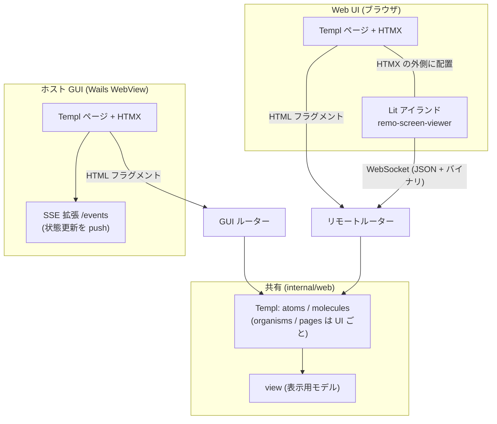
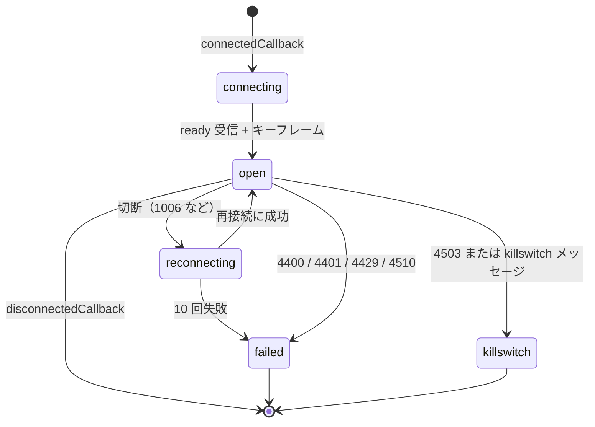
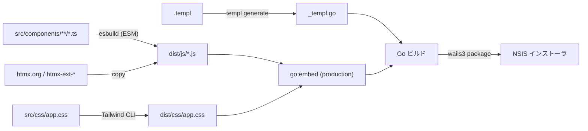

# フロントエンドアーキテクチャ設計（HALT）

全体構成は [アーキテクチャ設計](overview.md)、ルートとプロトコルは [API 仕様](../api/endpoints.md)、パッケージの責務は [コンポーネント設計](../components/overview.md) を参照。本書はフロントエンドを **HALT（HTMX + Atomic Design + Lit + Templ）** で作るための規約を定める。HALT 標準のリファレンスをベースにし、本プロジェクト固有の差分は §2 にまとめる。

## 1. 概要

### 1.1 設計思想

バックエンドファースト。判断に迷ったらサーバー側に寄せる。

- フロントエンドはアプリ（Go のプロセス）の中で動く。**SPA は作らない**
- サーバーが UI を制御し、HTMX がハイパーメディア駆動のインタラクションを担う
- リッチな操作が必要な箇所（ライブ画面）だけ Lit の Web Component で拡張する
- テンプレートは Atomic Design で構造化する
- クライアント側の状態とロジックは最小限にする。状態はサーバーが持つ
- **状態駆動レンダリング（HATEOAS）**: サーバーが現在の状態と権限に基づいて、利用可能なアクションだけを HTML に含める。ボタンが見えるなら押せる。見えないなら存在しない。`hidden` / `disabled` で隠さず、レンダリングしない。判定は Go 側で行う

### 1.2 技術スタック

| レイヤー | 技術 | 役割 |
|---------|------|------|
| サーバー | Go + Gin | ルーティングと SSR |
| JSON API | Huma | `/api/v1` の OpenAPI 3.1 生成と入出力検証（読み取り専用の小さな API のみ） |
| テンプレート | Templ | 型安全な Go の HTML テンプレート |
| インタラクション | HTMX 2.x + 拡張 `response-targets`（両 UI）、`sse`（ホスト GUI のみ） | サーバー駆動の DOM 更新 |
| リッチ UI | Lit（Web Components） | ライブ画面ビューア `<remo-screen-viewer>` のみ |
| スタイル | Tailwind CSS | Templ にはユーティリティクラス、Lit には Shadow DOM 内の `css` |
| ビルド | esbuild（TypeScript）、Tailwind CLI | 成果物を `static/dist/` に出力し、本番は `go:embed` で同梱 |
| シェル | Wails v3 | ホスト GUI の WebView。GUI ルーターを `AssetOptions.Handler` に渡す |

### 1.3 2 つの UI

同じ Templ の atoms / molecules を共有するが、**ハンドラと配信経路は共有しない**（ホスト専用の操作がリモートに露出しないことを構造で保証する）。

| UI | 利用者 | 配信経路 | 認可 | HTMX 拡張 |
|----|-------|---------|------|-----------|
| **ホスト GUI** | ホスト所有者（ホスト PC の Wails WebView） | GUI ルーター（プロセス内。ソケットなし） | プロセス内到達のみ | `response-targets`、`sse` |
| **Web UI（ビューア）** | tailnet 上の別端末のブラウザ | リモートルーター（tailnet IP） | WhoIs + 許可リスト（API 仕様 §1） | `response-targets` |



## 2. HALT 標準からの差分

| HALT 標準 | 本プロジェクト | 理由 |
|-----------|--------------|------|
| Cookie セッション + CSRF トークン（meta タグ） | **Cookie を使わない**。識別は WhoIs、CSRF 対策は Host / Origin 検証 + カスタムヘッダー `X-Puppet-Remo: 1`（`<body hx-headers>` で全 HTMX リクエストに付与） | tailnet 上の ID が真実の源で、Cookie の認証が無い（NFR-S03） |
| 単一の HTTP サーバー | **GUI ルーター（プロセス内）とリモートルーター（tailnet）に分離** | ホスト専用の操作を構造でネットワークから隔離する |
| HTMX 拡張は最小限 | ホスト GUI のみ `sse` を追加 | 承認要求・リース・接続要求を GUI へほぼリアルタイムに反映する（NFR-P06）。Web UI は WebSocket で足りる |
| Lit は編集系のリッチ UI | ライブ画面ビューア 1 つのみ | 要件が 1 画面に限られる |
| Huma で JSON API（アクションも含む） | `/api/v1/*` は読み取り専用（状態・モニター・リース）のみ。**アクションはすべて HTML を返す HTMX のルート**。MCP と WebSocket は Huma の対象外 | 状態を変更する操作の利用者は HTMX だけ。JSON の変更 API は不要 |
| 静的ファイルは Gin の `Static`、本番は `max-age=31536000` | `go:embed` した `dist/` を両ルーターで配信し、**`Cache-Control: no-cache` + `ETag`（ビルド ID）**。開発は `!production` ビルドでディスクから配信 | 単一バイナリ配布。ファイル名にハッシュを付けないため、アプリの更新後に利用者のブラウザが古い JS を長期保持する事故を避ける |
| 開発は `air` + `templ generate --watch` + `npm run dev` | **`wails3 dev`**（Go の再ビルドと再起動は Wails が行う）+ `templ generate --watch` + esbuild / Tailwind のウォッチ（§8.3） | Wails の開発サーバーとホットリロードが二重にならないようにする |
| `lib/api.ts` を共通ライブラリに含める | **初版では作らない**。Lit から HTTP を呼ぶ箇所が無いため。必要になった時点で追加する（§6.1） | 呼び出し元が無い共通コードは持たない |
| `lib/ws.ts` は JSON メッセージ前提 | **バイナリフレーム（画面）と JSON テキストフレーム（制御・入力）の両方を扱う**（§6.2） | `/ws/screen` の形式（API 仕様 §5） |

## 3. ディレクトリ構成

```
internal/web/
├── view/                     # Templ に渡す表示用モデル（domain から handler が組み立てる）
├── handler/
│   ├── gui/                  # GUI ルーター用: dashboard, requests, clients, tokens, approvals,
│   │                         #   tasks, agent, audit, settings, update, events(SSE)
│   └── remote/               # リモートルーター用: viewer, lease, clipboard, keys
├── middleware/               # hostcheck, csrfheader, whois, allowlist, bearer, killswitch
├── atoms/                    # 共有: button, input, textarea, select, checkbox, badge, spinner, toast, icon, kbd
├── molecules/                # 共有: card, modal, form_field, lease_badge, status_pill, token_reveal
├── organisms/
│   ├── gui/                  # server_status_panel, session_list, lease_panel, task_panel,
│   │                         #   killswitch_button, connection_request_list, client_list, client_detail,
│   │                         #   token_list, approval_body, audit_table, audit_filter_form, settings_form,
│   │                         #   agent_settings_form, update_panel, header, sidebar
│   └── remote/               # viewer_toolbar, lease_panel, clipboard_panel, key_menu
├── pages/
│   ├── gui/                  # dashboard, requests, clients, client_detail, approval, audit, audit_detail,
│   │                         #   settings, update, tasks, task_detail, agent
│   └── remote/               # viewer, pending (接続要求待ち), denied, error
└── layout/                   # gui, remote（<head>・ヘッダー・`hx-headers`・スクリプトの読み込み）

static/
├── package.json              # esbuild, tailwindcss, lit, htmx.org, htmx-ext-*, @open-wc/testing, @web/test-runner
├── esbuild.config.mjs
├── src/
│   ├── components/
│   │   ├── screen-viewer/    # remo-screen-viewer.ts（+ テスト）
│   │   └── lib/              # ws.ts, logger.ts
│   └── css/app.css           # Tailwind のエントリーポイント
├── dist/                     # ビルド成果物（go:embed。.gitignore）
└── e2e/                      # Playwright（§9）
```

- `atoms` / `molecules` は 2 つの UI で**共有**し、`organisms` / `pages` は UI ごとに分ける。共有側は UI 固有の URL を持たない（URL は props で受ける）
- `handler/gui` と `handler/remote` は互いを import しない。ハンドラが使えるのは `service` と `domain`（`repository` / `platform` は不可。[コンポーネント設計](../components/overview.md) §6）
- `view` は Templ 用の表示モデル（例: `LeasePanelView`、`ClientRowView`）。Templ は `domain` / `service` を import せず、`view` だけを受け取る
- `go:embed` は `static/dist` を対象にする。開発ビルド（`!production`）はディスクから読む（§8.3）

## 4. Templ（Atomic Design）

### 4.1 層

| 層 | 責務 | 例 |
|----|------|----|
| atoms | 最小の UI 要素。単一の責務 | button, input, badge, spinner, toast |
| molecules | atoms の組み合わせ | form_field, modal, lease_badge, token_reveal |
| organisms | 機能単位。HTMX の `hx-*` を持つ | lease_panel, client_list, viewer_toolbar |
| pages | ページ全体 | viewer, dashboard, clients |
| layout | `<html>`・`<head>`・共通ヘッダー・スクリプト | gui, remote |

### 4.2 コンポーネントの規約

- 単純なコンポーネント（引数 3 個以下）は直接パラメータ、複雑なものは `Props` 構造体にする
- バリエーションは `const` + 独自型で型安全にする（`ButtonVariant` など）
- 子要素は `templ.Component` のスロット（`{ children... }`）で受ける
- HTML 属性のパススルーは `Attrs templ.Attributes`
- 状態の分岐・権限の判定は**ハンドラが行い、`view` に結果として渡す**。テンプレートは `if` で描画の有無を決めるだけで、権限のロジックを持たない

### 4.3 状態駆動レンダリングの例（リースパネル）

```go
// internal/web/organisms/remote/lease_panel.templ
type LeasePanelView struct {
    State     string // "idle" | "pending_approval" | "held"
    Holder    *HolderView // 種別（mcp / web / agent）・名前・タスクの概要
    Mine      bool
    CanAcquire, CanRelease, CanRevoke bool // ハンドラが LeaseManager の状態から決める
}

templ LeasePanel(v LeasePanelView) {
    <section id="lease-panel"
             hx-get="/viewer/lease"
             hx-trigger="remo:lease-changed from:#viewer-root"
             hx-swap="outerHTML">
        @molecules.LeaseBadge(v.State, v.Holder)
        if v.CanAcquire {
            @atoms.Button("操作権を取得", atoms.ButtonPrimary, hx.Post("/viewer/lease/acquire"), hx.Target("#lease-panel"))
        }
        if v.CanRelease {
            @atoms.Button("解放", atoms.ButtonSecondary, hx.Post("/viewer/lease/release"), hx.Target("#lease-panel"))
        }
        if v.CanRevoke {
            @atoms.Button("強制剥奪", atoms.ButtonDanger, hx.Post("/viewer/lease/revoke"), hx.Target("#lease-panel"))
        }
    </section>
}
```

- リースが `idle` なら「取得」だけ、他者の保持中なら「強制剥奪」だけ、自分が保持なら「解放」だけを描画する
- キルスイッチ中は操作系を一切描画しない（そもそもリモートのページは 503 になる。ホスト GUI は解除ボタンだけを描画する）
- `hx.Post(...)` などは `hx-*` 属性を組み立てる補助関数（`atoms` に置く）。URL はハンドラ側（または view）が持つ文字列で、JS には書かない

## 5. HTMX パターン

### 5.1 ルートの 3 パターン

| パターン | 例 | `HX-Request` | 返却 | 登録先 |
|---------|----|-------------|------|--------|
| ページルート | `GET /viewer`、GUI の `GET /clients` | で分岐する | フルページ（`layout` 込み）またはフラグメント | Gin |
| アクションルート | `POST /viewer/lease/acquire`、`PATCH /clients/{id}`、`GET /viewer/lease` | しない | **常にフラグメント** | Gin |
| API ルート | `GET /api/v1/status` | しない | JSON（problem+json のエラー） | Huma |

- **Web UI・GUI のルートは常に HTML**。`HX-Request` の有無で JSON に切り替えない（JSON を返すのは `/api/v1` と MCP のみ。API 仕様 §1）
- 同じ URL をブラウザが直接開いても、HTMX が部分更新しても動く（ページルート）。ページルートの分岐の実装は次のとおり。

```go
func (h *Handler) Clients(c *gin.Context) {
    v := h.clientsView(c.Request.Context())
    if c.GetHeader("HX-Request") != "" {
        organisms.ClientList(v).Render(c.Request.Context(), c.Writer)
    } else {
        pages.Clients(v).Render(c.Request.Context(), c.Writer)
    }
}
```

- 状態変更のルートは `X-Puppet-Remo: 1` を必須にする（リモートのみ。API 仕様 §1 の連鎖の 2）。`<body hx-headers='{"X-Puppet-Remo":"1"}'>` で全リクエストに付与する
- ビューアのページには `X-Viewer-Id` も付ける: `<main id="viewer-root" hx-headers={ templ.JSONString(map[string]string{"X-Viewer-Id": id}) }>`（`hx-headers` は子孫へ継承され、親の値とマージされる）

### 5.2 OOB（Out of Band）スワップ

1 レスポンスで複数の DOM を更新する。**副作用の反映だけ**に使い、メインの更新には使わない。3 箇所以上の同時更新は設計の見直しのサインとする。

| 場面 | メイン（`hx-target`） | OOB |
|------|---------------------|-----|
| 接続要求を許可・拒否（GUI） | 要求の一覧 | ヘッダーの件数バッジ、トースト |
| トークンを失効（GUI） | トークン一覧 | トースト |
| キルスイッチを発動・解除（GUI） | ダッシュボード | ヘッダーの状態バッジ |
| 設定を保存（GUI） | フォーム | トースト |

### 5.3 SSE（ホスト GUI のみ）

ホスト GUI は `hx-ext="sse"` で `GET /events` を購読する。接続は GUI のウィンドウごとに 1 本。

```html
<body hx-ext="sse,response-targets" sse-connect="/events" hx-headers=...>
  <section id="server-status" sse-swap="server-status" hx-swap="innerHTML"></section>
  <section id="sessions"      sse-swap="sessions"      hx-swap="innerHTML"></section>
  <section id="lease"         sse-swap="lease"         hx-swap="innerHTML"></section>
  ...
</body>
```

- イベントと更新先の対応は API 仕様 §7.4。`data` は描画済みの HTML フラグメント
- `approval` のイベントは JSON で、DOM を更新しない。承認ダイアログのウィンドウは Go 側（`app` が `Bus` から購読）が開く
- 接続が切れたら HTMX の SSE 拡張が再接続する。再接続した時点で最新の状態を再取得するため、サーバーは接続直後に各イベントの現在値を 1 回送る

### 5.4 ローディングと遷移

サーバーが真実。応答を待つのが正しい姿勢で、Optimistic UI は使わない。スケルトンスクリーンも使わない。

| 場面 | 手法 |
|------|------|
| 部分更新 | `hx-indicator` で対象にスピナー atom を表示 |
| ページ遷移（ホスト GUI のサイドバーのみ） | `hx-boost` + `#main` への差し替え。グローバルに有効化しない |
| 二重送信の防止 | `hx-disabled-elt="this"` |
| 破壊的な操作（クライアント削除、トークン失効、キルスイッチ解除など） | サーバーが描画した確認のモーダル（molecule）を `hx-get` で開き、確定のボタンだけが実際のアクションを送る |

### 5.5 HTMX 拡張の採否

| 拡張 | 採否 | 理由 |
|------|------|------|
| `response-targets` | 採用（両 UI） | エラーの表示先をステータス別に分ける |
| `sse` | 採用（ホスト GUI のみ） | §5.3 |
| `hx-boost` | ホスト GUI のサイドバーのみ | §5.4 |
| `preload` | 不使用 | 不要なリクエストを増やす |
| `loading-states` | 不使用 | `hx-indicator` で足りる |

### 5.6 エラーハンドリング

サーバーが UI を制御する原則はエラーにも適用する。

| 種類 | 扱い |
|------|------|
| バリデーション（422） | フォームを入力値とエラーメッセージ付きで再描画する。クライアント側のバリデーション JS は書かない。表示先は `hx-target-422` |
| ビジネスエラー（403 / 404 / 409 など。API 仕様 §2 の `code`） | エラーのフラグメントを同じステータスで返す（`data-error-code="<code>"` を付ける）。メインの領域は現状維持にして、OOB でトーストを出す |
| 未登録デバイス（403 `device_not_registered`） | 接続要求の待機ページ（フルページ。FR-W02） |
| 認証・認可の失敗など、ミドルウェアが拒否したもの | ページルートはエラーページ、アクションルートはエラーのフラグメント |
| ネットワーク障害・想定外の 5xx | クライアント側で唯一処理する。`htmx:responseError` / `htmx:sendError` のグローバルリスナーで汎用トーストを出す |

```html
<form hx-post="/clients/01J.../tokens"
      hx-target="#token-list"
      hx-target-422="#token-form-errors"
      hx-target-5*="#global-error">
```

- `/api/v1` のエラーは problem+json（HTML にしない）。Lit のビューアは `/api/v1` を呼ばないので HTML のエラーは受けない

## 6. Lit Web Components

### 6.1 使用基準と共通ライブラリ

**Web Component を作る基準**: リアルタイム編集、複雑なドラッグ＆ドロップ、Canvas / WebGL の描画、WebSocket によるリアルタイム同期のいずれか。HTMX で足りるもの（フォーム、一覧の更新、モーダル、承認ダイアログのカウントダウンなど）には使わない。

本プロジェクトで基準に該当するのは **ライブ画面ビューアのみ**（Canvas 描画、WebSocket のバイナリフレーム、マウス・キーの捕捉）。承認ダイアログの 60 秒のカウントダウンは、サーバーが残り時間を描画した HTMX（`hx-trigger="every 1s"` での再取得）または CSS で作り、Lit にはしない。

| ライブラリ | 状態 | 内容 |
|-----------|------|------|
| `lib/ws.ts` | 初版で作る | WebSocket のラッパー（§6.4）。Lit は必ずこれ経由で WebSocket を使い、`new WebSocket()` を直接呼ばない |
| `lib/logger.ts` | 初版で作る | レベル付きのコンソールロガー。本番はエラーと警告のみ |
| `lib/api.ts` | **初版では作らない** | Lit から HTTP を呼ぶ箇所が無い（画面の更新は WebSocket と HTMX）。必要になった時点で追加する。追加する場合は、`X-Puppet-Remo` と `X-Viewer-Id` を付与し、problem+json を `ApiError` に変換し、Lit は必ずここを経由する（直接 `fetch()` を使わない） |

画面座標・キーの変換（`remo-screen-viewer` 内の入力処理）は、コンポーネントと同じディレクトリに置く（共通ライブラリには出さない）。

**命名**: カスタム要素の接頭辞は `remo`（`<remo-screen-viewer>`）。

### 6.2 `<remo-screen-viewer>`

ホスト画面をライブ表示し、操作権を持つときにマウス・キーボード入力を送る。

**属性（サーバーが注入する。クライアントは URL をハードコードしない）**

| 属性 | 型 | 内容 |
|------|----|------|
| `ws-url` | string | `ws://<host>:<port>/ws/screen?viewer_id=<ULID>`。サーバーが描画時に埋め込む |
| `readonly` | boolean | 描画時にサーバーが判定した入力の可否。操作権を持たなければ付与する |
| `monitor` / `quality` / `fps` | number | **初期値**。接続後はサーバーの `config` メッセージが正で、HTMX のツールバー（Lit の外）からの変更はサーバー経由で反映される |

```go
// Templ（remote/pages/viewer）
<main id="viewer-root" hx-headers={ templ.JSONString(map[string]string{"X-Viewer-Id": v.ViewerID}) }>
    @organisms.ViewerToolbar(v.Toolbar)   // Lit の外。モニター・品質・FPS・クリップボード・ショートカット
    @organisms.LeasePanel(v.Lease)        // Lit の外
    <remo-screen-viewer
        ws-url={ v.WSURL }
        readonly?={ !v.Lease.Mine }
        monitor={ strconv.Itoa(v.Monitor) }
        quality={ strconv.Itoa(v.Quality) }
        fps={ strconv.Itoa(v.FPS) }>
    </remo-screen-viewer>
</main>
```

**イベント（`bubbles: true, composed: true`）**

| イベント | `detail` | 用途 |
|---------|---------|------|
| `remo:lease-changed` | WebSocket の `lease` メッセージの内容 | HTMX がリースパネルを再取得する（`hx-trigger`） |
| `remo:error` | `{ code, message }` | 入力の拒否（`lease_required` / `input_blocked` など）。ページ側のハンドラがトーストを出す |

**状態とライフサイクル**



- `connectedCallback` で `lib/ws.ts` に接続し、`disconnectedCallback` で接続・タイマー・キー押下状態を破棄する
- `connecting` / `reconnecting` / `failed` / `killswitch` の表示は、Shadow DOM 内にコンポーネント自身が描画する（HTMX は Lit の領域を swap しない）。`failed`（4401 / 4510 / 再試行の上限）と `killswitch` では、ページの再読み込みを促す文言を出す
- **再接続時はリースが失われる**（サーバーは WebSocket の切断で `web` のリースを解放する。API 仕様 §4.1）。再接続後の `ready` に現在のリース状態が入っているので、コンポーネントはそれを反映し、`remo:lease-changed` を発火して HTMX にパネルを再取得させる

**描画**

- `ready` / `config` の `width` / `height` で `canvas` のサイズを決める（ストリームの座標空間 = モニターの物理ピクセル）。CSS で表示サイズに縮小する
- バイナリフレーム（API 仕様 §5.4）を受信したら、各タイルの JPEG を `createImageBitmap` で復号し、`(x, y)` に描画する。連番（`seq`）が古いフレームは捨てる。キーフレーム（bit0）は全面を置き換える。復号中に新しいフレームが来ても、描画は連番の順に行う
- `width` / `height` が変わったら `canvas` を作り直し、次のキーフレームまで描画を保留する
- 閲覧のみ（`readonly` または非保持）でも描画は行う

**入力（操作権を持つときだけ）**

「入力が有効」とは、`readonly` が付いておらず、かつ最後に受信した `lease` メッセージで `mine: true` であること。`readonly` は描画時のサーバー判定で、その後の変化は WebSocket の `lease`（サーバーが判定した `mine`）で切り替える。HTMX はコンポーネントを swap しないため、属性の再描画に頼らない。サーバー側でも入力は常に検査される（リース・InputGuard）。

| 入力 | 送るメッセージ（API 仕様 §5.3） | 備考 |
|------|------------------------------|------|
| マウス移動 | `input.mouse` `move` | 座標は `canvas` の表示座標からストリームの物理座標へ変換（`round((clientX − rect.left) × canvas.width ÷ rect.width)`）。1 アニメーションフレームにつき最大 1 回に間引く |
| ボタン・ホイール | `input.mouse` `down` / `up` / `wheel` | `contextmenu` を抑止する。`wheel` は `WheelEvent` の値を `deltaMode` に応じて px 換算して `dx` / `dy` で送る（単位の最終決定は §11） |
| キー | `input.key` `down` / `up`（`code`、`key`、`modifiers`） | キャンバスにフォーカスがあるときだけ捕捉し、`preventDefault` する。ブラウザが先取りするショートカットは送れない（専用メニュー。FR-W06）。フォーカスを失ったら押下中のキーすべてに `up` を送る |
| IME 確定 | `input.text` | `compositionend` の文字列を Unicode で送る |

### 6.3 Shadow DOM とスタイル

- Lit 側は Shadow DOM 内の `css` テンプレートリテラルで書き、外部の CSS の影響を受けない
- Templ 側は Tailwind のユーティリティクラス
- ダークモードは CSS カスタム変数で切り替える

### 6.4 `lib/ws.ts`

| 項目 | 仕様 |
|------|------|
| サブプロトコル | `puppet-remo.v1` |
| `binaryType` | `arraybuffer` |
| 受信 | テキストフレームは JSON をパースして `{ kind: "text", message }`、バイナリは `{ kind: "binary", data: ArrayBuffer }` として渡す |
| 送信 | `send(obj)`（JSON）。64 KiB を超えるメッセージは送らずエラーにする（NFR-S09） |
| 再接続 | 指数バックオフ（500 ms から、上限 15 s）で最大 10 回。**再接続しない閉じコード**: 4400 / 4401 / 4429 / 4503 / 4510。再接続した後は `onOpen` が再度呼ばれる |
| コールバック | `onOpen`、`onMessage`、`onClose(code)`、`onGiveUp` |

## 7. セキュリティとスタイル

- Cookie と認証トークンを JS から扱わない。識別はサーバーが WhoIs で行う（§2）
- `X-Puppet-Remo` と `X-Viewer-Id` は `hx-headers` が付与する。JS が組み立てない
- トークンの平文は、トークン発行のレスポンスのフラグメントに**一度だけ**表示する（`Cache-Control: no-store`。API 仕様 §7.2）。`<input readonly>` に全選択して出す。コピーボタンの実装方式（`navigator.clipboard` が WebView 上で使えるか）は実装時に確認する（§11）
- `Origin` が同一のオリジンでない状態変更は拒否される（ミドルウェア。NFR-S02）。フロントエンドは Origin を偽装できない前提で、何もしない
- Templ は既定で出力を HTML エスケープする。`templ.Raw` と `templ.JSONString` 以外の生 HTML の埋め込みは禁止する
- ライブ画面の表示は、サーバーがキャプチャから除外した自ウィンドウを含まない（承認ダイアログ・オーバーレイはビューアに写らない。NFR-S06）

## 8. ビルド

### 8.1 パイプライン



- esbuild: エントリーポイントは各 Web Component（`screen-viewer`）。出力は ES モジュール。本番は minify、開発は sourcemap
- Tailwind CLI: `src/css/app.css` → `dist/css/app.css`（minify）。Templ のファイルをコンテンツとして走査する
- HTMX: `htmx.min.js`、`response-targets`、`sse` を `dist/js/` にコピーする（HTMX の拡張は別パッケージ）
- Templ の `<script>` タグには `type="module"`（HTMX は通常のスクリプトでよい）を付ける
- 成果物は両ルーターが同じ `dist/` から配信する。`Cache-Control: no-cache` + `ETag`（ビルド ID。§2）

### 8.2 ビルドスクリプト（`static/package.json`）

```json
{
  "scripts": {
    "build": "npm run build:css && npm run build:js && npm run copy:htmx",
    "build:js": "node esbuild.config.mjs",
    "build:css": "tailwindcss -i src/css/app.css -o dist/css/app.css --minify",
    "copy:htmx": "node scripts/copy-htmx.mjs",
    "dev": "concurrently \"npm run dev:css\" \"npm run dev:js\"",
    "test": "web-test-runner \"src/**/*.test.ts\" --node-resolve"
  }
}
```

実際のコマンド名・オプションは実装時に確定する。

### 8.3 開発ワークフロー（Wails 流）

`wails3 dev` が Taskfile の `dev` タスクを実行する。Go の変更の検知・再ビルド・再起動は Wails が行うため、`air` は使わない。

| プロセス | ツール | 役割 |
|---------|-------|------|
| アプリ（Go） | `wails3 dev` | `.go` の変更で再ビルド・再起動。ホスト GUI は WebView で確認 |
| Templ 生成 | `templ generate --watch` | `.templ` の変更で `_templ.go` を再生成（Wails がそれを検知して再ビルド） |
| フロントエンド | `npm run dev`（esbuild / Tailwind のウォッチ） | `static/dist/` を更新 |

- 開発ビルド（`!production`）の静的ファイルはディスク（`static/dist`）から配信する。ブラウザの再読み込みで反映される。本番ビルド（`-tags production`。`wails3 build` / `package` が付与）は `go:embed` を使う
- **Wails の開発サーバーはフロントエンドの開発サーバーの URL（`FRONTEND_DEVSERVER_URL`）が設定されていると、ランタイム以外のリクエストをそこへ転送する**（Wails のアセットサーバーの仕様）。本アプリのホスト GUI は Gin のハンドラが配信するため、`dev` タスクはこの変数を設定しない。実機で、設定しないときに GUI ルーターのハンドラへ到達することを確認する（§11）
- `/wails/*` は Wails のランタイム用に予約する。GUI ルーターにそのパスを登録しない
- リモートの Web UI は、ホスト上のアプリが tailnet IP で配信する。開発時は、ホストのブラウザでそのアドレスを開いて確認する

## 9. テスト戦略

レイヤーごとに手法を使い分ける。HTMX のインタラクションは E2E でカバーする。CI（`windows-latest`）には対話デスクトップが無いため、E2E は偽の `platform` 実装で行う（[コンポーネント設計](../components/overview.md) §10）。

| レイヤー | 手法 | 検証内容 |
|---------|------|---------|
| Go ハンドラ（GUI・リモート） | `httptest` + HTML アサーション | ページルートの `HX-Request` 分岐（フルページに `<html>` が有る / フラグメントに無い）、アクションルートが常にフラグメント、ステータスコード、`/api/v1` が JSON、ミドルウェアの拒否（Host / Origin / ヘッダー / 未登録 / キルスイッチ）、エラーのフラグメントの `data-error-code` |
| Templ | Go のテストで `Render()` → HTML 文字列のアサーション | **状態駆動レンダリング**: 権限・状態ごとに、押せないボタンが**描画されていない**こと（`CanRevoke = false` なら強制剥奪のボタンが HTML に無い）。キルスイッチ中は操作系が無い |
| Lit（`<remo-screen-viewer>`） | `@open-wc/testing` + `@web/test-runner`（ヘッドレス Chromium） | タイルの描画（偽の WebSocket から画像を流す）、座標変換、連番の古いフレームの破棄、キーフレームでの置換、`readonly` と `lease.mine` による入力の有効・無効、フォーカスを失ったときの `up` 送信、再接続の方針（再接続しない閉じコード）、`remo:lease-changed` の発火 |
| E2E | Playwright（Chromium） | **偽の `platform` と偽の tailnet（`Listener` / `WhoIs` のテスト用実装）で起動したテスト専用のサーバー**（ビルドタグ `e2e`。本番のバイナリには含めない）に対して、リモートの Web UI を操作する: 未登録デバイスの待機ページ → ホスト側で許可 → ビューアの表示 → 操作権の取得 → クリックが偽の injector に届く → 強制剥奪 → キルスイッチ |
| GUI ルーターの E2E | `httptest` で足りる範囲に限る | Wails のウィンドウ自体（トレイ、承認ダイアログのウィンドウ、オーバーレイ）の動作は実機スモーク（コンポーネント設計 §10） |

テスト専用サーバーは tailnet の IP ではなくループバックで Listen するが、これは**テスト用のビルドタグ（`e2e`）に限る**（NFR-S01）。本番のビルドは常に tailnet の IP だけで Listen する。

**CI の手順（予定）**: `templ generate` の差分チェック → フロントエンドのビルド → `go build` / `vet` / lint / `test` → `npm test`（Lit）→ Playwright。

## 10. 要件とのトレース

| 要件 | 担当 |
|------|------|
| FR-W01〜W09（Web UI） | `pages/remote`、`organisms/remote`、`<remo-screen-viewer>`、`handler/remote` |
| FR-H02〜H11（ホスト GUI） | `pages/gui`、`organisms/gui`、`handler/gui`、SSE |
| FR-L06（強制剥奪） | `lease_panel`（リモート・GUI）の状態駆動レンダリング |
| NFR-S02・S03（Host / Origin、カスタムヘッダー） | `middleware`、`layout` の `hx-headers` |
| NFR-S06（自己保護） | ビューアに自ウィンドウが写らない（キャプチャ除外）。GUI に AI の入力が届かない（InputGuard） |
| NFR-P02（表示遅延） | ビューアの描画方式（§6.2）、`lib/ws.ts` |

## 11. 未決・実装時の確認事項

| 項目 | 内容 |
|------|------|
| ホイールの単位 | `input.mouse` の `wheel` の `dx` / `dy` を px とするかノッチとするか。決まったら API 仕様 §5.3 に追記する（ブラウザの `deltaMode` の差を吸収する） |
| Wails の dev で GUI ルーターへ到達できること | `FRONTEND_DEVSERVER_URL` を設定せず `wails3 dev` を実行したとき、カスタムの `AssetOptions.Handler` に到達するか。`/wails/*` の予約と合わせて実機で確認する |
| GUI の WebView でのクリップボード | トークンのコピーボタンに `navigator.clipboard` が使えるか。使えない場合は全選択して手動コピーを案内する |
| htmx の版と拡張 | htmx 2.x と、拡張（`htmx-ext-response-targets`、`htmx-ext-sse`）の版を実装時に固定する |
| Playwright の CI 実行環境 | `windows-latest` でヘッドレス Chromium を実行できること。重ければ Linux の別ジョブに分ける（E2E は偽の platform なので OS 非依存） |

## 改訂履歴

| 版 | 日付 | 変更内容 | 変更理由 |
|---|------|---------|---------|
| 1.0 | 2026-10-29 | 初版作成（`overview.md` の「HALT の適用」から詳細を分離） | HALT の規約を 1 か所に集約する |
