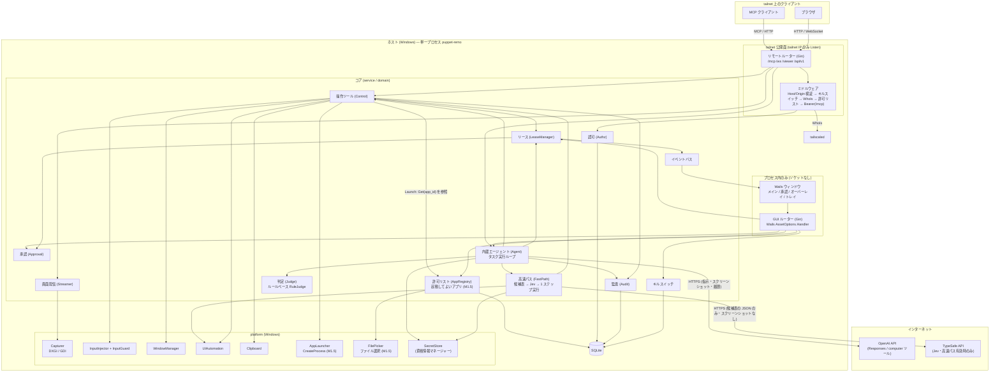
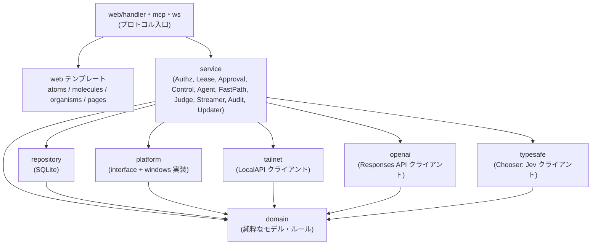
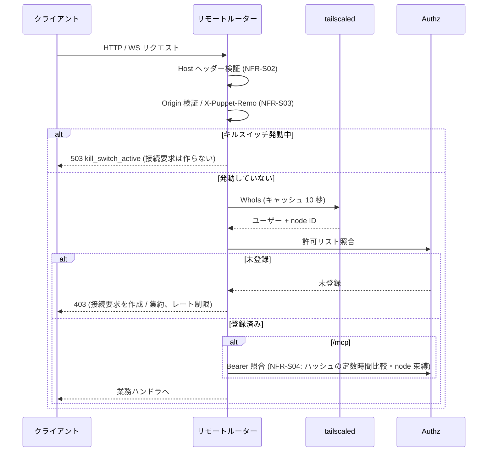
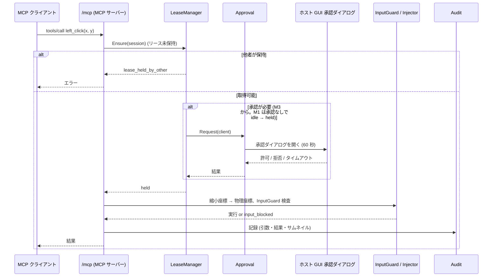
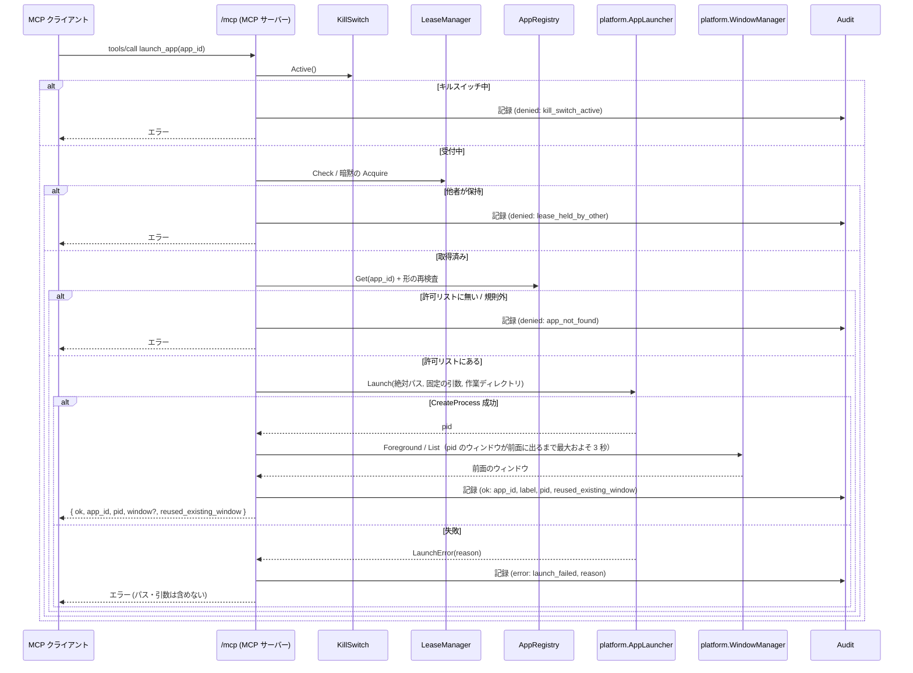
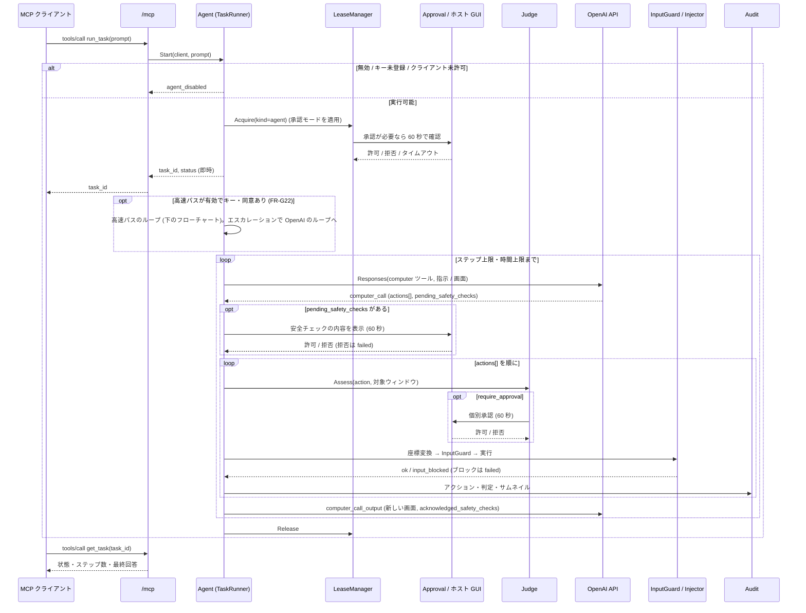
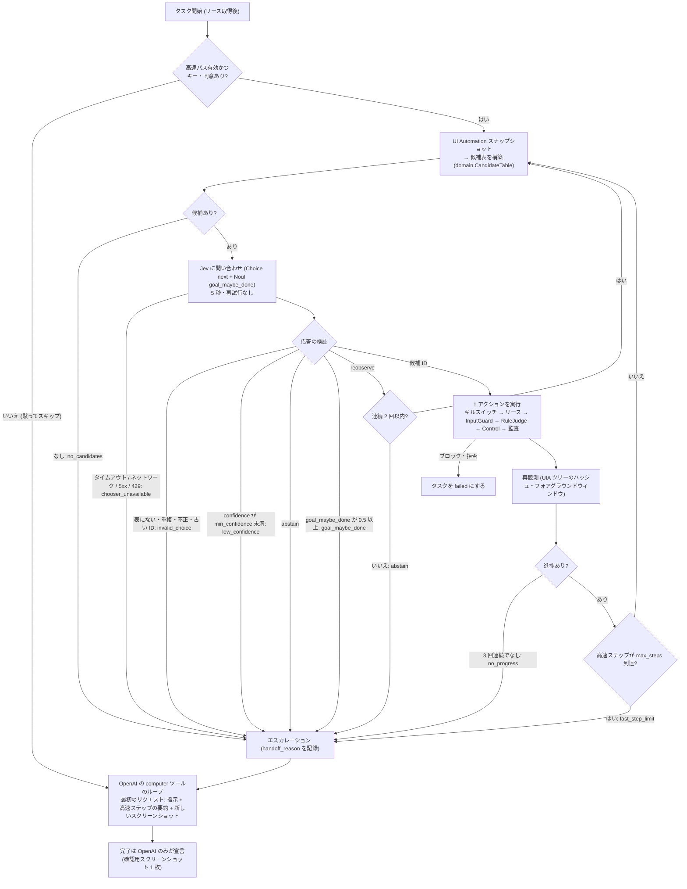
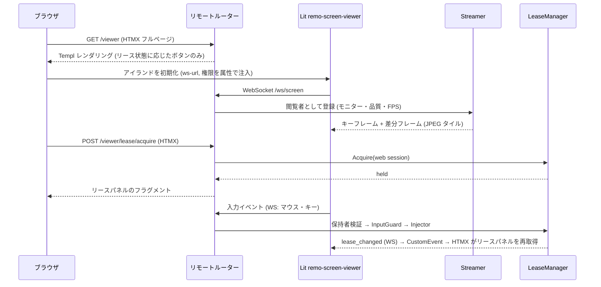
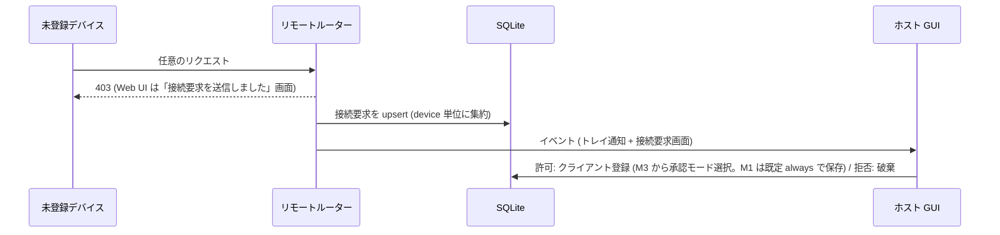
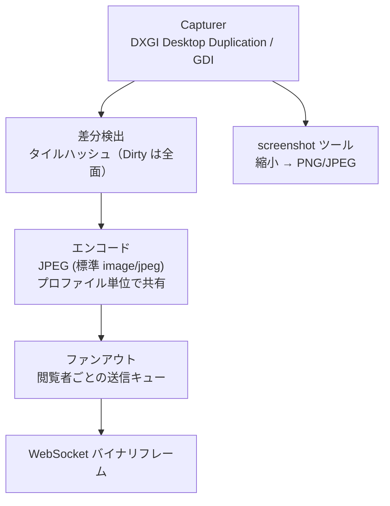

# アーキテクチャ設計

要件は [機能要件](../requirements/functional.md) と [非機能要件](../requirements/non-functional.md)、全体像は [プロジェクト概要](../overview.md) を参照。対象 OS は Windows のみ。

## 設計方針

- **単一の Go プロセス**がすべてを担う。ホスト GUI・Web UI・MCP・内蔵エージェント・画面キャプチャ・入力注入・永続化を 1 つの Wails アプリに内蔵する
- **フロントエンドは HALT（HTMX + Atomic Design + Lit + Templ）**。SPA を作らず、サーバー（Go）が UI を制御する。状態駆動レンダリング（操作可能なアクションだけを HTML に出す）を徹底する
- **ホスト GUI は外部から到達できない**。ホスト GUI（トークン発行・承認・設定・キルスイッチ解除）は Wails のアセットハンドラ経由でプロセス内だけで配信し、ソケットを開かない。tailnet に公開するルーターは別にする（セキュリティ上の最重要分離）
- **OS 依存部はインターフェースの背後に置く**（`platform` パッケージ）。コアは OS 非依存でテストできる（[NFR-O03](../requirements/non-functional.md)）
- **純 Go（cgo なし）**。画像は JPEG のみ（配信・サムネイルとも）
- tailnet への参加は**ホストの tailscaled** に任せ、本アプリは LocalAPI クライアントになる
- **内蔵エージェントは「別の操作主体」であり、安全機構は共通**。OpenAI の `computer` ツールが返すアクションを 1 件ずつ、MCP 直接・Web UI と同じ入力層（キルスイッチ → リース → InputGuard → Judge → 操作 → 監査）に通す。モデルが生成したコードをホストで実行する方式（`exec_py` 等）は採らない。ほかに承認を省略できる経路を作らない（[NFR-S15](../requirements/non-functional.md)）
- **高速パス（任意。既定は無効）は「選ぶだけ」の補助**。TypeSafe の Jev は、アプリが UI Automation から作った**不変の候補表から ID を 1 つ選ぶ**だけで、ツール名・座標・引数を生成しない。迷ったら OpenAI の `computer` ツールのループへ引き継ぎ、**タスクの完了宣言は常に OpenAI が行う**。Jev は Judge ではなく、承認を緩めることはない（[FR-G16](../requirements/functional.md)、[NFR-S17](../requirements/non-functional.md)）
- **外部通信は GitHub（更新）、OpenAI（エージェント有効時のみ）、TypeSafe（高速パス有効時のみ）の 3 つだけ**。OpenAI API キーと TypeSafe API キーは Windows 資格情報マネージャーにだけ置く。OpenAI へは常に `store: false` で送る（[FR-G24](../requirements/functional.md)、[NFR-PR03](../requirements/non-functional.md)）

## 技術選定

| 領域 | 技術 | 選定理由・備考 |
|------|------|--------------|
| 言語 | Go | Wails / Tailscale クライアントライブラリと同じ言語。cgo を使わず Windows ビルドを単純化 |
| アプリシェル | Wails v3 | トレイ常駐・複数ウィンドウ・`AssetOptions.Handler`（`http.Handler` を WebView に配信）・`IgnoreMouseEvents` / `AlwaysOnTop` / 透過背景（オーバーレイ）・`ContentProtectionEnabled`（`WDA_EXCLUDEFROMCAPTURE`）・単一インスタンスを標準で持つ。ドキュメント上は beta 表記のため `go.mod` で v3.0.0 に固定する。`wails3 dev` は常に `FRONTEND_DEVSERVER_URL=http://<host>:$WAILS_VITE_PORT`（既定 9245）を設定し、その待受を確認できないと起動に失敗する（ソースで確認済み）。デフォルトの AssetFileServer だけが開発サーバーへプロキシし、カスタム `AssetOptions.Handler`（本アプリの GUI ルーター）には適用されない。開発時は WebView の開始 URL のポートも開発サーバーのポートになる |
| HTTP ルーティング / SSR | Gin | HALT 標準 |
| JSON API | Huma | HALT 標準。Lit アイランドが使う JSON API と OpenAPI を提供 |
| テンプレート | Templ | 型安全な SSR。Atomic Design（atoms / molecules / organisms / pages / layout）で構成 |
| インタラクション | HTMX（`response-targets`。ホスト GUI の状態の更新は `GET /poll` のポーリング） | サーバー駆動の DOM 更新。CSP（`script-src 'self'` 等）下で動かすため、`allowEval=false`・`includeIndicatorStyles=false` を同梱 JS で設定し、`hx-on` と `js:` 接頭辞は使わない（[NFR-S19](../requirements/non-functional.md)、[フロントエンド設計](frontend.md)） |
| リッチ UI | Lit（Web Components） | ライブ画面ビューア 1 つだけ（`<remo-screen-viewer>`）。Canvas + WebSocket + 入力キャプチャのため |
| スタイル / ビルド | Tailwind CSS / esbuild | HALT 標準。成果物は `go:embed` で単一バイナリに同梱。`wails3 dev` が開発サーバーの待受を要求するため、`frontend:dev` タスクは esbuild の `--serve=$WAILS_VITE_PORT --servedir=static/dist`（ウォッチ付き）を起動する。これは待受の代替とライブ再ビルドのみで、GUI のページは GUI ルーターが配信する。開発時の静的ファイルはディスクから読む |
| MCP | 公式 Go SDK（`github.com/modelcontextprotocol/go-sdk` v1.8.0） | `NewStreamableHTTPHandler` で Streamable HTTP を提供。オプションの扱い（`SessionTimeout` 30 分、`MaxRequestBodyBytes` 1 MiB、`Stateless=false`、`CrossOriginProtection` 不使用など）は「ルーターの分離とリクエスト処理」を参照 |
| tailnet 連携 | `tailscale.com/client/local` | LocalAPI の `WhoIs`、`WatchIPNBus`（IP 変化監視）、`StatusWithoutPeers`。Windows では名前付きパイプ経由でライブラリが接続する |
| WebSocket | `github.com/coder/websocket` v1.8.15（ISC） | context 対応・バイナリフレーム・軽量 |
| 永続化 | SQLite（`modernc.org/sqlite`、純 Go）+ 埋め込み SQL マイグレーション | cgo なし。WAL モード（[NFR-A06](../requirements/non-functional.md)） |
| 画面キャプチャ | DXGI Desktop Duplication（主、`github.com/kirides/go-d3d` v1.0.1・MIT・cgo なし）、GDI BitBlt（フォールバック） | DXGI は画面が変化したときだけコマを返し低 CPU。失敗時は GDI へ切り替え。`go-d3d` は M2 のキャプチャスパイク（#57）で採用を確定した（実機の安定性は未確認。成立しなければ自前の syscall 実装に切り替える）。`go-d3d` は変更矩形を公開しないため `Frame.Dirty` は全面で、差分はタイルハッシュ（Streamer）が求める |
| 入力注入 | Win32 `SendInput`（`golang.org/x/sys/windows`） | cgo 不要。`type` は `KEYEVENTF_UNICODE` で日本語を直接送る |
| UI Automation | COM `IUIAutomation`（`github.com/go-ole/go-ole` v1.3.0・MIT。IUIAutomation の vtable バインディングは自前で書く） | `get_ui_tree` と高速パスの候補表（スナップショット）用 |
| 画像エンコード | 標準 `image/jpeg` | 純 Go 制約のため JPEG のみ |
| OpenAI クライアント | `github.com/openai/openai-go/v3` | v3.90.0 で確認済み: `responses.ComputerToolParam`（`{type:"computer"}`）、`ResponseComputerToolCall` の `Actions`（`click` / `double_click` / `drag` / `move` / `scroll` / `keypress` / `type` / `wait` / `screenshot`）と `PendingSafetyChecks`、`ResponseComputerToolCallOutputItem` の `AcknowledgedSafetyChecks`。旧 `computer_use_preview`（`environment: "windows"` 等を指定する旧方式）は使わない |
| API キー保管 | Windows 資格情報マネージャー（`github.com/zalando/go-keyring` v0.2.8・MIT。内部で `danieljoos/wincred` v1.2.3 を使う純 Go で、cgo 不要をソースと `go list` で確認済み） | [NFR-S14](../requirements/non-functional.md)。`platform.SecretStore` の背後に置く。OpenAI キーと TypeSafe キー（ターゲット名はそれぞれ `puppet-remo/openai:puppet-remo`・`puppet-remo/typesafe:puppet-remo`）は同じ SecretStore に置く |
| 高速パス（Jev による候補選択） | TypeSafe API（`POST https://api.typesafe.ai/v1/systemone`、モデル既定 `jev-1.13`）を `internal/typesafe` から直接呼ぶ。Go SDK は無いため標準 `net/http` | 既定は無効（`agent.fastpath.enabled`）。入力はテキストと JSON のみ（スクリーンショットは送らない）。呼び出しは 5 秒タイムアウト・再試行なし。**Jev は Judge ではない**（承認を緩めない）。Judge は既定のルールベース（自前の `RuleJudge`）のまま。品質は自前のタスクで M4 に測定して確認し、仕様書には性能の主張を書かない（[FR-G16](../requirements/functional.md)） |
| ID 生成 | `github.com/oklog/ulid/v2` v2.1.2（Apache-2.0） | タスク・監査ログなどの ID。時刻順に並ぶ |
| 検討したが採らない | Cua Driver（`trycua/cua`、Rust 製、MIT） | CLI・MCP・型付き SDK 経由で OS 操作を提供するが、本アプリは同一プロセス・純 Go で InputGuard・リース・監査を一貫して制御するため `platform` 層を自前実装する |
| 自動更新 | GitHub Releases（認証なし・HTTPS）+ minisign 形式（Ed25519）の署名検証。署名は `aead.dev/minisign`（v0.3.0）で検証する | [NFR-S10](../requirements/non-functional.md) |

## システム構成図



## レイヤー構造

HALT のレイヤードアーキテクチャを採用し、OS アダプタとプロトコル層を加える。依存は上から下への一方向のみ。逆向きの import は禁止。



| レイヤー | 責務 | 依存してよい先 |
|---------|------|--------------|
| `domain` | クライアント、リース状態機械、承認モード、座標変換、ツール引数、エラー種別、高速パスの候補（`Candidate` / `CandidateTable`: 役割クラスの対応表、除外、ID 導出、選択の検証）などの純粋なモデルとルール | なし |
| `repository` | SQLite へのアクセス（クライアント、トークン、設定、接続要求、監査ログ） | `domain` |
| `platform` | 画面キャプチャ・入力注入・ウィンドウ列挙・UI Automation（`get_ui_tree` と、候補表に使えるスナップショット: 役割 / ControlType・名前・有効・画面外・外接矩形・祖先パス）・クリップボード・資格情報（SecretStore）・オーバーレイ補助・アプリ起動（`AppLauncher`。M1.5）・ファイル選択（`FilePicker`。M1.5）のインターフェースと Windows 実装 | `domain` |
| `tailnet` | tailscaled 連携（IP 監視、WhoIs + 10 秒キャッシュ、Listener 管理） | `domain` |
| `openai` | OpenAI Responses API のクライアント（`computer` ツールの要求・応答、`store: false` 固定、タイムアウト、キーの読み出し）。`Model` インターフェースの背後に置き、テストではモックする（[NFR-O06](../requirements/non-functional.md)） | `domain` |
| `typesafe` | TypeSafe（Jev）の HTTP クライアント。境界のインターフェース `Chooser`（`Choose(ctx, ChoiceRequest) (ChoiceResult, error)`）の背後に置き、テストではモックする（[NFR-O06](../requirements/non-functional.md)） | `domain` |
| `service` | ユースケース。リース、承認、操作ツール、内蔵エージェント、高速パス（`FastPath`。Agent の内部）、Judge、画面配信、監査、更新 | `domain`、`repository`、`platform`、`tailnet`、`openai`、`typesafe` |
| `web/handler`、`mcp`、`ws` | HTTP / MCP / WebSocket の入口。`repository` と `platform` を直接使わない | `service`、`domain` |
| `web` テンプレート | Templ（Atomic Design） | `domain`（表示用データ） |

## ルーターの分離とリクエスト処理

| ルーター | 配信経路 | 提供するもの | 認可 |
|---------|---------|-------------|------|
| **GUI ルーター** | Wails `AssetOptions.Handler`（プロセス内。ソケットなし） | ホスト GUI（ダッシュボード、接続要求、クライアント管理、起動許可アプリ、ログ、承認ダイアログ、タスク、エージェント設定（API キー入力）、監査ログ、設定、更新）、`/poll`（GUI の更新。OOB）、`/events`（SSE。GUI は購読しない） | プロセス内到達のみ。ネットワークからは到達不能 |
| **リモートルーター** | tailnet IP の TCP ポート（FR-S01、既定 8765） | `/mcp`、`/viewer`（Web UI）、`/ws/screen`、`/api/v1/*`、静的ファイル | ミドルウェア連鎖（下図） |

2 つのルーターは `templ` コンポーネント（atoms / molecules）を共有できるが、ハンドラは共有しない（ホスト専用操作がリモートに露出しないことを構造で保証する）。



`/mcp` の手前には、本アプリ自前の Host / Origin 検証ミドルウェア（NFR-S02）を必ず置く。MCP Go SDK v1.8.0 の `StreamableHTTPOptions` は次のとおり扱う（ソースで確認済み）。

| オプション | 方針 | 理由 |
|-----------|------|------|
| `DisableLocalhostProtection` | SDK の保護に依存しない | ループバックのアドレスで届いたリクエストにだけ働く。tailnet IP で Listen する本アプリでは無関係で、保護は自前の Host / Origin ミドルウェア（NFR-S02）が担う |
| `CrossOriginProtection` | 使わない | 非推奨のため |
| `SessionTimeout` | 30 分（アイドル）を明示 | 既定の 0 は「セッションを閉じない」。リースのアイドル解放（FR-S04、既定 5 分）とは独立に設定する |
| `KeepAlive` | 設定しない（既定の 0 = ping しない） | SDK のサーバーからの ping は standalone の GET SSE ストリームにしか流れず、GET を張らない（POST だけの）クライアントは応答できない。有効にすると、生きたセッションとリースを、ping の 3 回連続の失敗（15 秒間隔で 45 秒。`internal/mcp` の `Config.KeepAlive` を有効にしたときの閾値）で失う。切断は `DELETE`・トランスポートの切断・`SessionTimeout`・リースのアイドル解放（FR-S04）で拾う（[NFR-A04](../requirements/non-functional.md)）。WebSocket（M2）は 15 秒 / 45 秒の keepalive を持つ |
| `EventStore` | v1 では使わない | ストリームの再開は提供せず、クライアントは再 initialize する |
| `MaxRequestBodyBytes` | 1 MiB を明示 | [NFR-S09](../requirements/non-functional.md) |
| `Stateless` | `false` | リース保持者をセッションに束縛するため |
| `JSONResponse` | 既定のまま | — |

## 主要フロー

### MCP ツール呼び出し（リース取得と承認を含む）



### アプリ起動（`launch_app`。M1.5）

起動できるのは、ホスト所有者がホスト GUI で登録した許可リストのアプリだけ。クライアントが渡せるのは `app_id` だけで、パス・引数は登録時に固定されている（FR-M19、NFR-S20）。検査の順序は `Control.Launch`（[コンポーネント設計](../components/overview.md) §5.4.1）。承認は M1.5 には無い。



許可リストの登録・変更・削除は GUI ルーターだけ（書き込みを持つ `AppRegistry` を受け取るのは GUI ルーターだけで、`Control` は読み取り専用の `AppReader` だけを受け取る。`mcp` は持たない）。ファイル選択は `AppRegistry.PickExecutable` が `platform.FilePicker` に委ねる。内蔵エージェント（M4）がアプリを起動するときも、同じ許可リストと `Control.Launch` を使う。

### 内蔵エージェントのタスク実行



- **ループの 1 ステップ**は、OpenAI ループでは Responses API の呼び出し 1 回、高速パスでは Jev 1 回 + アクション 1 件。`computer_call` が返らなくなったら最終回答として `completed` にする（[FR-G04](../requirements/functional.md)）。監査の各ステップに `route`（`fast` / `openai`）を記録する
- **画面**は MCP の `screenshot` と同じキャプチャを使い、FR-M16 の縮小規則で縮小した PNG を `detail: "original"` で送る。モデルが返す座標は縮小座標として物理座標に戻す（OpenAI のガイドが求める「縮小した場合はモデルの座標を元の座標空間に戻す」に一致）
- **すべてのアクションを 1 件ずつ検査**する。ブロック・拒否が 1 回でも起きたら、残りの `actions[]` は実行せずタスクを `failed` にする（FR-G07）
- **中断**は、実行中の OpenAI 呼び出しの `context` を取り消し、押下中のキー・ボタンを解放し、リースを解放する。キルスイッチ・リース剥奪・`cancel_task` はすべて同じ経路（FR-G10）
- **状態の永続化**: タスクは状態遷移のたびに `agent_tasks` を更新する。ステップは監査ログの行として `task_id` と連番付きで保存する（[ER](er.md)）。実行状態（ループ・リース）はメモリのみで、再起動時に `running` / `pending_approval` のタスクを `aborted` にする（NFR-A08）
- **会話の継続はステートレス**（[FR-G24](../requirements/functional.md)）: すべての Responses API 呼び出しで `store: false` を送り、`previous_response_id` は使わない。毎回、指示・これまでの出力アイテム（原文のまま）・`computer_call_output` アイテムを含む履歴を再送する。スクリーンショットは直近 `agent.keep_screenshots` 枚（既定 3、FR-S19）だけを残し、古いものはテキストのプレースホルダに置き換える。`reasoning` の暗号化コンテンツなど `include` に必要なものは、実装時のスモークテストで実 API に対して確認する
- **OpenAI 側のデータ保持**（OpenAI の文書による）: API のデータは既定で学習に使われない。不正利用監視のログは最大 30 日保持される（ゼロデータ保持の承認があれば除く）。`store` を省略または `true` にするとアプリの状態が 30 日以上保持される。画像入力は CSAM のスキャン対象で、ゼロデータ保持でも審査のために保持されうる（[NFR-PR03](../requirements/non-functional.md)）
- **スクリーンショットの大きさ**: 最大辺の既定は 1568 px（FR-S03）。16:9 では 1568×882 = 49×28 = 1,372 パッチで、文書上の拒否上限 30,000 パッチと、リサイズの予算（10,000 / 2,500 パッチ）を大きく下回る。PNG を `detail: "original"` で送る。測定に基づく調整は設定で行える

### 高速パス（Jev による 1 ステップずつの候補選択）

任意機能（`agent.fastpath.enabled`、既定 false）。タスクの先頭で、Jev が候補表から 1 件ずつ選んで実行する。**迷ったら OpenAI のループへ引き継ぎ、一度引き継いだらタスクの終了まで OpenAI のまま**（v1 では戻さない）。完了の宣言は常に OpenAI が、確認用のスクリーンショット 1 枚を見たうえで行う（[FR-G16](../requirements/functional.md)〜[FR-G23](../requirements/functional.md)）。



- **候補表**は `domain` の純粋なロジック（[FR-G17](../requirements/functional.md)）。フォアグラウンドウィンドウの UI Automation スナップショット（フォーカス移動は `list_windows`）から作る。v1 の候補は UIA 要素の `click`（外接矩形の中心をアプリが計算）と `focus_window`、メタ候補の `reobserve` / `abstain`。`type` / `key` / `scroll` は高速パスに載せず、必要になった時点で OpenAI へ引き継ぐ。候補は有効・画面内・ラベルが空でないネイティブ要素に限り、最大 24 件。ID は（役割クラス + 正規化したラベル + 操作可能な祖先パス）のハッシュで、要素の添字やランタイム ID は使わない。`agent.fastpath.excluded_labels`（FR-S18。既定: delete、send、purchase、close、削除、送信 など）に一致するラベルは除外する
- **Jev に送るもの**: 指示、ウィンドウのタイトルとプロセス名、候補（ID・役割・ラベル・有効）、直近 5 件の高速ステップの短い文。**送らないもの**: スクリーンショット、要素の値、クリップボード、入力テキストの本文、API キー（[FR-G18](../requirements/functional.md)、[NFR-PR04](../requirements/non-functional.md)）。Jev の回答は構築時の不変の表と照合し、一致しなければ採らない
- **共通の入力層**: 高速パスの 1 アクションも、MCP・OpenAI の経路と同じ層を通る。Judge は Jev の回答を見ず、RuleJudge が判定する。高速ステップも全体の `agent.max_steps`（50）と `agent.max_duration_sec`（600）に数える
- **縮退**（[FR-G21](../requirements/functional.md)）: 高速パスの失敗でタスクは失敗にならない。TypeSafe 呼び出しの失敗（タイムアウト・ネットワーク・5xx・429）は、そのステップを `chooser_unavailable` で OpenAI へ引き継ぐ（引き継いだタスクは最後まで OpenAI で続ける）。HTTP 401 は GUI に通知し、`agent.fastpath.enabled` を false にする（キー無効）
- **引き継ぎ理由**（`handoff_reason`）: `abstain` / `low_confidence` / `no_candidates` / `invalid_choice` / `no_progress` / `goal_maybe_done` / `fast_step_limit` / `chooser_unavailable`。引き継ぎが起きなかった場合（高速パス無効、または高速パス中にキャンセル・失敗で終了）は NULL。`agent_tasks` に `fast_steps` / `openai_steps` / `handoff_reason` を持ち、`get_task` と監査（ステップの `route`、候補数、除外数、選択 ID、confidence、goal_maybe_done の確率）に出す。入力テキストと要素の値は記録しない（[FR-G23](../requirements/functional.md)、[ER](er.md)）
- **評価**: 高速パスの品質の根拠は、Cua の小規模な自己申告テスト（8/9 対 9/9、判断の中央値が 13.6 倍速い）しかない。M4 で、固定したタスク集合を使って自前で測定し、結果が出るまで仕様に性能の主張を書かない。Jev のプロンプトインジェクション検知は一切あてにしない。敵対的なコンテンツへの弱さ（Jev の jaggedness の文書）は、固定の候補表、RuleJudge、InputGuard、ステップ上限で緩和する

### Web UI のライブ表示と手動操作



### 接続要求（未登録デバイス）



### キルスイッチ

発動経路（トレイ、ダッシュボード、グローバルホットキー）はいずれも `KillSwitch.Trigger()` を呼ぶ。処理順は、(1) 状態を `active` に永続化、(2) 全リース剥奪、(3) 実行中のエージェントのタスクを中断（OpenAI・TypeSafe 呼び出しの取り消し、押下中入力の解放）、(4) リモートルーターのリクエストを 503 `kill_switch_active` で拒否、(5) 全 MCP・WebSocket セッションを切断、(6) オーバーレイ消去、(7) 監査記録。順序は NFR-P05（1 秒以内）を満たすため同期で行い、永続化は先頭に置いて再起動後も維持する（[NFR-S07](../requirements/non-functional.md)）。

## 運用ログと監査ログ

この製品には 2 種類の「ログ」があり、目的・置き場所・閲覧の画面が違う。

| | アプリの運用ログ（本節で言う「アプリログ」） | 監査ログ |
|---|---|---|
| 目的 | アプリの動作の記録。不具合の調査・動作の確認。成功・失敗・エラーをレベル（DEBUG・INFO・WARN・ERROR）つきで残す | 業務記録。誰が（操作主体）・いつ・何を・どうなったかを、あとから検証できるように残す（FR-AU01） |
| 置き場所 | ファイル `%LOCALAPPDATA%\puppet-remo\logs\puppet-remo.log`（slog の JSON。10 MiB × 5 世代でローテーション。NFR-O01） | DB の `audit_logs`（`repository.Audit`。保持期間あり。[ER](er.md)） |
| 書く側 | 各コンポーネントが `slog` で書く（起動・tailscaled の状態・待ち受け・接続要求・認証の失敗・リース・ツールの実行・キルスイッチ・設定の反映など） | `Audit.Record`（`Control`・`LeaseManager`・`KillSwitch`・`Authz`・`HostAdmin` など。非同期のキュー） |
| 秘密 | トークンの平文・ハッシュ・API キーなどは出さない（NFR-S13。`slog` の `ReplaceAttr` が安全網） | 同じ（FR-AU03。`type` の本文・クリップボードも既定で記録しない） |
| 閲覧 | ホスト GUI の「ログ」画面（`/logs`。FR-H13。**M1**）。ログファイルを直接開いてもよい | ホスト GUI の監査ログ画面（FR-AU01。**M3**。M1 は記録だけで、閲覧 UI はない） |

運用ログの画面は、監査ログの代わりにはならない。たとえば認証の失敗は、運用ログには「理由・デバイス・IP」だけを 1 行（WARN）で残し、監査ログには `auth.bearer_failed` のイベントとして構造化して残す。運用ログは、ファイルが 10 MiB を超えて古い世代が消えると見えなくなる（5 世代まで）。長く残す必要のある記録は監査ログ（保持期間の設定による）に置く。

### アプリログの読み方（ログ画面）

「ログ」画面（`service.AppLog` の実装 `app.LogReader`）は、ログファイルを**末尾から一定のブロック（64 KiB）ずつ逆向きに読み**、1 ページ（50 件）に必要な分だけ取り出す。ファイル全体をメモリに載せない。今のファイルを読み切っても足りなければ、ローテーションされた古いファイル（`puppet-remo-<時刻>.log`。名前の時刻の降順）へ続く。選んだ理由:

- **メモリ上のリングバッファ（slog のハンドラから複製）にしなかった**: 再起動で消える。ファイルに残っているログ（起動直後の失敗など）が見えなくなる。ファイルが唯一の真実の源であり続けるほうが、画面とファイルが食い違わない
- **別の保存先（DB など）に二重に書かなかった**: 書き込みの経路が増え、ログを書く処理がログの保存の失敗に影響される
- 逆向きの読みは、書き込み中の途中の行・JSON でない行・壊れた行・1 MiB を超える行を読み飛ばすだけで、ローテーション（`lumberjack` の名前の付け替え）にも追従する（1 回の読み出しごとにファイルの一覧を取り直す）
- 絞り込み（レベル）は読みながら行う。深いページや、まれなレベル（ERROR のみ）では多くを読むが、読むのは保持するファイル（最大 50 MiB）までで、ページは 100 までに丸める。読み出しはファイルを共有つきで開く（Windows は `FILE_SHARE_READ | FILE_SHARE_WRITE | FILE_SHARE_DELETE`。`internal/app/logfile_windows.go`）。Go の `os.Open` は `FILE_SHARE_DELETE` を付けず、読んでいる間（数ミリ秒）にちょうど `lumberjack` のローテーション（名前の付け替え）が起きると共有違反で失敗し、そのときの 1 行が書けない（#53）ため、読み出しだけ `CreateFile` で開く。実機の確認は [smoke-windows.md](../operations/smoke-windows.md) の §4.14 の F6（未確認）
- 画面に出すときは、値を 500 文字までに切り詰め、1 件あたり 24 個までの属性だけを出す。値は書き込み時の伏せ字（`redactAttr`）のうえに、読み出し時にも同じ規則（`redactString`）で秘密を伏せる

画面のレベルの絞り込みは「すべて」「WARN 以上」「ERROR のみ」。「すべて」はファイルにあるものをそのまま出すので、環境変数 `PUPPET_REMO_LOG_LEVEL=debug` で起動したときの DEBUG も含む（既定の INFO では DEBUG は書かれない）。ツールの成功のうち読み取りだけのもの（スクリーンショットの取得など。頻繁に呼ばれる）は DEBUG にして、既定のログを埋めない。


## 画面配信パイプライン



- キャプチャ・差分検出は**モニターごとに 1 つの goroutine**。閲覧者がゼロなら停止する（FR-W09、NFR-P04）
- 差分は 64×64 px のタイル単位。変化したタイルを矩形にまとめて JPEG で送る。接続直後と一定間隔（既定 5 秒）で全面キーフレームを送る
- エンコードは (モニター, 品質, FPS) のプロファイル単位に 1 回だけ行い、同じプロファイルの閲覧者で共有する（NFR-P07）。閲覧者ごとの送信キューが詰まったら古いフレームを捨てる（遅延の累積を防ぐ）
- DXGI は `ACCESS_LOST`（ロック画面・UAC・解像度変更など）で再初期化する（200 ms 間隔で最大 5 回）。復旧できなければ `desktop_unavailable` を `errs` に流し、GDI にフォールバックする。DXGI は画面が変化したときだけコマを返し、GDI は `fps` の間隔で撮って前のコマと内容を比べる
- `screenshot` ツールは配信とは独立に 1 回だけ撮り、縮小（FR-M16 の縮小率）して返す

## 入力注入と自己保護

- **座標変換**: 縮小座標 → `round(x ÷ 縮小率)` → モニター原点を加算 → 仮想デスクトップ座標。`SendInput` は `MOUSEEVENTF_ABSOLUTE | MOUSEEVENTF_VIRTUALDESK` で 0〜65535 に正規化して送る。プロセスは Per-Monitor DPI Aware V2 のマニフェストを持つ
- **`InputGuard`**（すべての注入の前に必ず通る。[NFR-S06](../requirements/non-functional.md)）:
  1. 注入先の座標にあるトップレベルウィンドウ、またはフォアグラウンドウィンドウが**自プロセスのもの**ならブロック（`input_blocked`）。ただしクリック透過のオーバーレイ（自プロセスで `WS_EX_TRANSPARENT` かつ `WS_EX_LAYERED`）は例外で、入力は下のウィンドウへ通るため拒否しない。全モニターを覆うオーバーレイの下にある承認ダイアログなどが判定から漏れないよう、座標の問い合わせ（`WindowManager.At`）はオーバーレイを飛ばして下の実ウィンドウを返す
  2. 管理者権限ウィンドウ（UIPI）が対象なら `input_blocked`
  3. キルスイッチ中・リース非保持なら拒否
  4. エージェントの入力は、上記に加えて Judge（次節）を通す。InputGuard はすべての保持者種別（`mcp` / `web` / `agent`）に同じ規則を適用する
- **自ウィンドウのキャプチャ除外**: ホスト GUI・承認ダイアログ・オーバーレイは Wails の `ContentProtectionEnabled`（`WDA_EXCLUDEFROMCAPTURE`）を有効にする。AI のスクリーンショットにも Web UI のライブ画面にも写らない。AI が入力の止まる場所を避けられるよう、`own_window` のエラー・`screenshot` の `own_windows`・`list_windows` の `blocked`・`instructions` で範囲（縮小座標の矩形）と印を伝える（画像への描画はしない。FR-M20）
- **オーバーレイ**（[FR-H07](../requirements/functional.md)）: 全モニターに、モニターごとに 1 ウィンドウ（物理座標の原点・大きさに合わせる）。枠なし・透過背景・最前面・`IgnoreMouseEvents`（クリック透過。`WS_EX_TRANSPARENT` + `WS_EX_LAYERED`）・タスクバー非表示・フォーカスを奪わない（`WS_EX_NOACTIVATE`）・キャプチャ除外。リースの保持（`held`）で表示・保持者の変更でラベル更新・解放（アイドル解放・強制剥奪・キルスイッチ・切断を含む）と承認待ちで消去する。中身は GUI ルーターの `GET /overlay`（枠と「操作中: <クライアント名>（種別）」だけ）。出している間のモニター構成の変化は追わず、次に出すときに反映する
- **承認ダイアログ**: 承認要求ごとに専用の Wails ウィンドウを開く（Go 側でウィンドウ生成）。内容は GUI ルーターが Templ で描画し、「許可 / 拒否」は HTMX の `hx-post` で GUI ルーターへ送る。操作は入力ガードにより AI から押せない

## Judge（判定インターフェース）

エージェントの各アクションの直前に、実行してよいかを助言させるインターフェース。

```go
type Verdict int // Allow < RequireApproval < Deny の順に厳しい

type Judge interface {
    Assess(ctx context.Context, a Action, w WindowInfo) (Verdict, error)
}
```

- **合成**: 複数の Judge は `Chain` で束ね、**最も厳しい判定**を採る。したがって後から差し込む Judge が `Allow` を返しても、他の判定を緩めることはできない（引き上げ専用）
- **fail-closed**: `error`・タイムアウト・低 confidence は `RequireApproval` に変換する。外部に到達できないときに「許可」にしない
- **既定の `RuleJudge`**: 対象ウィンドウ（InputGuard が解決したウィンドウ）のプロセス名が `agent.deny_processes` に一致すれば `Deny`、`agent.approve_processes` に一致すれば `RequireApproval`、それ以外は `Allow`（FR-G12、FR-S13）
- **Jev は Judge ではない**: Jev（TypeSafe）は高速パス（「主要フロー」の「高速パス」節）の**候補選択**にだけ使い、アクションの可否は判定しない。Judge は既定の `RuleJudge`（ルールベース）のまま。Jev の回答は Judge を通らずに実行されることはなく、Jev が承認を減らすこともない（[NFR-S17](../requirements/non-functional.md)）。外部モデルを Judge として足す案は採らない

## HALT の適用

フロントエンドは HALT で構成する。規約・ディレクトリ・HTMX パターン・Lit コンポーネント・ビルド・テストの詳細は [フロントエンド設計](frontend.md) に集約する。ここでは全体構成との接点だけを示す。

- 画面の大半（ホスト GUI、ビューアの周辺 UI、リースパネル）は **Templ + HTMX** で描画する。ページ・アクションルートは常に HTML を返し、JSON は `/api/v1` と MCP だけが返す（[API 仕様](../api/endpoints.md) §1）
- **Lit は `<remo-screen-viewer>` のみ**（Canvas 描画、WebSocket のバイナリフレーム、入力の捕捉）
- ホスト GUI は GUI ルーター（プロセス内）、Web UI はリモートルーター（tailnet）で配信し、ハンドラを共有しない

### HALT 標準からの差分（要約）

| 項目 | 本プロジェクト |
|------|--------------|
| 認証・CSRF | Cookie を使わない。WhoIs + Host / Origin 検証 + `X-Puppet-Remo` |
| サーバー | GUI ルーターとリモートルーターに分離 |
| HTMX 拡張 | `response-targets`（両 UI）。ホスト GUI の更新は `GET /poll`（Wails の AssetServer が SSE をバッファするため） |
| JSON API | `/api/v1` は読み取り専用。アクションは HTML を返す HTMX ルート |
| 開発 | `wails3 dev` + `templ generate --watch` + esbuild / Tailwind のウォッチ（`air` は使わない）。`wails3 dev` が開発サーバーの待受を要求するため、esbuild の `--serve` を待受として起動する |
| CSP | すべての HTML レスポンスに、ミドルウェアから `Content-Security-Policy: default-src 'self'; script-src 'self'; style-src 'self'; img-src 'self' data: blob:; connect-src 'self'; object-src 'none'; base-uri 'none'; form-action 'self'; frame-ancestors 'none'` を送る（meta タグは使わない）。インラインのスクリプト・スタイル・イベント属性は置かない。両ルーターで共有するテンプレートに適用する（[NFR-S19](../requirements/non-functional.md)） |
| 静的ファイル | `Cache-Control: no-cache` + `ETag`（ビルド ID） |
| テスト | Go `httptest`、Templ のレンダリング、Lit は `@open-wc/testing`、E2E は Playwright（偽の platform。Lit と Playwright は M2 で CI に足す） |

全項目と理由は [フロントエンド設計](frontend.md) §2 を参照。

## ディレクトリ構成

最終形（M4 完了時）の構成。M1 で存在するものと差分は「[M1 実装での差分](#m1-実装での差分)」を参照。

```
puppet-remo/
├── cmd/puppet-remo/              # エントリーポイント (Wails アプリ起動、DI)
├── internal/
│   ├── domain/                   # クライアント、リース、承認、座標、エラー、高速パスの候補 (Candidate / CandidateTable)
│   ├── repository/               # SQLite (clients, tokens, settings, ...)
│   │   └── migrations/           # 埋め込み SQL マイグレーション
│   ├── platform/                 # interface 定義
│   │   └── windows/              # capture(DXGI/GDI), input, window, uia, clipboard, secret(資格情報), launcher(CreateProcess), filepicker
│   ├── tailnet/                  # LocalAPI クライアント、Watcher、Listener 管理
│   ├── openai/                   # Responses API クライアント (Model インターフェース + 実装、モック)
│   ├── typesafe/                 # TypeSafe (Jev) HTTP クライアント (Chooser インターフェース + 実装、モック)
│   ├── service/                  # authz, lease, approval, control, agent (fastpath を含む), judge, streamer, audit, updater
│   ├── mcp/                      # MCP サーバー (ツール定義と service 呼び出し)
│   ├── ws/                       # WebSocket プロトコル (画面フレーム・入力)
│   ├── router/                   # gui.go, remote.go
│   ├── web/                      # 詳細は frontend.md §3
│   │   ├── view/ handler/{gui,remote}/ middleware/
│   │   ├── atoms/ molecules/ organisms/{gui,remote}/ pages/{gui,remote}/ layout/
│   └── app/                      # Wails ウィンドウ・トレイ・オーバーレイ・ホットキー
├── static/
│   ├── package.json              # esbuild, tailwind, lit, htmx, テスト
│   ├── src/
│   │   ├── components/
│   │   │   ├── screen-viewer/    # <remo-screen-viewer>
│   │   │   └── lib/              # ws.ts, logger.ts
│   │   └── css/
│   ├── dist/                     # ビルド成果物 (go:embed)
│   └── e2e/                      # Playwright
├── build/                        # Wails パッケージング (NSIS、マニフェスト)
├── docs/
└── Taskfile.yml                  # templ / tailwind / esbuild (dev は --serve) / wails3 package
```

## ビルドと配布

| 段階 | 内容 |
|------|------|
| コード生成 | `templ generate` |
| フロントエンド | Tailwind CSS ビルド、esbuild（Lit コンポーネント）、`htmx.min.js` のコピー → `static/dist/` |
| Go ビルド | 純 Go（cgo なし）。Per-Monitor DPI Aware V2 のマニフェストを埋め込む |
| パッケージ | `wails3 package` による NSIS インストーラ（WebView2 ブートストラップ込み） |
| 配布・更新 | GitHub Releases（リポジトリは公開が前提）。インストーラ・`.sha256`・署名ファイル `.minisig`（minisign 形式。Ed25519）を公開し、アプリが埋め込みの公開鍵で署名検証して適用する。署名の trusted comment に版とファイル名を入れ、Release との不一致（付け替え）を拒否する。署名の秘密鍵は GitHub Actions の Secret（`MINISIGN_SECRET_KEY`）にだけ置き、Secret が無いときは署名を省いて公開する（アプリは署名のないリリースを適用しない）。チャネルは正式版（既定）とナイトリー。確認は起動の 1 分後と 6 時間ごと。詳細は [リリース運用](../operations/release.md) |
| CI | GitHub Actions。すべてのジョブをセルフホストの Linux ランナー（`[self-hosted, Linux, X64]`）で実行する。templ 生成の差分チェック、フロントエンドのビルド、build / vet / lint / go test を行い、Windows 向けのコードは `GOOS=windows` の `go build` / `go vet`（Linux 上のクロスコンパイル）だけで検査する。Lit のテストと Playwright の E2E は M2 で足す（偽の platform と偽の tailnet により OS に依存しない。実機のスモークテストは手動）（[フロントエンド設計](frontend.md) §9） |
| 署名 | v1 では Authenticode 署名をしない（個人利用）。README に SmartScreen の回避手順を書く。更新の完全性は Ed25519 署名検証（NFR-S10）で担保する（[NFR-O07](../requirements/non-functional.md)） |

## M1 実装での差分

M1 の実装が本書の記述と異なる点、本書にあって M1 では存在しない点。コンポーネントの型・シグネチャの差分は [コンポーネント設計](../components/overview.md) §13、ルート・エラーの形の差分は [API 仕様](../api/endpoints.md) §7.5、フロントエンドの差分は [フロントエンド設計](frontend.md) §12 に置く。

### 技術選定・依存ライブラリ

| 項目 | 設計 | M1 の実装 |
|------|------|----------|
| Huma（JSON API） | `/api/v1` を提供 | 使わない（`go.mod` に無い）。`/api/v1` は M2 以降 |
| WebSocket | `github.com/coder/websocket` v1.8.15 | M2（#61）で直接依存にした（`internal/ws`。v1.8.14 の間接依存だったものを v1.8.15 に上げた） |
| 資格情報マネージャー | `github.com/zalando/go-keyring` v0.2.8 | M4（#19）で依存に加え、`platform/windows` の `SecretStore` の背後に置いた（M1 は `platform.SecretStore` の宣言・偽実装・契約テストだけだった）。呼び出しは M4 の後続の変更で足す |
| DXGI キャプチャ | `kirides/go-d3d`（M2 のスパイク） | M2（#57）で直接依存に追加し採用を確定した（`internal/platform/windows` の `dxgi_windows.go`）。`Capturer.Watch` は DXGI を主、GDI をフォールバックとして実装した。変更矩形は使わず `Frame.Dirty` は全面 |
| OpenAI / TypeSafe クライアント | `openai-go/v3`、`net/http` | `internal/openai`（`openai-go/v3` v3.90.0）・`internal/typesafe`（`net/http`）を M4（#19）で追加した。`app` は import せず、組み立ては `service`（`NewAgentModel`・`NewAgentChooser`）が持つ |
| MCP | go-sdk v1.8.0 | 同じ。`SessionTimeout` 30 分・`MaxRequestBodyBytes` 1 MiB・`Stateless=false`・`CrossOriginProtection` 不使用に加え、`KeepAlive` は既定の 0（ping しない。NFR-A04） |
| ULID | `oklog/ulid/v2` | 同じ（`internal/app` の `ULIDGen`）。`domain.IDGen` として注入する |
| ホスト GUI の更新 | `GET /poll`（本書の技術選定のとおり） | 同じ。`GET /events`（SSE）と `htmx-ext-sse` の同梱は残すが、M1 の GUI は読み込まない（未使用） |
| 自動更新（M3・#74） | 署名検証付きの更新（`service.Updater`・`platform.Installer`。GitHub Releases の認証なしの取得・minisign の署名検証・チャネル・ダウングレード拒否・適用の可否） | M3 で実装した。公開鍵はプレースホルダ（`internal/service/updater_pubkey.pub`）のままで、オーナーが鍵を生成して置き換えるまで、確認だけ行い適用しない（fail closed）。リリース CI の署名は Secret があるときだけ（[リリース運用](../operations/release.md)「署名」）。`internal/app` が `Updater` を組み立て、`Shutdown` で止める（Wails の終了への結線は `wails_windows.go`） |
| ホスト GUI のウィンドウ | `ContentProtectionEnabled`（キャプチャ除外）を承認ダイアログ・オーバーレイ・ホスト GUI に付ける | 同じ（承認ダイアログは #68、オーバーレイは #69 で付けた） |

### ディレクトリ構成

本書の「ディレクトリ構成」は最終形で、M1 で存在するのは次のとおり（差分）。

| 項目 | M1 の実装 |
|------|----------|
| `internal/openai`・`internal/typesafe`・`internal/ws` | 無い（M4・M4・M2 で作る） |
| `internal/web` | `handler/gui` と `handler/remote`（M2）。`organisms/`・`pages/` は `gui/` / `remote/` のサブディレクトリに分けず平らに置く。`view/`（表示用モデル）、`middleware/`（`csp`・`hostcheck`・`csrfheader`・`killswitch`・`whois`・`allowlist`・`bearer`）、`webtest/`（ハンドラのテスト補助）、`handler/gui/guitest/`・`handler/remote/remotetest/`（偽の service）を持つ |
| `internal/platform` | `platformtest/`（偽実装と契約テスト）を持つ。`windows/` の `secret`（資格情報）は無い |
| `internal/router` | `gui.go`・`remote.go` と `internal/guidemo`（GUI のデモサーバー。`task gui:demo`） |
| `internal/app` | `app.go`・`lifecycle.go`・`shell.go`（トレイ・ダッシュボード・終了）・`hotkey.go`・`listen.go`・`logging.go`・`ids.go`・`wails_windows.go`・`wails_overlay_windows.go`。承認ダイアログ（`approval_dialogs.go`。M3・#68）とオーバーレイ（`overlay.go`。M3・#69）の購読側は OS に依存せず、Wails の実装だけが Windows 専用 |
| `cmd/puppet-remo` | `main.go`（Windows）と `main_other.go`（Windows 以外はエラー終了するスタブ。`go build ./...` を Linux の CI で通すため） |
| `static/` | `src/app/`（`htmx-config.ts`・`app.ts`）、`src/css/`、`esbuild.config.mjs`、`scripts/`（`clean.mjs`・`copy-htmx.mjs`）、Go 側の `handler.go`・`disk.go`・`embed_production.go`（配信と ETag）。`src/components/`（`screen-viewer`・`lib`。M2 の #63）。`e2e/` は作らない |
| 追加のファイル | `scripts/check-imports.sh`（レイヤー間の import 規則の検査）、`.github/workflows/ci.yml`、`.golangci.yml`、`README.md`、`docs/environment/setup.md`（環境構築）、`docs/operations/smoke-windows.md`（Windows 実機スモークの手順）、`docs/screenshots/m1/`（ホスト GUI のスクリーンショット） |
| Taskfile のタスク | M1 で使うのは `build`・`vet`・`test`・`lint`・`check:imports`・`templ:generate` / `templ:check`・`frontend:*`（開発は `frontend:dev`）・`gui:demo`・`build:production`・`package`・`dev`・`ci` など |

### 依存の向き

`web` と `mcp` は `repository`・`platform`・`tailnet` を import しない（本書は `repository` と `platform` だけを禁じるが、M1 は `tailnet` も禁じる）。`web/middleware` は `service` の `Authenticator`・`Identity`（`tailnet.Identity` の別名）・`ResolveIdentity` を使う。`platform.Power` は `app.Config` の必須項目。詳細と `scripts/check-imports.sh` の許可表はコンポーネント設計 §13.1。

### キルスイッチ（「キルスイッチ」の節）

M1 の `Trigger` は、先にメモリ上の状態を `active` にして（以後のリクエストを 503 にする）から、(1) 永続化、(2) 全リース剥奪、(3) 登録済みクローザーの**並行**実行（MCP セッションの切断・押下中の入力の解放）、監査の順で行う。WebSocket の切断（クローザー `web-sessions`。閉じコード 4503）は M2 で足した。オーバーレイの消去は、`Trigger` が `Bus` に出す `lease`（全リース剥奪の通知）を `app` が受けて行う（M3・#69）。エージェントの中断は M4 で足す。永続化とクローザーはそれぞれ自分の期限（既定 1 秒）を持つため、永続化が遅いと `Trigger` が戻るまで最大 2 × 期限かかり、NFR-P05 の 1 秒を超えうる（**既知の制限**。受付停止はメモリ上の状態で直ちに効くが、セッション切断の完了は遅れうる。詳細はコンポーネント設計 §13.5）。

### 受付と入力（「ルーターの分離とリクエスト処理」「入力注入と自己保護」の節）

| 項目 | M1 の実装 |
|------|----------|
| リモートルーター | `/mcp`・`GET /ws/screen`・Web UI（`/`・`/viewer*`）・`GET /static/*`（それ以外は 404）。未登録デバイスのブラウザへ返すページは、接続要求の状態（待機・拒否・失効）を読み取り専用で引いて選ぶ（FR-W02。ステータスと FR-A06 の挙動は変えない）。tailnet 向けの `http.Server` は `ReadHeaderTimeout` 10 秒・`IdleTimeout` 120 秒・`MaxHeaderBytes` 64 KiB（`WriteTimeout` なし） |
| WhoIs | LocalAPI の 1 回の呼び出しは 5 秒で打ち切る（失敗は `whois_failed`。fail closed）。結果は IP 単位に最大 10 秒キャッシュ |
| 接続要求 | 期限切れの `pending` は一覧に出ず、許可もできない。同じデバイスの `pending` を 5 秒以内に更新済みなら DB に書かない。登録済みデバイスのログイン名が変わった要求を許可すると、古いクライアントを置き換える（`client.replace` を監査に記録。トークンは CASCADE で削除、セッションは切断、リースは解放）。古いクライアントの切断は、他の許可を止めないようロックの外で行う |
| 監査 | クライアントの行がすでに無いときの `client_id` は NULL で保存する（ラベルは残る）。`Control` を通らない MCP ツール（`get_screen_info`・`screenshot` など）は `mcp` のツール登録が記録する |
| 入力の実行 | `Control` は入力（マウス・キーボード）を 1 度に 1 つへ直列化する。`get_ui_tree` は `max_depth` ≤ 20・`max_nodes` ≤ 5000 |
| UI Automation のワーカー | 専用スレッドへの呼び出しは `ctx` を受け、取り消されたらスレッドの処理の終了を待たずに戻る |

## 改訂履歴

| 版 | 日付 | 変更内容 | 変更理由 |
|---|------|---------|---------|
| 1.0 | 2026-10-28 | 初版作成 | — |
| 1.1 | 2026-10-29 | 内蔵エージェント（OpenAI `computer` ツール）を追加: 構成図・レイヤー（`openai`、`Agent`、`Judge`、`SecretStore`）、タスク実行フロー、キルスイッチの手順、Judge インターフェース、技術選定（openai-go v3、資格情報）、MCP SDK の保護に関する注記。MCP フローのツール名を `left_click` に更新 | ホスト内蔵エージェントを主役にする決定 |
| 1.2 | 2026-10-29 | 「HALT の適用」を [フロントエンド設計](frontend.md) へ分離し、差分の要約とリンクに縮小。ディレクトリ構成を更新（`lib/api.ts` を初版から除外、`e2e/` 追加）、CI にフロントエンドのテストを追加 | HALT の規約を 1 か所に集約 |
| 1.3 | 2026-10-29 | 未決事項の決定を反映: 外部通信に TypeSafe（高速パス有効時のみ）を追加、高速パス（Jev による候補選択、引き継ぎ理由、縮退）のフローとコンポーネント（`typesafe`、`FastPath`、`domain.Candidate`）を追加、Judge は RuleJudge のまま Jev を Judge にしない旨を明記、OpenAI の会話継続を `store: false` のステートレス方式に確定、技術選定のライブラリ・バージョン・ライセンス確定（go-keyring、go-ole、go-d3d、coder/websocket、ulid、MCP SDK の設定）、Wails dev の待受（esbuild `--serve`）、CSP、CI（Playwright は別の ubuntu ジョブ）、署名なしを追記 | 未決事項の決定 |
| 1.4 | 2026-10-29 | PR #2 のレビュー対応: ミドルウェア連鎖でキルスイッチを WhoIs・許可リスト・接続要求の作成より前に移動（構成図・シーケンス図）。Bearer の照合を NFR-S04 の参照に統一。承認が必要な分岐と接続要求の許可時の承認モード選択は M3 からと明記（M1 は承認なしの `idle → held`） | M1 の実装者が迷わない仕様にするためのレビュー指摘の解消 |
| 1.5 | 2026-10-30 | ホスト GUI の状態の更新を SSE から `GET /poll` のポーリングに変更（HTMX 拡張は `response-targets` のみ。GUI ルーターの提供物に `/poll` を追加） | Wails v3.0.0 の Windows の AssetServer が応答をバッファし、SSE が WebView に届かないため（#12） |
| 1.6 | 2026-10-30 | 開発タスク名を実在する `frontend:dev` に訂正（`dev:frontend` は誤り） | レビュー指摘（Taskfile.yml のタスク名との不一致）の反映 |
| 1.7 | 2026-10-30 | CI の記述を、`windows-latest` と ubuntu の別ジョブから、Linux のセルフホストランナーと `GOOS=windows` のクロスコンパイルに更新。Lit と Playwright は M2 | CI をセルフホストの Linux ランナーに統一（オーナー決定） |
| 1.8 | 2026-10-30 | MCP SDK のオプション表に `KeepAlive`（既定の 0 のまま）を追加 | MCP の keepalive を既定で無効にした実装との整合（オーナー決定。NFR-A04） |
| 1.9 | 2026-10-30 | 「M1 実装での差分」を新設（依存ライブラリ・ディレクトリ構成・依存の向き・キルスイッチ（`Trigger` が最大 2 × 期限かかりうる既知の制限を含む）・受付と入力の実装値）。ディレクトリ構成の冒頭に参照を追加 | M1 の実装との差分の文書化（オーナー決定） |
| 1.10 | 2026-10-30 | 起動許可リスト（M1.5）を追加: 構成図（`AppLauncher`・`FilePicker`・許可リスト）、レイヤー表の `platform`、GUI ルーターの提供物、主要フロー「アプリ起動」、ディレクトリ構成（`launcher`・`filepicker`） | M1.5 の仕様追記（#16。オーナー決定 8 件） |
| 1.11 | 2026-10-30 | 許可リストの読み取りを `AppReader` に分け、`Control` には読み取り専用の面だけを渡すことを反映 | #16 の独立レビュー指摘 |
| 1.12 | 2026-11-01 | 「運用ログと監査ログ」（違いと、ログ画面の読み方・選んだ理由）を追加し、GUI ルーターの画面に「ログ」を追記 | #45 |
| 1.13 | 2026-11-01 | 「アプリ起動」の流れ図に、起動後のウィンドウの観測（`WindowManager`。最大およそ 3 秒）と、応答の `window`・`reused_existing_window` を追記 | #46 |
| 1.14 | 2026-11-01 | 「入力注入と自己保護」に、自ウィンドウの範囲と印を AI へ伝える旨（FR-M20。画像には描かない）を追記 | #47 |
| 1.15 | 2026-11-01 | M1 実装での差分の「追加のファイル」に `docs/environment/setup.md` を追加 | #40 |
| 1.16 | 2026-11-01 | 技術スタックの画面キャプチャと「M1 実装での差分」の DXGI の行を、M2 の `Capturer.Watch` の実装（`go-d3d` の採用、`Frame.Dirty` は全面）に更新 | #57 |
| 1.17 | 2026-11-01 | 技術選定の WebSocket（`coder/websocket` v1.8.15）を直接依存にしたこと、「M1 実装での差分」の `KillSwitch.Trigger` の記述に WebSocket の切断（`web-sessions`）を M2 で足したことを反映 | #61 |
| 1.18 | 2026-11-01 | M1 実装での差分の `internal/web`（`handler/remote`・`remotetest`）とリモートルーターの提供物（Web UI・`/static/*`・待機ページの出し分け）を反映 | #62 |
| 1.19 | 2026-11-02 | 入力注入と自己保護の InputGuard にクリック透過のオーバーレイの例外（`At` は Overlay を飛ばす）、オーバーレイを全モニター・物理座標・保持者の変更・構成変化の扱いに具体化、M1 実装での差分の `internal/app`・キルスイッチ・`ContentProtectionEnabled` の行を #68・#69 の実装に更新 | #69 |
| 1.20 | 2026-11-02 | 自動更新を具体化: 認証なしの取得（リポジトリは公開が前提）、minisign 形式の署名と trusted comment による版・ファイル名の束縛、公開鍵の埋め込みと未設定時の fail closed、署名鍵を GitHub Actions の Secret に置くこと（Secret が無いときは署名を省く）、チャネル、確認の間隔。M1 実装での差分に自動更新の行を追加 | #74 |
| 1.21 | 2026-11-02 | 技術選定表の OpenAI / TypeSafe クライアントの行を M4 の実装（`internal/openai`・`internal/typesafe` を追加。`app` は import せず、組み立ては `service.NewAgentModel`・`service.NewAgentChooser`）に更新 | #19 |
| 1.22 | 2026-11-02 | 資格情報のターゲット名を実装の実名（OpenAI は `puppet-remo/openai:puppet-remo`、TypeSafe は `puppet-remo/typesafe:puppet-remo`。go-keyring の `service:user`）に統一した。要件・実装は変えない | #19 |
| 1.23 | 2026-11-02 | 「運用ログと監査ログ」のログ画面の読み出しを、Windows で `FILE_SHARE_DELETE` つきで開く実装（`openLogFile`）に更新し、ローテーションとの共有違反の注記を直した | #53 |
