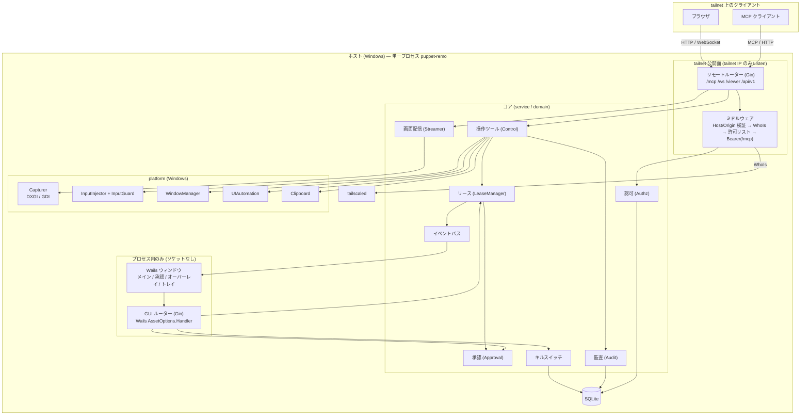
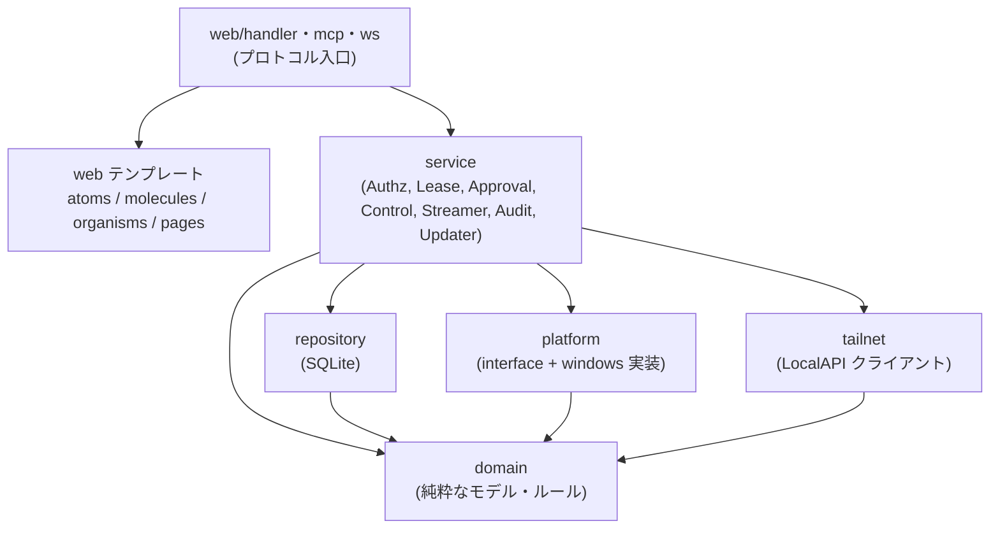
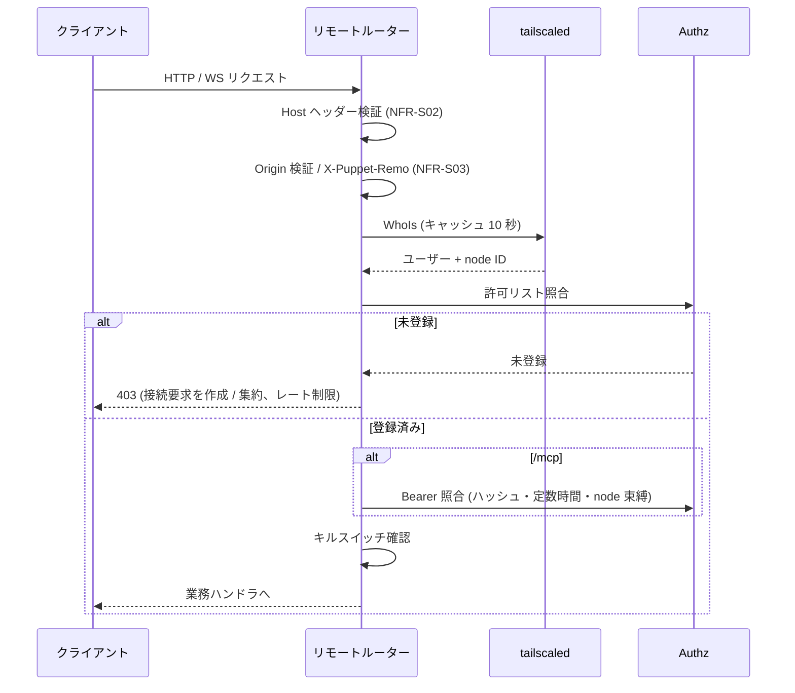
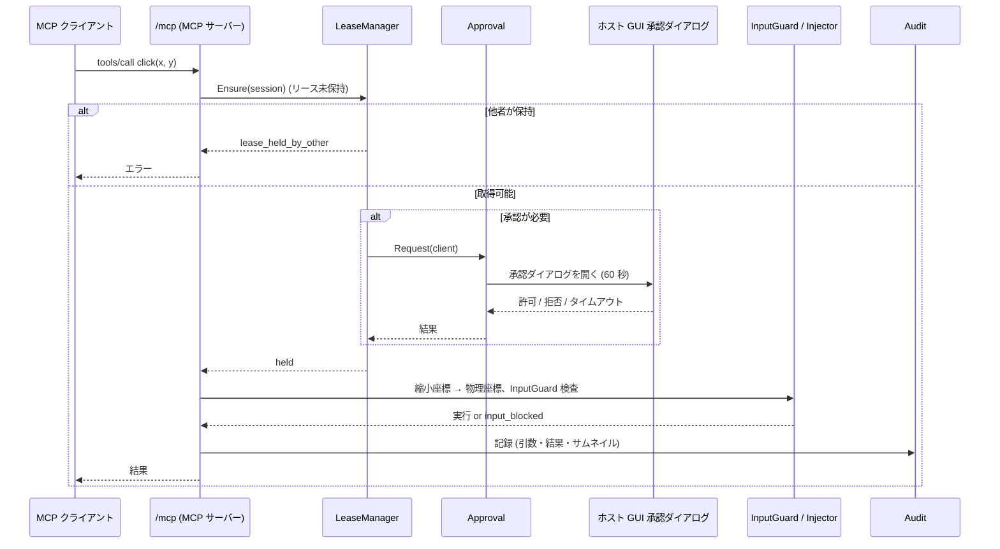
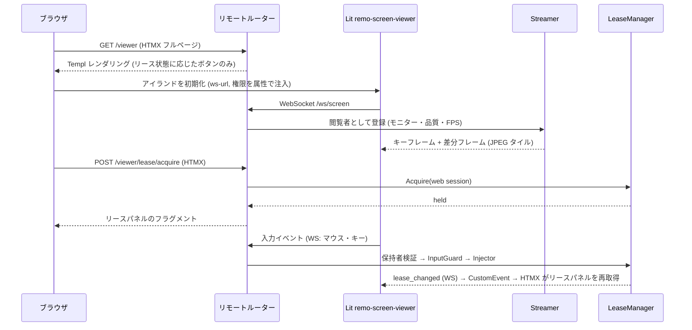
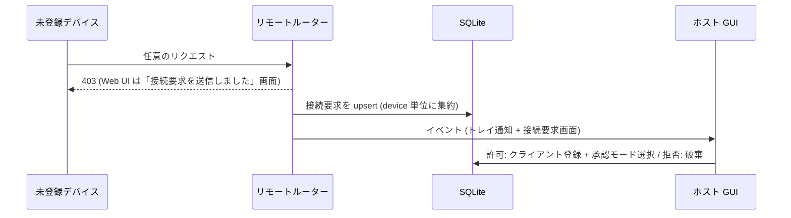
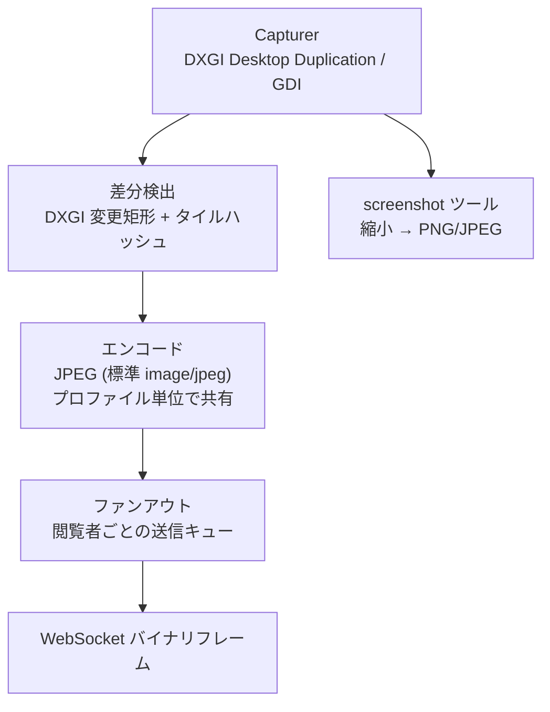
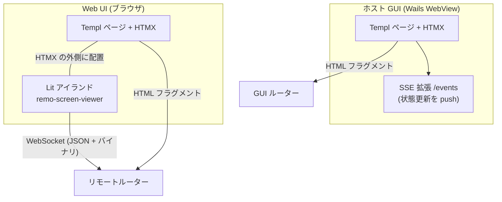

# アーキテクチャ設計

要件は [機能要件](../requirements/functional.md) と [非機能要件](../requirements/non-functional.md)、全体像は [プロジェクト概要](../overview.md) を参照。対象 OS は Windows のみ。

## 設計方針

- **単一の Go プロセス**がすべてを担う。ホスト GUI・Web UI・MCP・画面キャプチャ・入力注入・永続化を 1 つの Wails アプリに内蔵する
- **フロントエンドは HALT（HTMX + Atomic Design + Lit + Templ）**。SPA を作らず、サーバー（Go）が UI を制御する。状態駆動レンダリング（操作可能なアクションだけを HTML に出す）を徹底する
- **ホスト GUI は外部から到達できない**。ホスト GUI（トークン発行・承認・設定・キルスイッチ解除）は Wails のアセットハンドラ経由でプロセス内だけで配信し、ソケットを開かない。tailnet に公開するルーターは別にする（セキュリティ上の最重要分離）
- **OS 依存部はインターフェースの背後に置く**（`platform` パッケージ）。コアは OS 非依存でテストできる（[NFR-O03](../requirements/non-functional.md)）
- **純 Go（cgo なし）**。画像は JPEG のみ（配信・サムネイルとも）
- tailnet への参加は**ホストの tailscaled** に任せ、本アプリは LocalAPI クライアントになる

## 技術選定

| 領域 | 技術 | 選定理由・備考 |
|------|------|--------------|
| 言語 | Go | Wails / Tailscale クライアントライブラリと同じ言語。cgo を使わず Windows ビルドを単純化 |
| アプリシェル | Wails v3 | トレイ常駐・複数ウィンドウ・`AssetOptions.Handler`（`http.Handler` を WebView に配信）・`IgnoreMouseEvents` / `AlwaysOnTop` / 透過背景（オーバーレイ）・`ContentProtectionEnabled`（`WDA_EXCLUDEFROMCAPTURE`）・単一インスタンスを標準で持つ。ドキュメント上は beta 表記のため、実装時にバージョンを固定する（`go.mod` は v3.0.0 タグを確認済み） |
| HTTP ルーティング / SSR | Gin | HALT 標準 |
| JSON API | Huma | HALT 標準。Lit アイランドが使う JSON API と OpenAPI を提供 |
| テンプレート | Templ | 型安全な SSR。Atomic Design（atoms / molecules / organisms / pages / layout）で構成 |
| インタラクション | HTMX（`response-targets`、ホスト GUI のみ `sse` 拡張） | サーバー駆動の DOM 更新 |
| リッチ UI | Lit（Web Components） | ライブ画面ビューア 1 つだけ（`<remo-screen-viewer>`）。Canvas + WebSocket + 入力キャプチャのため |
| スタイル / ビルド | Tailwind CSS / esbuild | HALT 標準。成果物は `go:embed` で単一バイナリに同梱 |
| MCP | 公式 Go SDK（`github.com/modelcontextprotocol/go-sdk`） | `NewStreamableHTTPHandler` で Streamable HTTP を提供 |
| tailnet 連携 | `tailscale.com/client/local` | LocalAPI の `WhoIs`、`WatchIPNBus`（IP 変化監視）、`StatusWithoutPeers`。Windows では名前付きパイプ経由でライブラリが接続する |
| WebSocket | `github.com/coder/websocket` | context 対応・バイナリフレーム・軽量（候補。実装時に確定） |
| 永続化 | SQLite（`modernc.org/sqlite`、純 Go）+ 埋め込み SQL マイグレーション | cgo なし。WAL モード（[NFR-A06](../requirements/non-functional.md)） |
| 画面キャプチャ | DXGI Desktop Duplication（主）、GDI BitBlt（フォールバック） | DXGI は変更矩形を OS から取得でき低 CPU。失敗時は GDI へ切り替え |
| 入力注入 | Win32 `SendInput`（`golang.org/x/sys/windows`） | cgo 不要。`type` は `KEYEVENTF_UNICODE` で日本語を直接送る |
| UI Automation | COM `IUIAutomation`（`go-ole` 等） | `get_ui_tree` 用 |
| 画像エンコード | 標準 `image/jpeg` | 純 Go 制約のため JPEG のみ |
| 自動更新 | GitHub Releases + Ed25519 署名検証 | [NFR-S10](../requirements/non-functional.md) |

## システム構成図



## レイヤー構造

HALT のレイヤードアーキテクチャを採用し、OS アダプタとプロトコル層を加える。依存は上から下への一方向のみ。逆向きの import は禁止。



| レイヤー | 責務 | 依存してよい先 |
|---------|------|--------------|
| `domain` | クライアント、リース状態機械、承認モード、座標変換、ツール引数、エラー種別などの純粋なモデルとルール | なし |
| `repository` | SQLite へのアクセス（クライアント、トークン、設定、接続要求、監査ログ） | `domain` |
| `platform` | 画面キャプチャ・入力注入・ウィンドウ列挙・UI Automation・クリップボード・オーバーレイ補助のインターフェースと Windows 実装 | `domain` |
| `tailnet` | tailscaled 連携（IP 監視、WhoIs + 10 秒キャッシュ、Listener 管理） | `domain` |
| `service` | ユースケース。リース、承認、操作ツール、画面配信、監査、更新 | `domain`、`repository`、`platform`、`tailnet` |
| `web/handler`、`mcp`、`ws` | HTTP / MCP / WebSocket の入口。`repository` と `platform` を直接使わない | `service`、`domain` |
| `web` テンプレート | Templ（Atomic Design） | `domain`（表示用データ） |

## ルーターの分離とリクエスト処理

| ルーター | 配信経路 | 提供するもの | 認可 |
|---------|---------|-------------|------|
| **GUI ルーター** | Wails `AssetOptions.Handler`（プロセス内。ソケットなし） | ホスト GUI（ダッシュボード、接続要求、クライアント管理、承認ダイアログ、監査ログ、設定、更新）、`/events`（SSE） | プロセス内到達のみ。ネットワークからは到達不能 |
| **リモートルーター** | tailnet IP の TCP ポート（FR-S01、既定 8765） | `/mcp`、`/viewer`（Web UI）、`/ws/screen`、`/api/v1/*`、静的ファイル | ミドルウェア連鎖（下図） |

2 つのルーターは `templ` コンポーネント（atoms / molecules）を共有できるが、ハンドラは共有しない（ホスト専用操作がリモートに露出しないことを構造で保証する）。



## 主要フロー

### MCP ツール呼び出し（リース取得と承認を含む）



### Web UI のライブ表示と手動操作



### 接続要求（未登録デバイス）



### キルスイッチ

発動経路（トレイ、ダッシュボード、グローバルホットキー）はいずれも `KillSwitch.Trigger()` を呼ぶ。処理順は、(1) 状態を `active` に永続化、(2) 全リース剥奪、(3) リモートルーターのリクエストを 503 `kill_switch_active` で拒否、(4) 全 MCP・WebSocket セッションを切断、(5) オーバーレイ消去、(6) 監査記録。順序は NFR-P05（1 秒以内）を満たすため同期で行い、永続化は先頭に置いて再起動後も維持する（[NFR-S07](../requirements/non-functional.md)）。

## 画面配信パイプライン



- キャプチャ・差分検出は**モニターごとに 1 つの goroutine**。閲覧者がゼロなら停止する（FR-W09、NFR-P04）
- 差分は 64×64 px のタイル単位。変化したタイルを矩形にまとめて JPEG で送る。接続直後と一定間隔（既定 5 秒）で全面キーフレームを送る
- エンコードは (モニター, 品質, FPS) のプロファイル単位に 1 回だけ行い、同じプロファイルの閲覧者で共有する（NFR-P07）。閲覧者ごとの送信キューが詰まったら古いフレームを捨てる（遅延の累積を防ぐ）
- DXGI は `ACCESS_LOST`（ロック画面・UAC・解像度変更など）で再初期化する。復旧できなければ `desktop_unavailable` とし、GDI にフォールバックする
- `screenshot` ツールは配信とは独立に 1 回だけ撮り、縮小（FR-M16 の縮小率）して返す

## 入力注入と自己保護

- **座標変換**: 縮小座標 → `round(x ÷ 縮小率)` → モニター原点を加算 → 仮想デスクトップ座標。`SendInput` は `MOUSEEVENTF_ABSOLUTE | MOUSEEVENTF_VIRTUALDESK` で 0〜65535 に正規化して送る。プロセスは Per-Monitor DPI Aware V2 のマニフェストを持つ
- **`InputGuard`**（すべての注入の前に必ず通る。[NFR-S06](../requirements/non-functional.md)）:
  1. 注入先の座標にあるトップレベルウィンドウ、またはフォアグラウンドウィンドウが**自プロセスのもの**ならブロック（`input_blocked`）
  2. 管理者権限ウィンドウ（UIPI）が対象なら `input_blocked`
  3. キルスイッチ中・リース非保持なら拒否
- **自ウィンドウのキャプチャ除外**: ホスト GUI・承認ダイアログ・オーバーレイは Wails の `ContentProtectionEnabled`（`WDA_EXCLUDEFROMCAPTURE`）を有効にする。AI のスクリーンショットにも Web UI のライブ画面にも写らない
- **オーバーレイ**: モニターごとに 1 ウィンドウ。枠なし・透過背景・最前面・`IgnoreMouseEvents`（クリック透過）・タスクバー非表示。リースの保持・解放イベントで表示・消去する
- **承認ダイアログ**: 承認要求ごとに専用の Wails ウィンドウを開く（Go 側でウィンドウ生成）。内容は GUI ルーターが Templ で描画し、「許可 / 拒否」は HTMX の `hx-post` で GUI ルーターへ送る。操作は入力ガードにより AI から押せない

## HALT の適用

### フロントエンド構成



- 画面の大半（ダッシュボード、クライアント管理、接続要求、設定、監査ログ、ビューアの周辺 UI、リースパネル）は **Templ + HTMX** で描画する
- **Lit は `<remo-screen-viewer>` のみ**。理由は Canvas 描画、WebSocket のバイナリフレーム、マウス・キー入力のキャプチャが必要でハイパーメディアに載せられないため（HALT の使用基準に該当）
- Lit アイランドの属性: `ws-url`（サーバーが注入）、`readonly`（操作権なしなら付与）、`monitor`、`quality`、`fps`
- **HTMX ↔ Lit 境界**: HTMX は Lit アイランドを swap しない。ビューアのツールバー（モニター・品質・FPS・クリップボード・リースボタン）は Lit の外に Templ で描画し、設定変更は `hx-post` でサーバーに送る。サーバーが WS 経由で設定を反映する。リース状態の変化は WS 制御メッセージ → Lit の CustomEvent → HTMX の `hx-trigger` でパネルを再取得する
- **状態駆動レンダリング**: リースが `idle` なら「操作権を取得」だけ、他者保持なら「強制剥奪」だけ、自分が保持なら「解放」だけを描画する。キルスイッチ中は操作系を一切描画しない。判定は Go 側で行う
- 命名規則: カスタム要素のプレフィックスは `remo`（例: `<remo-screen-viewer>`）
- 共通ライブラリ: `lib/ws.ts`（自動再接続）、`lib/api.ts`、`lib/logger.ts`（HALT 標準）。直接 `fetch()` / `new WebSocket()` は使わない

### HALT 標準からの差分

| HALT 標準 | 本プロジェクト | 理由 |
|-----------|--------------|------|
| Cookie セッション + CSRF トークン（meta タグ） | **Cookie を使わない**。識別は WhoIs、CSRF 対策は Host / Origin 検証 + カスタムヘッダー（`X-Puppet-Remo: 1`。`hx-headers` と `lib/api.ts` が付与） | tailnet 上の ID が真実の源であり、Cookie ベースの認証がそもそも無い（NFR-S03） |
| 単一の HTTP サーバー | **GUI ルーター（プロセス内）とリモートルーター（tailnet）に分離** | ホスト専用操作を構造的にネットワークから隔離するため |
| HTMX 拡張は最小限 | ホスト GUI のみ `sse` 拡張を追加 | 承認要求・リース・接続要求をほぼリアルタイムに GUI へ反映するため（NFR-P06）。Web UI は WS 経由で足りるため追加しない |
| Lit は編集系リッチ UI | ライブ画面ビューア 1 つのみ | 要件が 1 画面に限られる |
| Huma で JSON API | `/api/v1/*` は小規模（モニター一覧・状態・OpenAPI）のみ。MCP と WebSocket は Huma の対象外 | JSON API の主な利用者が Lit アイランドと運用確認に限られる |
| 静的ファイルは Gin の `Static` で配信 | `go:embed` した `dist/` を両ルーターで配信 | 単一バイナリ配布のため |

## ディレクトリ構成

```
puppet-remo/
├── cmd/puppet-remo/              # エントリーポイント (Wails アプリ起動、DI)
├── internal/
│   ├── domain/                   # クライアント、リース、承認、座標、エラー
│   ├── repository/               # SQLite (clients, tokens, settings, ...)
│   │   └── migrations/           # 埋め込み SQL マイグレーション
│   ├── platform/                 # interface 定義
│   │   └── windows/              # capture(DXGI/GDI), input, window, uia, clipboard
│   ├── tailnet/                  # LocalAPI クライアント、Watcher、Listener 管理
│   ├── service/                  # authz, lease, approval, control, streamer, audit, updater
│   ├── mcp/                      # MCP サーバー (ツール定義と service 呼び出し)
│   ├── ws/                       # WebSocket プロトコル (画面フレーム・入力)
│   ├── router/                   # gui.go, remote.go
│   ├── web/
│   │   ├── handler/              # 機能別ハンドラ
│   │   ├── middleware/           # hostcheck, whois, allowlist, bearer, killswitch
│   │   ├── atoms/ molecules/ organisms/ pages/ layout/
│   └── app/                      # Wails ウィンドウ・トレイ・オーバーレイ・ホットキー
├── static/
│   └── src/
│       ├── components/
│       │   ├── screen-viewer/    # <remo-screen-viewer>
│       │   └── lib/              # api.ts, ws.ts, logger.ts
│       ├── css/
│       └── dist/                 # ビルド成果物 (go:embed)
├── build/                        # Wails パッケージング (NSIS、マニフェスト)
├── docs/
└── Taskfile.yml                  # templ / tailwind / esbuild / wails3 package
```

## ビルドと配布

| 段階 | 内容 |
|------|------|
| コード生成 | `templ generate` |
| フロントエンド | Tailwind CSS ビルド、esbuild（Lit コンポーネント）、`htmx.min.js` のコピー → `static/dist/` |
| Go ビルド | 純 Go（cgo なし）。Per-Monitor DPI Aware V2 のマニフェストを埋め込む |
| パッケージ | `wails3 package` による NSIS インストーラ（WebView2 ブートストラップ込み） |
| 配布・更新 | GitHub Releases。インストーラと署名ファイル（Ed25519）を公開し、アプリが署名検証して適用 |
| CI | GitHub Actions `windows-latest` で templ 生成の差分チェック、フロントエンドビルド、build / vet / lint / test |

## 改訂履歴

| 版 | 日付 | 変更内容 | 変更理由 |
|---|------|---------|---------|
| 1.0 | 2026-10-28 | 初版作成 | — |
