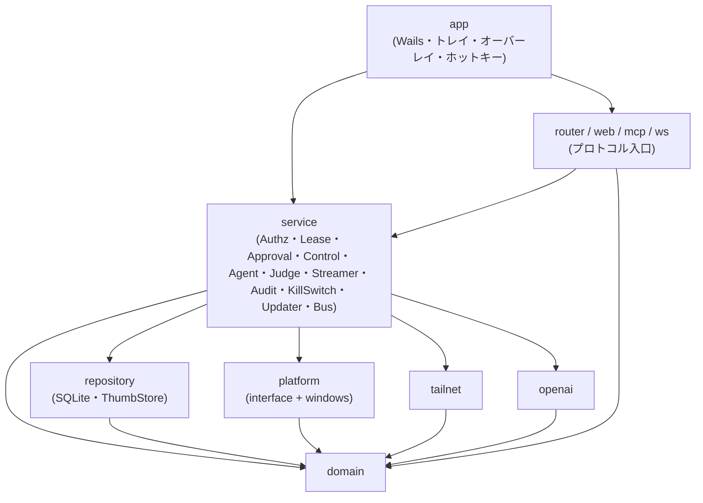
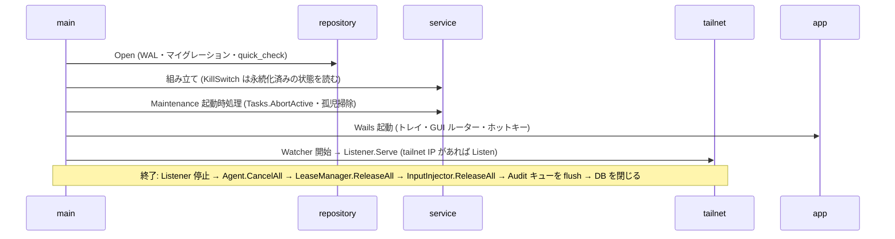

# コンポーネント設計

要件は [機能要件](../requirements/functional.md) / [非機能要件](../requirements/non-functional.md)、構成とレイヤーは [アーキテクチャ設計](../architecture/overview.md)、永続化は [ER](../architecture/er.md)、入口の仕様は [API 仕様](../api/endpoints.md) を参照。

本書は `internal/` 配下の各パッケージの責務、依存、Go インターフェース、goroutine と状態の所有者を定める。シグネチャは設計上の契約であり、実装で引数を足す場合も、依存の向きと「誰が状態を持つか」は変えない。

## 1. コンポーネント一覧と依存関係



| パッケージ | 責務（一行） | 主な FR / NFR |
|-----------|------------|---------------|
| `domain` | 純粋なモデルとルール（リース状態機械、座標変換、承認モード、判定、エラー型） | FR-L、FR-M16/M17、FR-G03 |
| `repository` | SQLite と `thumbs/` へのアクセス、マイグレーション | ER、NFR-A06/O05 |
| `platform` | OS 依存のインターフェースと Windows 実装 | FR-M、NFR-S06/S14/O03 |
| `tailnet` | tailscaled 連携（IP 監視、WhoIs、Listener） | FR-A01〜A03、NFR-S05/A03 |
| `openai` | Responses API の `computer` ツール呼び出し | FR-G04〜G06、NFR-S16 |
| `service` | ユースケース（下記 §5）。状態を持つのは主にここ | 全般 |
| `mcp` / `web` / `ws` / `router` | リモート・GUI の入口。`service` と `domain` だけに依存する | API 仕様 |
| `app` | Wails のウィンドウ・トレイ・オーバーレイ・グローバルホットキー、起動・終了の組み立て | FR-H、FR-S08 |

**依存の規則**

- 矢印の逆向きの import は禁止。`mcp` / `web` / `ws` は `repository` と `platform` を import しない（CI で `go list -deps` により検査する）
- インターフェースの置き場所は、OS・外部サービスの境界（`platform`、`tailnet`、`openai`）では**境界側のパッケージ**に置き、`service` のテストはそれを偽の実装に差し替える。`service` 内のコンポーネント（`LeaseManager`、`Judge` など）は `service` に置く。いずれも、利用側が具象型ではなくインターフェースに依存する
- 時刻と乱数は `domain.Clock` / `domain.IDGen` を注入する（テストの決定性のため）
- すべての長時間処理は `context.Context` を第 1 引数に取り、キャンセルで確実に終了する

## 2. domain

状態を持たない値と純粋関数のみ。外部 I/O をしない。

```go
// 操作主体。リースの保持者とも、監査ログの actor とも対応する。
type ActorKind string // "mcp" | "web" | "agent" | "host" | "system"

type Actor struct {
    Kind      ActorKind
    ClientID  string // 未登録・host・system は空
    Label     string // 表示名のスナップショット
    SessionID string // MCP セッション / viewer_id / task_id（監査用の文字列）
}

type ApprovalMode string // "always" | "first_time" | "auto"

type Client struct {
    ID, StableNodeID, LoginName, DisplayName string
    WebEnabled, MCPEnabled, AgentEnabled     bool
    ApprovalMode                             ApprovalMode
    ApprovedAt                               *time.Time
}

// 座標。MCP は Scaled 座標、WebSocket は Physical 座標を使う（API 仕様 §3.2 / §5.3）。
type Monitor struct {
    Index   int
    Primary bool
    Origin  Point // 仮想デスクトップ上の物理座標
    Size    Size  // 物理ピクセル
    DPI     float64
}
func (m Monitor) Scale(maxDim int) float64 // min(1, maxDim / 長辺)
func (m Monitor) ScaledToPhysical(p Point, maxDim int) (Point, error) // 範囲外は ErrInvalidCoordinates
func (m Monitor) PhysicalToScaled(p Point, maxDim int) Point

// ツールの操作（MCP・WebSocket・エージェントが共通で組み立てる）。
type Op interface{ isOp() }
type MouseMove struct{ At Point; Monitor int }
type Click struct{ At *Point; Button Button; Count int; Mods []Modifier; Monitor int }
type Drag struct{ From, To Point; Mods []Modifier; Monitor int }
type Scroll struct{ At Point; Dir Direction; Amount int; Monitor int }
type KeyPress struct{ Keys KeyCombo }
type TypeText struct{ Text string }
type FocusWindow struct{ ID string }
// ... ClipboardRead / ClipboardWrite / GetUITree / Wait

// エージェントが 1 件ずつ検査を受ける対象。OpenAI のアクションを Op へ写像したもの。
type Action struct {
    Op     Op
    Source string // "mcp" | "web" | "agent"
}

type Verdict int // Allow < RequireApproval < Deny（厳しさの順）
func Stricter(a, b Verdict) Verdict

type TaskStatus string // pending_approval | running | completed | failed | cancelled | limit_reached | aborted | denied
func (s TaskStatus) Terminal() bool

// エラー（API 仕様 §2 の code と 1 対 1）。errors.Is で判定する。
var (
    ErrLeaseRequired, ErrLeaseHeldByOther, ErrLeaseRevoked, ErrApprovalDenied,
    ErrApprovalTimeout, ErrKillSwitchActive, ErrInvalidCoordinates, ErrInvalidArgument,
    ErrWindowNotFound, ErrInputBlocked, ErrDesktopUnavailable, ErrAgentDisabled,
    ErrTaskNotFound, ErrJudgeDenied, ErrUnsupportedAction error
)
type Error struct{ Code string; Msg string; Detail map[string]any } // errors.As で取り出す
```

**不変条件**: `domain` は他の内部パッケージを import しない。`Monitor.ScaledToPhysical` と `PhysicalToScaled` は丸めの誤差が 1 px を超えない（プロパティテスト）。

## 3. platform（OS 依存）

`internal/platform` にインターフェース、`internal/platform/windows` に実装を置く。**1 つのインターフェースに 1 つの責務**とし、goroutine を内部で起動するものは下に明記する。

```go
// 画面キャプチャ。モニターごとに 1 つ。DXGI を主、GDI をフォールバックとする。
type Capturer interface {
    Monitors(ctx context.Context) ([]domain.Monitor, error)
    // 1 枚を撮る（screenshot ツール・エージェント・サムネイル用）。呼び出しごとに完結する。
    Grab(ctx context.Context, monitor int) (*image.RGBA, error)
    // 継続キャプチャを開始する（Streamer 用）。frames は変化した矩形つきで流れる。
    // ctx のキャンセルまたは Stop で停止する。DXGI の ACCESS_LOST は内部で再初期化し、
    // 復旧できなければ ErrDesktopUnavailable を errs に流して GDI に切り替える。
    Watch(ctx context.Context, monitor int, fps int) (frames <-chan Frame, errs <-chan error, err error)
}
type Frame struct{ Image *image.RGBA; Dirty []image.Rectangle; Seq uint32 }

// 入力注入。InputGuard を通った後にだけ呼ばれる（呼び出し側の責任ではなく、service.Control が唯一の呼び出し元）。
type InputInjector interface {
    MoveTo(ctx context.Context, p domain.Point) error // 仮想デスクトップの物理座標
    Click(ctx context.Context, b domain.Button, count int, mods []domain.Modifier) error
    Drag(ctx context.Context, from, to domain.Point, mods []domain.Modifier) error
    Scroll(ctx context.Context, at domain.Point, dir domain.Direction, amount int) error
    Key(ctx context.Context, k domain.KeyCombo) error
    KeyEvent(ctx context.Context, e domain.KeyEvent) error // Web UI の down / up
    Text(ctx context.Context, s string) error // KEYEVENTF_UNICODE
    ReleaseAll() error // 押下中のキー・ボタンをすべて解放（中断・キルスイッチ時）
    CursorPos() (domain.Point, error)
}

type WindowManager interface {
    List(ctx context.Context) ([]domain.WindowInfo, error)
    At(p domain.Point) (domain.WindowInfo, bool, error)  // 座標上の最上位ウィンドウ（InputGuard 用）
    Foreground() (domain.WindowInfo, error)
    Focus(ctx context.Context, id string) error
}
type WindowInfo struct {
    ID, Title, Process string; PID uint32; Rect domain.Rect; Monitor int
    Foreground, Minimized, Elevated, Own bool // Own: 自プロセスのウィンドウ
}

type UIAutomation interface {
    Tree(ctx context.Context, windowID string, maxDepth, maxNodes int) (domain.UINode, error)
}
type Clipboard interface {
    ReadText(ctx context.Context) (string, error)
    WriteText(ctx context.Context, s string) error
}
type SecretStore interface { // 資格情報マネージャー
    Get(name string) (string, error)  // 未登録は ErrNotFound
    Set(name, value string) error
    Delete(name string) error
}
type Hotkey interface { // グローバルホットキー
    Register(spec string, fn func()) (unregister func(), err error)
}
type Power interface { // スリープ抑止
    KeepAwake(on bool)
}
```

**所有する goroutine**: `Capturer.Watch` が 1 モニターにつき 1 本のキャプチャ goroutine を持つ（`ctx` で停止。呼び出し側が閲覧者ゼロで取り消す）。`Hotkey.Register` が Win32 のメッセージループ用に 1 本の専用 OS スレッド（`runtime.LockOSThread`）を持つ。それ以外のインターフェースは goroutine を内部に持たず、呼び出し元のそれで同期的に動く。

**スレッドの制約**: Win32 の入力注入・UI Automation（COM）は、スレッドアフィニティを持つ。`InputInjector` と `UIAutomation` の実装は、専用の goroutine（OS スレッドに固定）へ呼び出しを直列化して渡す（呼び出し側から見るとスレッドセーフな同期呼び出し）。

### InputGuard は platform ではなく service にある

`InputGuard`（NFR-S06）は `WindowManager` と `domain` を使う純粋な判定なので `service` に置く（§5.4）。`platform` は事実（座標上のウィンドウ、自プロセスか、昇格しているか）を返すだけで、許可・拒否を決めない。

## 4. repository・tailnet・openai

### 4.1 repository

すべての関数が `context.Context` を取り、SQLite へのアクセスは 1 つの `*sql.DB`（WAL、`SetMaxOpenConns` は書き込みを 1 に直列化）を共有する。

```go
type Clients interface {
    Get(ctx, id string) (domain.Client, error)
    ByNode(ctx, stableNodeID string) (domain.Client, error) // 未登録は ErrNotFound
    List(ctx) ([]domain.Client, error)
    Create(ctx, c domain.Client) error
    Update(ctx, id string, patch ClientPatch) error // approval_mode 変更時は approved_at を NULL に戻す
    Delete(ctx, id string) error                     // client_tokens は CASCADE
    TouchSeen(ctx, id string, at time.Time) error
}
type Tokens interface {
    Create(ctx, t TokenRecord) error                            // ハッシュのみ
    ByHash(ctx, sha256 [32]byte) (TokenRecord, error)           // 定数時間比較は Authz が行う
    ListByClient(ctx, clientID string) ([]TokenRecord, error)
    Revoke(ctx, id string, at time.Time) error
    TouchUsed(ctx, id string, at time.Time) error
}
type ConnRequests interface {
    UpsertPending(ctx, r ConnRequest) (ConnRequest, created bool, err error) // 1 デバイス 1 件に集約
    Decide(ctx, id string, status string, clientID *string) error
    DeniedActive(ctx, stableNodeID string, now time.Time) (bool, error)
    ListPending(ctx) ([]ConnRequest, error)
    Expire(ctx, now time.Time) error
}
type Settings interface {
    Get(ctx, key string) (json.RawMessage, bool, error)
    Set(ctx, key string, value json.RawMessage) error
    All(ctx) (map[string]json.RawMessage, error)
}
type Audit interface {
    Append(ctx, e AuditEntry) (id int64, err error)
    Query(ctx, q AuditQuery) ([]AuditEntry, next int64, err error)
    AttachThumb(ctx, auditID int64, t ThumbMeta) error
    PurgeBefore(ctx, t time.Time) (removedThumbs []string, err error)    // 行を先に削除し、ファイルは呼び出し側が消す
    PurgeThumbsOver(ctx, maxBytes int64) (removedThumbs []string, err error)
}
type Tasks interface {
    Create(ctx, t TaskRecord) error
    Update(ctx, id string, patch TaskPatch) error
    Get(ctx, id string) (TaskRecord, error)
    List(ctx, clientID string, limit int) ([]TaskRecord, error)
    AbortActive(ctx, now time.Time) (int, error) // 起動時: pending_approval/running → aborted
}
type ThumbStore interface { // thumbs/ 配下のファイル
    Save(ctx, relPath string, jpeg []byte) error
    Open(relPath string) (io.ReadCloser, error) // パス走査を拒否
    Remove(relPath string) error
    SweepOrphans(ctx, known func(rel string) bool) error
}
```

**所有する goroutine / 状態**: `repository` は goroutine を持たない（保守処理のタイマーは `service/maintenance` が持つ）。マイグレーションは `Open` が起動時に同期で実行する。

### 4.2 tailnet

```go
type Watcher interface { // tailscaled の状態を監視する
    // 状態（ログイン済みか、tailnet IP、MagicDNS 名）の変化を流す。WatchIPNBus を使い、切断時は再接続する。
    Watch(ctx context.Context) (<-chan Status, error)
}
type Status struct{ LoggedIn bool; IPs []netip.Addr; DNSName string; Err error }

type WhoIs interface { // 接続元 IP → ユーザー・デバイス（10 秒キャッシュ）
    Lookup(ctx context.Context, remoteAddr string) (Identity, error) // 失敗は ErrWhoIsFailed（fail closed）
}
type Identity struct{ LoginName, StableNodeID, NodeName string }

type Listener interface { // tailnet IP だけで Listen する
    // 状態の変化に追従して Listen を張り直す。IP が無い間は停止して理由を Reason に出す。
    Serve(ctx context.Context, h http.Handler, port func() int) error
    State() ListenState // { Listening bool; Addrs []string; Reason string }
}
```

**所有する goroutine**: `Watcher` が 1 本（`WatchIPNBus` の読み取り）、`Listener` が Listen 用に 1 本と接続ごとの標準の `http.Server` の goroutine。`WhoIs` は goroutine を持たず、キャッシュは `sync.Map` + 有効期限（TTL 10 秒）。Listener の再起動は 10 秒以内に完了する（NFR-A03）。`0.0.0.0` と `127.0.0.1` では Listen しない（NFR-S01）。

### 4.3 openai

```go
// service/agent が使うモデルのインターフェース。テストではモックする（NFR-O06）。
type Model interface {
    // 1 ステップ（Responses API 呼び出し 1 回）。60 秒でタイムアウト（NFR-S16）。
    Step(ctx context.Context, in StepInput) (StepOutput, error)
}
type StepInput struct {
    Model       string
    Prompt      string               // 最初のステップのみ
    PrevID      string               // 継続（previous_response_id）
    CallID      string               // 直前の computer_call への返答
    Screenshot  []byte               // PNG（縮小済み）
    Acknowledged []SafetyCheck       // 許可された pending_safety_checks
}
type StepOutput struct {
    ResponseID  string
    Actions     []domain.Op          // computer_call の actions[] を写像したもの
    CallID      string
    SafetyChecks []SafetyCheck       // pending_safety_checks
    FinalText   string               // computer_call が返らなかったときの最終回答
    Usage       Usage                // input / output トークン
}
```

実装は `openai-go/v3` の `responses.ComputerToolParam`（`{type:"computer"}`）を使う。未知のアクション種別は `ErrUnsupportedAction`。API キーは呼び出しごとに `SecretStore` から読み、**ログ・エラーメッセージに出さない**（`http.RoundTripper` で `Authorization` を伏せる）。**所有する goroutine**: なし（呼び出しは `ctx` で取り消せる）。

## 5. service

### 5.1 一覧と状態の所有者

| コンポーネント | 持つ状態 | goroutine | 排他 |
|---------------|---------|-----------|------|
| `LeaseManager` | 現在のリース（保持者・状態・最終活動時刻） | アイドルタイマー 1 本 | `sync.Mutex` 1 つで全遷移を直列化 |
| `Approval` | 承認待ちの要求（id → チャネル） | なし（要求ごとの待機は呼び出し側の goroutine） | `sync.Mutex` |
| `Control` | なし（ステートレス。検査の順序を定義する） | なし | — |
| `Judge` | なし（設定のスナップショットは都度読む） | なし | — |
| `Agent` | 実行中タスクの `*run`（高々 1 つ） | タスクごとに 1 本（ループ） | `sync.Mutex`（`run` の参照の差し替え） |
| `Streamer` | 閲覧者の一覧、(モニター, 品質, FPS) ごとのプロファイルとエンコード結果 | モニターごとにキャプチャ受信 1 本 + エンコード、閲覧者ごとに送信 1 本 | `sync.RWMutex` |
| `KillSwitch` | 発動状態（永続化済みのものをキャッシュ） | なし | `sync.Mutex` |
| `Authz` | なし（レート制限のカウンタのみメモリ） | なし | 固定窓のカウンタを `sync.Mutex` で保護 |
| `Audit` | なし（書き込みは `repository.Audit` へ） | 書き込みキュー 1 本（バッファ付きチャネル） | — |
| `Updater` | 最新版の確認結果 | 定期確認 1 本 | `sync.Mutex` |
| `Bus` | 購読者（GUI の SSE、WebSocket の `lease`） | なし（`Publish` は購読者ごとのバッファ付きチャネルへ非ブロッキングで送る） | `sync.RWMutex` |
| `Maintenance` | なし | 1 時間ごとのタイマー 1 本 | — |

**状態の所有者は 1 つだけ**。たとえばリースは `LeaseManager` だけが持ち、他のコンポーネントは `Holder()` で読む。`Bus` を除き、コンポーネント同士はコールバックではなくインターフェースの呼び出しで協調する。ロックを持ったまま他のコンポーネントを呼ばない（`LeaseManager` は承認待ちの間ロックを手放す）。

### 5.2 LeaseManager

```go
type LeaseManager interface {
    // 取得。承認が必要なら Approval に問い合わせて待つ（最大 60 秒）。他者が保持中は ErrLeaseHeldByOther。
    Acquire(ctx context.Context, who domain.Actor) (Lease, error)
    // 保持者のみ。保持していなければ何もしない。
    Release(who domain.Actor)
    // 強制剥奪（Web・ホスト）。保持者が agent ならタスクを中断する（Agent.Cancel を呼ぶ）。
    Revoke(by domain.Actor) error
    // 以後の入力操作が許されるかの確認。活動時刻を更新する（アイドル解放の起点）。
    Check(who domain.Actor) error // ErrLeaseRequired / ErrLeaseHeldByOther / ErrLeaseRevoked
    Holder() (Holder, bool)
    // キルスイッチ・セッション切断用。
    ReleaseAll(reason string)
    Subscribe() <-chan Event // 変化（Bus 経由でも配る）
}
type Lease struct{ ID string; Holder domain.Actor; Since time.Time }
```

- 状態は `idle → pending_approval → held → idle`（FR-L03）。`pending_approval` の間は他者の取得を `ErrLeaseHeldByOther` で断る
- アイドルタイマーは `lease.idle_timeout_sec`（既定 300 秒）。`Check` が呼ばれるたびに延長する。`agent` のリースは、エージェントの各アクション実行が `Check` を呼ぶことで延長される（FR-L05）
- **リースは MCP セッションに紐づく**: セッション終了で `Release`。WebSocket の切断で `web` のリースを `Release`
- 状態遷移はすべて `Audit` に記録し、`Bus` に `lease` イベントを出す（Web UI・GUI が購読）

### 5.3 Approval

```go
type Approval interface {
    // ダイアログを開いて待つ。60 秒でタイムアウトし ErrApprovalTimeout。ctx のキャンセルで取り下げる。
    Request(ctx context.Context, req ApprovalRequest) (Decision, error)
    // GUI ルーターから呼ばれる。解決済み・失効は ErrApprovalTimeout（410）。
    Resolve(id string, allow bool) error
    Pending() []ApprovalRequest
}
type ApprovalRequest struct {
    ID   string
    Kind string // "lease" | "safety_check" | "judge_action"
    Who  domain.Actor
    Detail ApprovalDetail // 内容（指示の要約、安全チェック、アクション、対象ウィンドウ、判定の理由）
}
```

要求を作るたびに `Bus` へ `approval` を出す。承認ダイアログのウィンドウを開くのは `app`（購読側）で、`Approval` は UI を知らない。

### 5.4 Control と InputGuard（すべての入力の唯一の入口）

MCP・Web UI・エージェントの入力は、**必ず `Control` を通る**。`platform.InputInjector` を直接呼べるのは `Control` だけ（パッケージの可視性で保証する）。

```go
type Control interface {
    // 入力系。検査の順序は固定（下記）。
    Do(ctx context.Context, who domain.Actor, op domain.Op) (Result, error)
    // 閲覧系（リース不要）。
    Screenshot(ctx context.Context, monitor int, format string) (Shot, error)
    Monitors(ctx context.Context) ([]domain.Monitor, error)
    Windows(ctx context.Context) ([]domain.WindowInfo, error)
}
```

`Do` の検査順序（1 つでも失敗したら実行しない）:

1. `KillSwitch.Active()` → `ErrKillSwitchActive`
2. `LeaseManager.Check(who)` → リースの検査（暗黙取得が許される `mcp` は、ここで `Acquire` を試みる）
3. `InputGuard.Check(op)` → 自ウィンドウ・昇格ウィンドウ・SAS を `ErrInputBlocked` で拒否（NFR-S06、UIPI）
4. `who.Kind == agent` のとき `Judge.Assess` → `Deny` は `ErrJudgeDenied`、`RequireApproval` は `Approval.Request`（拒否・失効は `ErrApprovalDenied`）
5. `platform` の注入を実行
6. `Audit.Append`（引数、結果、所要時間。`type` の本文は既定で文字数のみ。FR-AU03）と、設定が有効ならサムネイル保存

```go
// InputGuard は事実（platform）から判定する純粋なロジック。状態を持たない。
type InputGuard struct{ Windows platform.WindowManager }
func (g InputGuard) Check(ctx context.Context, op domain.Op, mon []domain.Monitor) error
```

座標を持つ `op` は、物理座標へ変換した位置の `WindowManager.At` を、座標を持たない `op`（`key` / `type`）は `Foreground()` を調べる。`Own` なら拒否、`Elevated` なら拒否。**判定ルール自体は `domain` に置き、表形式のテストで網羅する**。

### 5.5 Judge

```go
type Judge interface {
    Assess(ctx context.Context, a domain.Action, w domain.WindowInfo) (domain.Verdict, Reason, error)
}
// 複数を束ねる。最も厳しい判定を採る（緩める方向には作用しない）。
func Chain(js ...Judge) Judge
// error・タイムアウト・低 confidence は RequireApproval に変換する（fail-closed）。
func FailClosed(j Judge, timeout time.Duration) Judge
```

既定は `RuleJudge`（`agent.deny_processes` / `agent.approve_processes` をプロセス名で照合。FR-G12）。外部モデル（Jev 等）の実装は未決で、決まるまで作らない（[非機能要件](../requirements/non-functional.md) の未決事項）。

### 5.6 Agent（TaskRunner）

```go
type Agent interface {
    Start(ctx context.Context, by domain.Actor, in StartInput) (Task, error) // 条件は FR-G01
    Get(ctx context.Context, by domain.Actor, id string) (Task, error)       // 他クライアントのタスクは ErrTaskNotFound
    Cancel(ctx context.Context, by domain.Actor, id string) (Task, error)
    CancelAll(reason string)                                                 // キルスイッチ・無効化・クライアント削除
}
```

**所有する状態**: 実行中のタスク `*run`（`id`、`cancel context.CancelFunc`、`done chan struct{}`）を 1 つだけ。`Start` は排他リース（種別 `agent`）の取得に成功した場合だけ goroutine を起動する。実行状態はメモリのみ（NFR-A08）。

ループの擬似コード（FR-G04〜G10 と一致）:

```go
func (r *run) loop(ctx context.Context) {
    defer r.finish()                          // 状態を永続化、押下中入力を ReleaseAll、リースを Release
    shot := r.capture(ctx)                    // MCP の screenshot と同じ縮小規則
    for step := 1; step <= r.maxSteps && !r.timeUp(); step++ {
        out, err := r.model.Step(ctx, r.input(shot))        // 60 秒タイムアウト。再試行しない
        // err → failed(openai_error)。out.Actions が空 → completed（FinalText を保存）
        if len(out.SafetyChecks) > 0 && !r.askSafety(ctx, out) { r.fail("safety_check_denied"); return }
        for _, op := range out.Actions {
            if _, err := r.control.Do(ctx, r.actor, op); err != nil { // Do が Lease / Guard / Judge / 承認 / 監査を担う
                r.fail(codeOf(err)); return                        // 1 件でも拒否・ブロックなら終了（残りは実行しない）
            }
        }
        shot = r.capture(ctx)                                      // 実行後の画面を次のステップへ
    }
    r.finishWith(limitReached)
}
```

- `ctx` は `Cancel` / `CancelAll` / リース剥奪で取り消される。取り消しは `Model.Step` の HTTP を打ち切り、`InputInjector.ReleaseAll` を呼ぶ
- 画面の縮小・座標の逆変換は `domain.Monitor` のメソッドで行い、MCP と同じ規則を使う（FR-G06）
- `computer_call` の `actions[]` のうち `screenshot` は、実行時に新しい画面を撮るだけの操作として扱う
- ステップごとに `agent_tasks`（`step_count`、トークン）を更新し、`Audit` にステップを書く（`task_id`、`step_no`）

### 5.7 Streamer

```go
type Streamer interface {
    // 閲覧者を登録する。キャプチャは閲覧者がいる間だけ動く（FR-W09）。
    Subscribe(ctx context.Context, v ViewerConfig) (*Viewer, error) // ErrTooManyViewers
    Configure(id string, c ViewerConfig) error                      // モニター・品質・FPS の変更
}
type Viewer struct {
    Frames <-chan []byte // バイナリフレーム（API 仕様 §5.4）。詰まったら古いものを捨てる
    Done   <-chan struct{}
}
```

- モニターごとに 1 つのキャプチャ goroutine（`Capturer.Watch`）。閲覧者がゼロなら取り消す
- 差分は 64×64 のタイル単位。(モニター, 品質, FPS) の**プロファイルごとに 1 回だけ**エンコードし、同じプロファイルの閲覧者にファンアウトする（NFR-P07）
- 閲覧者ごとの送信チャネルは容量 2。満杯なら最古を捨て、次のキーフレームで復帰する
- キーフレームの間隔は既定 5 秒。解像度が変わったら全プロファイルを作り直す

### 5.8 KillSwitch

```go
type KillSwitch interface {
    Active() bool
    Trigger(source string) error // 手順は下記。1 秒以内（NFR-P05）
    Release() error              // ホスト GUI からのみ
}
```

`Trigger` は同期で次の順に実行する: (1) `settings` に永続化 → (2) `LeaseManager.ReleaseAll` → (3) `Agent.CancelAll` → (4) リモートルーターに受付停止を設定（以後 503）→ (5) 全 MCP・WebSocket セッションを閉じる（閉じコード 4503）→ (6) `Bus` に `killswitch` を出し、`app` がオーバーレイを消す → (7) `Audit` に記録。(1) が先頭なのは、途中で落ちても再起動後に停止状態を維持するため（NFR-S07）。

### 5.9 Authz

```go
type Authz interface {
    // ミドルウェア連鎖の 3〜5 を担う。
    Authorize(ctx context.Context, r Request) (Principal, error)
    IssueToken(ctx context.Context, clientID, label string, ttl *time.Duration) (plaintext string, err error)
    // 未登録デバイスの接続要求を作る（レート制限付き。超過は GUI に出さず記録のみ）。
    RecordConnectionRequest(ctx context.Context, id tailnet.Identity, ip string) error
}
type Principal struct{ Client domain.Client; Identity tailnet.Identity; Token *TokenRecord }
```

トークンは 256 bit の乱数、DB にはハッシュのみ、比較は `subtle.ConstantTimeCompare`。認証失敗のカウンタ（デバイスごと、1 分 10 回）はメモリに持つ。

### 5.10 そのほか

| コンポーネント | インターフェース（要点） | 備考 |
|---------------|-------------------------|------|
| `Audit` | `Record(ctx, e domain.AuditEvent)`（非同期キューへ。満杯時は呼び出しを遅延させず、ドロップ数を `slog` に警告） | サムネイル保存は `Control` が `Capturer.Grab` → 縮小 → JPEG → `ThumbStore`。保持期間・容量の削除は `Maintenance` |
| `Updater` | `Check(ctx)`、`Apply(ctx)` | 署名検証（Ed25519）に失敗・ダウングレードは適用しない。リース・タスク実行中は適用しない |
| `Bus` | `Publish(Event)`、`Subscribe(topics ...string) (<-chan Event, cancel func())` | イベント: `lease` / `approval` / `tasks` / `connection-requests` / `killswitch` / `server-status` / `sessions` / `toast` |
| `Maintenance` | `Run(ctx)` | 起動時と 1 時間ごと: 接続要求の失効、監査の保持期間、サムネイル容量、孤児ファイルの掃除、タスクの保持期間。起動時に `Tasks.AbortActive` |
| `Settings`（service） | `Get[T](key) T`、`Set(ctx, key, v)` | 型付きの取り出し。既定値はコードで持つ。変更時に `Bus` と、影響のあるコンポーネント（`Listener` のポートなど）へ通知 |

## 6. 入口（mcp / web / ws / router）

| パッケージ | 責務 | 依存してよい先 |
|-----------|------|---------------|
| `router` | GUI ルーターとリモートルーターの組み立て、ミドルウェア連鎖（API 仕様 §1） | `service`、`domain` |
| `web/middleware` | `hostcheck`、`csrfheader`、`whois`、`allowlist`、`bearer`、`killswitch` | `service.Authz`、`tailnet.WhoIs` |
| `web/handler` | 機能別の HTTP ハンドラ（viewer、clients、tasks、settings、audit …）。Templ で描画 | `service`、`domain` |
| `mcp` | ツール定義（引数スキーマ、`readOnlyHint`）。引数を `domain.Op` に変換して `Control` / `Agent` を呼ぶ。エラーを `isError` + `structuredContent` に変換 | `service`、`domain` |
| `ws` | WebSocket のプロトコル（JSON とバイナリフレームの符号化・復号）。入力メッセージを `domain.Op` に変換して `Control` へ | `service`、`domain` |

**goroutine**: WebSocket 接続ごとに「受信ループ」と「送信ループ（`Viewer.Frames` を書く）」の 2 本。どちらかが終了したら `context` を取り消して双方を終了し、`web` リースを `Release` する。MCP のセッションは SDK が管理する。

## 7. app（Wails）

```go
type Windows interface { // ウィンドウの生成・破棄（Wails v3 のラッパ）
    Main() Window
    OpenApproval(id string) Window // 承認ダイアログ。60 秒または解決で閉じる
    ShowOverlay(monitors []domain.Monitor, label string)
    HideOverlay()
}
```

- **メイン**: ホスト GUI（GUI ルーターを `AssetOptions.Handler` に渡す）。閉じてもトレイに残る。多重起動は Wails の単一インスタンスで 1 つに制限（FR-H01）
- **承認ダイアログ**: `Bus` の `approval` を購読して開く。`ContentProtectionEnabled`（キャプチャ除外）を必ず有効にする
- **オーバーレイ**: モニターごとに 1 ウィンドウ（枠なし・透過・最前面・`IgnoreMouseEvents`・タスクバー非表示・キャプチャ除外）。`Bus` の `lease` で表示・消去。`agent` のときは指示の要約を併記（FR-H07）
- **トレイ**: キルスイッチ、ダッシュボードを開く、終了。`connection-requests` の件数で通知
- **ホットキー**: `Hotkey.Register(killswitch.hotkey, killSwitch.Trigger)`。設定変更時は登録し直す
- 自ウィンドウはすべて `platform.WindowManager` の `Own` 判定の対象（Wails のウィンドウハンドルを登録する）

## 8. フロントエンド（static/src）

| コンポーネント | 種別 | 責務 |
|---------------|------|------|
| Templ（atoms / molecules / organisms / pages / layout） | SSR | 画面の大半。状態駆動レンダリング（リース状態に応じたボタンのみ描画。キルスイッチ中は操作系を描画しない） |
| HTMX | 拡張 | 部分更新。リモートは `response-targets` のみ、ホスト GUI は `sse` を追加 |
| `<remo-screen-viewer>`（Lit） | Web Component | `canvas` への描画（`createImageBitmap`）、WebSocket の受信・再接続、マウス・キーの捕捉と送信、座標のスケーリング（表示サイズ → ストリームの物理座標）。属性: `ws-url`、`readonly`、`monitor`、`quality`、`fps`。イベント: `remo:lease-changed`、`remo:error` |
| `lib/ws.ts` | ユーティリティ | 自動再接続（指数バックオフ）、サブプロトコル `puppet-remo.v1`、メッセージの型 |
| `lib/api.ts` | ユーティリティ | `X-Puppet-Remo` と `X-Viewer-Id` の付与 |

HTMX は Lit のアイランドを swap しない。ツールバー（モニター・品質・FPS・クリップボード・リース）は Lit の外に Templ で描画する。

## 9. 起動と終了の順序



- 終了時は、受付を止めてから実行中の操作を中断し、押下中の入力を解放し、監査のキューを書き切ってから DB を閉じる
- `KillSwitch` が `active` で起動した場合、`Listener` は Listen するが全リクエストが 503 になる（NFR-S07）

## 10. テスト方針

CI（`windows-latest`）には**対話デスクトップがない**ため、DXGI・`SendInput`・UI Automation・オーバーレイ・グローバルホットキーは CI では動かない。そこで各インターフェースを「モックで検証する範囲」と「実機スモークで確認する範囲」に分ける。実機スモークの手順は `docs` に別途置く（NFR-O04）。

| インターフェース | モック / 単体で検証する範囲 | 実機スモークで確認する範囲 |
|----------------|-------------------------|---------------------------|
| `domain`（座標・リース状態機械・Verdict・InputGuard の判定規則） | すべて（プロパティテスト、表駆動） | — |
| `Capturer` | `Frame` の差分・タイル化・エンコード・ファンアウト（偽のフレーム列を流す）。`ACCESS_LOST` の復旧の分岐（偽のエラー） | DXGI の実キャプチャ、GDI へのフォールバック、マルチモニター・DPI スケール、ロック画面で `desktop_unavailable` |
| `InputInjector` | `Control` の検査順序（偽の injector が呼ばれない／呼ばれることを確認）、`ReleaseAll` が中断で呼ばれること | `SendInput` の座標精度（縮小 → 物理の往復）、日本語の `type`、修飾キー、管理者権限ウィンドウで `input_blocked`、`Ctrl+Alt+Del` の拒否 |
| `WindowManager` | `InputGuard`（偽の `At` / `Foreground` で `Own` / `Elevated` を網羅） | 実ウィンドウの `Elevated` / `Own` / `Minimized` の取得 |
| `UIAutomation` | ツリーの切り詰め（`max_depth` / `max_nodes`）、パスワード欄の伏せ字（偽のノード） | 実アプリ（メモ帳・ブラウザ）のツリー、パスワード欄 |
| `Clipboard` | サイズ上限、テキスト以外の扱い | 実クリップボードの往復（日本語） |
| `SecretStore` | `Agent` が API キーを要求する経路、キーがログ・エラーに出ないこと（偽の store、ログを検査） | 資格情報マネージャーへの保存・削除、別ユーザーから読めないこと |
| `Hotkey` / `Overlay` / `Windows` | キルスイッチの手順（`Trigger` を直接呼ぶ）、`Bus` イベント → ウィンドウ操作の呼び出し（偽の `Windows`） | グローバルホットキーの発動、オーバーレイの表示・クリック透過・キャプチャへの非表示（スクリーンショットにも Web のライブにも写らない）、承認ダイアログが AI の入力を受けない |
| `tailnet.Watcher` / `WhoIs` / `Listener` | キャッシュ TTL、WhoIs 失敗で fail closed、IP 変化での Listen の張り直し（偽の LocalAPI） | 実際の tailscaled（ログアウト・再ログイン・ネットワーク切替で 10 秒以内に復旧） |
| `openai.Model` | `computer_call` の連鎖、`pending_safety_checks`、未知アクション、タイムアウト、401、上限（ステップ・時間）、中断（偽の Model） | 実 API での `computer` ツールのループ（小さなタスクで 1 回。費用が発生する） |
| `repository` | すべて（一時ファイルの SQLite。マイグレーション、制約、部分 UNIQUE、`ON DELETE`、削除の順序） | — |
| `mcp` / `ws` / `web` | プロトコルの符号化、エラー変換、ミドルウェア連鎖（偽の `Authz`）、problem+json、HTMX の分岐、`Host` / `Origin` 検証 | 実ブラウザでのビューア（描画・入力・再接続）、実 MCP クライアントからの `run_task` |

**契約テスト**: `platform` のインターフェースごとに「実装が満たすべき振る舞い」の共通テストを書き、偽の実装（CI で走る）と Windows 実装（実機のスモークで走る。ビルドタグ `smoke`）の両方に同じテストを流す。

## 11. 要件とのトレース

| 要件 | 主な担当コンポーネント |
|------|-----------------------|
| FR-A（接続・認証・認可） | `tailnet.*`、`Authz`、`web/middleware` |
| FR-L（リース） | `LeaseManager`、`Approval`、`Control` |
| FR-M（MCP ツール） | `mcp`、`Control`、`Capturer`、`InputInjector`、`WindowManager`、`UIAutomation`、`Clipboard` |
| FR-G（内蔵エージェント） | `Agent`、`openai.Model`、`Judge`、`Control`、`Approval`、`SecretStore` |
| FR-W（Web UI） | `web/handler`、`ws`、`Streamer`、`<remo-screen-viewer>` |
| FR-H（ホスト GUI） | `app`、`web/handler`（GUI ルーター）、`Bus` |
| FR-AU（監査） | `Audit`、`Control`、`ThumbStore`、`Maintenance` |
| FR-S（設定） | `Settings`（service）、`repository.Settings` |
| NFR-S06（自己保護） | `InputGuard`、`WindowManager.Own`、`app`（キャプチャ除外） |
| NFR-S14（API キー） | `SecretStore`、`openai.Model` |

## 12. 未決・実装時の確認事項

| 項目 | 内容 |
|------|------|
| COM / UI Automation の Go ライブラリ | `go-ole` 系を候補とするが、メンテナンス状況とスレッドモデルを実装前に確認する。純 Go（cgo なし）で成立しない場合は、方針の見直しを Issue で相談する |
| DXGI の Go 実装 | 既存ライブラリ（例: `kirides/go-d3d`）の採否、自前の `syscall` 実装かは実装時に決める（cgo なし・メンテナンス状況・ライセンスを確認） |
| Wails v3 の beta | 複数ウィンドウ・`IgnoreMouseEvents`・`ContentProtectionEnabled`・トレイ・単一インスタンスは v3.0.0 のソースで確認済み。実機でオーバーレイのクリック透過とキャプチャ除外の挙動を確認する |
| OpenAI の会話継続 | `previous_response_id` を使うか全履歴を再送するか、`store` の扱いは、OpenAI の最新仕様とデータ保持（NFR 未決事項）を確認して確定する |
| 判定補助モデル（Jev 等） | `Judge` の外部実装は未決。決まったら本書 §5.5 と [非機能要件](../requirements/non-functional.md) を更新する |

## 改訂履歴

| 版 | 日付 | 変更内容 | 変更理由 |
|---|------|---------|---------|
| 1.0 | 2026-10-29 | 初版作成 | — |
