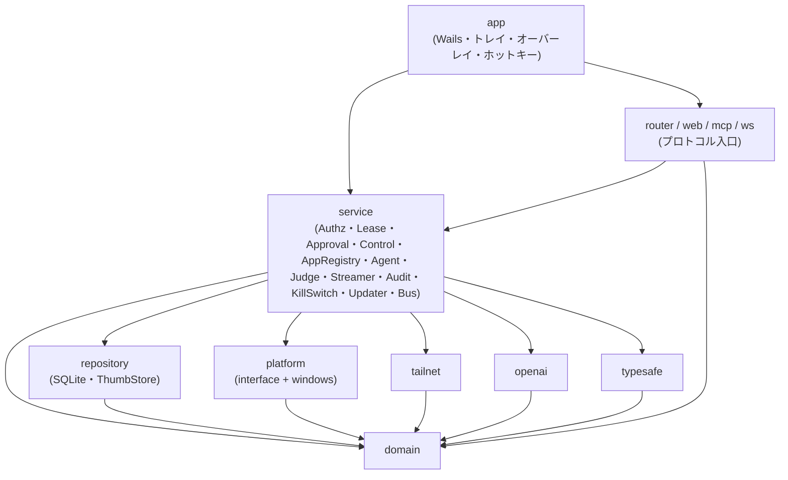
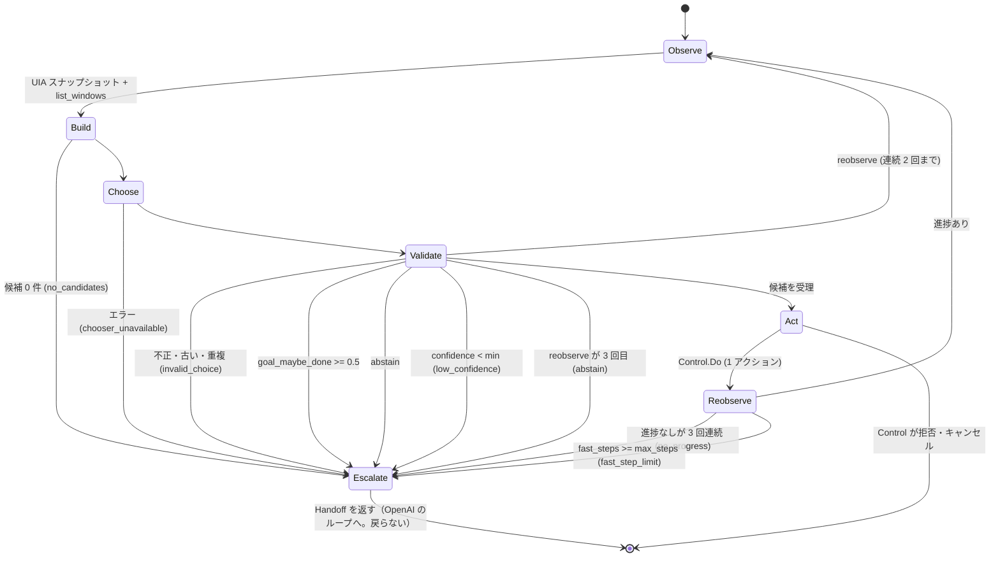
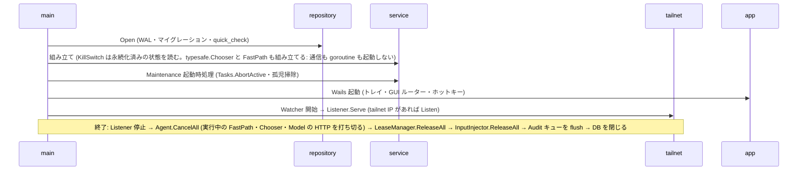

# コンポーネント設計

要件は [機能要件](../requirements/functional.md) / [非機能要件](../requirements/non-functional.md)、構成とレイヤーは [アーキテクチャ設計](../architecture/overview.md)、永続化は [ER](../architecture/er.md)、入口の仕様は [API 仕様](../api/endpoints.md) を参照。**M1 の実装が本書と異なる点、本書にあって M1 では未実装の点は §13 に集約する**（本文と §13 が食い違うときは、M1 の実装については §13 が事実）。

本書は `internal/` 配下の各パッケージの責務、依存、Go インターフェース、goroutine と状態の所有者を定める。シグネチャは設計上の契約であり、実装で引数を足す場合も、依存の向きと「誰が状態を持つか」は変えない。

## 1. コンポーネント一覧と依存関係



| パッケージ | 責務（一行） | 主な FR / NFR |
|-----------|------------|---------------|
| `domain` | 純粋なモデルとルール（リース状態機械、座標変換、承認モード、判定、エラー型、高速パスの候補表 `Candidate` / `CandidateTable`） | FR-L、FR-M16/M17、FR-G03、FR-G17 |
| `repository` | SQLite と `thumbs/` へのアクセス、マイグレーション | ER、NFR-A06/O05 |
| `platform` | OS 依存のインターフェースと Windows 実装（画面・入力・ウィンドウ・UI Automation・クリップボード・資格情報・アプリ起動 `AppLauncher`・ファイル選択 `FilePicker`） | FR-M、FR-M19、FR-H12、NFR-S06/S14/S20/O03 |
| `tailnet` | tailscaled 連携（IP 監視、WhoIs、Listener） | FR-A01〜A03、NFR-S05/A03 |
| `openai` | Responses API の `computer` ツール呼び出し。`store: false` 固定のステートレス継続（履歴の再送とスクリーンショットの間引き） | FR-G04〜G06、FR-G24、NFR-S16 |
| `typesafe` | TypeSafe（Jev）の HTTP クライアント。境界のインターフェース `Chooser`。高速パスが有効なときだけ呼ばれる | FR-G18、FR-G21、NFR-S18 |
| `service` | ユースケース（下記 §5）。状態を持つのは主にここ | 全般 |
| `mcp` / `web` / `ws` / `router` | リモート・GUI の入口。`service` と `domain` だけに依存する | API 仕様 |
| `app` | Wails のウィンドウ・トレイ・オーバーレイ・グローバルホットキー、起動・終了の組み立て | FR-H、FR-S08 |

**依存の規則**

- 矢印の逆向きの import は禁止。`mcp` / `web` / `ws` は `repository`・`platform`・`tailnet` を import しない（`scripts/check-imports.sh` が `go list` で検査する。実際の許可は §13.1）
- インターフェースの置き場所は、OS・外部サービスの境界（`platform`、`tailnet`、`openai`、`typesafe`）では**境界側のパッケージ**に置き、`service` のテストはそれを偽の実装に差し替える。`service` 内のコンポーネント（`LeaseManager`、`Judge`、`FastPath` など）は `service` に置く。いずれも、利用側が具象型ではなくインターフェースに依存する
- 時刻と乱数は `domain.Clock` / `domain.IDGen` を注入する（テストの決定性のため）
- すべての長時間処理は `context.Context` を第 1 引数に取り、キャンセルで確実に終了する

## 2. domain

状態を持たない値と純粋関数のみ。外部 I/O をしない。

```go
// 操作主体。リースの保持者とも、監査ログの actor とも対応する。
type ActorKind string // "mcp" | "web" | "agent" | "host" | "system"

type Actor struct {
    Kind      ActorKind
    ClientID  string // 未登録・host・system は空
    Label     string // 表示名のスナップショット
    SessionID string // MCP セッション / viewer_id / task_id（監査用の文字列）
}

type ApprovalMode string // "always" | "first_time" | "auto"

type Client struct {
    ID, StableNodeID, LoginName, DisplayName string
    WebEnabled, MCPEnabled, AgentEnabled     bool
    ApprovalMode                             ApprovalMode
    ApprovedAt                               *time.Time
}

// 座標。MCP は Scaled 座標、WebSocket は Physical 座標を使う（API 仕様 §3.2 / §5.3）。
type Monitor struct {
    Index   int
    Primary bool
    Origin  Point // 仮想デスクトップ上の物理座標
    Size    Size  // 物理ピクセル
    DPI     float64
}
func (m Monitor) Scale(maxDim int) float64 // min(1, maxDim / 長辺)
func (m Monitor) ScaledToPhysical(p Point, maxDim int) (Point, error) // 範囲外は ErrInvalidCoordinates
func (m Monitor) PhysicalToScaled(p Point, maxDim int) Point

// ツールの操作（MCP・WebSocket・エージェントが共通で組み立てる）。
type Op interface{ isOp() }
type MouseMove struct{ At Point; Monitor int }
type Click struct{ At *Point; Button Button; Count int; Mods []Modifier; Monitor int }
type Drag struct{ From, To Point; Mods []Modifier; Monitor int }
type Scroll struct{ At Point; Dir Direction; Amount int; Monitor int }
type KeyPress struct{ Keys KeyCombo }
type TypeText struct{ Text string }
type FocusWindow struct{ ID string }
type Wheel struct{ At Point; DX, DY float64; Monitor int } // ホイール。単位はノッチ（小数可。dy > 0 が下、dx > 0 が右。API 仕様 §5.3）。WebSocket の input.mouse wheel 用
// Web UI の WebSocket（input.*）用。座標は縮小座標ではなく**ストリームの座標**（Monitor の物理ピクセル。Monitor の左上が原点）。
type PointerMove struct{ At Point; Monitor int }                                       // input.mouse move
type MouseButton struct{ At Point; Button Button; Action ButtonAction; Monitor int }   // input.mouse down / up（ButtonAction = "down" | "up"）
// KeyEvent（Action = KeyDown | KeyUp。Code・Key・Mods）も Op。input.key
// ... ClipboardRead / ClipboardWrite / GetUITree / Wait

// エージェントが 1 件ずつ検査を受ける対象。OpenAI のアクションを Op へ写像したもの。
type Action struct {
    Op     Op
    Source string // "mcp" | "web" | "agent"
}

type Verdict int // Allow < RequireApproval < Deny（厳しさの順）
func Stricter(a, b Verdict) Verdict

type TaskStatus string // pending_approval | running | completed | failed | cancelled | limit_reached | aborted | denied
func (s TaskStatus) Terminal() bool

// エラー（API 仕様 §2 の code と 1 対 1）。errors.Is で判定する。
var (
    ErrLeaseRequired, ErrLeaseHeldByOther, ErrLeaseRevoked, ErrApprovalDenied,
    ErrApprovalTimeout, ErrKillSwitchActive, ErrInvalidCoordinates, ErrInvalidArgument,
    ErrWindowNotFound, ErrInputBlocked, ErrDesktopUnavailable, ErrAgentDisabled,
    ErrTaskNotFound, ErrJudgeDenied, ErrUnsupportedAction error
)
type Error struct{ Code string; Msg string; Detail map[string]any } // errors.As で取り出す
```

```go
// --- 高速パスの候補（FR-G16〜G20）。純粋な値と関数のみ。外部 I/O をしない ---

// UI Automation のスナップショット。platform.UIAutomation.Snapshot が返す。要素の値・テキスト本文は持たない。
type UIElement struct {
    ControlType int      // UIA の ControlType ID
    Name        string   // UIA の Name（ラベル）
    Enabled     bool
    Offscreen   bool
    Rect        Rect     // 物理座標の外接矩形
    Path        []string // 祖先パス: 役割クラスとラベルを持つ祖先の "role:label" を、根 → 親の順に並べたもの
    Chrome      bool     // ウィンドウ枠（タイトルバー・システムメニュー・最小化 / 最大化 / 閉じる）
    SameAsValue bool     // 名前と値が同一か（値そのものは持たない）
}
type UISnapshot struct {
    Window    WindowInfo
    Hash      string // ツリーのハッシュ。ControlType・名前・有効・画面外・矩形・トグル / 選択状態から作る。テキスト値は含めない
    Elements  []UIElement
    Truncated bool
}

type RoleClass string // button | menu_item | tab_item | hyperlink | check_box | radio_button | list_item | tree_item | combo_box | window
// UIA の ControlType → 役割クラスの対応表。表にない型（Edit・Document・Pane など）は ok=false で候補にしない。
func RoleClassOf(controlType int) (RoleClass, bool)

type CandidateKind string // "click" | "focus_window" | "reobserve" | "abstain"（v1 の高速パスに type / key / scroll はない）
type Candidate struct {
    ID       string // CandidateID の結果。要素の添字・実行時 ID は使わない
    Kind     CandidateKind
    Role     RoleClass
    Label    string
    Enabled  bool
    At       Point  // click: 外接矩形の中心（物理座標。アプリが計算する。Jev には送らない）
    Monitor  int
    WindowID string // focus_window
}

// ID = "c_" + hex(SHA-256(role, 0x00, NormalizeLabel(label), 0x00, join(path, "/")))[:12]
func CandidateID(role RoleClass, label string, path []string) string
func NormalizeLabel(s string) string                         // 前後の空白除去・連続空白の圧縮・小文字化
func LabelExcluded(label string, excluded []string) bool     // 大文字小文字を区別しない部分一致

type CandidateSource struct { Snapshot UISnapshot; Windows []WindowInfo } // Windows は list_windows の結果（focus_window 用）
type CandidateOptions struct { Max int; ExcludedLabels []string }        // Max は 24

// 候補表は構築後に変更できない値（変更するメソッドを持たない）。Jev の応答は、問い合わせに使った表そのものに対して検証する。
type CandidateTable struct{ /* 非公開: candidates []Candidate; byID map[string]int; dropped int */ }
func BuildCandidateTable(src CandidateSource, opt CandidateOptions) CandidateTable
func (t CandidateTable) Candidates() []Candidate // 複製を返す。reobserve / abstain は含まない
func (t CandidateTable) Len() int
func (t CandidateTable) Dropped() int            // 上限超過と ID 衝突で表から落とした数（ログに出す）
// 選択の検証。表に 1 件だけある ID、または "reobserve" / "abstain" だけを受理する。
// 未知・空・重複・形式不正・古い表の ID は ErrInvalidChoice。
func (t CandidateTable) Validate(choice string) (Candidate, error)

const ChoiceReobserve, ChoiceAbstain = "reobserve", "abstain"
var ErrInvalidChoice error // 内部エラー。API の code には対応しない（引き継ぎ理由 invalid_choice へ写像）

type HandoffReason string // abstain | low_confidence | no_candidates | invalid_choice | no_progress | goal_maybe_done | fast_step_limit | chooser_unavailable
func (r HandoffReason) Valid() bool
```

`BuildCandidateTable` の規則（FR-G17）:

1. 採用する要素は、有効・画面内・ラベルが空でない・`Chrome` でない・`SameAsValue` でない、かつ `RoleClassOf` が ok のものだけ
2. `LabelExcluded`（`agent.fastpath.excluded_labels`。FR-S18）に当たるラベルは除く
3. `click` 候補は外接矩形の（上端, 左端）の昇順に並べ、その後ろに `list_windows` から作る `focus_window` 候補（前面・自プロセス・昇格ウィンドウは除く）を並べる
4. ID が衝突する候補は、決定的にするため**すべて**表から落とす（`Dropped` に数える）
5. 先頭から `Max`（24）件で切り、超過分を `Dropped` に数える

**起動許可アプリ（M1.5。FR-M18・M19・H12）**。外部 I/O を持たない値と検証だけ。

```go
type LaunchableApp struct {
    ID, Label, ExePath, WorkingDir string // ID は ULID（MCP の app_id）。WorkingDir が空なら実行ファイルのディレクトリ
    Args                           []string // 登録時に固定
    CreatedAt, UpdatedAt           time.Time
    Corrupt                        bool // DB には無い。args_json が文字列の配列として読めない行（手で書き換えられた）。Args は空。起動は CheckLaunchTarget が拒否する
}
// MCP に出せるのはこれだけ。パス・引数・作業ディレクトリは型に無い（Control が返す型として使い、漏れを型で防ぐ）。
type AppSummary struct{ ID, Label string }
func (a LaunchableApp) Summary() AppSummary

// GUI のフォームの入力（ID・時刻は service が付ける）。
type AppInput struct{ Label, ExePath, WorkingDir string; Args []string }
const MaxLaunchableApps = 50 // NFR-C06

// 形の検証（純粋。ファイルの存在は見ない）。項目名 → メッセージ。空なら有効。
//  Label: 前後の空白を除いて 1〜64 文字。ExePath: 絶対パスのローカルの .exe（ドライブ文字で始まる。UNC・\\?\ ・\\.\ ・相対パス・".." の要素を含むパスは不可）。
//  Args: 32 個以内・合計 8,192 文字以内（NUL を含まない）。WorkingDir: 空、または絶対パスのローカルのパス（ExePath と同じ形の規則。".." を含まない）。
//  ExePath・WorkingDir 共通のパスの規則（isAbsoluteLocalPath）: 各 32,766 文字（UTF-16。終端の NUL を含めて 32,767）以内。ドライブ指定（2 文字目）以外の ":"（代替データストリーム）、<>"|?*、C0 制御文字と DEL を含まない。
//  予約デバイス名（CON・PRN・AUX・NUL・COM1〜9・LPT1〜9、上付き数字の COM¹²³・LPT¹²³、コンソールの CONIN$・CONOUT$）の要素を含まない（大文字小文字を区別せず、末尾のドット・空白を落とした後の、最初の "." より前で判定。拡張子付き・ディレクトリの要素でも不可）。
//  戻り値のキーは定数 AppFieldLabel / AppFieldExePath / AppFieldArgs / AppFieldWorkingDir（"label" / "exe_path" / "args" / "working_dir"）。メッセージに入力値（パス・引数）は含めない。
func ValidateAppInput(in AppInput) map[string]string
func ParseArgsLines(s string) []string // フォームの改行区切り（CRLF 可）を分割する。空行は捨てる（空文字の引数は登録できない）
// 起動のたびの再検査（NFR-S20 (3)）。ValidateAppInput と同じ形の規則を、保存済みの行に当てる。満たさない行・読めない行（Corrupt）は ErrAppNotFound。
func CheckLaunchTarget(a LaunchableApp) error

type LaunchFailure string // "file_missing" | "access_denied" | "elevation_required" | "other"（API 仕様 §2 `launch_failed` の reason。FR-AU06）
// 定数: LaunchFileMissing / LaunchAccessDenied / LaunchElevationRequired / LaunchOther。
// ErrAppNotFound（code app_not_found）と ErrLaunchFailed（code launch_failed。Detail["reason"] に LaunchFailure）を §2 のエラー型に加える。
// reason つきの ErrLaunchFailed は NewLaunchFailed(reason) で作る（未知の reason は LaunchOther に丸め、Detail に任意の文字列が入らないようにする）。
```

**不変条件**: `domain` は他の内部パッケージを import しない。`Monitor.ScaledToPhysical` と `PhysicalToScaled` は丸めの誤差が 1 px を超えない（プロパティテスト）。`CandidateID` は同じ入力に同じ出力を返し、要素の並び・添字・実行時 ID に依存しない。`CandidateTable.Validate` は表に無い文字列を一切受理しない（プロパティテスト）。

## 3. platform（OS 依存）

`internal/platform` にインターフェース、`internal/platform/windows` に実装を置く。**1 つのインターフェースに 1 つの責務**とし、goroutine を内部で起動するものは下に明記する。

```go
// 画面キャプチャ。モニターごとに 1 つ。DXGI を主、GDI をフォールバックとする。
type Capturer interface {
    Monitors(ctx context.Context) ([]domain.Monitor, error)
    // 1 枚を撮る（screenshot ツール・エージェント・サムネイル用）。呼び出しごとに完結する。
    Grab(ctx context.Context, monitor int) (*image.RGBA, error)
    // 継続キャプチャを開始する（Streamer 用）。frames は変化した矩形つきで流れる。
    // ctx のキャンセルまたは Stop で停止する。DXGI の ACCESS_LOST は内部で再初期化し、
    // 復旧できなければ ErrDesktopUnavailable を errs に流して GDI に切り替える。
    Watch(ctx context.Context, monitor int, fps int) (frames <-chan Frame, errs <-chan error, err error)
}
type Frame struct{ Image *image.RGBA; Dirty []image.Rectangle; Seq uint32 }

// 入力注入。InputGuard を通った後にだけ呼ばれる（呼び出し側の責任ではなく、service.Control が唯一の呼び出し元）。
type InputInjector interface {
    MoveTo(ctx context.Context, p domain.Point) error // 仮想デスクトップの物理座標
    Click(ctx context.Context, b domain.Button, count int, mods []domain.Modifier) error
    Button(ctx context.Context, b domain.Button, a domain.ButtonAction) error // 現在のカーソル位置でボタンを押す・離す（Web UI の input.mouse down / up）。押したままのボタンは ReleaseAll が離す
    Drag(ctx context.Context, from, to domain.Point, mods []domain.Modifier) error
    Scroll(ctx context.Context, at domain.Point, dir domain.Direction, amount int) error
    Wheel(ctx context.Context, at domain.Point, dx, dy float64) error // ノッチ単位（小数可）。× 120（WHEEL_DELTA）を丸めて注入し、端数は実装が持ち越す。縦は Win32 の正が上向きのため dy の符号を反転する
    Key(ctx context.Context, k domain.KeyCombo) error
    KeyEvent(ctx context.Context, e domain.KeyEvent) error // Web UI の down / up
    Text(ctx context.Context, s string) error // KEYEVENTF_UNICODE
    ReleaseAll() error // 押下中のキー・ボタン（KeyEvent・Button で押したもの）をすべて解放（中断・キルスイッチ時）
    CursorPos() (domain.Point, error)
}

type WindowManager interface {
    List(ctx context.Context) ([]domain.WindowInfo, error)
    At(p domain.Point) (domain.WindowInfo, bool, error)  // 座標上の最上位ウィンドウ（InputGuard 用）。クリック透過のオーバーレイ（Overlay）は飛ばし、下の実ウィンドウを返す
    Foreground() (domain.WindowInfo, error)
    Focus(ctx context.Context, id string) error
}
type WindowInfo struct {
    ID, Title, Process string; PID uint32; Rect domain.Rect; Monitor int
    Foreground, Minimized, Elevated, Own bool // Own: 自プロセスのウィンドウ
    Overlay bool // Own のうち、クリック透過（WS_EX_TRANSPARENT かつ WS_EX_LAYERED）の操作中オーバーレイ。InputGuard は拒否しない
}

type UIAutomation interface {
    Tree(ctx context.Context, windowID string, maxDepth, maxNodes int) (domain.UINode, error)
    // 高速パスの候補表の入力。windowID が空なら前面ウィンドウ。1 回の呼び出しで 1 つの整合したスナップショットを返す。
    // 要素の値・テキスト本文は返さない（名前と値が同一かの真偽だけ）。maxNodes を超えたら Truncated。
    Snapshot(ctx context.Context, windowID string, maxNodes int) (domain.UISnapshot, error)
}
type Clipboard interface {
    ReadText(ctx context.Context) (string, error)
    WriteText(ctx context.Context, s string) error
}
type SecretStore interface { // 資格情報マネージャー（go-keyring）。name は下記の定数
    Get(name string) (string, error)  // 未登録は ErrNotFound
    Set(name, value string) error
    Delete(name string) error
}
const (
    SecretOpenAI   = "puppet-remo/openai"
    SecretTypeSafe = "puppet-remo/typesafe" // 高速パス。値は登録後に表示しない（FR-G22）
)
// アプリ起動（M1.5。FR-M19）。service.Control が唯一の呼び出し元。goroutine を持たず、呼び出し元の goroutine で同期的に動く。
type AppLauncher interface {
    // CreateProcess。spec.ExePath を lpApplicationName に明示し、コマンドラインは「引用した ExePath + Args」を Windows の引数規則（CommandLineToArgvW の逆）で組み立てる。
    // シェルを経由せず、標準権限のまま起動し、環境変数は本アプリのものを引き継ぐ。プロセスの作成に成功した時点で返す（ウィンドウは待たない）。
    // 失敗は *LaunchError（Reason は file_missing / access_denied / elevation_required / other。パス・引数をメッセージに含めない）。
    // 空の ExePath・絶対パスでない ExePath（Windows 実装）・コマンドラインに組めない値（NUL など。引用後の全体が 32,766 UTF-16 ユニット（終端の NUL を含めて 32,767）を超えるものを含む）は domain.ErrInvalidArgument。
    Launch(ctx context.Context, spec LaunchSpec) (pid uint32, err error)
    // 登録・更新時の存在確認: exePath が存在する通常ファイルか、workingDir（空でなければ）が存在するディレクトリか。
    // 無ければ platform.ErrNotFound（SecretStore と共通。パスをメッセージに含めない）。ERROR_INVALID_NAME（123）・ERROR_BAD_PATHNAME（161）も「無い」として写す（Windows 実装）。
    Inspect(ctx context.Context, exePath, workingDir string) error
}
type LaunchSpec struct{ ExePath string; Args []string; WorkingDir string } // WorkingDir が空なら ExePath のディレクトリ
type LaunchError struct{ Reason domain.LaunchFailure; Err error } // Error() は理由だけ（パス・引数を含めない）。Err は Win32 のエラーコードだけを持つ（errors.Is / As 用）

// ネイティブのファイル選択ダイアログ（M1.5。FR-H12）。`.exe` のフィルターで、ホスト GUI のメインウィンドウを親にしたモーダル。
// ダイアログは自プロセスのウィンドウなので、InputGuard の自己保護（NFR-S06）が AI の入力を拒む。ctx の取り消しでダイアログを閉じる。
type FilePicker interface {
    PickExecutable(ctx context.Context) (path string, ok bool, err error) // ok=false はキャンセル
}
type Hotkey interface { // グローバルホットキー
    Register(spec string, fn func()) (unregister func(), err error)
}
type Power interface { // スリープ抑止
    KeepAwake(on bool)
}
type Installer interface { // 署名検証済みの更新のインストーラの実行（M3・#74。FR-H09）
    Run(ctx context.Context, path string) error // `/S`（サイレント）で起動し、終了は待たない。アプリの終了は呼び出し側（Updater）が行う
}
```

**所有する goroutine**: `Capturer.Watch` が 1 モニターにつき 1 本のキャプチャ goroutine を持つ（`ctx` で停止。呼び出し側が閲覧者ゼロで取り消す）。`Hotkey.Register` が Win32 のメッセージループ用に 1 本の専用 OS スレッド（`runtime.LockOSThread`）を持つ。`FilePicker.PickExecutable` は、ダイアログを開いている間だけ `ctx` の取り消しを監視する goroutine を 1 本持つ（ダイアログ自体は呼び出し元の goroutine を OS スレッドに固定して開き、閉じるまで戻らない。同時に開くのは 1 つ）。それ以外のインターフェースは goroutine を内部に持たず、呼び出し元のそれで同期的に動く。

**スレッドの制約**: Win32 の入力注入・UI Automation（COM）は、スレッドアフィニティを持つ。`InputInjector` と `UIAutomation`（`Tree` / `Snapshot`）の実装は、専用の goroutine（OS スレッドに固定）へ呼び出しを直列化して渡す（呼び出し側から見るとスレッドセーフな同期呼び出し）。UI Automation のワーカーへの呼び出しは `ctx` を受け、`ctx` が取り消されたら、専用スレッドの処理の終了を待たずに `ctx.Err()` を返す（ワーカーに積まれた処理が長引いても、呼び出し側の待ちが縛られない。§13.3）。`Snapshot` はこのスレッドで 1 回のキャッシュ要求（`CacheRequest`）にまとめ、COM の往復を減らす。`InputInjector` のホイールの端数の持ち越しも、この専用スレッドが所有する（排他不要。`ReleaseAll` で破棄）。

### InputGuard は platform ではなく service にある

`InputGuard`（NFR-S06）は `WindowManager` と `domain` を使う純粋な判定なので `service` に置く（§5.4）。`platform` は事実（座標上のウィンドウ、自プロセスか、昇格しているか）を返すだけで、許可・拒否を決めない。拒否の理由（`domain.InputBlockReason`）は `InputGuard` と `list_windows` の `blocked` で共通で、自ウィンドウの範囲の縮小座標への変換（`domain.Monitor.ScaledRect`・`domain.OwnWindowRegions`）も `domain` の純粋な関数にあり、`Control.Screenshot` は `Shot.OwnWindows` に、MCP は `list_windows` の `rect` と同じ変換で、同じ範囲を返す（FR-M20）。スクリーンショットの画像には印を描かない（キャプチャの経路は `Grab` → 縮小 → 符号化のままで、NFR-S06 のキャプチャ除外は `app` が設定する）。

## 4. repository・tailnet・openai・typesafe

### 4.1 repository

すべての関数が `context.Context` を取り、SQLite へのアクセスは 1 つの `*sql.DB`（WAL、`SetMaxOpenConns` は書き込みを 1 に直列化）を共有する。

```go
type Clients interface {
    Get(ctx, id string) (domain.Client, error)
    ByNode(ctx, stableNodeID string) (domain.Client, error) // 未登録は ErrNotFound
    List(ctx) ([]domain.Client, error)
    Create(ctx, c domain.Client) error
    Update(ctx, id string, patch ClientPatch) error // approval_mode 変更時は approved_at を NULL に戻す
    Delete(ctx, id string) error                     // client_tokens は CASCADE
    TouchSeen(ctx, id string, at time.Time) error
}
type Tokens interface {
    Create(ctx, t TokenRecord) error                            // ハッシュのみ
    ByHash(ctx, sha256 [32]byte) (TokenRecord, error)           // 引数はトークン文字列（接頭辞 `prm_` を含む）の SHA-256。形式は NFR-S04。ハッシュの定数時間比較は Authz が行う
    ListByClient(ctx, clientID string) ([]TokenRecord, error)
    Revoke(ctx, id string, at time.Time) error
    TouchUsed(ctx, id string, at time.Time) error
}
type ConnRequests interface {
    UpsertPending(ctx, r ConnRequest) (ConnRequest, created bool, err error) // 1 デバイス 1 件に集約
    Decide(ctx, id string, status string, clientID *string) error
    DeniedActive(ctx, stableNodeID string, now time.Time) (bool, error)
    ListPending(ctx) ([]ConnRequest, error)
    Expire(ctx, now time.Time) error
}
type Settings interface {
    Get(ctx, key string) (json.RawMessage, bool, error)
    Set(ctx, key string, value json.RawMessage) error
    All(ctx) (map[string]json.RawMessage, error)
}
// M1.5。起動許可リスト（FR-H12）。書き込みは service.AppRegistry だけ。
type LaunchableApps interface {
    Get(ctx, id string) (domain.LaunchableApp, error)  // 無ければ ErrNotFound
    List(ctx) ([]domain.LaunchableApp, error)          // label の昇順（NOCASE）
    // 件数の確認と挿入を同じトランザクションで行う。limit 件に達していれば ErrLimitReached、label の重複は ErrConflict。
    Create(ctx, a domain.LaunchableApp, limit int) error
    Update(ctx, a domain.LaunchableApp) error          // 無ければ ErrNotFound、label の重複は ErrConflict
    Delete(ctx, id string) error                       // 無ければ ErrNotFound
}
type Audit interface {
    Append(ctx, e AuditEntry) (id int64, err error)
    Query(ctx, q AuditQuery) ([]AuditEntry, next int64, err error)
    Get(ctx, id int64) (AuditEntry, error)                               // 詳細（detail_json・サムネイルのメタを含む）。無ければ ErrNotFound
    AttachThumb(ctx, auditID int64, t ThumbMeta) error
    PurgeBefore(ctx, t time.Time) (removedThumbs []string, err error)    // 行を先に削除し、ファイルは呼び出し側が消す
    PurgeThumbsOver(ctx, maxBytes int64) (removedThumbs []string, err error)
    ThumbPaths(ctx) ([]string, error)                                    // 孤児の掃除用: audit_thumbnails の全 rel_path
    PurgeMissingThumbs(ctx, exists func(rel string) bool) (int, error)   // 孤児の掃除用: ファイルの無い行を削除（ログ行は残す）
}
type Tasks interface {
    Create(ctx, t TaskRecord) error
    Update(ctx, id string, patch TaskPatch) error
    Get(ctx, id string) (TaskRecord, error)
    List(ctx, clientID string, limit int) ([]TaskRecord, error)
    AbortActive(ctx, now time.Time) (int, error) // 起動時: pending_approval/running → aborted
}
type ThumbStore interface { // thumbs/ 配下のファイル
    Save(ctx, relPath string, jpeg []byte) error
    Open(relPath string) (io.ReadCloser, error) // パス走査を拒否
    Remove(relPath string) error
    SweepOrphans(ctx, known func(rel string) bool) error
}
// DB.Thumbs() が thumbs/（DB ファイルと同じディレクトリ）の ThumbStore を返す。
```

**所有する goroutine / 状態**: `repository` は goroutine を持たない（保守処理のタイマーは `service/maintenance` が持つ）。マイグレーションは `Open` が起動時に同期で実行する。

`TaskRecord` / `TaskPatch` は `fast_steps`、`openai_steps`、`handoff_reason`（NULL 可。8 種の列挙を `CHECK`）を持つ（[ER](../architecture/er.md)、FR-G23）。

### 4.2 tailnet

```go
type Watcher interface { // tailscaled の状態を監視する
    // 状態（ログイン済みか、tailnet IP、MagicDNS 名）の変化を流す。WatchIPNBus を使い、切断時は再接続する。
    Watch(ctx context.Context) (<-chan Status, error)
}
type Status struct{ LoggedIn bool; IPs []netip.Addr; DNSName string; Err error }

type WhoIs interface { // 接続元 IP → ユーザー・デバイス（10 秒キャッシュ）
    Lookup(ctx context.Context, remoteAddr string) (Identity, error) // 失敗は ErrWhoIsFailed（fail closed）
}
type Identity struct{ LoginName, StableNodeID, NodeName string }

type Listener interface { // tailnet アドレスだけで Listen する
    // Status.IPs のうち取れたアドレス（IPv4・IPv6）のそれぞれに bind する。片方だけ取れたらそれで動作する。
    // 両方とも取れない間は停止して理由を Reason に出す。状態の変化に追従して Listen を張り直す。
    Serve(ctx context.Context, h http.Handler, port func() int) error
    State() ListenState // { Listening bool; Addrs []string; Reason string }
}
```

**所有する goroutine**: `Watcher` が 1 本（`WatchIPNBus` の読み取り）、`Listener` が Listen 用にアドレスごとに 1 本（最大 IPv4・IPv6 の 2 本）と接続ごとの標準の `http.Server` の goroutine。`WhoIs` は goroutine を持たず、キャッシュは `sync.Mutex` で守る `map` + 有効期限（TTL 10 秒。期限切れの掃除をするため `sync.Map` ではない）で、LocalAPI の 1 回の呼び出しは 5 秒で打ち切る（超えたら `ErrWhoIsFailed`。fail closed）。Listener の再起動は 10 秒以内に完了する（NFR-A03）。`0.0.0.0`・`127.0.0.1`・tailnet 以外のアドレスでは Listen しない（FR-A01、NFR-S01）。ビルドタグ `e2e` のテスト専用の `Listener` は M2 で足す（M1 には無い）。`http.Server` の設定は §13.4。

### 4.3 openai

```go
// service/agent が使うモデルのインターフェース。テストではモックする（NFR-O06）。
type Model interface {
    // 1 ステップ（Responses API 呼び出し 1 回）。60 秒でタイムアウト（NFR-S16）。再試行しない。
    // 常に store: false。previous_response_id は使わない（FR-G24）。
    Step(ctx context.Context, in StepInput) (StepOutput, error)
}
type StepInput struct {
    Model   string
    History *History // 呼び出し側（run）が所有し、Step は読むだけ
}
type StepOutput struct {
    ResponseID   string               // 診断用（監査・ログ）。継続には使わない
    Items        []OutputItem         // 出力アイテム（原文のまま。History へ追記して次回に返す）
    Actions      []domain.Op          // computer_call の actions[] を写像したもの
    CallID       string
    SafetyChecks []SafetyCheck        // pending_safety_checks
    FinalText    string               // computer_call が返らなかったときの最終回答
    Usage        Usage                // input / output トークン
}
type OutputItem struct{ Raw json.RawMessage } // 変更せず、そのまま次の呼び出しへ返す

// ステートレス継続の履歴（FR-G24）。run が 1 タスクにつき 1 つ持つ。
type History struct{ /* 非公開: items []item; keep int */ }
// 指示、高速パスの文章要約（無ければ空）、最初のスクリーンショットから最初のユーザーメッセージを作る。
func NewHistory(instruction, handoffSummary string, firstShot []byte, keepScreenshots int) *History
func (h *History) AddOutput(items []OutputItem)
// computer_call_output を追加し、直近 keep 枚を超える古いスクリーンショットをプレースホルダのテキストへ置き換える。
func (h *History) AddComputerOutput(callID string, shot []byte, ack []SafetyCheck)
func (h *History) Screenshots() int
const OmittedScreenshot = "[screenshot omitted]"
```

実装は `openai-go/v3` の `responses.ComputerToolParam`（`{type:"computer"}`）を使う。毎回の要求は、指示・これまでの出力アイテム（原文のまま）・`computer_call_output`（`History` が保持する直近 `agent.keep_screenshots` 枚だけ画像つき）で組み立てる。スクリーンショットは PNG・`detail: "original"`（最大辺の既定 1568 px。FR-S03）。`include` に何が要るか（推論の暗号化コンテンツなど）は実 API のスモークで確認する（§12.2）。未知のアクション種別は `ErrUnsupportedAction`。API キーは呼び出しごとに `SecretStore`（`puppet-remo/openai`）から読み、**ログ・エラーメッセージに出さない**（`http.RoundTripper` で `Authorization` を伏せる）。**所有する goroutine**: なし（呼び出しは `ctx` で取り消せる）。`History` は `run` の goroutine だけが触る。

### 4.4 typesafe

```go
package typesafe

// 境界のインターフェース。FastPath が使い、テストではモックする（NFR-O06）。
type Chooser interface {
    // 1 回の問い合わせ。5 秒でタイムアウト（NFR-S18）。自動再試行はしない。
    Choose(ctx context.Context, req ChoiceRequest) (ChoiceResult, error)
}
type ChoiceRequest struct {
    Model    string          // agent.fastpath.model（既定 jev-1.13）
    Goal     string          // タスクの指示
    Window   ChoiceWindow    // { Title, Process string }。タイトルは送る（NFR-PR04）
    Elements []ChoiceElement // { ID, Role, Label string; Enabled bool }。値・テキスト本文は持たない。focus_window の候補は Role "window"
    History  []string        // 直近 5 件の高速ステップの短い文（入力した文字列の本文は含めない）
}
type ChoiceResult struct {
    Choice        string  // 候補の ID、"reobserve"、"abstain"
    Confidence    float64 // Choice 質問の確信度（0〜1）
    GoalMaybeDone float64 // Noul 質問 goal_maybe_done の確率（0〜1）
}
var (
    ErrUnavailable  error // タイムアウト・ネットワークエラー・5xx・429・要求本文が 256 KiB 超
    ErrUnauthorized error // 401（キー無効）
    ErrBadResponse  error // 応答の解析に失敗（FastPath は invalid_choice として扱う）
)

type Config struct { Endpoint string; Timeout time.Duration; MaxBody int } // 既定: https://api.typesafe.ai/v1/systemone、5 秒、256 KiB（Endpoint の差し替えはテスト用の引数で、設定項目にはしない）
func New(key func(ctx context.Context) (string, error), cfg Config) Chooser
```

`Choose` は、`Elements` から Choice 質問 `next`（criteria は「候補 ID → 短い説明」に `reobserve` と `abstain` を加えたもの）と Noul 質問 `goal_maybe_done`（履歴と要素から見て目的は既に達成されているか）を組み立て、`POST /v1/systemone` を 1 回送る。`Authorization: Bearer` のキーは**呼び出しごとに** `key` 関数（実体は `SecretStore.Get(SecretTypeSafe)`）から読み、ログ・エラー・`slog` に出さない（`http.RoundTripper` で伏せる）。スクリーンショット・要素の値・クリップボード・入力した文字列の本文・API キーは `ChoiceRequest` に入る欄がなく、送れない。**所有する goroutine**: なし（呼び出しは `ctx` で取り消せる）。

## 5. service

### 5.1 一覧と状態の所有者

| コンポーネント | 持つ状態 | goroutine | 排他 |
|---------------|---------|-----------|------|
| `LeaseManager` | 現在のリース（保持者・状態・最終活動時刻） | アイドルタイマー 1 本 | `sync.Mutex` 1 つで全遷移を直列化 |
| `Approval` | 承認待ちの要求（id → チャネル） | なし（要求ごとの待機は呼び出し側の goroutine） | `sync.Mutex` |
| `Control` | なし（ステートレス。検査の順序を定義する） | なし | — |
| `Judge` | なし（設定のスナップショットは都度読む） | なし | — |
| `AppRegistry` | なし（ステートレス。許可リストの正は `repository.LaunchableApps`） | なし | — |
| `Agent` | 実行中タスクの `*run`（高々 1 つ。ステップ数・`History`・高速パスのカウンタを含む） | タスクごとに 1 本（ループ。高速パスもこの goroutine で動く） | `sync.Mutex`（`run` の参照の差し替え）。`run` の内部状態は goroutine 1 本だけが触る |
| `FastPath` | なし（`Agent` の内部部品。タスクごとの状態は `run` が持つ） | なし（`run` の goroutine で同期的に動く） | 不要（候補表は不変の値） |
| `Streamer` | 閲覧者の一覧、(モニター, 品質, FPS) ごとのプロファイルとエンコード結果 | モニターごとにキャプチャ受信 1 本 + エンコード、閲覧者ごとに送信 1 本 | `sync.RWMutex` |
| `KillSwitch` | 発動状態（永続化済みのものをキャッシュ） | なし | `sync.Mutex` |
| `Authz` | なし（レート制限のカウンタのみメモリ） | なし | 固定窓のカウンタを `sync.Mutex` で保護 |
| `Audit` | なし（書き込みは `repository.Audit` へ） | 書き込みキュー 1 本（バッファ付きチャネル） | — |
| `Updater` | 最新版の確認結果 | 定期確認 1 本 | `sync.Mutex` |
| `Bus` | 購読者（GUI の `GET /poll` のトースト待ち行列・`GET /events`（SSE）、WebSocket の `lease`） | なし（`Publish` は購読者ごとのバッファ付きチャネルへ非ブロッキングで送る） | `sync.RWMutex` |
| `Maintenance` | なし | 1 時間ごとのタイマー 1 本 | — |

**状態の所有者は 1 つだけ**。たとえばリースは `LeaseManager` だけが持ち、他のコンポーネントは `Holder()` で読む。`Bus` を除き、コンポーネント同士はコールバックではなくインターフェースの呼び出しで協調する。ロックを持ったまま他のコンポーネントを呼ばない（`LeaseManager` は承認待ちの間ロックを手放す）。

### 5.2 LeaseManager

```go
type LeaseManager interface {
    // 取得。承認が要らなければ idle → held（保持者種別は mcp と web）。M3 から、クライアントの承認モード（FR-L07）が承認を求めるときは
    // idle → pending_approval にして、ロックを手放してから Approval に問い合わせて待つ（最大 60 秒）。許可で held、拒否は ErrApprovalDenied、
    // タイムアウトは ErrApprovalTimeout。待ち中の ctx のキャンセルは ctx.Err()、キルスイッチの発動は ErrKillSwitchActive（後から許可されても held にならない）、
    // セッション切断・クライアントの削除・無効化は ErrLeaseRequired（取り下げ）で、いずれも idle に戻る。他者が保持中、または承認待ちは ErrLeaseHeldByOther。
    // 拒否・タイムアウトの直後 30 秒（ApprovalCooldown）は、同じクライアントの取得を承認なしで ErrApprovalDenied にする。
    // 監査は承認の遷移ごとに approval.requested / granted / denied / timeout / withdrawn を記録する（kind = lease）。
    Acquire(ctx context.Context, who domain.Actor) (Lease, error)
    // Acquire の待たない版（Web の POST /viewer/lease/acquire）。承認が要れば承認待ちにして待ちを LeaseManager の goroutine に渡し、
    // すぐ (承認待ちのリース, true, nil) を返す。結果は lease の変化（許可）と Bus の lease-result（拒否・タイムアウト）。
    // すでに承認待ちの who は承認を二重に作らず pending = true。
    RequestAcquire(ctx context.Context, who domain.Actor) (l Lease, pending bool, err error)
    // 拒否・タイムアウト後のクールダウンを解く（承認のリセット・承認モードの変更・クライアントの削除）。
    ClearApprovalCooldown(clientID string)
    // 保持者のみ。保持していなければ何もしない。
    Release(who domain.Actor)
    // セッション切断（FR-L05）。Release と同じだが、監査の理由が explicit ではなく disconnect になる。who の承認待ちがあれば取り下げて idle に戻す。
    ReleaseSession(who domain.Actor)
    // 強制剥奪（Web・ホスト。M2 から）。by は host か web（それ以外は ErrInvalidArgument）。保持者がいなければ何もせず nil（冪等）。
    // 保持者が agent（M4）ならタスクを中断する（Agent.Cancel を呼ぶ）。M2 では agent の保持者がいないので Cancel は呼ばない。
    // 剥奪された保持者の Check は、次の Acquire が成功するまで ErrLeaseRevoked を返し続ける。監査は lease.revoke（actor_type = by）。
    Revoke(by domain.Actor) error
    // 以後の入力操作が許されるかの確認。活動時刻を更新する（アイドル解放の起点）。
    Check(who domain.Actor) error // ErrLeaseRequired / ErrLeaseHeldByOther / ErrLeaseRevoked
    Holder() (Holder, bool)           // held のときだけ。承認待ちは Pending
    Pending() (PendingLease, bool)    // 承認待ち（pending_approval）の要求者。M3 から
    // キルスイッチ・セッション切断用。承認待ちがあれば取り下げる。
    ReleaseAll(reason string)
    Subscribe() <-chan domain.LeaseEvent // 変化（Bus 経由でも配る）
}
type Lease struct{ ID string; Holder domain.Actor; Since time.Time }
type Holder struct{ LeaseID string; Actor domain.Actor; Since time.Time; IdleRemaining time.Duration }
type PendingLease struct{ LeaseID string; Actor domain.Actor; Since time.Time } // LeaseID は承認されたときのリースの ID
```

- 保持者種別は `mcp`（M1）と `web`（M2）。`agent` は M4。状態は `idle → held → idle`（M1。FR-L03）。`pending_approval`（`idle → pending_approval → held`）は M3（FR-L07）で加わる。`pending_approval` の間は、他者の取得を `ErrLeaseHeldByOther` で断る。**要求者本人も同じ**（承認前の `Acquire`・`Check` は `ErrLeaseHeldByOther`。承認を待たずに `held` にしない。明示解放 `Release` は承認待ちに触れない。取り下げは `ctx` のキャンセル・キルスイッチ・セッション切断・クライアントの削除・無効化だけ）。承認が要るかは `domain.NeedsApproval(mode, approved_at)` が決める（`always` は常に、`first_time` は `approved_at` が NULL のときだけ、`auto` は要らない。定義外の値は要る）。保持者の再 `Acquire` は承認を要さず、活動として数える。取得者のクライアントが読めない（未登録・削除済み・読み取りの失敗）ときは承認を求めず取得させない（fail-closed）。`first_time` で許可されたら `clients.approved_at` を記録する（記録に失敗してもリースは取り消さず、次の取得でもう一度承認を求める）。アイドルタイマーとスリープ抑止（NFR-A05）は `held` の間だけ
- アイドルタイマーは `lease.idle_timeout_sec`（既定 300 秒）。`Check` が呼ばれるたびに延長する。`agent` のリース（M4）は、エージェントの各アクション実行が `Check` を呼ぶことで延長される（FR-L08）
- **リースは MCP セッションに紐づく**: セッション終了で `Release`。WebSocket の切断で `web` のリースを `Release`（M2）
- 状態遷移はすべて `Audit` に記録し、`Bus` に `lease` イベントを出す（Web UI・GUI が購読）

### 5.3 Approval

```go
type Approval interface {
    // ダイアログを開いて待つ。60 秒でタイムアウトし ErrApprovalTimeout。ctx のキャンセルで取り下げる（ctx.Err() を返す）。
    // 許可・拒否は Decision{Allow}（拒否はエラーではない）。ID と ExpiresAt は Approval が決める。
    Request(ctx context.Context, req ApprovalRequest) (Decision, error)
    // GUI ルーターから呼ばれる。解決済み・失効・取り下げ済み・存在しない id は ErrApprovalTimeout（410）。
    Resolve(id string, allow bool) error
    Pending() []ApprovalRequest // 要求した順
}
type ApprovalRequest struct {
    ID        string
    Kind      string // "lease"（M3）| "safety_check" | "judge_action"（M4）
    Who       domain.Actor
    ExpiresAt time.Time // この時刻までに結果がなければ ErrApprovalTimeout（ダイアログのカウントダウン用）
    // Detail ApprovalDetail // 内容（指示の要約、安全チェック、アクション、対象ウィンドウ、判定の理由）。M4 で足す。M3 の lease は Kind と Who だけ
}
```

要求を作るたびに `Bus` へ `approval`（`Data` は `ApprovalEvent{ID, Kind}`）を**ブロックせずに**出す（NFR-P06: リース取得要求からダイアログの表示まで 1 秒以内）。承認ダイアログのウィンドウを開くのは `app`（購読側。§7）で、`Approval` は UI を知らない。承認待ちが終わるたび（許可・拒否の `Resolve`・60 秒の失効・取り下げ）に、`Bus` へ `approval-closed`（`Data` は `ApprovalClosedEvent{ID}`）も**ブロックせずに**出す（要求が `Pending` から消えたあとに 1 回だけ。負けた `Resolve` は出さない）。購読側（`app`）はダイアログを閉じる（M3・#68）。`Approval` は M3 から使う（M1・M2 の `LeaseManager` は `Approval` を呼ばず、承認なしで取得させた）。状態（承認待ちの要求）は `sync.Mutex` 1 つで守り、ロックを持ったまま `Bus`・呼び出し側を呼ばない。タイムアウトは `domain.Clock` と `AfterFunc` の差し替えで進める。

### 5.4 Control と InputGuard（すべての入力の唯一の入口）

MCP・Web UI・エージェントの入力は、**必ず `Control` を通る**。`platform.InputInjector` を直接呼べるのは `Control` だけ（パッケージの可視性で保証する）。

```go
type Control interface {
    // 入力系。検査の順序は固定（下記）。
    Do(ctx context.Context, who domain.Actor, op domain.Op) (Result, error)
    // 閲覧系（リース不要）。
    Screenshot(ctx context.Context, monitor int, format string) (Shot, error)
    Monitors(ctx context.Context) ([]domain.Monitor, error)
    Windows(ctx context.Context) ([]domain.WindowInfo, error)
    // M1 で mcp が使う読み取り（リース不要）。CursorPosition は縮小座標とモニター、MaxDimension は設定 `screenshot.max_dimension`（縮小率の算出に使う）。
    CursorPosition(ctx context.Context) (Cursor, error)
    MaxDimension(ctx context.Context) (int, error)
    // M1.5（FR-M18）。リース不要。許可リストの id と表示名だけを返す（label の昇順）。
    LaunchableApps(ctx context.Context) ([]domain.AppSummary, error)
    // M1.5（FR-M19）。許可リストのアプリを起動する。呼び出し側が渡せるのは app_id だけ。検査の順序は §5.4.1。
    Launch(ctx context.Context, who domain.Actor, appID string) (LaunchResult, error)
}
```

`Do` の検査順序（1 つでも失敗したら実行しない）:

1. `KillSwitch.Active()` → `ErrKillSwitchActive`
2. `LeaseManager.Check(who)` → リースの検査（暗黙取得が許される `mcp` は、ここで `Acquire` を試みる）
3. `InputGuard.Check(op)` → 自ウィンドウ・昇格ウィンドウ・SAS を `ErrInputBlocked` で拒否（NFR-S06、UIPI）。`own_window` の拒否には、`Control` が `WindowManager.List` と `Capturer.Monitors` から `domain.OwnWindowRegions` で求めた puppet-remo のウィンドウの範囲（モニターごとの縮小座標の矩形）を `Detail[DetailOwnWindows]`（値は `[]domain.OwnRegion`）に付ける（FR-M20。取れなければ付けず、拒否は変えない）
4. `who.Kind == agent` のとき `Judge.Assess` → `Deny` は `ErrJudgeDenied`、`RequireApproval` は `Approval.Request`（拒否・失効は `ErrApprovalDenied`）
5. `platform` の注入を実行
6. `Audit.Record`（引数、結果、所要時間。`type` の本文・クリップボードは既定で文字数のみ。設定 `audit.record_text` が true のときだけ本文も記録。FR-AU03）。`result = ok` で画面を変える操作（`opChangesScreen`。クリック・ドラッグ・`scroll`・`key`・`type`・`focus_window`・`launch_app`、Web のボタン・ホイール・キー・文字入力）は、設定 `audit.thumbnails_enabled` が有効なら、操作の直後に非同期でサムネイルを撮り、撮影のあとに同じエントリへ付けて記録する（FR-AU02。§13.5）。`Do` は撮影を待たない

**Web UI（保持者種別 `web`）の入力**も同じ順序で `Do` を通る。`WebSocket` の `input.mouse` は `PointerMove`（move）・`MouseButton`（down / up。カーソルを動かしてから押す・離す）・`Wheel`（wheel）に、`input.key` は `KeyEvent` に、`input.text` は `TypeText` に、ショートカット送信（`POST /viewer/keys/send`）は `KeyPress` に、クリップボード（`POST /viewer/clipboard/send` / `fetch`）は `ClipboardWrite` / `ClipboardRead` に写す。`web` は暗黙にリースを取らず、未保持は `ErrLeaseRequired`（FR-L04）。3 では `PointerMove`・`MouseButton`・`Wheel` の座標（ストリームの座標）を、選択モニターの原点を足して仮想デスクトップの物理座標にする（モニターの外は `ErrInvalidCoordinates`。縮小しない）。`Wheel` の `DX` / `DY` は有限で絶対値 50 ノッチまで（超過は `ErrInvalidArgument`）。`ctrl+alt+delete`（SAS）は `KeyPress` も `KeyEvent`（`Delete` に `ctrl` と `alt`）も `ErrInputBlocked`（`secure_attention_sequence`）で、Web UI からも送れない。

```go
// InputGuard は事実（platform）から判定する純粋なロジック。状態を持たない。
type InputGuard struct{ Windows platform.WindowManager }
func (g InputGuard) Check(ctx context.Context, op domain.Op, mon []domain.Monitor) error
```

座標を持つ `op` は、物理座標へ変換した位置の `WindowManager.At` を、座標を持たない `op`（`key` / `type`）は `Foreground()` を調べる。`Own` なら拒否、`Elevated` なら拒否。ただしクリック透過の操作中オーバーレイ（`WindowInfo.Overlay`。#69）は `Own` でも拒否しない（`domain.InputBlockReason` が空を返す。入力は下のウィンドウへ通るため）。オーバーレイは全モニターを覆うので、`At` が最上位として返すと下のダイアログの `own_window` 判定が漏れる。そのため `At` の実装（`platform/windows`・`platformtest.FakeWindows`）は Overlay を飛ばして下の実ウィンドウを返す。**判定ルール自体は `domain` に置き、表形式のテストで網羅する**。

### 5.4.1 AppRegistry と Launch（M1.5。FR-M18・M19・H12）

```go
// 許可リストの読み取り専用の面。Control はこれだけを受け取る（ControlConfig.Apps）。AppRegistry が満たす。
// 読めない行（args_json が壊れている）は Corrupt を立てて返し、エラーにしない（List が全体失敗しない。GUI が 500 にならず、所有者が削除できる）。
type AppReader interface {
    List(ctx context.Context) ([]domain.LaunchableApp, error)              // 一覧（パス・引数を含む。GUI 用）
    Get(ctx context.Context, id string) (domain.LaunchableApp, error)     // 無ければ ErrNotFound
}

// 許可リストの管理。GUI ルーター（web/handler/gui）が使う。書き込みは GUI だけが呼ぶ（mcp・ws は AppRegistry を持たない）。Control には AppReader だけを渡す。
type AppRegistry interface {
    AppReader
    // 検証（domain.ValidateAppInput + platform.AppLauncher.Inspect で存在確認）→ 保存 → 監査（settings.launchable_app.*、actor host）。
    // 検証エラーは AppFieldErrors（項目名 → メッセージ。GUI が 422 で再描画）、50 件到達は domain.CodeConflict、label の重複は AppFieldErrors{"label": …}。
    Create(ctx context.Context, in domain.AppInput) (domain.LaunchableApp, error)
    Update(ctx context.Context, id string, in domain.AppInput) (domain.LaunchableApp, error) // id・CreatedAt は変えない。無ければ ErrNotFound
    Delete(ctx context.Context, id string) error                                        // 無ければ ErrNotFound
    // ネイティブのファイル選択ダイアログを開く（platform.FilePicker の委譲。web/handler は platform を import できないため）。キャンセルは ok=false。
    PickExecutable(ctx context.Context) (path string, ok bool, err error)
}
type LaunchResult struct {
    AppID string
    PID   uint32
    // 起動後に前面にあったウィンドウ。前面を確かめられなかったとき（Foreground の失敗）は nil。Window.PID が PID と違うことがある。
    Window *domain.WindowInfo
    // PID のトップレベルウィンドウが無いまま別のプロセスのウィンドウが前面にあるとき true（既存のウィンドウが前に出ただけの可能性。FR-M19）。Window が nil なら false。
    ReusedExistingWindow bool
}
```

`Control.Launch` の検査の順序（1 つでも失敗したら起動しない。`Do` の 1・2 と同じ前段を共有し、3 以降が異なる）:

1. `KillSwitch.Active()` → `ErrKillSwitchActive`
2. `LeaseManager.Check(who)` → リースの検査（暗黙取得が許される `mcp` は、ここで `Acquire` を試みる。FR-L04。**M3 から、クライアントの承認モード（FR-L07）が承認を求めるときは、この `Acquire` がホストの結果を待つ（最大 60 秒）ので、`Do` / `Launch` の呼び出しもその間ブロックする**。拒否・タイムアウト・取り下げなら実行せず、`ErrApprovalDenied` / `ErrApprovalTimeout` などを返し、監査の `result` は `denied`）
3. `AppReader.Get(appID)` → 無ければ `ErrAppNotFound`。`domain.CheckLaunchTarget` → 満たさない行・読めない行（`Corrupt`）は `ErrAppNotFound`（fail closed。監査 `denied`、label は許可リストを引けたので入る）。
4. `KillSwitch.Active()` を再確認する（1〜3 の間に発動したキルスイッチを取りこぼさない。`Do` の実行直前の再確認と同じ）→ `ErrKillSwitchActive`
5. `platform.AppLauncher.Launch`（Windows 実装は、起動の直前に実行ファイルがローカルの固定ディスク上の実体であること — `GetDriveType` が `DRIVE_FIXED`、`GetFinalPathNameByHandle` の結果が登録されたパスと一致 — を確かめ、違えば `access_denied`）→ 失敗は `*platform.LaunchError` の理由を `ErrLaunchFailed{reason}` に写す（コマンドラインに組めない値の `domain.ErrInvalidArgument` も `other`。それ以外の想定外のエラーはそのまま返し、`mcp` が `internal` にする）
5b. 起動後のウィンドウの観測（`Control` の内部。`platform.WindowManager` の `Foreground` と `List`。成功したときだけ。FR-M19）: 200 ミリ秒間隔（`launchWindowPollInterval`）で最大 16 回（`launchWindowPollAttempts`。待ちはおよそ 3 秒）、前面のウィンドウの `PID` が起動した `pid` に一致するまで観測する。待ちは `ControlConfig.Sleep`（`Wait` と共通。テストが差し替える）で行い、`ctx` の取り消しなどで待ちが失敗したらそこまでの観測で打ち切る。観測の失敗は起動の失敗にしない。最後の観測で、`Window` は `Foreground()` の結果（失敗したら nil）、`ReusedExistingWindow` は「`Foreground()` が取れて、その `PID` も `List()` のどのウィンドウの `PID` も起動した `pid` でない」とき `true`（`List` が読めなかったときは前面のウィンドウだけで判断する）
6. `Audit.Record`（成功 `ok`・1〜4 の拒否 `denied`・5 の失敗 `error`。`tool.launch_app`。FR-AU06）。起動のあとに非同期で記録するため、キューが満杯・書き込み失敗のときは起動が成立したまま記録が残らない（fail-open。NFR-S20 の残存リスク）。`Audit` は取りこぼしを Error で運用ログに出す（`audit entry dropped`・`audit append failed`）

- 監査の `result` は `domain.CodeOf` による: `kill_switch_active`・`lease_held_by_other`・`lease_required`・`app_not_found` は `denied`、`launch_failed` とそれ以外は `error`（`ToolAuditEntry`）。`detail` は `{app_id, label（許可リストを引けたときだけ）, pid と reused_existing_window（成功のみ）, reason（launch_failed のみ）}`。前面のウィンドウのタイトル・id は記録しない。パス・引数・作業ディレクトリは入れない
- **InputGuard は通らない**（座標も前面ウィンドウも持たない操作）。`Judge`・`Approval` も M1.5 には無い。M3 の承認モードは、2 の暗黙のリース取得（`LeaseManager.Acquire`）で 1 回だけ適用する（FR-L07。`launch_app` にもかかる）。リースの保持中に `launch_app` の呼び出しごとの承認を足すかは未決で、M3（#66）では足していない
- 起動の直列化はしない（`Do` の入力セマフォを使わない。プロセスの作成は入力の順序に影響しない）。同じアプリの多重起動を禁止しない（毎回新しいプロセス）
- `Control` だけが `platform.AppLauncher` を呼べる（`InputInjector` と同じ。パッケージの可視性で保証する）。**M4 の `Agent` がアプリを起動するときも、`Control.Launch`（`who.Kind = agent`）と同じ `AppRegistry` を使い**、別の許可リスト・別の起動経路は作らない（決定事項）。`agent` のときの Judge・承認の適用は M4 の設計で定める
- `LaunchableApps` は `AppRegistry.List` のうち、起動できない行（`domain.CheckLaunchTarget` が拒否する行。読めない `Corrupt` の行を含む）を除いて `Summary()` に写して返す。`mcp` はこの型しか受け取らないため、パス・引数を応答に載せる経路が型の上で存在しない
- 起動後のプロセスは管理しない。`platform` は `CreateProcess` が返したハンドル（プロセス・スレッド）をすぐ閉じる（リークしない）。ジョブオブジェクトに入れない（本アプリの終了・キルスイッチで子プロセスは終了しない）
- `Control` の `AppReader` が「無い」以外のエラーを返したときは、起動せず、そのエラーを返す（監査は `error` / `internal`。メッセージにパスを含めない）
- リースの保持者は M2 では `mcp` と `web`（`domain.ActorKind.CanHoldLease`）。`agent` は暗黙の取得もできず、保持者になれる M4 まで `lease_required` で拒否される（監査の `actor_type` は `agent`）

`AppRegistry` の実装（`NewAppRegistry`）は `repository.LaunchableApps`・`platform.AppLauncher`（`Inspect` だけ。`Launch` は `Control` だけが呼ぶ）・`platform.FilePicker` を受け取る。`Create` / `Update` は表示名の前後の空白を除いて検証し、実行ファイルの存在 → 作業ディレクトリの存在の順に `Inspect` する（`Inspect` はどちらが無いかを区別しないため、作業ディレクトリは実行ファイルがあるときだけ確かめる。形が不正な項目のパスは渡さない）。`Inspect` 自体の失敗（`ErrNotFound` 以外）は項目エラーにせずそのまま返す。`Update` の監査の `changed` は変わった項目だけを `label`・`exe_path`・`args`・`working_dir` の順に並べる。

`AppRegistry` を `HostAdmin`（§13.5）に統合せず分けるのは、`Control` が読み取り（`Get` / `List`）に使い、`HostAdmin` の責務（クライアント・接続要求・トークンの操作と `SessionCloser` による切断）と依存が重ならないため。ホスト所有者の操作として `actor_type = host` で監査する点と、書き込みを GUI ルーターだけに渡す点（ルーター組み立てのテストで `mcp` / リモート側に `AppRegistry` を渡さないことを検査する）は `HostAdmin` と同じ。

### 5.5 Judge

```go
type Judge interface {
    Assess(ctx context.Context, a domain.Action, w domain.WindowInfo) (domain.Verdict, Reason, error)
}
// 複数を束ねる。最も厳しい判定を採る（緩める方向には作用しない）。
func Chain(js ...Judge) Judge
// error・タイムアウト・低 confidence は RequireApproval に変換する（fail-closed）。
func FailClosed(j Judge, timeout time.Duration) Judge
```

既定は `RuleJudge`（`agent.deny_processes` / `agent.approve_processes` をプロセス名で照合。FR-G12）。**Jev は Judge ではない**: 高速パスの Jev は候補表から ID を 1 つ選ぶだけで、判定に関与せず、承認を減らす・判定を緩めることはない。高速パスの行動も `Control.Do` の手順 4 で RuleJudge の判定を受ける（§5.6.1、NFR-S17）。外部モデルを使う Judge 実装は作らない。

### 5.6 Agent（TaskRunner）

```go
type Agent interface {
    Start(ctx context.Context, by domain.Actor, in StartInput) (Task, error) // 条件は FR-G01
    Get(ctx context.Context, by domain.Actor, id string) (Task, error)       // 他クライアントのタスクは ErrTaskNotFound。fast_steps / openai_steps / handoff_reason を含む
    Cancel(ctx context.Context, by domain.Actor, id string) (Task, error)
    CancelAll(reason string)                                                 // キルスイッチ・無効化・クライアント削除
}
```

**所有する状態**: 実行中のタスク `*run`（`id`、`cancel context.CancelFunc`、`done chan struct{}`、ステップ数 `steps` / `fastSteps` / `openaiSteps`、`*openai.History`）を 1 つだけ。`Start` は排他リース（種別 `agent`）の取得に成功した場合だけ goroutine を起動する。実行状態はメモリのみ（NFR-A08）。

ループの擬似コード（FR-G04〜G10、G16〜G24 と一致）:

```go
func (r *run) loop(ctx context.Context) {
    defer r.finish()                          // 状態を永続化、押下中入力を ReleaseAll、リースを Release
    var summary []string                      // 高速ステップの文章要約（OpenAI へ渡す）
    if r.fast.Enabled(ctx) {                  // 設定・キー・同意のどれかが欠ければ黙ってスキップ（FR-G22）
        h, err := r.fast.Run(ctx, r)          // 1 ステップに 1 アクション。引き継ぐか、終了する
        if err != nil { r.endWith(err); return } // キャンセル・Control の拒否・全体の上限（handoff_reason は NULL のまま）
        r.persistHandoff(h.Reason); summary = h.Steps
    }
    hist := openai.NewHistory(r.instruction, joinSummary(summary), r.capture(ctx), r.keepShots) // 新しく撮る。縮小規則は FR-G06
    for !r.overLimit() {                      // steps（高速ステップを含む）< agent.max_steps、経過時間 < agent.max_duration_sec
        out, err := r.model.Step(ctx, openai.StepInput{Model: r.modelName, History: hist}) // 60 秒タイムアウト。再試行しない
        // err → failed(openai_error)。out.Actions が空 → completed（FinalText を保存。完了を宣言できるのは OpenAI だけ）
        hist.AddOutput(out.Items)
        if len(out.SafetyChecks) > 0 && !r.askSafety(ctx, out) { r.fail("safety_check_denied"); return }
        for _, op := range out.Actions {
            if _, err := r.control.Do(ctx, r.actor, op); err != nil { // Do が Lease / Guard / Judge / 承認 / 監査を担う
                r.fail(codeOf(err)); return                        // 1 件でも拒否・ブロックなら終了（残りは実行しない）
            }
        }
        hist.AddComputerOutput(out.CallID, r.capture(ctx), r.acknowledged(out)) // 実行後の画面を次のステップへ。古い画像は間引かれる
        r.steps++; r.openaiSteps++            // ステップごとに agent_tasks を更新
    }
    r.finishWith(limitReached)
}
```

- `ctx` は `Cancel` / `CancelAll` / リース剥奪で取り消される。取り消しは `Model.Step` と `Chooser.Choose` の HTTP を打ち切り、`InputInjector.ReleaseAll` を呼ぶ
- 画面の縮小・座標の逆変換は `domain.Monitor` のメソッドで行い、MCP と同じ規則を使う（FR-G06）
- `computer_call` の `actions[]` のうち `screenshot` は、実行時に新しい画面を撮るだけの操作として扱う
- ステップごとに `agent_tasks`（`step_count`、`fast_steps`、`openai_steps`、トークン）を更新し、`Audit` にステップを書く（`task_id`、`step_no`、`route` = `fast` | `openai`）
- 高速パスで全体の上限（`agent.max_steps`・`agent.max_duration_sec`）に達したときは `limit_reached` で終了する（引き継ぎはしない）

### 5.6.1 FastPath（Agent の内部。FR-G16〜G23）

`FastPath` は `Agent` が使う `service` 内の部品で、公開インターフェースを持たず、**専用の goroutine も持たない**（`run` の goroutine で 1 ステップずつ同期的に動く）。`Jev` が選べるのは候補表の ID だけで、ツール名・座標・引数を生成させない（NFR-S17）。

```go
type FastPath struct {
    UI      platform.UIAutomation // 読み取り（Snapshot）だけ。入力は注入しない
    Control Control               // Windows()（focus_window 用）と Do()（実行）
    Chooser typesafe.Chooser
    Secrets platform.SecretStore  // キーの有無の確認だけ（読んだ値は即座に捨てる）
    Settings Settings
    Audit   Audit
    Bus     Bus
}
// 設定 agent.fastpath.enabled が true、SecretTypeSafe が登録済み、agent.fastpath.consent_at がある、の 3 つがそろうときだけ true。
func (f *FastPath) Enabled(ctx context.Context) bool
// 引き継ぐ（Handoff を返す）か、終了する（error を返す）まで 1 ステップずつ進める。
// r の steps / fastSteps を進め、永続化と監査も行う。設定（モデル・確信度・最大ステップ・除外ラベル）はタスク開始時に読み、そのタスクでは固定する。
func (f *FastPath) Run(ctx context.Context, r *run) (Handoff, error)
type Handoff struct {
    Reason domain.HandoffReason
    Steps  []string // 実行した高速ステップの文章要約（アクションの説明。type の本文は含めない）
}
```



1 ステップの手順（番号が検査の優先順）:

1. **観測**: `UI.Snapshot`（前面ウィンドウ）と `Control.Windows` を取り、`CandidateTable` を `domain.BuildCandidateTable` で作る。`Len() == 0` は `no_candidates`。件数と `Dropped()` を監査に残す
2. **問い合わせ**: `ChoiceRequest` を組み立て（要素は ID・役割・ラベル・有効のみ。値なし）、`Chooser.Choose`。エラーは下記の縮退
3. **検証**（同じ表に対して、この順）: `Validate` が `ErrInvalidChoice`（`ErrBadResponse` も同じ）→ `invalid_choice`。`GoalMaybeDone >= 0.5` → `goal_maybe_done`（行動せずに引き継ぎ、OpenAI が確認用スクリーンショットで完了を宣言する）。`abstain` → `abstain`。`Confidence < min_confidence` → `low_confidence`。`reobserve` → 手順 1 へ（連続 2 回まで。3 回目は `abstain`）
4. **実行**: 受理した候補を 1 つだけ `domain.Op` にして `Control.Do(ctx, r.actor, op)` を呼ぶ。`click` は中心座標（物理）を `Monitor.PhysicalToScaled` で縮小座標にして `domain.Click`（左・1 回）にし、`focus_window` は `domain.FocusWindow`。検査順序は `KillSwitch → Lease → InputGuard → RuleJudge → Control → Audit`（§5.4）で、高速パスだけを通す近道はない。`Control.Do` がエラーなら、OpenAI のループと同じくタスクを終了する（`handoff_reason` は NULL）
5. **再観測と進捗**: `UI.Snapshot` を取り直し、(ツリーのハッシュ, 前面ウィンドウ ID) の組が実行前と異なれば進捗あり。進捗なしが 3 回連続で `no_progress`。`fastSteps >= agent.fastpath.max_steps`（既定 15）で `fast_step_limit`
6. 各ステップで `r.steps` と `r.fastSteps` を進め、監査に `route=fast`、`candidate_count`、`dropped_count`、`chosen_id`、`confidence`、`goal_maybe_done`、（引き継ぎ時は）`handoff_reason` を書く。**入力した文字列と要素の値は書かない**

**縮退（FR-G21）**: `Choose` が `ErrUnavailable`（タイムアウト・ネットワーク・5xx・429・本文超過）のとき、そのステップを `chooser_unavailable` で引き継ぐ。引き継いだタスクは OpenAI のまま終わる（戻らない）。`ErrUnauthorized`（401）は `Bus` の `toast` でホスト GUI に通知し、`agent.fastpath.enabled` を `false` に戻し（監査に記録）、同じく `chooser_unavailable` で引き継ぐ。どの場合もタスクは失敗させない。

**引き継ぎ**: `FastPath.Run` が返した `Handoff` を `run` が `handoff_reason` として保存し、`openai.NewHistory` に指示・要約・新しいスクリーンショットを渡す。以後は OpenAI のループだけが動く。完了の宣言は、`Model.Step` が `computer_call` を返さなかったとき（確認用のスクリーンショット 1 枚を見たうえで）だけ。

### 5.7 Streamer

```go
type Streamer interface {
    // 閲覧者を登録する。キャプチャは閲覧者がいる間だけ動く（FR-W09）。
    Subscribe(ctx context.Context, v ViewerConfig) (*Viewer, error) // ErrTooManyViewers
    Configure(id string, c ViewerConfig) error                      // モニター・品質・FPS の変更
}
type Viewer struct {
    ID     string        // Configure に渡す識別子（Streamer が発行する。ws の viewer_id とは別）
    Frames <-chan []byte // バイナリフレーム（API 仕様 §5.4）。詰まったら古いものを捨てる
    Done   <-chan struct{}
}
type ViewerConfig struct{ Monitor, Quality, FPS int } // 品質 1〜100、FPS 1〜30
```

- モニターごとに 1 つのキャプチャ goroutine（`Capturer.Watch`）。閲覧者がゼロなら取り消す
- 差分は 64×64 のタイル単位。(モニター, 品質, FPS) の**プロファイルごとに 1 回だけ**エンコードし、同じプロファイルの閲覧者にファンアウトする（NFR-P07）
- 閲覧者ごとの送信チャネルは容量 2。満杯なら最古を捨て、次のキーフレームで復帰する
- キーフレームの間隔は既定 5 秒。解像度が変わったら全プロファイルを作り直す
- 同時閲覧者は最大 5（`MaxViewers`）。超えると `Subscribe` が `ErrTooManyViewers`（ws は閉じコード 4429）
- `Subscribe` の `Quality` / `FPS` が 0 なら設定 `viewer.default_quality` / `viewer.default_fps`（既定 70 / 10。FR-S06）を使う。`Configure` の `Quality` / `FPS` が 0 なら今の値のまま、`Monitor` は常に反映する（変えないなら今のモニターを渡す）。変えたあとはキーフレームから始まる
- 登録の解除は `Subscribe` に渡した `ctx` の取り消し（`Frames` と `Done` が閉じる）。キャプチャが自分で終わったときも、そのモニターの閲覧者の `Done` を閉じる
- 差分の比較は `Streamer` が行う（`Frame.Dirty` は全面で、使わない）。基準はプロファイルが最後に送った画像で、変わった 64×64 の格子を行ごとに隣り合うものを 1 つの矩形にまとめ、同じ横の範囲が次の行も続けば縦に伸ばす。見た目が変わらないコマは送らない
- FPS はプロファイルごとの間引きで守り、キャプチャはそのモニターの閲覧者の最大の FPS で動かす（閲覧者の増減で FPS の最大が変わったら `Watch` をやり直す）
- 満杯の閲覧者へは、最古を捨てて新しいものを入れ、その閲覧者にだけ次のキーフレームを送る（同じプロファイルのほかの閲覧者には差分のまま）。接続直後と設定の変更のあともキーフレームから始まる。キーフレームの間隔が来たら、そのプロファイルの全員に送る

### 5.7.1 ViewerSessions（ビューアのセッション。`viewer_id`）

```go
type ViewerSessions interface {
    Issue(client domain.Client) string                                                // GET /viewer のレンダリング時に viewer_id（ULID）を発行する
    Actor(viewerID string, client domain.Client) (domain.Actor, error)                // 検証して web の保持者を返す（X-Viewer-Id。接続の有無は問わない）
    Open(ctx context.Context, viewerID string, client domain.Client, c ViewerConfig) (ViewerSession, error) // WebSocket の接続時
    Configure(viewerID string, client domain.Client, c ViewerConfig) error             // POST /viewer/settings。接続中のセッションの config へ届く
    SessionCloser                                                                      // CloseClient(clientID, web) / CloseToken（何もしない）
}
type ViewerSession interface {
    Actor() domain.Actor              // {Kind: web, ClientID, Label, SessionID: viewer_id}
    Viewer() *Viewer                  // Streamer の閲覧者（Frames・Done）
    Config() ViewerConfig
    ConfigChanged() <-chan ViewerConfig // 設定が変わるたび（WebSocket の config と POST /viewer/settings のどちらから変えても）。容量 1、最新を残す
    Configure(c ViewerConfig) error
    Done() <-chan struct{}; Reason() ViewerCloseReason // disconnect | replaced | client_removed | kill_switch
    OnEnd(fn func())                  // 終わるとき（どの理由でも）、web のリースの解放の前に fn を 1 度呼ぶ。終わった後の登録はその場で呼ぶ
    Close()
}
```

- `viewer_id` は接続元クライアント（登録済みクライアント ID）に束縛する。未知・期限切れ・別のクライアントからの利用は `ErrInvalidArgument`（どれかを区別して知らせない。HTTP は 400 `invalid_argument`、WebSocket は閉じコード 4401）
- 有効期間: WebSocket の接続中は期限なし。接続していないあいだは**発行から、または切断から `ViewerIDTTL`（5 分）**（再接続の猶予。[frontend §6.4](../architecture/frontend.md)）
- 同時接続は 1 つの `viewer_id` につき 1 本。新しい `Open` は古い接続を `replaced` で閉じ（`web` のリースを `ReleaseSession` し、`Streamer` の登録を外し）、外れてから `Subscribe` する（同時閲覧者の上限に、置き換える古い接続を数えさせない）
- セッションの終わり（WebSocket の切断・`Open` の `ctx` の取り消し・`Streamer` が閲覧者を外した・置き換え・クライアントの削除・無効化・キルスイッチ）で、`web` のリースを `ReleaseSession` で解放し（FR-L05。保持者でなければ何もしない）、`Streamer` の登録を外す。切断した `viewer_id` は 5 分のあいだ再接続できる。押下中のボタン・キー（`Button`・`KeyEvent`）は、セッションの終わりでも離す: `ws` が接続ごとに押下中の入力を覚え、`ViewerSession.OnEnd` に登録した関数から、リースを解放する前に、`Control.Do(ViewerSession.Actor(), up)` で離す（ボタンは最後のポインタの位置。ベストエフォートで、失敗はログに残すだけ。キルスイッチは `ReleaseAll` が離す。`Control` に解放専用の窓口は足さない）
- `NewViewerSessions` はキルスイッチのクローザー `web-sessions` を登録し、発動時に全セッションを `kill_switch` で閉じる。発動中の `Open` は `ErrKillSwitchActive`。`SessionCloser` として `HostAdmin` に渡すとクライアントの削除・無効化（`web_enabled` の無効化）でセッションを閉じ、その `viewer_id` を無効にする
- `lease` メッセージ（リースの変化）は `Bus` の `lease` イベント（`BridgeLeaseEvents`）を購読して WebSocket ごとに組み立てる。`LeaseManager.Subscribe` は拡張しない

### 5.8 KillSwitch

```go
type KillSwitch interface {
    Active() bool
    Trigger(source string) error // 手順は下記。1 秒以内（NFR-P05）
    Release() error              // ホスト GUI からのみ
}
```

`Trigger` は同期で次の順に実行する: (1) `settings` に永続化 → (2) `LeaseManager.ReleaseAll` → (3) `Agent.CancelAll` → (4) リモートルーターに受付停止を設定（以後 503）→ (5) 全 MCP・WebSocket セッションを閉じる（閉じコード 4503）→ (6) `Bus` に `killswitch` を出し、`app` がオーバーレイを消す → (7) `Audit` に記録。(1) が先頭なのは、途中で落ちても再起動後に停止状態を維持するため（NFR-S07）。

### 5.9 Authz

```go
type Authz interface {
    // ミドルウェア連鎖の 4〜6（WhoIs、許可リスト、Bearer）を担う。キルスイッチ（3）は Authorize より前、接続要求の作成より前に判定する。
    Authorize(ctx context.Context, r Request) (Principal, error)
    IssueToken(ctx context.Context, clientID, label string, ttl *time.Duration) (plaintext string, err error)
    // 未登録デバイスの接続要求を作る（レート制限付き。超過は GUI に出さず記録のみ）。
    RecordConnectionRequest(ctx context.Context, id tailnet.Identity, ip string) error
}
type Principal struct{ Client domain.Client; Identity tailnet.Identity; Token *TokenRecord }
```

Bearer トークンは `prm_` + base64url（パディングなし）の 32 バイト乱数。DB には接頭辞を含むトークン文字列（UTF-8）の SHA-256 だけを保存し、照合は提示された文字列の SHA-256 とのハッシュの `subtle.ConstantTimeCompare`（形式・保存・照合の定義は NFR-S04）。認証失敗のカウンタ（デバイスごと、1 分 10 回）はメモリに持つ。

### 5.10 そのほか

| コンポーネント | インターフェース（要点） | 備考 |
|---------------|-------------------------|------|
| `Audit` | `Record(ctx, e domain.AuditEvent)`（非同期キューへ。満杯時は呼び出しを遅延させず、ドロップ数を `slog` に警告） | **M1**: 認証失敗・リース・ツール実行を `repository.Audit.Append` で DB に追記するところまで（閲覧 UI と縮小スクリーンショットは作らない）。**M3**: 全イベントの記録（カタログは ER「イベントのカタログ」）、閲覧（`Query`。読み取りの窓口は `AuditReader`。§13.5）、サムネイル保存（`Capturer.Grab` → 縮小 → JPEG → `ThumbStore`。`RecordWithThumb`。§13.5）、保持期間・容量の削除（`Maintenance`） |
| `Updater` | `Status(ctx)`、`Check(ctx, by)`、`Apply(ctx, by)`（`by` は監査の `actor_type`: `host` / `system`）、`Start()`、`Close()` | 署名検証（minisign・Ed25519）に失敗・ダウングレード・同じ版は適用しない。リース保持中・承認待ち・接続中・タスク実行中は適用しない（409）。実装は §13.5 |
| `Bus` | `Publish(Event)`、`Subscribe(topics ...string) (<-chan Event, cancel func())` | イベント: `lease` / `approval` / `tasks` / `connection-requests` / `killswitch` / `server-status` / `sessions` / `toast` |
| `Maintenance` | `Run(ctx)` | 起動時と 1 時間ごと: 接続要求の失効、監査の保持期間、サムネイル容量、孤児ファイルの掃除（起動時だけ）、タスクの保持期間。起動時に `Tasks.AbortActive`。M3 で監査の 3 つ（保持期間・容量・孤児）を実装（§13.5）。1 回分の容量の削除は `PurgeThumbsOverCap(ctx)` として公開し、サムネイルの保存の都度の確認（#71）と共用する |
| `Settings`（service） | `Get[T](key) T`、`Set(ctx, key, v)` | 型付きの取り出し。既定値はコードで持つ。変更時に `Bus` と、影響のあるコンポーネント（`Listener` のポートなど）へ通知 |

`agent.fastpath.enabled` の変更時、`Settings` は `agent.fastpath.consent_at` を設定（有効化）または削除（無効化）し、エージェントの有効化とは別の監査イベント（`fastpath_consent`）を記録する（FR-G22）。

## 6. 入口（mcp / web / ws / router）

| パッケージ | 責務 | 依存してよい先 |
|-----------|------|---------------|
| `router` | GUI ルーターとリモートルーターの組み立て、ミドルウェア連鎖（API 仕様 §1） | `service`、`domain` |
| `web/middleware` | `csp`（全 HTML 応答に CSP ヘッダー。NFR-S19）、`hostcheck`、`csrfheader`、`killswitch`、`whois`、`allowlist`、`bearer`（API 仕様 §1 の連鎖の順） | `service`（`Authenticator`・`Identity`・`ResolveIdentity`）、`domain`。`tailnet` は import しない（§13.1） |
| `web/handler` | 機能別の HTTP ハンドラ（viewer、clients、apps（M1.5）、tasks、settings、audit …）。Templ で描画 | `service`、`domain` |
| `mcp` | ツール定義（引数スキーマ、`readOnlyHint`）。引数を `domain.Op` に変換して `Control` / `Agent` を呼ぶ。エラーを `isError` + `structuredContent` に変換。M1.5: `list_launchable_apps`（`Control.LaunchableApps` の `AppSummary` だけを返す）と `launch_app`（引数は `app_id` のみ。`Control.Launch`）。`mcp` は `AppRegistry` を持たない（許可リストを書く経路が無い）。`list_launchable_apps` の監査は `addAuditedTool` が `tool.list_launchable_apps` で記録し、`launch_app` は `Control.Launch` が記録する | `service`、`domain` |
| `ws` | WebSocket のプロトコル（JSON とバイナリフレームの符号化・復号）。入力メッセージを `domain.Op` に変換して `Control` へ。接続の認可（`viewer_id`）・keepalive・閉じコード・`Streamer` の配信の中継（`ws.New(Config{Sessions, Control, Leases, Events, ClientFrom})`。M2・#61） | `service`、`domain` |

**goroutine**: WebSocket 接続ごとに「受信ループ」「送信ループ（`Viewer.Frames`・`config`・`lease`・セッションの終わりを書く）」「keepalive（15 秒ごとに ping。45 秒 pong が無ければ切断）」の 3 本。どれかが終了したら閉じて双方を終了し、`ViewerSession.Close` で `web` リースを解放し `Streamer` から外す。MCP のセッションは SDK が管理する。

## 7. app（Wails）

```go
type Windows interface { // ウィンドウの生成・破棄（Wails v3 のラッパ）
    Main() Window
    OpenApproval(id string) Window // 承認ダイアログ。60 秒または解決で閉じる
    ShowOverlay(monitors []domain.Monitor, label string) // 操作中オーバーレイを全モニターに出す（出していれば更新）。失敗してもリースは妨げない
    HideOverlay()                                        // 出しているオーバーレイをすべて閉じる。出していなければ何もしない
}
type Window interface{ Close() } // 閉じる操作。すでに閉じていれば何もしない
```

- **メイン**: ホスト GUI（GUI ルーターを `AssetOptions.Handler` に渡す）。閉じてもトレイに残る。多重起動は Wails の単一インスタンスで 1 つに制限（FR-H01）
- **承認ダイアログ**: `Bus` の `approval` を購読して開く。`ContentProtectionEnabled`（キャプチャ除外）を必ず有効にする。`approval-closed`（許可・拒否・失効・取り下げ）とシャットダウンで閉じる。同時に開くのは 1 つ。重なった要求（M3 の `kind` は `lease` だけだが、複数クライアントが同時に取得を要求しうる）は到着順（`Approval.Pending` の順）に待たせ、今の要求が終わったら（`approval-closed`）、まだ承認待ちの次の要求のダイアログを開く。各要求の 60 秒はその要求自身の到着時刻から数える（`ExpiresAt`）ので、待たされている間に失効した要求のダイアログは開かない。許可も拒否もせずウィンドウを閉じた場合は、承認待ちが続き、60 秒の失効で拒否になる（ダイアログは開き直さない。待たされている次の要求も、この要求が終わるまで開かない。§13.6）
- **オーバーレイ**（FR-H07。#69）: リースが `held` の間、**全モニター**に 1 モニター 1 ウィンドウで出す（枠なし・透過背景・最前面・クリック透過 = `IgnoreMouseEvents`（`WS_EX_TRANSPARENT` + `WS_EX_LAYERED`）・タスクバー非表示・フォーカスを奪わない（`WS_EX_NOACTIVATE`）・キャプチャ除外（`ContentProtectionEnabled`））。各ウィンドウは `domain.Monitor` の**物理座標**の原点・大きさに合わせる（Wails の DIP ではなく `SetPhysicalBounds`。DPI の異なるモニターが混在してもずれない）。中身は GUI ルーターの `GET /overlay?label=…`（枠と「操作中: <クライアント名>（種別）」の札だけ。背景は透明で画面の内容を隠さない）。`app` の `overlayController`（`overlay.go`）が `Bus` の `lease` を購読し、`LeaseManager.Holder` の今の状態を真実の源にして出し入れする: `held` → 表示（保持者が変われば隠さずに label を更新）、解放・アイドル解放・強制剥奪・キルスイッチ・切断・`pending_approval` → 消去、`Shutdown` でも消去。モニター一覧が取れない・0 台のときはログに残してオーバーレイを出さないだけで、リースは妨げない。出している間のモニター構成の変化（抜き差し・解像度・DPI）は追わず、次に出すとき（`ShowOverlay`。構成が違えばウィンドウを作り直す）に反映する。`agent` のときの指示の要約の併記は M4（`agent` の保持者種別と同時）
- **トレイ**: キルスイッチ、ダッシュボードを開く、終了。`connection-requests` の件数で通知
- **ホットキー**: `Hotkey.Register(killswitch.hotkey, killSwitch.Trigger)`。設定変更時は登録し直す
- 自ウィンドウはすべて `platform.WindowManager` の `Own` 判定の対象（プロセス ID の一致）。ただしクリック透過のオーバーレイ（`Own` かつ `WS_EX_TRANSPARENT` かつ `WS_EX_LAYERED` = `WindowInfo.Overlay`）だけは `InputGuard` が拒否せず（入力は下のウィンドウへ通るため）、`At` は Overlay を飛ばして下の実ウィンドウを返す。ホスト GUI・承認ダイアログなどそのほかの自ウィンドウは、オーバーレイの下にあっても `own_window` で拒否する（NFR-S06。§5.4）

## 8. フロントエンド（static/src）

| コンポーネント | 種別 | 責務 |
|---------------|------|------|
| Templ（atoms / molecules / organisms / pages / layout） | SSR | 画面の大半。状態駆動レンダリング（リース状態に応じたボタンのみ描画。キルスイッチ中は操作系を描画しない） |
| HTMX | 拡張 | 部分更新。リモートもホスト GUI も `response-targets` のみ。ホスト GUI の更新は `GET /poll`（OOB） |
| `<remo-screen-viewer>`（Lit） | Web Component | `canvas` への描画（`createImageBitmap`）、WebSocket の受信・再接続、マウス・キーの捕捉と送信、座標のスケーリング（表示サイズ → ストリームの物理座標）、ホイールのノッチへの換算（`deltaMode` が PIXEL なら `delta ÷ 100`、LINE なら `÷ 3`、PAGE なら `× 10`。`dy > 0` が下）。属性: `ws-url`、`readonly`、`monitor`、`quality`、`fps`。イベント: `remo:lease-changed`、`remo:error` |
| `lib/ws.ts` | ユーティリティ | 自動再接続（指数バックオフ）、サブプロトコル `puppet-remo.v1`、メッセージの型 |
| `lib/logger.ts` | ユーティリティ | レベル付きのコンソールロガー（`lib/api.ts` は v1 では作らない。JSON API を叩く画面がないため） |

HTMX は Lit のアイランドを swap しない。ツールバー（モニター・品質・FPS・クリップボード・リース）は Lit の外に Templ で描画する。

## 9. 起動と終了の順序



- 終了時は、受付を止めてから実行中の操作を中断し、押下中の入力を解放し、監査のキューを書き切ってから DB を閉じる
- `KillSwitch` が `active` で起動した場合、`Listener` は Listen するが全リクエストが 503 になる（NFR-S07）
- 高速パスは起動順序に依存を足さない。`Chooser` は組み立て時に作るだけで、TypeSafe への通信は高速パスが有効なタスクの最初のステップまで発生しない。`agent.fastpath.enabled` が `false`（既定）のときは `typesafe` を一切呼ばない

## 10. テスト方針

CI はセルフホストの Linux ランナー（`[self-hosted, Linux, X64]`）で動き、**対話デスクトップがない**。Windows 向けのコードは CI では `GOOS=windows` の `go build` / `go vet`（Linux 上のクロスコンパイル）で検査するだけで、DXGI・`SendInput`・UI Automation・オーバーレイ・グローバルホットキーは CI では動かない。そこで各インターフェースを「モックで検証する範囲」と「実機スモークで確認する範囲」に分ける。実機スモークの手順は `docs` に別途置く（NFR-O04。キャプチャ・入力・ウィンドウ・クリップボードは [Windows 実機スモーク手順](../operations/smoke-windows.md)）。

| インターフェース | モック / 単体で検証する範囲 | 実機スモークで確認する範囲 |
|----------------|-------------------------|---------------------------|
| `domain`（座標・リース状態機械・Verdict・InputGuard の判定規則） | すべて（プロパティテスト、表駆動） | — |
| `Capturer` | `Frame` の差分・タイル化・エンコード・ファンアウト（偽のフレーム列を流す）。`ACCESS_LOST` の復旧の分岐（偽のエラー） | DXGI の実キャプチャ、GDI へのフォールバック、マルチモニター・DPI スケール、ロック画面で `desktop_unavailable` |
| `InputInjector` | `Control` の検査順序（偽の injector が呼ばれない／呼ばれることを確認）、`ReleaseAll` が中断で呼ばれること | `SendInput` の座標精度（縮小 → 物理の往復）、日本語の `type`、修飾キー、管理者権限ウィンドウで `input_blocked`、`Ctrl+Alt+Del` の拒否 |
| `WindowManager` | `InputGuard`（偽の `At` / `Foreground` で `Own` / `Elevated` を網羅） | 実ウィンドウの `Elevated` / `Own` / `Minimized` の取得 |
| `UIAutomation` | ツリーの切り詰め（`max_depth` / `max_nodes`）、パスワード欄の伏せ字（偽のノード）。`Snapshot` の契約テスト（値を返さないこと、`Truncated`、同じ画面で同じ `Hash`） | 実アプリ（メモ帳・ブラウザ）のツリー、パスワード欄、`Snapshot` の要素（ControlType・画面外・矩形・祖先パス）と `Hash` の安定性 |
| `Clipboard` | サイズ上限、テキスト以外の扱い | 実クリップボードの往復（日本語） |
| `AppLauncher` / `FilePicker`（M1.5） | `AppLauncher`: 契約テスト（`platformtest`。偽の実装）で、`Launch` が `pid` を返すこと、存在しない実行ファイル → `file_missing`、拒否 → `access_denied`、昇格が必要 → `elevation_required`、メッセージにパス・引数が入らないこと、`Inspect` の存在確認（ファイル・ディレクトリ）。引数のコマンドライン組み立ては純粋関数として、空白・引用符・バックスラッシュ・日本語を含む表駆動テスト（Linux でも走る）。`FilePicker`: 偽の実装で選択・キャンセル（`ok=false`）・`ctx` の取り消し。`domain` の `ValidateAppInput` / `CheckLaunchTarget` は表駆動（絶対・相対・UNC・`\\?\`・`..`・拡張子・長さ・引数の数と合計長・重複する `label` の大文字小文字）。`AppRegistry`（偽の `repository` と `AppLauncher`）: 検証エラー・存在しない実行ファイル・50 件の上限・`label` の重複・更新で `id` が変わらないこと・監査が `settings.launchable_app.*` で `args` と作業ディレクトリを含まないこと。`Control.Launch`（偽の `KillSwitch`・`LeaseManager`・`AppRegistry`・`AppLauncher`）: 検査の順序（キルスイッチ中・他者のリース・許可リスト外・規則を満たさない行では `AppLauncher` が呼ばれない）、リースの暗黙取得、`pid` を返すこと、毎回 `Launch` が呼ばれること（冪等でない）、`launch_failed` の理由、監査の結果（`ok` / `denied` / `error`）と `detail_json` にパス・引数が出ないこと。`mcp`: `launch_app` のスキーマに `app_id` 以外が無いこと、`list_launchable_apps` の応答に `id` と `label` 以外が出ないこと、エラーの `structuredContent` にパス・引数が出ないこと。`web/handler/gui`: `/apps` の各ルートの 422・409・404・204、一覧・編集のフラグメント、リモートルーターに `/apps` が存在しないこと（404） | 実 `CreateProcess`（`smoke`）: 空白・日本語・引用符を含むパスと引数が登録どおりに渡ること、シェルを経由しないこと、標準権限で起動すること、`requireAdministrator` が `elevation_required` になること、ネイティブのファイル選択ダイアログの選択・キャンセルと、表示中に WebView の応答待ちがタイムアウトしないこと |
| `Installer`（M3・#74） | 契約テスト（`platformtest.RunInstallerContract`。偽の実装）で、実在の `.exe` を起動できること、空・相対パス・拡張子違い → `invalid_argument`、存在しない → `ErrNotFound`（パスをエラーに含めない）、取り消し済みの `ctx` では起動しないこと。`Updater` のテストは偽の `Installer`・`httptest` の偽の GitHub・テスト専用の鍵・偽の `AfterFunc` | 本物の NSIS のインストーラの起動・UAC・アプリの終了と再起動（`smoke-windows.md` §4.13）。`smoke` タグの `TestSmokeInstaller` は `whoami.exe` の複製で契約だけを流す |
| `SecretStore` | `Agent` が OpenAI キー、`typesafe` が TypeSafe キーを要求する経路、キーがログ・エラーに出ないこと（偽の store、ログを検査） | 資格情報マネージャーへの保存・削除（`puppet-remo/openai`、`puppet-remo/typesafe`）、別ユーザーから読めないこと |
| `Hotkey` / `Overlay` / `Windows` | キルスイッチの手順（`Trigger` を直接呼ぶ）、`Bus` イベント → ウィンドウ操作の呼び出し（偽の `Windows`） | グローバルホットキーの発動、オーバーレイの表示・クリック透過・キャプチャへの非表示（スクリーンショットにも Web のライブにも写らない）、承認ダイアログが AI の入力を受けない |
| `tailnet.Watcher` / `WhoIs` / `Listener` | キャッシュ TTL、WhoIs 失敗で fail closed、IP 変化での Listen の張り直し（偽の LocalAPI） | 実際の tailscaled（ログアウト・再ログイン・ネットワーク切替で 10 秒以内に復旧） |
| `openai.Model` / `History` | `computer_call` の連鎖、`pending_safety_checks`、未知アクション、タイムアウト、401、上限（ステップ・時間）、中断（偽の Model）。`History`: すべての要求が `store: false` で `previous_response_id` を持たないこと、出力アイテムが原文のまま返ること、直近 N 枚だけ画像が残り古いものはプレースホルダになること（表駆動） | 実 API での `computer` ツールのループ（小さなタスクで 1 回。費用が発生する）。ステートレス継続の要求形式（`include`、プレースホルダの受理） |
| `typesafe.Chooser` | `httptest` のサーバーで、要求の形式（`Authorization`、モデル、Choice / Noul の質問、本文 256 KiB 以下）、要求に値・スクリーンショット・キーが入らないこと、5 秒のタイムアウト、再試行しないこと、401 → `ErrUnauthorized`、5xx / 429 / 超過 → `ErrUnavailable`、不正な応答 → `ErrBadResponse`、キーがログに出ないこと | 実 API で 1 回の問い合わせ（キー登録後。小さな費用が発生する）、応答の形式（`confidence`、Noul の確率） |
| `domain.CandidateTable` | UIA 要素のフィクスチャ（メモ帳・ダイアログ・メニュー・ブラウザを想定した偽の `UISnapshot`）から表を作る表駆動テスト: 役割クラスの対応、無効・画面外・空ラベル・ウィンドウ枠・名前＝値の除外、`excluded_labels`（日本語・英語・大文字小文字）、24 件の上限と `Dropped`、ID の決定性と添字非依存、ID 衝突の除去、`Validate`（未知・空・重複・古い ID・`reobserve` / `abstain`）。プロパティテスト: 表に無い文字列は受理されない | — |
| `FastPath`（偽の `Chooser`・偽の `UIAutomation`・偽の `Control`） | 引き継ぎの表駆動テスト: 8 種の理由それぞれが想定どおりの入力で発生し、検証の優先順（`invalid_choice` → `goal_maybe_done` → `abstain` → `low_confidence`）、`reobserve` は連続 3 回目で `abstain`、進捗なし 3 回で `no_progress`、`max_steps` で `fast_step_limit`。縮退: タイムアウト・5xx・429 → `chooser_unavailable` で引き継ぎタスクは失敗しない、401 → 設定が `false` に戻り通知、`Control` の拒否 → タスク終了で `handoff_reason` が NULL、キャンセルで HTTP 中断と `ReleaseAll`。1 ステップ 1 アクション、`type` / `key` / `scroll` を実行しないこと、Jev が返した ID 以外（座標・ツール名）を実行しないこと。完了は OpenAI だけが宣言すること。無効・キー無し・同意無しで `Chooser` が呼ばれないこと。監査に入力文字列・要素の値が出ないこと | 実アプリで固定のタスク集合を測定（M4 の受け入れ: 性能の主張を仕様に書かない）、1 ステップの時間（NFR-P09）、`Hash` による進捗の判定 |
| `repository` | すべて（一時ファイルの SQLite。マイグレーション、制約、部分 UNIQUE、`ON DELETE`、削除の順序） | — |
| `mcp` / `ws` / `web` | プロトコルの符号化、エラー変換、ミドルウェア連鎖（偽の `Authz`）、problem+json、HTMX の分岐、`Host` / `Origin` 検証、CSP ヘッダー（全 HTML 応答）、`wheel` のノッチ → `Wheel` への写像（小数、符号）、MCP の `Session` タイムアウト（30 分）と本文上限（1 MiB） | 実ブラウザでのビューア（描画・入力・再接続・ホイールの換算）、実 MCP クライアントからの `run_task` |

**契約テスト**: `platform` のインターフェースごとに「実装が満たすべき振る舞い」の共通テストを書き、偽の実装（CI で走る）と Windows 実装（実機のスモークで走る。ビルドタグ `smoke`）の両方に同じテストを流す。

## 11. 要件とのトレース

| 要件 | 主な担当コンポーネント |
|------|-----------------------|
| FR-A（接続・認証・認可） | `tailnet.*`、`Authz`、`web/middleware` |
| FR-L（リース） | `LeaseManager`、`Approval`、`Control` |
| FR-M（MCP ツール） | `mcp`、`Control`、`Capturer`、`InputInjector`、`WindowManager`、`UIAutomation`、`Clipboard` |
| FR-M18・M19・H12・AU06（アプリ起動と許可リスト） | `mcp`、`Control`（`Launch` / `LaunchableApps`）、`AppRegistry`、`repository.LaunchableApps`、`domain.LaunchableApp`、`platform.AppLauncher`、`platform.FilePicker`、`web/handler`（`/apps`）、`Audit` |
| FR-G（内蔵エージェント・高速パス） | `Agent`、`FastPath`、`openai.Model`、`typesafe.Chooser`、`domain.CandidateTable`、`UIAutomation.Snapshot`、`Judge`、`Control`、`Approval`、`SecretStore` |
| FR-W（Web UI） | `web/handler`、`ws`、`Streamer`、`<remo-screen-viewer>` |
| FR-H（ホスト GUI） | `app`、`web/handler`（GUI ルーター）、`Bus` |
| FR-AU（監査） | `Audit`、`Control`、`ThumbStore`、`Maintenance` |
| FR-S（設定） | `Settings`（service）、`repository.Settings` |
| NFR-S06（自己保護） | `InputGuard`、`WindowManager.Own`、`app`（キャプチャ除外） |
| NFR-S20（アプリ起動の制約） | `domain.ValidateAppInput` / `CheckLaunchTarget`、`Control.Launch`（検査の順序）、`platform.AppLauncher`（`lpApplicationName` の明示・シェル非経由）、`router`（GUI ルーターだけに `/apps`）、`mcp`（入力は `app_id` のみ・出力は `AppSummary` のみ） |
| NFR-S14（API キー） | `SecretStore`、`openai.Model`、`typesafe.Chooser` |
| NFR-S17 / S18（高速パスの防御・TypeSafe 呼び出し） | `domain.CandidateTable`（ID の検証）、`FastPath`、`Control`、`Judge`、`typesafe.Chooser` |

## 12. 決定事項と実装時の検証事項

### 12.1 決定事項（設計として確定。実装時に再検討しない）

| 項目 | 決定 |
|------|------|
| COM / UI Automation | `github.com/go-ole/go-ole` v1.3.0（MIT）で COM を扱い、`IUIAutomation` の vtable バインディングは自前で書く（cgo なし） |
| DXGI のキャプチャ | `github.com/kirides/go-d3d` v1.0.1（MIT、cgo なし）を第一候補とし、GDI `BitBlt` をフォールバックにする。M2 のキャプチャのスパイクで採否を確認し、成立しなければ自前の `syscall` 実装にする |
| 資格情報 | `github.com/zalando/go-keyring` v0.2.8（MIT。内部で `danieljoos/wincred` v1.2.3 を使う純 Go）。ターゲット名は `puppet-remo/openai`、`puppet-remo/typesafe` |
| WebSocket / ID / OpenAI / MCP | `github.com/coder/websocket` v1.8.15、`github.com/oklog/ulid/v2` v2.1.2、`github.com/openai/openai-go/v3` v3.90.0、`github.com/modelcontextprotocol/go-sdk` v1.8.0 |
| MCP SDK の設定 | `DisableLocalhostProtection` は loopback 経由の要求にしか効かず tailnet IP では無関係なので、自前の Host / Origin ミドルウェア（NFR-S02）で守る。非推奨の `CrossOriginProtection` は使わない。`SessionTimeout` は 0 だと閉じないため 30 分アイドルに明示（リースのアイドル 5 分とは独立）。`KeepAlive` は既定の 0（ping しない。POST だけのクライアントは ping に応えられないため。NFR-A04）。`EventStore` は v1 では使わない（ストリームの再開なし。クライアントは再初期化する）。`MaxRequestBodyBytes` は 1 MiB（NFR-S09）、`Stateless=false`（セッションに紐づくリース保持者）、`JSONResponse` は既定 |
| OpenAI の会話継続 | `store: false` 固定、`previous_response_id` は使わず、履歴を毎回再送する。スクリーンショットは直近 `agent.keep_screenshots`（既定 3）枚だけ残す（§4.3、FR-G24） |
| 高速パス（Jev） | §4.4・§5.6.1 のとおり。Jev は Judge ではなく、外部モデルの Judge は作らない（Judge は RuleJudge） |
| ホイールの単位 | `input.mouse` の `wheel` の `dx` / `dy` はノッチ（小数可。MCP `scroll.amount` と同じ）。サーバー（`InputInjector.Wheel`）が × 120 を丸めて端数を繰り越す。ブラウザ側の換算は `<remo-screen-viewer>`（§8） |
| Wails の開発時 | `wails3 dev` は `FRONTEND_DEVSERVER_URL` を常に出し、`WAILS_VITE_PORT`（既定 9245）の待ち受けを待つ。カスタム `AssetOptions.Handler`（Gin）には転送されない。そのため `frontend:dev` は esbuild の `--serve=$WAILS_VITE_PORT --servedir=static/dist`（監視つき）を起動する（待ち受けの代役とライブ再ビルド。画面は Gin から出る）。詳細は [フロントエンド設計](../architecture/frontend.md) |
| フロントエンドのファイル | `lib/ws.ts` と `lib/logger.ts` のみ（`lib/api.ts` は作らない）。静的ファイルは `Cache-Control: no-cache` + `ETag`（ビルド ID） |
| トークンのコピー（GUI） | クリックで `navigator.clipboard.writeText`。使えないときは全選択して Ctrl+C を促す |
| テストの実行環境 | CI はすべて Linux のセルフホストランナー。Windows 向けは `GOOS=windows` の build / vet のクロスコンパイルのみ。Playwright の E2E と Lit のテストは M2（Web UI）で足す（偽の platform・tailnet で OS 非依存）。実機スモークは手動 |
| 配布 | v1 は Authenticode で署名しない（個人利用）。更新の完全性は Ed25519（NFR-S10） |
| 意図的に設定しないもの | メモリ・帯域の目標は実装後の測定まで設定しない。日程は設定しない。4K 以上の WebSocket は縮小配信せず物理解像度のまま（`config` に後から `scale` を足せる） |
| OpenAPI の範囲 | Huma は `/api/v1` の JSON API だけを公開する。MCP ツールは `tools/list` が定義 |
| 起動許可リスト（M1.5） | 起動は許可リストのアプリだけ・入力は `app_id` だけ・応答は `id` と表示名だけ。`Control.Launch` は `Do` の前段（キルスイッチ → リース）を共有し InputGuard と承認は通らない（M3 で承認を足す）。毎回新しいプロセスで、起動後は管理しない。`Agent`（M4）も同じ `AppRegistry` を使う。ファイル選択は `platform.FilePicker`（ホスト GUI の `POST /apps/pick-file` が `AppRegistry.PickExecutable` 経由で呼ぶ） |

### 12.2 実装時に実機・実 API で検証する事項（設計は確定済み。検証の結果で変えるのは値・実装の詳細だけ）

| 項目 | 検証内容 |
|------|---------|
| Wails v3（beta） | 複数ウィンドウ・`IgnoreMouseEvents`・`ContentProtectionEnabled`・トレイ・単一インスタンスは v3.0.0 のソースで確認済み。実機で、オーバーレイのクリック透過とキャプチャ除外の挙動、ホスト GUI の origin（開発時は WebView の URL のポートが開発用ポートになる）、Wails が inline script を差し込まないこと（CSP）、`runtime.js` が同一 origin であること |
| DXGI のキャプチャ | M2 のスパイクで `go-d3d` の安定性（`ACCESS_LOST`、マルチモニター、DPI）と GDI へのフォールバックを確認する |
| OpenAI のステートレス継続 | スモークで、`include`（推論の暗号化コンテンツなど）が要るか、出力アイテムを原文のまま返す形式、古い `computer_call_output` の画像をプレースホルダのテキストに置き換えた要求が受理されるか、`detail: "original"` と最初のユーザーメッセージへの画像の添付が受理されるか |
| 高速パス（TypeSafe） | 実 API で、Choice / Noul の応答の形式、`confidence` の意味、1 ステップの時間（NFR-P09 の暫定 2 秒以下）。固定のタスク集合で OpenAI のみの場合と成功率・時間を測定する（M4 の受け入れ。測定前に性能を主張しない） |
| UI Automation の `Hash` | 進捗の判定に使うハッシュ（トグル・選択状態を含み、テキスト値を含まない）が、実アプリで実際の変化に追従し、揺らぎで偽の進捗を出さないこと |
| ホイールとクリップボード | 実ブラウザでの `deltaMode` ごとの換算の体感、WebView2 での `navigator.clipboard.writeText`（`*.localhost` を安全なコンテキストとして扱う前提） |

## 13. M1 実装での差分

M1 の実装が本書の他の節と異なる点と、本書が定めていて M1 では実装していない点をまとめる。本書のシグネチャは設計上の契約であり、依存の向きと「誰が状態を持つか」は変えていない。実装で型・引数・規則を足した箇所と、実装時に仕様が定めていなかった点の選択を記す。

### 13.1 依存規則と型の置き場所（§1・§6）

| 項目 | 設計 | M1 の実装 |
|------|------|----------|
| `mcp` / `web` / `ws` の import | `repository` と `platform` を import しない | `tailnet` も import しない。許可は `scripts/check-imports.sh` の規則のとおり: `repository`・`platform`・`tailnet`・`openai`・`typesafe` は `domain` だけ、`service` は `domain`・`repository`・`platform`・`tailnet`・`openai`・`typesafe`、`mcp`・`ws`・`web` は `domain`・`service`、`router` は `domain`・`service`・`web`・`mcp`・`ws`、`app` は `domain`・`repository`・`service`・`router`・`web`・`mcp`・`ws`・`platform`・`tailnet`。`openai`・`typesafe` はまだ存在しない（`ws` は M2 で作った。§13.6） |
| `web/middleware` の依存先（§6） | `service.Authz`、`tailnet.WhoIs` | `service.Authenticator`（`Identify`・`CheckAllowlist`・`VerifyBearer`）、`service.Identity`（`tailnet.Identity` の別名）、`service.ResolveIdentity`。`tailnet` は import しない |
| repository の型を入口が使う | — | `service.ConnRequest`、`service.TokenRecord`、`service.AuditEntry` は `repository` の型の別名（`type X = repository.X`）。`web`・`mcp` は `repository` を import せずにこれらを使う |
| `ErrNotFound` / `ErrConflict` の置き場所（§4.1） | 置き場所の記述なし | `repository.ErrNotFound`・`repository.ErrConflict`（`repository` パッケージ）。`service` は `HostAdmin` の対象なしを `service.ErrNotFound` に、衝突を `domain.CodeConflict` の `*domain.Error` に写す。`platform.ErrNotFound` は `SecretStore` の未登録 |

### 13.2 domain（§2）

| 項目 | M1 の実装 |
|------|----------|
| 追加した値型 | `Rect`、`WindowInfo`、`Button`、`Modifier`、`Direction`、`KeyAction`、`KeyCombo`（`ParseKeyCombo`・`String`・`Validate`）、`KeyEvent`、`UINode`、`UIElement`、`UISnapshot`。`platform` の署名（§3）が参照する型で、`UIElement` / `UISnapshot` は高速パス（M4）の入力として M1 で先に入れた。`ValidKeyName`・`CheckInputTarget`・`CheckObserveTarget`・`CheckKeyCombo`（InputGuard の判定規則。§5.4）も `domain` にある |
| `WindowInfo` の置き場所 | §3 のコード片に `type WindowInfo` があるが、実体は `domain.WindowInfo`（フィールドは同じ）。`platform.WindowManager` が返す |
| `Client` / `ApprovalMode` | §2 のとおり。`ApprovalMode.Valid` を足した。`ApprovedAt` は M3 から使う（M1 は参照しない） |
| `Monitor` | `Name`（`get_screen_info` の `name`）を追加。`ScaledSize`・`DPIScale`・`ContainsPhysical`・`MonitorAt` を足した。`Op` の `Monitor` は `int` で、`domain.MonitorPrimary`（-1）が「省略（プライマリ）」 |
| エラー（§2 の `Error`） | `Code` 型（`string` の別名。`domain.CodeXxx`）を導入し、`Error.Code` は `Code`。`Error.Is` は `Code` の一致で判定する（`Msg`・`Detail` は比較しない）。`NewError`・`WithMsg`・`WithDetail`・`CodeOf`・`Code.HTTPStatus`・`Code.Valid` を足した。§2 の `ErrXxx` は `NewError(CodeXxx, …)` で作った `*Error`。`conflict` は `CodeConflict` だけでエラー値は持たない |
| リース | `LeaseMachine`（`NewLeaseMachine`。I/O もタイマーも持たない idle → held → idle の状態機械）、`Lease`、`LeaseEvent`、`LeaseState`、`ReleaseReason`、`DefaultLeaseIdleTimeout`、`ActorKind.CanHoldLease`、`Actor.SameSession`、`Clock`、`IDGen` を足した |
| M2 で追加した Op（#60） | `PointerMove`・`MouseButton`（`ButtonAction` = `ButtonActionDown` / `ButtonActionUp`）・`Wheel`（座標はストリームの座標。`Monitor.StreamToPhysical` で仮想デスクトップの物理座標へ）。`KeyEvent` も `Op` になった（`CheckKeyEvent` が SAS を拒否する）。MCP は使わない（ツールの公開面は変わらない） |
| 未実装（M4） | なし。M3〜M4 の予定だった `Action`・`Verdict`・`Stricter`・`TaskStatus`・`ErrJudgeDenied`・`ErrUnsupportedAction`、高速パスの `RoleClass`・`Candidate`・`CandidateTable`・`HandoffReason`・`ErrInvalidChoice` とその関数は M4（#19）で実装した（§13.7）。`TaskStatus`・`HandoffReason`・`Task` は `task.go` |

### 13.3 platform（§3）

| 項目 | M1 の実装 |
|------|----------|
| `Capturer` | M1 は GDI BitBlt だけで、`Watch` と `Frame` は宣言だけだった（Windows 実装の `Watch` は常にエラーを返すスタブ）。M2（#57）で `Watch` を実装した: DXGI Desktop Duplication（`kirides/go-d3d`）を主、GDI をフォールバックとし、`Frame.Dirty` は常に全面（差分は `Streamer` の 64×64 比較）。`ACCESS_LOST` は 200 ms 間隔で最大 5 回再初期化し、戻らなければ `ErrDesktopUnavailable` を `errs` に 1 回流して GDI に切り替える（GDI から DXGI へは戻らない） |
| `SecretStore`・`SecretOpenAI`・`SecretTypeSafe`・`platform.ErrNotFound` | M1 は宣言と偽実装・契約テスト（`platformtest`）だけだった。M4（#19）で Windows 実装 `windows.NewSecretStore()`（`go-keyring` v0.2.8。内部は `danieljoos/wincred`）を足し、`app.Platform.Secrets` は**必須**（nil なら起動に失敗する。`Power`・`Installer` と同じ）にした。`name` を go-keyring の `service` に、`user` に固定値 `puppet-remo` を渡す。go-keyring は資格情報のターゲット名を `service:user` で作るので、資格情報マネージャー上の実際のターゲット名は `puppet-remo/openai:puppet-remo`・`puppet-remo/typesafe:puppet-remo`（`user` を省く経路がなく、`name` と完全に同じにはできない）。未登録は `platform.ErrNotFound`、空の `name`・空の値・上限（wincred は 2560 バイト）超えは `domain.ErrInvalidArgument`。エラー・ログに名前も値も入れない。契約テスト `RunSecretStoreContract` に「空の値は拒否」を足した（偽実装も同じ）。実機のスモークは `windows && smoke` の `TestSmokeSecretStore`（実行ごとの専用名。本物の名前には触れない）。呼び出し側（エージェント・高速パス・ホスト GUI のキー管理）は M4 の後続の変更で足す |
| `InputInjector.Button`（M2。#60） | `Button(ctx, b, a)` は、現在のカーソル位置でボタンを押す・離す（Web UI の `input.mouse` の `down` / `up` を `Click` / `Drag` にまとめず、1 つずつ注入する）。Windows 実装は押下中のボタンを覚え、`ReleaseAll` がキーと一緒に離す（ボタン、キーの順に 1 回の `SendInput`）。偽実装（`FakeInput.HeldButtons`）と共通の契約テスト（押す・離す、不正な引数、取り消し済みの ctx、`ReleaseAll`）を足した。ブラウザ側で `Click` / `Drag` にまとめない（ボタンを押したままの移動・選択をそのまま再現する） |
| `Installer`（M3・#74） | `platform.Installer`（`Run(ctx, path)`）。Windows 実装は `ShellExecute` の `open`（引数 `/S`、`SW_HIDE`。インストーラは既定で全ユーザー向けなので UAC の確認が出る。取り消すと失敗し、何もインストールされない）。絶対パスの実在する `.exe` だけを受け付け（`domain.ErrInvalidArgument` / `platform.ErrNotFound`）、エラーにパスを含めない。偽実装 `platformtest.FakeInstaller`・共通の契約テスト `RunInstallerContract`（実機のスモークは `windows && smoke` の `TestSmokeInstaller`。本物のインストーラは動かさず、`whoami.exe` の複製で確かめる）。`app.Config` の `Platform.Installer` は**必須** |
| `Secrets` | `app.Config` の `Platform.Secrets` は**必須**（nil なら起動に失敗する）。API キー（OpenAI・TypeSafe）の保管先（NFR-S14）。本番は `windows.NewSecretStore()`、テストは `platformtest.NewFakeSecretStore()` |
| `Power` | `app.Config` の `Platform.Power` は**必須**（nil なら起動に失敗する）。リース保持中のスリープ・画面オフの抑止（NFR-A05）に使う |
| UI Automation のワーカー | 専用スレッドへの呼び出し（`Do(ctx, fn)`）は、`ctx` が取り消し済みなら `fn` を実行せず `ctx.Err()` を返し、実行中に `ctx` が終わったら `fn` の終了を待たずに `ctx.Err()` を返す |
| 追加 | 偽実装と共通の契約テストを `internal/platform/platformtest` に置く（Windows 実装は `windows && smoke` のビルドタグで同じ契約を実機で流す）。ログオン時の自動起動（FR-S08）は `service.Autostart` の実装を `internal/platform/windows` に置く（HKCU の Run キー） |

### 13.4 repository・tailnet（§4）

| 項目 | M1 の実装 |
|------|----------|
| `repository.Clients` | `Replace(ctx, oldID, c)`（既存クライアントを削除して新しい行を同一トランザクションで作る。再許可用）を追加。`Create` は `stable_node_id` の重複で `ErrConflict` |
| `repository.Audit` | M1 は `Append` だけ。M3（#70）で `Query`・`Get`・`AttachThumb`・`PurgeBefore`・`PurgeThumbsOver`・`ThumbPaths`・`PurgeMissingThumbs` と `ThumbStore`（`DB.Thumbs()`）を足した（詳細は下の「M3 の監査の読み出し・サムネイル・保守」の行）。`Tasks` は M4 で足した（下の「`repository.Tasks`（M4・#19）」の行）。`AuditEntry.ClientID` が空、またはクライアントの行がすでに無いときは `client_id` を NULL で保存する（`client_label` は残る。ER） |
| M3 の監査の読み出し・サムネイル・保守（#70。FR-AU04・AU05） | — | `AuditEntry` に読み出し専用の `ID` と `Thumb *ThumbMeta`（`RelPath`・`SizeBytes`・`Width`・`Height`・`CreatedAt`）を足した（`Append` は無視する）。`Query` は `AuditQuery`（`From`・`To`（`ts` の以上・以下）・`ClientID`・`Kind`・`Result`・`Q`（イベント名の部分一致。`%`・`_`・`\` は文字どおり。SQLite の `LIKE` は ASCII の大文字小文字を区別しない）・`Cursor`・`Limit`（0 以下は 50、最大 200））で絞り込み、`ts` 降順（同時刻は `id` 降順）の 1 ページと `next`（次のページがあるときの最後の `id`。無ければ 0）を返す。一覧は `detail_json` を読まない（`Get` だけが読む）。カーソルの行が保持期間の削除で消えていたら空の結果。`AttachThumb` は 1 ログに 1 枚（2 回目は `ErrConflict`、ログが無ければ `ErrNotFound`）で、`rel_path` が `thumbs/` 配下の安全な相対パスでなければ `ErrInvalidArgument`。`PurgeBefore`・`PurgeThumbsOver` は同じトランザクションで削除対象の `rel_path` を集めて行を削除し、返したパスのファイルは呼び出し側（`Maintenance`）が後で消す。`PurgeThumbsOver` は `maxBytes <= 0` で `ErrInvalidArgument`、`created_at`（同じなら `id`）の古い順に、合計が `maxBytes` 以下になるまで行だけを削除する（ログ行は残る）。`ThumbPaths`・`PurgeMissingThumbs` は孤児の掃除用 |
| `ThumbStore`（M3・#70） | — | `DB.Thumbs()`（DB ファイルと同じディレクトリの `thumbs/`。`app` では `%LOCALAPPDATA%\puppet-remo\thumbs\`）。パスは `/` 区切りの相対パスだけを受け付け、空・先頭の `/`・空や `.`・`..` の要素・`\`・`:`・`<>"\|?*`・制御文字（NUL を含む）・末尾が `.` か空白の要素・予約デバイス名（`CON`・`NUL`・`COM1`〜・上付き数字を含む）を `ErrInvalidArgument` で拒否する（書き換えて救済しない）。さらに `os.Root` で `thumbs/` の外へ出る操作を OS の層で防ぎ、途中・末尾のシンボリックリンクは `ErrInvalidArgument`。`Save` は同じディレクトリの一時ファイル（`.tmp-*`）へ書いて `Sync` してからリネームする（失敗しても残らない）。ディレクトリは `0700`、ファイルは `0600`（Windows は親の ACL を継承。NFR-S11）。`Open` は無ければ `ErrNotFound`、`Remove` は無くても成功。`SweepOrphans` は `known` が false のファイルと中断した `Save` の一時ファイルを消す（更新から 1 分以内のファイルは、保存の直後で DB への紐づけ前かもしれないので残す。シンボリックリンクは辿らずリンク自体を消す） |
| 接続要求の扱い | 期限切れの `pending` は `ListPending` に含めず、許可もできない（Expire の前でも）。`UpsertPending` は ON CONFLICT による 1 文の集約。`client_tokens.token_hash` に `length = 32` の `CHECK` を足した。同じデバイスの `pending` を 5 秒以内に更新済みなら DB に書かない（`service` の `connRequestTouchInterval`） |
| 接続要求の履歴 | `ConnRequests.ListHistory(ctx, limit, offset)`（状態を問わず `first_seen_at DESC, id DESC` の順。`limit` < 1・`offset` < 0 は `ErrInvalidArgument`）を追加。マイグレーション v3（`0003_connreq_history_index.sql`）で索引 `ix_connreq_first_seen` だけを足す（結果の `status` と `decided_at` は v1 から保存されており、許可・拒否した行は削除しない）。削除は従来どおり `last_seen_at` から 7 日（`ConnRequestRetention`）で、履歴に見える期間もこれに従う |
| 接続要求の最新の 1 件（FR-W02。M2・#62） | `ConnRequests.LatestByNode(ctx, stableNodeID)`（状態を問わず `first_seen_at DESC, id DESC` の先頭。無ければ `ErrNotFound`）を追加。読み取り専用で、未登録デバイスのブラウザへ返すページ（待機・拒否・失効）の出し分け（`service.ConnRequestStates`。§13.6）にだけ使う。スキーマは変えない |
| `repository.Tasks`（M4・#19。FR-G03） | — | `DB.Tasks()`。スキーマは v1 のまま（新しいマイグレーションは無い）。`Create`（`pending_approval` / `running` だけ。`ID` の重複は `ErrConflict`。`ClientID` が空・削除済みなら `client_id` は NULL で `ClientLabel` は残る）・`Get`（無ければ `ErrNotFound`）・`Update`（可変の列 = `status`・`started_at`・`finished_at`・`step_count`・`fast_steps`・`openai_steps`・`handoff_reason`・トークン 2 列・`result_text`・`error_code` だけ。**終了状態の行は二度と変えず `ErrConflict`**、無ければ `ErrNotFound`）・`List`（`TaskQuery{ClientID, Cursor, Limit}`。`created_at` 降順（同時刻は `id` 降順）の 1 ページと `Next`。`Cursor` は直前のページの最後の `id` で、カーソルの行が保守で消えていたら空。`Limit` は 0 以下で 50、最大 200）・`ListActive`（`ix_task_active`）・`AbortActive(ctx, at)`（起動時の回収。NFR-A08。1 文で全件を `aborted`・`finished_at = at`・`error_code` NULL にして件数を返す）・`PurgeFinishedBefore(ctx, before)`（`finished_at < before` の行だけ。実行中・承認待ちは消さない。`audit_logs.task_id` は外部キーで NULL になる）。値の検査は表の CHECK を Go 側でも行い（状態・負の値・`step_count = fast_steps + openai_steps`・`handoff_reason`・終了状態は `finished_at` 必須）、違反は `ErrInvalidArgument`。プロンプト・最終回答の長さの上限は `service` が守る。`Audit` に `ListByTask(ctx, taskID)`（そのタスクの行を `step_no` 昇順（NULL のタスク単位のイベントは先頭、同じなら `id` 昇順）で `detail_json`・サムネイルのメタ付きで返す。最大 `MaxTaskStepEntries`（1000）件で、超えた分は返さない）と `AuditQuery.TaskID`（完全一致）を足した |
| SQLite の接続 | 接続は 1 本（`SetMaxOpenConns(1)`）で、書き込みを直列化する。壊れた DB は `.corrupt-<ms>` にリネームして空 DB で起動する |
| `tailnet.WhoIs` | キャッシュは `sync.Mutex` + `map`（§4.2）。LocalAPI の 1 回の呼び出しは 5 秒で打ち切り、`ErrWhoIsFailed`（`context.DeadlineExceeded` を包む）で拒否する |
| `tailnet.Listener` | tailnet IP は `BackendState` が Running のときだけ採用し（Starting・Stopped では Listen しない）、Listen する対象を `100.64.0.0/10` と `fd7a:115c:a1e0::/48` に絞る（防御的な二重の絞り込み）。Listen・受け付けの失敗は 1 秒間隔で再試行する。`Watcher` も切断時に 1 秒間隔で再接続する |
| `http.Server` | `ReadHeaderTimeout` 10 秒、`IdleTimeout` **120 秒**、`MaxHeaderBytes` **64 KiB**。`WriteTimeout` は付けない（長い応答があるため） |
| ビルドタグ `e2e` の `Listener` | M2 で足す（M1 には無い） |

### 13.5 service（§5）

| 項目 | 設計 | M1 の実装 |
|------|------|----------|
| `Authz`（§5.9） | `Authorize`・`IssueToken`・`RecordConnectionRequest` | 拡張: `Authenticator`（`Identify`・`CheckAllowlist`・`VerifyBearer` を 1 段ずつ提供し、ミドルウェア連鎖の 4〜6 を各ミドルウェアが呼ぶ。`Authorize` はこの 3 段を順に呼ぶ）、`RevokeToken(ctx, tokenID)`、`Feature`（`FeatureWeb` / `FeatureMCP`）、`Request`、`Principal`、`Identity`、`ErrDeviceNotRegistered`・`ErrClientDisabled`・`ErrUnauthorized`・`ErrWhoIsFailed`、`RetryAfter`・`DetailRetryAfterSec` |
| `HostAdmin`（新規） | なし | ホスト所有者の GUI 操作（接続要求の許可・拒否、クライアントの更新・削除、トークンの発行・失効）を担う（FR-H03・H04）。`SessionCloser`（MCP のセッション表が実装）で、無効化・削除・トークン失効のときにセッションを切断し、リースを解放する。すべて操作主体 `host` で監査する。`ApproveRequest` は、同じ `stable_node_id` の登録済みクライアントがあれば（ログイン名の変更後の再許可）置き換え、古いクライアントのトークンを CASCADE で消し、セッションを切断し、リースを解放して `client.replace` を監査する。古いクライアントの切断は `approveMu` の外で行う（切断はツール呼び出しの完了を待つため、ロック中に行うと他の許可を止める） |
| `HostAdmin.RequestHistory`（FR-H03） | なし | `RequestHistory(ctx, page)` は `ListHistory` を `RequestHistoryPageSize`（20）+ 1 件で読み、次のページの有無を `HasNext` で返す（件数の数え上げをしない）。ページ番号は 1 始まりで、1 未満は 1、10000 超は 10000 に丸める。GUI（`web/handler/gui`）は `Deps.Admin` の `RequestHistory` で受け、`GET /requests/history` を描画する。結果の表示は、期限を過ぎて保守で `expired` にされる前の `pending` も「失効」として出す。履歴は監査ログ（`Audit`。FR-AU01、閲覧は M3）とは別の経路で、`audit_logs` は読まない |
| 新規の型 | なし | `HostSettingsService`（`Load`・`Save`・`AutostartAvailable`。§5.10 の `Settings` の `Get[T]` / `Set` の代わり。M1 のキーは `server.port`・`killswitch.hotkey`・`screenshot.max_dimension`・`lease.idle_timeout_sec`、M2 で `viewer.default_quality`・`viewer.default_fps`（FR-S06）、M3 の #73 で `audit.thumbnails_enabled`・`audit.record_text`・`audit.retention_days`・`audit.thumbs_max_bytes`（FR-S07）と `update.apply_mode`（FR-S09）を足した（詳しくは下の「設定画面の M3 の項目」の行）。自動起動は OS が真実の源で DB に持たない）、`ServerStatus`・`StatusTracker`・`TailscaledState`（ダッシュボードのサーバー状態）、`SessionSource`・`SessionInfo`（接続中セッション一覧）、`Autostart`、`Toast`、`Maintenance`（M1 は接続要求の失効だけ。M3 で監査の保持を足した。下の `Maintenance` の行）、`NewNotifyingConnRequests`・`NewNotifyingKillSwitch`・`BridgeLeaseEvents`（状態の変化を `Bus` へ流す）|
| `Audit`（§5.10） | `Record(ctx, e domain.AuditEvent)` | `Record(ctx, e repository.AuditEntry)`（`domain.AuditEvent` は作っていない。`service.AuditEntry` は `repository.AuditEntry` の別名）。消費側のインターフェースは `AuditRecorder`（`LeaseManager`・`KillSwitch`・`Control` 用）と `AuditSink`（`Authz` 用）。書き込み goroutine 1 本、キューは既定 256。満杯・Close 後の記録は捨てて数える（`Dropped`）。`Flush`・`Close` を持つ |
| `AuditReader`（新規。M3・#70。FR-AU05） | なし（§5.10 の `Audit` は書き込み側） | 監査の読み取りの窓口（`web` が `repository` を import しないため `service` に置く）。`NewAuditReader(repository.Audit, repository.ThumbStore)`。`Query(ctx, AuditQuery) (AuditPage{Entries, Next}, error)`（`AuditQuery = repository.AuditQuery`。一覧の `DetailJSON` は空）、`Get(ctx, id) (AuditDetail, error)`（`AuditEntry` に `Args []AuditArg`＝キーの昇順の（キー, 文字列にした値）を足した型。**生の `detail_json` は返さない**。オブジェクト以外の JSON は `detail` の 1 件。整数は桁を落とさない。入れ子の値は JSON の文字列。1 つの値は 500 文字で切る）、`Thumbnail(ctx, id) (io.ReadCloser, error)`（ログ・サムネイル・ファイルのどれかが無ければ `service.ErrNotFound`。`rel_path` は `ThumbStore` が走査を拒否する）。読み出し側でも秘密を伏せる（`[REDACTED]`。NFR-S13）: キー名が `secret`・`password`・`passwd`・`apikey`・`api_key`・`authorization`・`plaintext`・`hash` を含む、`token`・`*_token`、本文を指す `text`・`content`・`clipboard`・`body`（`*_text` なども。文字数の `text_len` は伏せない）の値、文字列に混ざったトークン（`prm_…`）・64 桁の 16 進・Bearer の値（入れ子も） |
| `Maintenance`（M3・#70。FR-AU04） | `Run(ctx)` | `MaintenanceConfig` に `Audit`・`Thumbs`・`Settings` を足した（`Audit` が nil なら従来どおり接続要求の失効だけ。`Audit` があるのに `Thumbs`・`Settings` が nil なら `NewMaintenance` が失敗する）。`Run` は起動時に `SweepOrphans`（行はあるのにファイルが無い `audit_thumbnails` の行の削除 → 行が無いファイルの削除。ファイルの有無を確かめられない（`ErrNotFound` 以外の失敗）ときは行を残す）を 1 回、次に `RunOnce` を行い、以後 1 時間ごとに `RunOnce` を行う。`RunOnce` は接続要求の失効 → `PurgeAuditBeforeRetention`（`audit.retention_days` を過ぎた行の削除 → そのサムネイルのファイルの削除）→ `PurgeThumbsOverCap`（`audit.thumbs_max_bytes` を超える分を古い順に行 → ファイルの順に削除。#71 がサムネイルの保存の都度に呼ぶ公開関数）の順に行い、1 つが失敗しても残りを行って、エラーをまとめて返す（`Run` が `slog` に残す）。ファイルの削除は 1 つ失敗しても残りを消す（残るのは孤児ファイルで、次の起動の掃除が消す）。設定は保守のたびに `Settings` から読む（行が無ければ既定値: 保持期間 30 日・容量 1 GiB）。**値が 1 以上の整数でない（0 以下・小数・数値以外）、保持期間が 36500 日を超える、容量が 2^53 を超える場合は既定値を使い `slog` に警告する**（0 = 無期限などの削除を止める値は実装しない。許容範囲の確定は設定画面 #73） |
| `Audit` のサムネイルの保存（M3・#71。FR-AU02） | `Audit`（サムネイル保存は `Control` が `Capturer.Grab` → 縮小 → JPEG → `ThumbStore`） | 縮小・符号化は純粋関数 `NewThumbnail(*image.RGBA) (Thumbnail, error)`（`thumbnail.go`。長辺 320 px・JPEG 品質 60。拡大しない）と、`CaptureThumbnail(ctx, Capturer, monitor)`。`AuditConfig` に `Thumbs`・`IDs`・`Settings`・`PurgeOverCap`（`Maintenance.PurgeThumbsOverCap`）・`MaxPendingThumbs`（既定 32）を足し、`Audit.RecordWithThumb(ctx, entry, Thumbnail)` が書き込み goroutine で `Append` → `Save` → `AttachThumb` → 容量の確認を行う。`Audit.ThumbnailsEnabled(ctx)` は `audit.thumbnails_enabled`（既定 true）を読み、保存できない構成（`Thumbs` が nil）・無効・不正な値なら false（呼び出し側は撮らない）。保存の失敗は運用ログだけで、エントリと `Control.Do` の結果は変えない。**`Control` への結線（`control_thumb.go`）**: `ControlConfig.Audit` が `ThumbnailsEnabled`・`RecordWithThumb` も持つ（`*Audit`）ときだけ撮る（持たなければ従来どおり `Record`。`ControlConfig.Logger` は撮影の失敗などの出力先）。撮る操作は `opChangesScreen` の 1 か所で決める: `Do` の `Click`・`Drag`・`Scroll`・`KeyPress`・`TypeText`・`FocusWindow`・`MouseButton`・`Wheel`・`KeyEvent` と `Launch`（`launch_app`）。**撮らない**: `MouseMove`・`PointerMove`（カーソルの移動だけ。クリックを伴わない移動は画面を変えず、Web では連続する）、`ClipboardRead`・`ClipboardWrite`・`GetUITree`・`Wait`、`result` が `ok` でない操作（拒否・失敗）。モニターは、`monitor` を明示した操作はそのモニター、座標のある操作（`Click`・`Drag` は到達点・`Scroll`）は座標を含むモニター（含むものが無ければプライマリ）、座標もモニターも無い操作（`key`・`type`・`focus_window`・`launch_app`）と **Web 入力はすべてプライマリ**（`domain.MonitorAt`）。操作の直後に goroutine で `Monitors` → `Grab` → 縮小し、`RecordWithThumb` で記録する。**監査エントリは撮影のあとに記録する**（`Audit` は追記のあとに画像を紐づけるため、画像を持たない先行の `Record` では、あとから付ける窓口が要る。撮影の goroutine から 1 回だけ記録すれば、画像は必ずその操作の行に付く。`ts` は操作の時刻を先に入れる）。`Do`・`Launch` は撮影を待たない。撮影は同時 2 件まで（`thumbWorkers`）で、満杯のときは画像だけ捨て、エントリは同期で記録する（debug ログ）。撮影は 10 秒で打ち切る。`Monitors`・`Grab`・符号化の失敗は `warn` ログだけで、画像なしで同じエントリを記録し、操作の結果は変えない。設定は操作のたびに `ThumbnailsEnabled` で読み、無効なら `Grab` しない。**Web 入力は全体（ビューアを通して）で 1 秒に 1 枚まで**（注入した `domain.Clock` の時刻で数える。間引かれた入力はエントリだけ記録）。MCP の操作にはこの制限は無い |
| 設定画面の M3 の項目（M3・#73。FR-S07、FR-S09） | `HostSettingsService`（`HostSettings`）・`handler/gui` の `PUT /settings` | `HostSettings` に `AuditThumbnailsEnabled`・`AuditRecordText`・`AuditRetentionDays`・`AuditThumbsMaxBytes`・`UpdateApplyMode`・`UpdateChannel`（#74）を足した。`Load` の既定値は ER の表（thumbnails true・record_text false・30 日・1073741824 バイト・`confirm`・`stable`）。`audit.retention_days`・`audit.thumbs_max_bytes` の範囲（1〜36500・1〜2^53。`Validate` の項目別のエラー）と「保存済みの値が範囲外なら既定値を使って警告する」規則は `Maintenance` と同じ関数（`readBoundedInt`）を使い、フォームと保守が食い違わない。`audit.thumbs_max_bytes` の単位はバイトのまま表示する（MiB・GiB への換算は、単位が未決のため入れない）。真偽値・`update.apply_mode` の保存済みの値が不正なら `Load` は `domain.ErrInvalidArgument`（既存の項目と同じ）。`update.apply_mode`（`confirm` / `auto_idle`）と `update.channel`（`stable` / `nightly`。#74）は `service.Updater` が読む（確認のたびにチャネルを、適用の可否の判定のたびに適用方法を読み直す）。`log.level` は未決のため設定画面に出さない。`audit.record_text` を有効にするときの確認ダイアログは作らず、設定画面に常に出す注意書き（サムネイル・本文は平文で保存される。BitLocker とサムネイル無効化の案内。NFR-S11）だけにした。`settings.update` の監査は、既存の項目と同じく変えた項目のキーと新しい値を `detail_json` に入れる。ただし `audit.record_text` は変えたことだけを残し、値は `null`（本文の記録の設定を監査の経路に流さない） |
| `audit.record_text`（M3・#71。FR-AU03、FR-S07） | `Control` が `type` の本文・クリップボードを文字数だけ記録 | 設定が true のとき、`Control.Do` の監査の `detail_json` に `text` を足す（`type`・`clipboard_write`・`clipboard_read` の結果。トークンの形を先に伏せてから 4,096 文字までに切り詰め、超過は `text_truncated`。ER「イベントのカタログ」）。MCP・Web の両方が `Control` を通るので、同じ規則になる。設定は記録のたびに読む |
| 接続要求の作成の監査（M3・#71。FR-AU01） | 記録する | `Authz.RecordConnectionRequest` が、新しい要求の行ができたとき（`created = true`）だけ `auth.connreq_create`（`result = ok`・`actor_type = system`・`client_label` はデバイス名）を追記する。pending への集約は記録しない |
| イベントのカタログ（M3・#71） | — | `service.AuditCatalog`（FR-AU01 の項目とイベント名の対応。承認（#66）は `approval.*` の 6 イベント、更新（#74）は `update.*` の 5 イベント）。網羅テストがソースの追記と ER の表との食い違いを検出する |
| アプリログの閲覧（FR-H13） | なし | `service.AppLog`（`Entries(ctx, filter, page)`・`Path()`）と、値の型（`AppLogEntry`・`AppLogAttr`・`AppLogPage`・`AppLogFilter` の `all` / `warn` / `error`。1 ページ `AppLogPageSize`（50）・ページの上限 `MaxAppLogPage`（100））を `service` に置く。実体は `app.LogReader`（`NewLogReader(dataDir)`）で、ログファイルを 64 KiB ずつ末尾から逆向きに読み、ローテーション済みの `puppet-remo-<時刻>.log` へ新しい順に続く（読み方と理由は [アーキテクチャ「運用ログと監査ログ」](../architecture/overview.md)）。GUI は `gui.Deps.Logs` で受け、`GET /logs` を描画する。`app.Config.Logs` は必須。`app.NewLogger` は `ReplaceAttr`（`redactAttr`）でトークン・ハッシュ・Authorization などを `[REDACTED]` にし、`LogReader` も読み出しで同じ規則を適用する（NFR-S13） |
| 運用ログの行（FR-H13・NFR-O01） | 一部の失敗だけ | 主な処理の成功と失敗を、次のレベルで `slog` に出す（ポーリングやフレームごとには出さない。秘密は渡さない）。起動 `puppet-remo starting`（INFO。`main`）・終了 `puppet-remo is shutting down`（INFO）。tailscaled の状態が変わったとき `tailscaled is running`（INFO）・`is not logged in` / `is not reachable`（WARN。`StatusTracker`）。待ち受けの状態が変わったとき `tailnet listener is listening`（INFO）・`is not listening`・一部のアドレスだけ（WARN。`app`）。接続要求 `connection request received`（INFO。新しい要求ができたときだけ）・`approved` / `denied`（INFO。`HostAdmin`）・レート制限 `connection requests are rate limited`（WARN）。認証 `bearer authentication failed`（WARN。理由・デバイス・IP だけ）・`bearer authentication is rate limited`（WARN）・WhoIs の失敗 `whois failed; the request was rejected`（WARN）。トークン `token issued` / `token revoked`（INFO。ID とラベルだけ）。クライアント `client updated` / `client deleted`（INFO）。リース `lease acquired` / `lease released`（INFO。理由つき）・`lease acquire denied`（INFO）。ツール `mcp tool succeeded`（状態を変えるものは INFO、読み取りだけは DEBUG）・`mcp tool was rejected`（WARN。コードつき）・想定外の失敗 `mcp tool failed`（ERROR）・`mcp tool timed out`（WARN）。キルスイッチ `kill switch triggered`（WARN）・`released`（INFO）・失敗（ERROR）。設定の反映 `server port changed`・`kill switch hotkey registered`（INFO）。ツールの引数・結果、トークンの平文・ハッシュ、Authorization ヘッダーは出さない。リリースの更新確認（FR-H09）は `Updater` が M1 に無いため、まだ出さない（`Updater` を実装するときに、確認・適用・失敗を同じ規則で足す） |
| MCP ツールの監査 | `Control` が記録する（§5.4） | `Control.Do` を通る入力系・`focus_window`・クリップボード・UI ツリー・`wait` と、`Control.Launch` を通る `launch_app`（M1.5）は `Control` が監査する。`list_launchable_apps` は `mcp` のツール登録（`addAuditedTool`）が `{count}` で記録する（件数は結果から決まるため、`toolResult.AuditDetail` で足す）。`Do` を通らない `get_screen_info`・`screenshot`・`cursor_position`・`list_windows`・`acquire_control`・`release_control`・`get_control_status` は、`mcp` のツール登録（`addAuditedTool`）が `service.ToolAuditEntry` で記録する。拒否（リース・InputGuard・キルスイッチ）は `denied`、それ以外の失敗は `error` |
| `Control` の直列化（§5.4） | ステートレス | 入力の実行（マウス・キーボード）は 1 度に 1 つへ直列化する（容量 1 のセマフォ。「移動してからクリック」の間に別の入力を割り込ませない）。検査の順序は設計のとおり（キルスイッチ → リース → 引数検査・縮小座標の変換 → InputGuard → platform → 監査。`Judge` は M4）。`get_ui_tree` は `max_depth` ≤ 20・`max_nodes` ≤ 5000（既定 5・500）で、超えると `invalid_argument` |
| `Control` の Web 入力（§5.4。M2・#60） | `Do` は MCP の入力が中心 | `web` の入力（`PointerMove`・`MouseButton`・`Wheel`・`KeyEvent`・`KeyPress`・`TypeText`・`ClipboardRead`・`ClipboardWrite`）も `Do` が同じ順序（キルスイッチ → リース → 引数検査と座標変換 → InputGuard → platform → 監査）で処理する。判断: (1) `web` は暗黙にリースを取らず、他者の保持と剥奪は `ErrLeaseHeldByOther` / `ErrLeaseRevoked`、(2) ストリームの座標は縮小せず、選択モニターの原点を足す（外は `ErrInvalidCoordinates`）、(3) `Wheel` は有限・絶対値 50 ノッチまで、(4) `PointerMove`（連続するカーソル移動）は監査しない。クリック・ホイール・キー・テキスト・クリップボードは監査する（`web` の `kind` は `input`、イベントは `tool.mouse_down`・`tool.mouse_up`・`tool.wheel`・`tool.key_down`・`tool.key_up` など）、(5) `KeyEvent` の監査にはキーの名前（`code`・`key`）を入れず、`action` と修飾キーだけを残す（パスワードの入力を監査ログに残さない。FR-AU03 の `type` と同じ扱い）。SAS は `KeyPress`・`KeyEvent` とも `input_blocked`（`secure_attention_sequence`）。キルスイッチは `ReleaseAll` で押下中のボタンとキーを離す |
| `ViewerSessions`（§5.7.1。M2・#60） | なし | `service.NewViewerSessions(ViewerSessionsConfig{Streamer, Leases, Kill, Clock, IDs})`。`viewer_id` の発行・検証（クライアントへの束縛）・WebSocket の接続（`Open`）・切断でのリース解放・置き換え・`SessionCloser`・キルスイッチのクローザー（`web-sessions`）・設定の経路（`Configure` → `ConfigChanged`）。判断: (1) 切断した `viewer_id` は 5 分のあいだ再接続できる、(2) 同時接続は 1 本で、新しい接続が古い接続を閉じて置き換える（ユーザー確定）、(3) `ViewerIDTTL` は 5 分。`Viewer` に `Config`（登録時の設定）を足した。`app` への組み込み（#61）: `app.sessionClosers{mcp, viewers}` を `HostAdmin.Sessions` へ渡し、クライアントの削除・無効化で MCP のセッションと WebSocket のビューアを閉じる。キルスイッチのクローザーは `NewViewerSessions` が登録する `web-sessions` だけ（`ws` 専用のクローザーは作らない。閉じた理由 `kill_switch` から `ws` が 4503 で閉じる）。`/viewer/*` は別の子 Issue |
| `LeaseManager`（§5.2） | `Acquire`・`Release`・`ReleaseSession`・`Check`・`Holder`・`ReleaseAll`・`Subscribe` | `SetIdleTimeout`（設定変更の即時反映）を追加。`Revoke(by)` は M2 で実装した（#58）: `by` は host / web だけ、idle なら何もしない（冪等）、剥奪された保持者は次の `Acquire` の成功まで `Check` が `ErrLeaseRevoked`（`LeaseMachine` が剥奪された保持者を 1 件覚える。ほかの保持者が取得すると忘れる）。解放の理由は `revoked`（`domain.ReleaseRevoked`）、`LeaseEvent.By` に剥奪した側が入り、監査は `lease.revoke`（`actor_type` は `by`、`detail` に剥奪された保持者の `holder_kind`・`holder_client_id`・`holder_label`）。ホスト GUI は `service.HostActor`（`host`）で呼ぶ。`LeaseConfig.Power` でスリープ・画面オフを抑止する **M3（#66）**: 承認モード（FR-L07）を実装した。`LeaseConfig.Approval`・`Clients`（`LeaseClients` = `repository.Clients` の `Get` と `MarkApproved`）は両方あるときだけ承認を適用し（`app` は常に渡す）、`Acquire` が `idle → pending_approval` にしてロックを手放し、`Approval.Request` を待つ。`domain.LeaseMachine` に `Request`・`Approve`・`Withdraw`・`WithdrawSession`・`Pending` を足し、`LeaseState` に `pending_approval`、`ReleaseReason` に `approval_denied`・`approval_timeout`・`withdrawn` を足した。`LeaseManager` に `Pending()`（承認待ちの要求者）を足した。承認待ちの間は本人を含む `Acquire`・`Check` を `ErrLeaseHeldByOther` で断り、`Release` は何もしない（取り下げはキルスイッチ・`ReleaseSession`（`HostAdmin` のクライアントの削除・無効化の切断を含む）・`ctx` のキャンセルだけ）。キルスイッチの発動後に許可が届いても `held` にしない（`ErrKillSwitchActive`）。承認が要るかの判定（`domain.NeedsApproval`）・取得者のクライアントが読めないときの fail-closed・`first_time` の `approved_at` 記録は §5.2。**承認の監査（#66）**: 遷移ごとに `kind = lease` で記録する — `approval.requested`（`idle → pending_approval`）・`approval.granted`（`pending_approval → held`。続けて既存の `lease.acquire`）・`approval.denied`（ホストの拒否）・`approval.timeout`（60 秒の失効）・`approval.withdrawn`（キルスイッチ・切断・クライアントの削除・`ctx` のキャンセルによる取り下げ。`detail.reason` に理由）。`actor_type` は承認を求めたセッション、`detail` は `client_id`・`lease_id`・`holder_kind`・`holder_label`・`reason` だけ（資格情報・パス・引数は入れない）。`approval.reset` は `HostAdmin.ResetApproval` が記録する。**クールダウン**: 拒否・タイムアウトの直後 `ApprovalCooldown`（30 秒。注入した `Clock` で数える）は、同じ `ClientID` の `Acquire` が承認を求めずに即座に `ErrApprovalDenied` になる（ダイアログも `approval.requested` も無く、監査は `lease.acquire` の `denied` に `detail.cooldown: true`）。取り下げ（`approval.withdrawn`）は始めない。`LeaseManager.ClearApprovalCooldown(clientID)` で解き、`HostAdmin` が承認のリセット・承認モードの変更・クライアントの削除で呼ぶ。**`RequestAcquire(ctx, who)`**（#67）は Web 用の待たない版: 承認が要らなければ `Acquire` と同じで `(lease, false, nil)`。承認が要れば承認待ちにして `LeaseManager` の goroutine（`ctx` から独立。上限は承認の失効 + 30 秒。キルスイッチ・切断・`ReleaseAll` で取り下げ）に待たせ、すぐ `(承認待ちのリース, true, nil)` を返す。`who` がすでに承認待ちなら `Approval.Request` を呼び直さずに `pending = true`（再試行で承認が二重にならない）。許可は `lease` の変化、拒否・タイムアウトは `LeaseConfig.Bus` の `lease-result`（`service.TopicLeaseResult`・`LeaseResult{Who, Err}`）で伝わる。launch_app を含め、呼び出しごとの承認は無い（承認はリース取得時の 1 回） |
| `HostAdmin` の承認モード（M3・#68。FR-H03・H04） | `ApproveRequest`・`UpdateClient` | `ApproveInput.ApprovalMode`（空は `always`。定義外は `ErrInvalidArgument` で、要求も登録も変えない）と `ClientUpdate.ApprovalMode`（`*domain.ApprovalMode`。定義外は `ErrInvalidArgument`）を足した。`UpdateClient` が承認モードを変えると `approved_at` が NULL に戻り（`repository.Clients.Update` の規則。同じ値では戻らない）、監査 `client.update` の `detail` に `approval_mode_before`・`approval_mode` を入れる（`auth.connreq_approve` の `detail` にも `approval_mode`）。`ResetApproval(ctx, id)` は `first_time` で承認済みのときだけ `approved_at` を NULL に戻す（それ以外は `conflict`、無ければ `ErrNotFound`）。取り消しは監査 `approval.reset`（`kind = lease`、`actor_type = host`、`detail` に `client_id`・取り消した `approved_at`。#66）と運用ログ `client approval reset` に残し、拒否・タイムアウト後のクールダウンも解く（承認モードの変更・クライアントの削除でも解く） |
| `Approval`（§5.3） | `Request`・`Resolve`・`Pending` | M3（#66）で実装した。`ApprovalRequest` は `ID`・`Kind`・`Who`・`ExpiresAt`（`Detail` は M4 で足す）、`Decision{Allow}`、`ApprovalEvent{ID, Kind}`（`Bus` の `approval` の `Data`。`service.TopicApproval`）。`ApprovalConfig`（`Clock`・`IDs`・`Bus`・`AfterFunc`・`Timeout`。既定 60 秒 = `DefaultApprovalTimeout`）。`Request` は ID を `IDs` から決め、要求を登録して `Bus` へ非ブロッキングで出してから待つ。`ctx` のキャンセルは `ctx.Err()`。`Resolve` と満了と取り下げは 1 回だけ有効で、負けた側（解決済み・失効・取り下げ済み・未知の id の `Resolve`）は `ErrApprovalTimeout`。ダイアログを開く購読（`app.approvalDialogs`）と `Resolve` を呼ぶ GUI ルーター（`/approvals/{id}/allow|deny`）は #68 で実装した。#68 で、承認待ちの終わりを知らせる `Bus` の `approval-closed`（`service.TopicApprovalClosed`・`ApprovalClosedEvent{ID}`）を足した |
| `KillSwitch`（§5.8） | `Trigger` は (1) 永続化 → (2) リース剥奪 → … → (7) 監査の順で、1 秒以内（NFR-P05） | 実装は、メモリ上の状態を先に `active` にして（以後のリクエストは 503）、(1) `settings` に永続化 → (2) `LeaseManager.ReleaseAll` → (3) 登録済みのクローザーを**並行**に実行（MCP セッションの切断、押下中の入力の解放）→ 監査の順。`Agent` は M4 でまだ無い。オーバーレイは `Trigger` が `Bus` に出す `lease` を `app` の `overlayController` が受けて、リースの解放（`ReleaseAll`）で消える（§7、§13.6。#69）（WebSocket は M2 で、クローザー `web-sessions` が閉じる）。永続化とクローザーはそれぞれ自分の期限（`KillSwitchConfig.Timeout`。既定 1 秒）を持つ。**既知の制限**: 永続化が遅い（遅いディスクなど）と、永続化が最大 1 期限、クローザーが最大 1 期限を使い、`Trigger` が戻るまで最大 2 × `Timeout`（既定で 2 秒）かかり、NFR-P05 の 1 秒を超えうる。メモリ上の状態は先頭で `active` になるので受付停止は直ちに効くが、全セッションの切断・入力の解放の完了は遅れうる。この点は未解決で、1 秒を保証していない |
| `Streamer`（§5.7）・FR-S06（M2） | `Subscribe`・`Configure`、`Viewer{Frames, Done}` | `service.NewStreamer(StreamerConfig{Capturer, Clock, IDs, Settings, KeyframeInterval, Logger})`。`Viewer` に `ID` を足し、`ViewerConfig{Monitor, Quality, FPS}` を置く（0 は既定値 / 今の値）。バイナリフレームの符号化（`encodeFrame`）と 64×64 の差分（`changedRects`）は `service` が持つ（標準ライブラリの `image/jpeg`）。連番はプロファイルごとに 1 から数え、同じ回のキーフレームと差分は同じ連番を持つ。`app` が `Platform.Capturer`・`Settings` を渡して組み立てる（#61）。設定 `viewer.default_quality`（1〜100、既定 70）・`viewer.default_fps`（1〜30、既定 10）は `HostSettings`（`ViewerDefaultQuality`・`ViewerDefaultFPS`）で `Load` / `Save` し、`service.ViewerDefaults` が `Streamer` 用に読む |
| `Updater`（M3・#74。FR-H09、FR-S09、NFR-S10） | `service.Updater`（`NewUpdater(UpdaterConfig)`）。`Status`（通信しない）・`Check`・`Apply`・`Start`・`Close` | 状態は最新の確認結果（`sync.Mutex`）、確認と適用の排他は容量 1 のチャネル。goroutine は持たず、`Start` が `AfterFunc` のタイマーを張る（起動の 1 分後、以後 6 時間ごと。`dev` ビルドは張らない）。取得は GitHub の REST API（認証なし・HTTPS・リダイレクトは GitHub の配信元だけ・応答 4 MiB・インストーラ 300 MiB・署名 4 KiB の上限）。新版（`domain.DecideUpdate`。チャネルは設定 `update.channel`）が見つかったら、インストーラと `.minisig` を取得して検証してから状態に入れる（同じ版は取得し直さない）。署名は minisign の事前ハッシュ形式で、trusted comment `version=<版> file=<ファイル名>` を Release の版・ファイル名と照合する（付け替えを拒否）。公開鍵は `internal/service/updater_pubkey.pub`（`go:embed`）で、プレースホルダの間は検証できないので確認だけ行い適用しない。適用の直前にもう一度検証し、`platform.Installer.Run` で `/S` を起動してから `UpdaterConfig.Quit`（`app` が Wails の終了へ結線）を呼ぶ。`auto_idle` は、署名検証済みの新版があるあいだ 30 秒ごとに空きを確認して適用する。確認の失敗は `slog`（URL・ヘッダーは出さない）と `UpdateStatus.LastError` に残して続ける。`update.last_checked_at`（UTC ミリ秒）は確認のたび（成功・失敗とも）に保存する。監査は `update.detected` / `verify_failed` / `downgrade_rejected` / `apply_started` / `apply_failed`（同じ版・理由の繰り返しは記録しない）。タスク実行中の判定は `UpdaterConfig.RunningTasks`（M4 まで nil = 常に 0） |
| 未実装（M3〜M4） | `Judge`・`Agent`・`FastPath`（M4）。`Approval` は M3（#66）で実装し、承認ダイアログ・承認モードの GUI・GUI ルーターの `Resolve` は #68 で実装した | — |

### 13.6 入口とアプリ（§6・§7・§9）

| 項目 | M1 の実装 |
|------|----------|
| リモートルーター | `/mcp`・`GET /ws/screen`（M2。`router.RemoteConfig.WS`）・Web UI（`GET /`・`/viewer*`。M2・#62。`RemoteConfig.Web`）・`GET /static/*`（`RemoteConfig.Static`。`/static` を外して渡す）を提供する（それ以外は 404）。`/api/v1` は M2 以降の別の段階 |
| `ws`（M2。#61） | `ws.Handler`（`http.Handler`）。`web/middleware` を import できないため、連鎖が認可したクライアントは `Config.ClientFrom`（`app` が `middleware.ClientFrom` を渡す）で受け取る。`Config.Events` は `Bus` の `lease`（リースの変化の通知）と `lease-result`（Web の承認待ちの失敗。#67）の購読元。ハンドシェイク前の拒否（サブプロトコル不一致）は problem+json、`viewer_id` の不正・上限・キルスイッチ中はハンドシェイク後に 4401 / 4429 / 4503 で閉じる。モニターはプライマリで始める。入力は `Control.Do(ViewerSession.Actor(), op)`。`error` の `message` は、ドメインエラーの文言、想定外は固定文。keepalive は `Config.PingInterval` / `PongTimeout`（既定 15 秒 / 45 秒。テストが短くする）。`Handler.Close` はアプリの `Shutdown` が呼び、接続を 1001 で閉じる。**押下中のボタン・キーはセッションの終わり（切断・置き換えなど）で離す**（§5.7.1・API 仕様 §5.3。`conn` が押下の状態を覚え、`ViewerSession.OnEnd` から、リースの解放の前に `Control.Do` で `up` を注入する） |
| `web/handler` | `handler/gui` と `handler/remote`（M2・#62）。`organisms` / `pages` は `gui/` / `remote/` のサブディレクトリに分けず、平らに置く。GUI のエラー応答は、`not_found`（対象なし。API 仕様 §2 のコード表に無い GUI 内のコード）を 404 で、`invalid_argument` を 422 で返す |
| `mcp` / `ws` / `web/handler/remote` の承認待ち（M3・#67） | `get_control_status`・`lease` メッセージ・リースパネルに `pending_approval`、`approval_denied`（403）・`approval_timeout`（408） | `mcp`: `get_control_status` と `acquire_control` の出力の `state` に `pending_approval`（`LeaseManager.Holder` が無く `Pending` があるとき。`holder` と `idle_remaining_sec` は無し、`mine` は要求者が自分のセッションか）。`acquire_control` と暗黙取得（`Control` が `Acquire` する入力系・`launch_app`）は承認を待ち、拒否・タイムアウトは `domain.CodeOf` の表のとおり 403 `approval_denied`・408 `approval_timeout` のツールエラー（`structuredContent` は `code`・`message` だけ）。待ちは、リースを取得しうるツール（`acquire_control` と説明に「acquired implicitly」とある入力系・`focus_window`・クリップボード・`get_ui_tree`・`launch_app`。`leaseAcquiringTools`）だけ `Config.LeaseToolTimeout`（既定 `DefaultLeaseToolTimeout` = 90 秒）、それ以外は `ToolTimeout`（30 秒。NFR-S09）で打ち切る（承認の 60 秒より長くして、クライアントが `approval_timeout` を受け取れるようにする。オーナー決定）。SDK は呼び出しごとのタイムアウトを持たないので `toolContext(ctx, tool)` が名前で選ぶ。テストが、説明と `leaseAcquiringTools` の食い違いを検出する。`launch_app` に呼び出しごとの承認は足していない（リース取得時の 1 回だけ。オーナー決定）。`ws`: `leaseBody` が `held`・`pending_approval`・`idle` を返し（`holder` は `idle` のときだけ省く。`pending_approval` の `holder` は要求者）、`ready` と `lease` メッセージに使う。`BridgeLeaseEvents` は承認待ちの遷移でも `lease` を出すので、各ビューアが自分の視点（`mine`）で受け取る。承認待ちの間の `input.*` は `Control` が `lease_held_by_other` を返す（本人も同じ）。接続は `Bus` の `lease` と `lease-result` を購読し、`lease-result`（`RequestAcquire` の拒否・タイムアウト）の `Who` が自分のセッションなら `error`（`approval_denied` / `approval_timeout`）を送る（他のビューアには送らない）。`web/handler/remote`: `Leases` に `Pending` と `RequestAcquire` を持ち、`leaseView` が `ViewerLease.Pending`・`PendingMine` を作る。`POST /viewer/lease/acquire` は承認待ちなら 202 で承認待ちのパネル（本人）を即座に返し、承認が要らなければ 200 のリースパネル（`Acquire` は呼ばない）。`failureMessages` に `approval_denied`・`approval_timeout`（クールダウン中の即時の拒否は 403）。ブラウザ側は `static/src/app/app.ts` の `wsErrorMessages` が同じ 2 つの `code` を日本語のトーストにする。`web/handler/gui`: `LeaseControl` に `Pending` を足し、ダッシュボードの `#lease` に「承認待ち: <名前>（種別）」を出す（強制剥奪は `held` のときだけ） |
| `web/handler/remote`（M2・#62） | Gin のハンドラ。依存は利用者側のインターフェース `Sessions`（`service.ViewerSessions` の `Issue`・`Actor`・`Configure`）・`Leases`（`LeaseManager` の `RequestAcquire`・`Release`・`Revoke`・`Holder`・`Pending`）・`Control`（`Monitors`・`Do`）・`Settings`（`Load`）だけで、`handler/gui` を import しない。連鎖が認可したクライアントは `middleware.ClientFrom` で受け、ビューアは `X-Viewer-Id` → `ViewerSessions.Actor` で操作主体（種別 `web`）にする。アクションの失敗はトースト（`HX-Retarget: #toast-root`）、`POST /viewer/settings` の検証エラーは 422 のツールバー再描画。クリップボードの本文は応答・ログ・監査に出さない（応答は文字数だけ）。本文の上限 1 MiB は `http.MaxBytesReader`（ハンドラ内）。偽の依存は `remotetest` |
| `ConnRequestStates`（M2・#62。FR-W02） | 未登録デバイスのブラウザへ返すページ（待機・拒否・失効）を選ぶための、接続要求の状態の読み取り専用の参照（`service.NewConnRequestStates(repository.ConnRequests, Clock)`。`State(ctx, nodeID)`）。`repository.ConnRequests.LatestByNode` で最新の 1 件を読み、`pending`（期限内）→ 待機、`denied`（期限内）→ 拒否、期限切れの `pending`・期限切れの `denied`・`expired` → 失効、無い・許可済み → 待機、読めないとき → 待機（エラーはログだけ）。接続要求を作らず更新しないので、FR-A06 の集約・拒否後の抑止には関わらない。`middleware.Allowlist` は照合の結果が `device_not_registered`（HTML の経路）のときだけ引き、応答のステータス・コードは変えない（`RemoteConfig.ConnStates`。nil なら常に待機）。`app` が組み立てて渡す |
| ホスト GUI の更新 | SSE ではなく `GET /poll`（3 秒ごと。表示中の領域が持つ隠し入力 `rev_*` の版が変わったときだけ OOB で差し替える。トースト（`Bus` の `toast`）は `gui.Handler` が購読して待ち行列にし、`/poll` が取り出す）。SSE の `GET /events` は残しているが、GUI のレイアウトは購読しない。`htmx-ext-sse` は `dist/js` に同梱するが、M1 の GUI は読み込まない（未使用） |
| `app` の `Windows`（承認ダイアログ・オーバーレイ。M3・#68・#69） | `Windows`（`Main`・`OpenApproval`・`ShowOverlay`・`HideOverlay`） | `Windows`（`Main() MainWindow`・`OpenApproval(id) Window`・`ShowOverlay(monitors []domain.Monitor, label string)`・`HideOverlay()`）と `Window{Close()}`（`internal/app/windows.go`）。`app.Config.Windows` は必須（`New` が検査）。本番は `WailsHost.Windows()`（`wails_windows.go`・`wails_overlay_windows.go`。`//go:build windows`）、テストと開発デモは偽の `FakeWindows`（`windowsfake.go`。`OpenApproval` の呼び出しと `Close`、`ShowOverlay`・`HideOverlay` の呼び出し（`OverlayCalls`・`OverlayEvents`・`OverlayShown`）を記録）。`approvalDialogs`（`approval_dialogs.go`）が `Bus` の `approval`・`approval-closed` を購読して開閉する（`App.Start` が起動し、`runCtx` の終了 = `Shutdown` で開いているダイアログを閉じてから戻る）。`Bus` は遅い購読者のイベントを捨てうるので、イベントの種類ではなく `Approval.Pending` を真実の源にして開閉を合わせる。判断: (1) 同時に開くのは 1 つで、重なった要求は到着順（`Pending` の順）に待たせ、今の要求の `approval-closed` で、まだ承認待ちの次の要求のダイアログを開く（待たされた要求の 60 秒もその要求自身の到着時刻から数える。待っている間に失効した要求は開かない）、(2) 許可も拒否もせずウィンドウを閉じても承認待ちは続き、60 秒の失効で拒否（再度は開かない。docs に定めが無く、承認が勝手に通らない動き）。その要求は終わるまで「今の要求」のままなので、待たされている次の要求のダイアログも、その要求が終わってから開く、(3) `kind` が `lease` 以外（M4）は開かない。Wails のウィンドウ（`OpenApproval`）は、固定サイズ（440×340）・最前面・画面中央・最小化 / 最大化ボタンなし・`ContentProtectionEnabled: true`（`WDA_EXCLUDEFROMCAPTURE`。NFR-S06）・URL `/approvals/{id}`（メインウィンドウと同じ `serveGUI`）で作る。プロセス内のウィンドウなので `platform.WindowManager` の `Own`（プロセス ID の一致）で入力拒否（`own_window`）の対象になる。トレイのメニューに項目は足さない。オーバーレイ（#69）: `overlayController`（`overlay.go`）が `Bus` の `lease` を購読し、`LeaseManager.Holder` を真実の源にして `ShowOverlay`・`HideOverlay` を呼ぶ（`held` → 全モニターへ表示。ラベル `操作中: <クライアント名>（<種別>）`。保持者が変われば隠さずにラベルだけ更新。`held` でなくなる・`pending_approval`・`Shutdown` → 消去）。`Capturer.Monitors` が失敗・0 台ならログに残して出さないだけで、リースは妨げない。Wails の実装（`wails_overlay_windows.go`）は 1 モニター 1 ウィンドウ: `Frameless`・`BackgroundTypeTransparent`・`AlwaysOnTop`・`IgnoreMouseEvents`・`ContentProtectionEnabled: true`・`HiddenOnTaskbar`、`ExStyle` は `WS_EX_TOPMOST | WS_EX_TOOLWINDOW | WS_EX_TRANSPARENT | WS_EX_LAYERED | WS_EX_NOACTIVATE`（`ExStyle` を指定すると Wails の組み立てを置き換えるため、`WS_EX_CONTROLPARENT` も含めて全部挙げる）。位置・大きさは `domain.Monitor` の物理座標を `SetPhysicalBounds` に渡し（Wails の `X`・`Y`・`Width`・`Height` は DIP のため混在 DPI でずれる）、`PhysicalBounds` と違えば 1 度置き直す。ページは `GET /overlay?label=…`（`ShowOverlay` が同じモニター構成で呼ばれたときは URL の差し替えだけ）。モニター構成の変化は追わず、次の `ShowOverlay`（構成が違えば作り直す）で反映する。**InputGuard との関係**: `platform/windows` の `WindowManager` が、自プロセスで `WS_EX_TRANSPARENT` かつ `WS_EX_LAYERED` のウィンドウを `WindowInfo.Overlay` にし、`InputBlockReason`・`CheckInputTarget` は Overlay を拒否しない（ダイアログなどそのほかの自ウィンドウは `own_window` のまま）。全モニターを覆うオーバーレイが下のダイアログを隠さないよう、`WindowManager.At`（Windows 実装と `platformtest.FakeWindows`）は Overlay を飛ばして下の実ウィンドウを返す。`OwnWindowRegions` も Overlay を含めない。実機の確認は [`smoke-windows.md`](../operations/smoke-windows.md) §4・§5 |
| `app`（M1） | M1 は `Shell`（トレイ・ダッシュボードを開く・終了）、`MainWindow`、`KillSwitchHotkey`、`Config`（`Repo`・`Platform`・`Watcher`・`WhoIs`・`Static`・`Clock`・`IDs`・`Version`・`Logger`・`ListenFunc`・`Closers` など）、ログ出力（`NewLogger`）、データの置き場（`DataDir`）を持つ。`Windows` インターフェース（承認ダイアログ・オーバーレイ。§7）は M3（#68・#69）で足した。`Platform.Power` は必須。M1.5 で `Platform.Launcher`・`Platform.FilePicker` も必須にし、`AppRegistry` を組み立てて `Control`（読み取りと起動）と、ホスト GUI の `web/handler/gui`（`Deps.Apps`。登録・編集・削除とファイル選択。`/apps`）へ渡す（`mcp` と、`router` の設定には渡さない）。`cmd/puppet-remo` は `FilePicker` を `NewFilePicker(host.MainWindowHandle)` で作る（`WailsHost.MainWindowHandle` が Wails のメインウィンドウの HWND を返し、ウィンドウが無い間は 0 = 親なし）。ホスト GUI のウィンドウは `ContentProtectionEnabled: true`（`WDA_EXCLUDEFROMCAPTURE`。NFR-S06）で作る |
| `cmd/puppet-remo` | Windows 以外では `puppet-remo: Windows only` を出して非ゼロで終了するスタブ（`main_other.go`）。`go build ./...` を Linux の CI で通すため |
| `web/handler/gui` の監査ログ（M3・#72。FR-AU05、FR-H08） | `/audit*` | `handler/gui/audit.go`。`Deps.Audit`（利用者側のインターフェース `gui.Audit`: `Query`・`Get`・`Thumbnail`。実体は `service.AuditReader`。`app` が `NewAuditReader(repo.Audit(), repo.Thumbs())` を渡す）。`GET /audit`（絞り込み・`cursor`・`limit`。`HX-Request` は `#audit-list` のフラグメント、不正な値は 422）・`GET /audit/:id`（404: 無い・数値でない）・`GET /audit/:id/thumbnail`（`image/jpeg`・`no-store`・`nosniff`。`ErrInvalidArgument`（パスの走査）・`ErrNotFound` は 404）。GUI ルーターだけで、リモートのルーターには無い。偽の `AuditReader` は `guitest.Audit`。`web` は `repository` / `platform` を import しない |
| 開発・補助 | 開発タスクは `frontend:dev`（`dev:frontend` ではない）。GUI の見た目の確認用に `task gui:demo`（`internal/router/internal/guidemo`。偽の service、loopback）がある。スクリーンショットは `docs/screenshots/m1/`、実機スモークの手順は [`docs/operations/smoke-windows.md`](../operations/smoke-windows.md) |

**M1 では実装していない `Approval`（M3 の #66 で実装した。§13.5）・`Judge`・`Agent`・`FastPath`・`Streamer`（M2 で実装した。§13.5）・`Updater`（M3 の #74 で実装した。§13.5）、`openai`・`typesafe` パッケージ、`/api/v1` は、本書の設計が M2〜M4 の予定である（`ws`・WebSocket と Web UI（`/viewer`）は M2 で実装した）。** M1 の実装で触れない（呼ばない）宣言だけのもの: `SecretStore`（`Capturer.Watch` / `Frame` は M2 で実装した。§13.3）。

### 13.7 M4 の domain の実装差分（#19。§2）

| 項目 | M4 の実装 |
|------|----------|
| Judge の型（`judge.go`） | `Verdict`（`VerdictAllow` < `VerdictRequireApproval` < `VerdictDeny`。ゼロ値は `VerdictAllow`。`String`）・`Stricter`（厳しい方）・`Action{Op, Source}`。`ErrJudgeDenied`・`ErrUnsupportedAction`・`ErrInvalidChoice` は `*Error` ではなく `errors.New` の単純なエラー（API 仕様 §2 のコード表に無く、`judge_denied`・`unsupported_action` はタスクの `error_code` の文字列だけなので `Code` を持たない）。同じ理由で `ErrSafetyCheckDenied`（FR-G08）と `ErrOpenAI`（`openai_error`。`openai.Model` の失敗は単純なエラーで返るため、`Agent` が `fmt.Errorf("%w: %w", ErrOpenAI, err)` で包む）を足した |
| タスクの `error_code`（`taskerror.go`） | 定数 `TaskErrorInputBlocked`・`TaskErrorJudgeDenied`・`TaskErrorApprovalDenied`・`TaskErrorApprovalTimeout`・`TaskErrorKillSwitchActive`・`TaskErrorLeaseRequired`・`TaskErrorLeaseHeldByOther`・`TaskErrorLeaseRevoked`・`TaskErrorSafetyCheckDenied`・`TaskErrorUnsupportedAction`・`TaskErrorOpenAI`・`TaskErrorInternal`（文字列は上のとおりスネークケース）と、`TaskErrorCode(err) string`（nil は空。`ErrJudgeDenied`・`ErrUnsupportedAction`・`ErrSafetyCheckDenied`・`ErrOpenAI` の順に判定し、次に `CodeOf` が `input_blocked`・`approval_denied`・`approval_timeout`・`kill_switch_active`・`lease_*` のとき同名、それ以外は `internal`） |
| 高速パスの候補表（`candidate.go`） | §2 の署名どおり。追加: `RoleClass` の定数（`RoleButton` …`RoleWindow`）、`CandidateKind` の定数（`CandidateClick`・`CandidateFocusWindow`・`CandidateReobserve`・`CandidateAbstain`）、`DefaultMaxCandidates`（24。`CandidateOptions.Max` が 0 以下ならこれ）。ControlType は Button 50000・CheckBox 50002・ComboBox 50003・Hyperlink 50005・ListItem 50007・MenuItem 50011・RadioButton 50013・TabItem 50019・TreeItem 50024・Window 50032 のみ（`RoleClassOf`） |
| `BuildCandidateTable` の選択（規則 1〜5 の実装上の確定） | (1) 外接矩形が空（幅か高さが 0 以下）の要素も採らない（中心が定まらない）。(2) `Label` は前後の空白除去・連続する空白の圧縮だけをした表示用の形（大文字小文字は残す。`CandidateID` は `NormalizeLabel` を通す）。(3) 並べ替えのキーは中心ではなく矩形の（上端, 左端）で、同位置は ID の昇順（入力の並びに結果が依存しない）。(4) `focus_window` 候補は前面・自プロセス（`Own`。オーバーレイを含む）・昇格のウィンドウと、スナップショットのウィンドウ自身（`Snapshot.Window.ID` と同じ ID）、タイトルが空のウィンドウを除き、タイトルにも除外ラベルを適用し、ID は `CandidateID(RoleWindow, タイトル, nil)`。(5) `click` の `Monitor` は `Snapshot.Window.Monitor`、`focus_window` は `WindowInfo.Monitor`。(6) ID の衝突は `click` と `focus_window` の間も含めて数え、衝突した候補はすべて落とす。落とした数は `Dropped` に、衝突の分と上限超過の分を合算する。採用の条件による除外は `Dropped` に数えない |
| `LabelExcluded` | 比較は `NormalizeLabel` を両辺に通した部分一致。**空（空白だけ）の除外語は無視する**（空文字列は何にでも部分一致し、全候補が消えるため） |
| `CandidateTable.Validate` | 表の ID は候補をそのまま返す。`ChoiceReobserve` / `ChoiceAbstain` は `Kind` が `CandidateReobserve` / `CandidateAbstain`、`ID` が選択の文字列の `Candidate` を返す（空の表でも受理）。それ以外は `ErrInvalidChoice` を `%w` で包んだエラーと `Candidate{}`。エラー文に Jev の応答（入力）は載せない |
| リースの保持者（FR-L08） | `ActorKind.CanHoldLease()` は `mcp`・`web`・`agent`。`LeaseMachine` の `Acquire`・`Request` は `agent` を受け付け、`agent` の保持中は他の種別が `lease_held_by_other`（`Detail["holder_kind"] = agent`）。`Revoke` は従来どおり `host` / `web` だけが呼べ、`agent` の保持者も剥奪できる（`ErrLeaseRevoked` が次の `Check`）。剥奪に伴うタスクの中断（`cancelled`）は `domain` ではなく `service` の責務 |

### 13.x typesafe（§4.4）: M4 の typesafe の実装差分

| 項目 | M4 の実装 |
|------|----------|
| 構成 | `internal/typesafe`（標準ライブラリだけ。`domain` も import しない）。`typesafe.go`（公開の型・エラー・`Config` の既定）、`chooser.go`（`net/http` の呼び出し・エラーの分類・キーの扱い）、`wire.go`（`/v1/systemone` の JSON の組み立てと解釈だけ。形式の修正はここと `testdata/` のゴールデンに閉じる） |
| 要求・応答の形式（根拠: TypeSafe の公開 OpenAPI v0.2.0、`https://api.typesafe.ai/openapi.json`。文書の閲覧のみで、実 API は呼んでいない） | 要求 `{model, state, questions}`。`state` は FR-G18 の状態オブジェクト `{goal, window{title, process}, elements[{id, role, label, enabled}], history}`（`history` は直近 5 件。空は `[]`）。`questions.next` は `{type:"choice", instructions, criteria}`（`criteria` は 候補 ID → 短い説明（`click` の候補は「Click the ‹role› labeled "‹label›".」、`window` は「Bring the window titled "‹label›" to the foreground.」）に `reobserve`・`abstain` を加えたもの。API の上限は 255 件で、候補は最大 24 件）、`questions.goal_maybe_done` は `{type:"noul", instructions}`。応答 `answers.next = {type:"choice", choice, confidence, probabilities}`、`answers.goal_maybe_done = {type:"noul", noul}`（はい の確率）。`ChoiceResult.Confidence` は `answers.next.confidence`、`GoalMaybeDone` は `answers.goal_maybe_done.noul`。`probabilities` と `usage` は使わない。指示文・説明文は英語で、文面の良し悪しは実測で確かめる |
| 応答の検証（NFR-S17） | 受理するのは、`next` が `type:"choice"` で `choice` と `confidence` があり、`choice` が**送った選択肢の名前**（候補 ID・`reobserve`・`abstain`）のどれかで、`confidence` と `noul` が 0〜1 のとき。それ以外（本文が JSON でない・項目欠落・型違い・範囲外・送っていない名前）は `ErrBadResponse`（誤りの文面に応答本文は含めない）。候補表との照合は `FastPath` も行う（二重の検査） |
| 要求の検査 | `Elements` の ID が空・`reobserve` / `abstain` と同名・重複のときは、選択肢の名前の衝突で別の要素を選びかねないため、送らずに `ErrBadResponse`（`FastPath` は `invalid_choice` として引き継ぐ）。本文が `MaxBody` を超えるときは、キーの読み出しも通信もせず `ErrUnavailable`（ちょうど `MaxBody` は送る）。JSON は `<` `>` `&` をエスケープしない |
| エラーの分類 | 401 → `ErrUnauthorized`（キーが空・空白や制御文字を含むときも、送らずに `ErrUnauthorized`）。429・5xx・タイムアウト・ネットワークエラー → `ErrUnavailable`。docs に無いその他の状態（400・403・422・3xx など）も `ErrUnavailable`（そのステップを OpenAI に任せる。要求は固定の形なので、通常は起きない）。リダイレクトは辿らない（キーを `api.typesafe.ai` 以外へ送らない。NFR-S18）。キーを読む関数が失敗したときは `ErrUnavailable`（原因は `errors.Is` で辿れる）。**呼び出し側の `ctx` が先に終わったときは、`ErrUnavailable` ではなく `ctx` のエラー**（`context.Canceled` など。`FastPath` のキャンセルは縮退ではない）を返し、HTTP を中断する |
| `Config` | ゼロ値の欄は既定値（`Endpoint` は `https://api.typesafe.ai/v1/systemone`、`Timeout` は 5 秒、`MaxBody` は 256 KiB）。`Endpoint` はテスト用で、設定項目にしない。応答本文の読み取りは 1 MiB まで（超過は `ErrBadResponse`）。`Model` が空のときの既定値は持たない（`agent.fastpath.model` が既定 `jev-1.13` を持つ） |
| キー（NFR-S14） | `Choose` のたびに `key` 関数から読み、保持しない。`http.RoundTripper`（`redactTransport`）がトランスポートのエラーの文面からキーを伏せる。ログは一切出さない。テスト: 応答本文にキーを反射するサーバーで、全失敗の種類のエラー（`%v`・`%+v`・`%#v`）と `slog` / `log` の出力にキーが出ないこと |
| 送信内容の検査（NFR-PR04） | `ChoiceRequest`・`ChoiceWindow`・`ChoiceElement` の欄を固定するテスト（欄が増えたら意図的に直す）と、すべて埋めた要求の本文のキー（`model`・`state{goal, window{title, process}, elements[{id, role, label, enabled}], history}`・`questions`）が許可した集合に収まるテスト |
| テスト（`httptest`。実 API・実ネットワークなし） | 成功・ゴールデン往復（`testdata/request.json`・`response.json`）、状態コードごとの分類と再試行なし、不正な応答、タイムアウト（ハンドラーを `ctx` の終了まで待たせる。sleep なし）、`ctx` のキャンセル、`MaxBody`（境界）、履歴の切り詰め、キーの扱い |
| **未確認（§12.2 の実 API スモーク）** | 公開 OpenAPI の例に沿って作ったが、実 API への 1 回の問い合わせは未実施。確かめること: 要求が 200 で受理されること、`confidence` の意味、`goal_maybe_done` の確率の分布、`jev-1.13` が `GET /v1/models` に載っていること、指示文・説明文の言い回しが判断品質に効くか、1 ステップの時間 |

## 改訂履歴

| 版 | 日付 | 変更内容 | 変更理由 |
|---|------|---------|---------|
| 1.0 | 2026-10-29 | 初版作成 | — |
| 1.1 | 2026-10-29 | 未決事項の決定を反映: `typesafe`（`Chooser`）、`domain.Candidate` / `CandidateTable`・`UISnapshot`・`HandoffReason`、`FastPath`（状態機械・引き継ぎ・縮退）、`UIAutomation.Snapshot`、`InputInjector.Wheel`、`SecretStore` のキー名を追加。`openai.Model` を `store: false` のステートレス継続（`History`・スクリーンショットの間引き）に変更。Judge から外部 Jev の記述を削除。テスト方針・トレース・起動終了の記述を追従。§12 を決定事項と実機・実 API の検証事項に再編 | 未決事項の決定 |
| 1.2 | 2026-10-29 | PR #2 のレビュー対応: `Listener` を tailnet の IPv4・IPv6 のそれぞれに bind し、片方だけでも動作・両方取れなければ停止と明記（`127.0.0.1` 等では Listen しない旨を NFR-S01 と揃える）。Bearer の形式・保存・照合を NFR-S04 に揃える。ミドルウェアの順序でキルスイッチを接続要求の作成より前に移動。`LeaseManager` の状態・取得・剥奪・切断の段階（M1 は承認なしの `idle → held`・`mcp` のみ、`pending_approval` は M3、強制剥奪は M2、`agent` は M4）、`Audit` の M1（追記のみ）/ M3（閲覧・サムネイル）の段階を明記 | M1 の実装者が迷わない仕様にするためのレビュー指摘の解消 |
| 1.3 | 2026-10-30 | `Bus` の購読者と HTMX 拡張の記述を、ホスト GUI の `GET /poll` のポーリング（トーストは `gui.Handler` が `Bus` を購読して待ち行列にする）に合わせて更新 | Wails v3.0.0 の Windows の AssetServer が応答をバッファし、SSE が WebView に届かないため（#12） |
| 1.4 | 2026-10-30 | 開発タスク名を実在する `frontend:dev` に訂正（`dev:frontend` は誤り） | レビュー指摘（Taskfile.yml のタスク名との不一致）の反映 |
| 1.5 | 2026-10-30 | テスト方針（§10）と実行環境の記述を、`windows-latest` から、セルフホストの Linux ランナーと `GOOS=windows` のクロスコンパイル（build / vet）に更新。Playwright・Lit は M2 | CI をセルフホストの Linux ランナーに統一（オーナー決定） |
| 1.6 | 2026-10-30 | §12.1 の MCP SDK の設定に `KeepAlive`（既定の 0）を追記 | MCP の keepalive を既定で無効にした実装との整合（オーナー決定。NFR-A04） |
| 1.7 | 2026-10-30 | §13「M1 実装での差分」を新設（依存規則と型の置き場所、domain・platform・repository・tailnet・service・入口とアプリの差分、未実装の範囲、`KillSwitch.Trigger` が最大 2 × `Timeout` かかりうる既知の制限）。§1 の依存規則、§3 のスレッドの制約（UI Automation のワーカーの `ctx`）、§4.2 の `WhoIs` のキャッシュ（`sync.Map` ではなく mutex + map、5 秒のタイムアウト）、§6 の `web/middleware` の依存先を実装に合わせて訂正 | M1 の実装との差分の文書化（オーナー決定） |
| 1.8 | 2026-10-30 | 起動許可リスト（M1.5）を追加: §1 の構成、§2 の `domain.LaunchableApp` と検証、§3 の `platform.AppLauncher` / `FilePicker`、§4.1 の `repository.LaunchableApps`、§5.1 の `AppRegistry`、§5.4 の `Control.LaunchableApps` / `Launch` と §5.4.1（検査の順序・M4 のエージェントとの共有）、§6 の `mcp` / `web/handler`、§10 のテスト方針、§11 のトレース、§12.1 の決定事項 | M1.5 の仕様追記（#16。オーナー決定 8 件） |
| 1.9 | 2026-10-30 | §5.4.1 に `AppRegistry` を `HostAdmin` に統合しない理由を追記 | #16 のレビュー指摘 |
| 1.10 | 2026-10-30 | §2 の起動許可アプリに、検証結果の項目名の定数・`LaunchFailure` の定数・`NewLaunchFailed` を追記し、§4.1 の `LaunchableApps.Create` の引数名を `max` から `limit` に変更（組み込みの `max` との衝突を避ける） | #20 の実装（domain・repository） |
| 1.11 | 2026-10-30 | §3 の `AppLauncher` / `FilePicker` を実装に合わせて追記: `Launch` の `ErrInvalidArgument`（空・絶対パスでない・NUL）、`Inspect` の `ErrNotFound` は `SecretStore` と共通の `platform.ErrNotFound`、`LaunchError` の `Error()` は理由だけで `Err` は Win32 のエラーコードだけ、`FilePicker` の監視 goroutine | #21 の実装（`platform` の `AppLauncher` / `FilePicker`） |
| 1.12 | 2026-10-30 | §5.4.1 に `Control.Launch` の実装上の確定事項を追記（起動直前のキルスイッチの再確認、監査の `result` と `detail`、`ErrInvalidArgument` の写し方）と `AppRegistry` の実装（`Inspect` の順序）、§13.5 の MCP ツールの監査・§13.6 の `app`（`Platform.Launcher`・`FilePicker` を必須に）を追記 | #22 の実装との整合 |
| 1.13 | 2026-10-30 | §13 の `app` に、`AppRegistry` を `web/handler/gui` の `Deps.Apps` にも渡すことと、`FilePicker` の親ウィンドウを `WailsHost.MainWindowHandle` で結線したことを反映 | #23 の実装 |
| 1.14 | 2026-10-30 | §2 の起動許可アプリに、パスの規則（代替データストリーム・使えない文字・制御文字・予約デバイス名・32,767 文字）と `LaunchableApp.Corrupt`、§3 の `AppLauncher` に、コマンドライン全体の上限と `Inspect` の `ERROR_INVALID_NAME`・`ERROR_BAD_PATHNAME` の写し方、§5.4.1 に読み取り専用の `AppReader`（`ControlConfig.Apps`）と検査の順序の訂正（キルスイッチの再確認を独立した段階に）、読めない行・`AppReader` の失敗・`agent` の扱いを追記 | #16 の独立レビュー指摘 |
| 1.15 | 2026-10-30 | §2 のパスの規則に上付き数字の予約名と 32,766 文字（終端の NUL を含めて 32,767）、§3 のコマンドラインの上限、§5.4.1 の `LaunchableApps` が起動できない行を除くことを反映 | #16 の再レビュー指摘 |
| 1.16 | 2026-11-01 | §13.4 に接続要求の履歴（`ListHistory`・マイグレーション v3 の索引）、§13.5 に `HostAdmin.RequestHistory` を追加 | #44 |
| 1.17 | 2026-11-01 | §13.5 に `AppLog`（運用ログの閲覧。`app.LogReader`・`app.Config.Logs`・伏せ字の安全網）と、運用ログに足した行（認証の失敗・接続要求・トークン・リース・ツールの実行・キルスイッチ・tailscaled の状態・待ち受け）を追加 | #45 |
| 1.18 | 2026-11-01 | §5.4.1 の `LaunchResult` に `Window`・`ReusedExistingWindow` を追加し、`Launch` の検査の順序に起動後のウィンドウの観測（5b。200 ミリ秒間隔・最大 16 回、`Sleep` で待つ）と監査の `reused_existing_window` を追記。`FakeAppLauncher.OnLaunch`（起動に伴うウィンドウの出現を再現するテスト用の関数）を追記 | #46 |
| 1.19 | 2026-11-01 | §5.4 の `Do` の検査順序の 3 に `own_window` の範囲（`Detail[DetailOwnWindows]`）、「InputGuard は platform ではなく service にある」に `InputBlockReason`・`ScaledRect`・`OwnWindowRegions` と `Shot.OwnWindows` を追記 | #47（FR-M20） |
| 1.21 | 2026-11-01 | §5.2 の `LeaseManager.Revoke`（`by` は host / web、idle は冪等、剥奪された保持者は次の `Acquire` まで `ErrLeaseRevoked`、保持者種別 `web`）と §13.5 の `LeaseManager` 行を M2 の実装に更新 | #58 |
| 1.22 | 2026-11-01 | §5.7 の `Streamer` に `Viewer.ID`・`ViewerConfig`・既定値・上限・差分と間引きの規則、§13.5 に `Streamer` と FR-S06 の設定（`viewer.default_quality`・`viewer.default_fps`）を追記 | #59 |
| 1.23 | 2026-11-01 | §2 に Web 入力の Op（`PointerMove`・`MouseButton`・`Wheel`・`KeyEvent`）、§3 に `InputInjector.Button`、§5.4 に Web 入力の `Do`（座標・ホイールの上限・SAS・監査）、§5.7.1 に `ViewerSessions`（`viewer_id` の束縛・有効期間・単一接続・切断でのリース解放・`SessionCloser`）を追記。§13.2・§13.3・§13.5 の差分を更新 | #60 |
| 1.24 | 2026-11-01 | §6 の `ws`（`Config`・3 本の goroutine・keepalive）、§13.1 の `ws` の存在、§13.5 の `app` への組み込み（`sessionClosers`・`web-sessions`）、§13.6 のリモートルーターの `GET /ws/screen` と `ws` の実装判断を追記 | #61 |
| 1.25 | 2026-11-01 | §5.7.1 の `ViewerSession` に `OnEnd` を追加し、押下中のボタン・キーをセッションの終わりで（リースの解放の前に）離すと改めた（「切断では離さない」「`Control` に解放の窓口は無い」を撤回）。§6 の `ws` の注記も更新 | #61 |
| 1.26 | 2026-11-01 | §13.6 にリモートルーターの提供物（Web UI・`/static/*`）、`web/handler/remote`、`ConnRequestStates`（`repository.ConnRequests.LatestByNode`・`middleware.RemoteConfig.ConnStates`）を追記 | #62 |
| 1.27 | 2026-11-02 | §4.1 の `Audit` に `Get`・`ThumbPaths`・`PurgeMissingThumbs`、`ThumbStore` の `DB.Thumbs()`、§5.10 の `Maintenance` の動作、§13.4 に M3 の監査の読み出し・`ThumbStore`、§13.5 に `AuditReader`・`Maintenance` の実装を追記 | #70 |
| 1.28 | 2026-11-02 | §5.2・§5.3・§13.5 を M3 の `pending_approval` と `Approval` の実装に更新（承認待ちの間は本人も含めて `Acquire`・`Check` を `ErrLeaseHeldByOther`、取り下げの経路、`first_time` の `approved_at`、fail-closed）。§5.4 の検査順序に、暗黙取得が承認で最大 60 秒ブロックすること・`launch_app` の承認はリース取得時の 1 回だけ（呼び出しごとは未決）を追記 | #66 |
| 1.29 | 2026-11-02 | §5.4 の `Do` の 6 と §5.10 の `Audit` を M3 の実装に合わせ、§13.5 にサムネイルの保存・`audit.record_text`・接続要求の作成の監査・イベントのカタログを追記（`Control` への結線は未決として未実装と明記） | #71 |
| 1.30 | 2026-11-02 | §13.6 に監査ログの閲覧 UI（`handler/gui/audit.go`・`gui.Audit`・`guitest.Audit`）を追記 | #72 |
| 1.31 | 2026-11-02 | §13.5 に設定画面の M3 の項目（`HostSettings` の監査ログ・更新の 5 項目、範囲の共通化、`update.apply_mode` は #74 まで読まれない、`log.level`・確認ダイアログは未実装）を追記 | #73 |
| 1.32 | 2026-11-02 | §13.6 に `mcp` / `ws` / `web/handler/remote` / `web/handler/gui` の承認待ち（`pending_approval`・`approval_denied`・`approval_timeout`）の実装と、Web の承認待ちのパネルを即座に返す窓口が未実装であることを追記 | #67 |
| 1.33 | 2026-11-02 | §5.3 に `approval-closed`、§7 に `Window`・承認ダイアログの開閉の規則、§13.5 に `HostAdmin` の承認モード・`approval-closed`、§13.6 に `app` の `Windows`（`FakeWindows`・`WailsHost.Windows`・`approvalDialogs`）を追記 | #68 |
| 1.34 | 2026-11-02 | §5.4 の `Do` の 6 と §13.5 のサムネイルの行を、`Control` への結線の実装（撮る操作・モニター・非同期の撮影・エントリの記録順・Web 入力の 1 秒 1 枚）に更新し、未実装の注記を除いた | #71 |
| 1.35 | 2026-11-02 | §7 のオーバーレイ（全モニター・クリック透過・物理座標・保持者の変更・構成変化の扱い）と承認ダイアログの到着順の待ち行列、§5.4 の InputGuard の Overlay の扱い（`At` は Overlay を飛ばす）、§3 の `WindowInfo.Overlay`、§13.6 の `Windows`・`overlayController`・`GET /overlay` を追記し、「複数の要求の扱いは未決」「オーバーレイは #69 が足す」を削除 | #69・#68 |
| 1.36 | 2026-11-02 | §13.5 の `LeaseManager`（承認の監査 `approval.*`・拒否後 30 秒のクールダウン・`RequestAcquire`・`lease-result`）・`HostAdmin`（`approval.reset`・クールダウンの解除）と、§13.6 の `mcp`（リースを取得しうるツールの 90 秒のタイムアウト）・`ws`（`lease-result` → `error`）・`web/handler/remote`（`POST /viewer/lease/acquire` の 202）を更新し、「未実装」「未決」の注記を削除。`launch_app` に呼び出しごとの承認は無いことを明記 | #66・#67 |
| 1.37 | 2026-11-02 | §3 に `platform.Installer`、§5.10 の `Updater`（`Check(ctx, by)`・`Apply(ctx, by)`・`Start`・`Close`）、§10 と §13.3 の `Installer`、§13.5 に `Updater` の実装（署名・版の束縛・チャネル・適用の可否・失敗時の扱い・監査）と設定の `UpdateChannel` を追記し、「未実装」から `Updater` を外した | #74 |
| 1.38 | 2026-11-02 | §13.2 の「未実装（M3〜M4）」を M4 の実装に更新し、§13.7 に M4 の domain の実装差分（Judge の型・タスクの `error_code`・高速パスの候補表の確定事項・`agent` のリース保持者）を追記 | #19 |
| 1.38 | 2026-11-02 | §13.4 に `repository.Tasks`（`Create`・`Get`・`Update`・`List`・`ListActive`・`AbortActive`・`PurgeFinishedBefore`。終了状態の不変・キーセットのページ送り）、`Audit.ListByTask`・`AuditQuery.TaskID` を追記 | #19 |
| 1.38 | 2026-11-02 | §13.3 の `SecretStore`（Windows 実装 `windows.NewSecretStore()`・実際のターゲット名・空の値の拒否）と `Platform.Secrets`（必須）を追記 | #19 |
| 1.38 | 2026-11-02 | §13.x に typesafe（§4.4）の M4 の実装差分（公開 OpenAPI に沿った要求・応答の形式、エラーの分類、`Config` の既定、キーの扱い、実 API とのスモークが未実施であること）を追記 | #19 |
