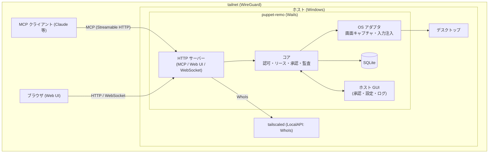

# プロジェクト概要

## 目的

自分の Windows PC（ホスト）に常駐する Wails アプリを通じて、tailnet 内の別端末から**デスクトップ全体を操作（computer-use）**できるようにする。操作の入口は 2 つ。

- **MCP**: Claude などの MCP クライアントが、スクリーンショット・マウス・キーボードのツールを呼んでホストを操作する
- **Web UI（ブラウザ）**: tailnet 内の別端末のブラウザでホスト画面をライブ表示し、人間が手動で操作・介入する

AI による操作は、ホスト側のキルスイッチ・承認・オーバーレイ・監査ログで常に制御・可視化する。

## 背景

- AI エージェントの computer-use を自宅・職場の「自分の PC」に向けたいが、公開サーバーや汎用リモートデスクトップを経由せず、tailnet（WireGuard）内で完結させたい。
- ホストは Windows。ホストの `tailscaled`（Tailscale クライアント）を利用して tailnet IP で Listen し、接続元の ID を LocalAPI の WhoIs で取得して認可に使う。
- 個人利用（ホスト所有者＝操作者）が前提。複数の自分の PC を対象にし、各 PC に 1 つずつアプリを常駐させる。

## スコープ

### 含むもの

- Wails アプリ（Go バックエンド + Web フロントエンド）のホスト常駐。トレイ常駐とホスト用 GUI（承認、設定、監査ログ、クライアント管理）
- MCP サーバー（Streamable HTTP）。screenshot / mouse / keyboard / 操作リース 等のツール
- Web UI（HTTP + WebSocket）。ライブ画面（JPEG 差分フレーム）と手動操作
- 認証・認可: tailnet ACL（第 1 層）、WhoIs 許可リスト、MCP 用 Bearer トークン
- 排他リースによる操作権管理（閲覧は複数可、操作権は常に 1 セッション）
- キルスイッチ（ホストでの即時切断・グローバルホットキー）、操作中オーバーレイ、操作承認モード、監査ログ（縮小スクリーンショット付き）
- ローカル永続化（SQLite）: 設定、クライアント、トークン、セッション、監査ログ
- 対象 OS: **Windows のみ**（初期スコープ）

### 含まないもの

- macOS / Linux 対応（Windows で確立後に別 Issue で検討。アーキテクチャ上は OS 依存部をインターフェースで分離しておく）
- Wails アプリを「操作する側のクライアント」として使う機能（操作側は MCP クライアントとブラウザのみ）
- tailnet 外（インターネット公開、Tailscale Funnel）からのアクセス
- tsnet 埋め込み（ホストの tailscaled を利用する）
- WebRTC / 動画エンコード配信
- 複数ユーザー向けのロール管理（owner / operator / viewer の分離）
- 音声・クリップボード同期・ファイル転送
- ロック画面・UAC セキュアデスクトップ・Session 0 の操作（Windows の制約として対象外）

## ステークホルダー / 想定ユーザー

| 区分 | 役割 | 備考 |
|------|------|------|
| ホスト所有者（兼操作者） | ホスト PC にアプリを導入・承認・設定し、手元の別端末からブラウザで操作する | 個人。複数 PC を所有 |
| AI エージェント（MCP クライアント） | MCP ツールでホストを操作する。所有者の別端末で動く Claude 等 | tailnet 上のデバイスから接続 |
| ホスト上の在席ユーザー | 画面を見ながら AI 操作を監視し、必要ならキルスイッチで止める | 所有者本人であることが多い |

## システム全体像

アーキテクチャの詳細は [アーキテクチャ設計](architecture/overview.md) を参照。

## ドキュメントマップ

このプロジェクトの仕様は以下のドキュメントで構成される。実装時はそれぞれ参照すること。

| ドキュメント | パス | 概要 |
|------------|------|------|
| 機能要件 | `docs/requirements/functional.md` | （作成後に確定） |
| 非機能要件 | `docs/requirements/non-functional.md` | （作成後に確定） |
| アーキテクチャ設計 | `docs/architecture/overview.md` | （作成後に確定） |
| ER / データモデル | `docs/architecture/er.md` | （作成後に確定） |
| API 仕様 | `docs/api/endpoints.md` | （作成後に確定） |
| コンポーネント設計 | `docs/components/overview.md` | （作成後に確定） |

## マイルストーン / リリース計画

目安時期は未定。対象 OS は Windows のみ。

- M1: Windows + MCP 最小ツール（screenshot / mouse / keyboard）、tailscaled 連携（WhoIs 許可リスト + Bearer）、キルスイッチ
- M2: Web UI（ライブ画面・手動操作）、排他リース
- M3: 承認モード、操作中オーバーレイ、監査ログ（縮小スクリーンショット付き）の強化
- 将来: macOS / Linux 対応（スコープ外。別途検討）

## 用語集

| 用語 | 定義 |
|------|------|
| ホスト | 操作される Windows PC。アプリが常駐する |
| クライアント | ホストに接続する側（MCP クライアント、または Web UI を開いたブラウザ） |
| tailnet | Tailscale が構成するプライベートネットワーク |
| tailscaled | ホスト上の Tailscale デーモン。LocalAPI を提供する |
| WhoIs | LocalAPI で接続元 IP からユーザー・デバイス情報を引く機能。認可の ID 源 |
| MCP | Model Context Protocol。AI クライアントがツールを呼ぶための標準プロトコル |
| Streamable HTTP | MCP の HTTP トランスポート |
| 操作リース | 入力操作の権利。同時に 1 セッションのみが保持できる排他ロック |
| 閲覧者 | ライブ画面の閲覧のみ可能なセッション。複数同時接続可 |
| キルスイッチ | ホスト側で全クライアント接続・操作を即時遮断する機構 |
| 承認モード | 操作を許可する条件（常時承認 / 初回のみ承認 / 自動許可）をクライアント単位で設定する仕組み |
| オーバーレイ | AI 操作中であることをホスト画面に明示する表示 |

## 改訂履歴

| 版 | 日付 | 変更内容 | 変更理由 |
|----|------|---------|---------|
| 1.0 | 2026-10-28 | 新規作成 | 初版 |
| 1.1 | 2026-10-28 | ライブ画面の形式を JPEG のみに修正 | アーキテクチャ決定（純 Go・cgo なし）との整合 |
