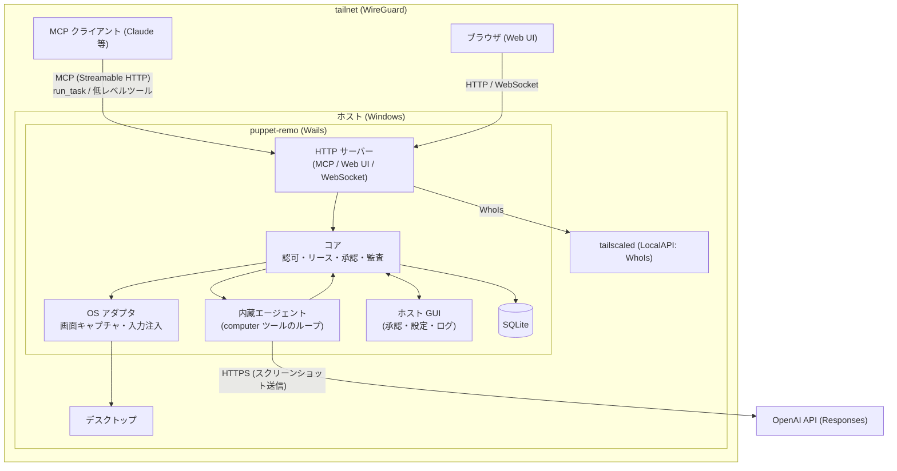

# プロジェクト概要

## 目的

自分の Windows PC（ホスト）に常駐する Wails アプリを通じて、tailnet 内の別端末から**デスクトップ全体を操作（computer-use）**できるようにする。ホストには **AI エージェントを内蔵**し、操作する側は「こういうことをして」と指示を送るだけで、ホストが OpenAI API と直接通信して画面を見ながら実行する。操作の入口は 3 つ。

- **MCP（高レベル）**: MCP クライアント（Claude 等）が `run_task` で自然言語の指示を送る。ホスト内蔵エージェントがタスクを実行し、進捗と結果を返す
- **MCP（低レベル）**: 同じ MCP クライアントが、スクリーンショット・マウス・キーボード等のツールを直接呼んでホストを操作する
- **Web UI（ブラウザ）**: tailnet 内の別端末のブラウザでホスト画面をライブ表示し、人間が手動で操作・介入する

AI による操作（内蔵エージェント、MCP 直接）は、ホスト側のキルスイッチ・承認・オーバーレイ・監査ログで常に制御・可視化する。エージェントのスクリーンショットは OpenAI に送信される（機能は既定で無効、ホスト所有者が明示的に有効化する）。

## 背景

- AI エージェントの computer-use を自宅・職場の「自分の PC」に向けたいが、公開サーバーや汎用リモートデスクトップを経由せず、tailnet（WireGuard）内で完結させたい。
- ホストは Windows。ホストの `tailscaled`（Tailscale クライアント）を利用して tailnet IP で Listen し、接続元の ID を LocalAPI の WhoIs で取得して認可に使う。
- 個人利用（ホスト所有者＝操作者）が前提。複数の自分の PC を対象にし、各 PC に 1 つずつアプリを常駐させる。

## スコープ

### 含むもの

- Wails アプリ（Go バックエンド + Web フロントエンド）のホスト常駐。トレイ常駐とホスト用 GUI（承認、設定、監査ログ、クライアント管理、API キー設定、実行中タスクの確認・中断）
- MCP サーバー（Streamable HTTP）。低レベルツール（screenshot / mouse / keyboard / ウィンドウ / クリップボード / UI ツリー / 操作リース）と、高レベルの `run_task`（非同期のタスク実行・状態取得・中断）
- ホスト内蔵エージェント: OpenAI Responses API の `computer` ツールで画面を見て操作する（`store: false`、履歴は毎回再送）。すべての入力は MCP 直接・Web UI と同じ入力層（InputGuard・リース・Judge・監査）を通す
- 高速パス（既定は無効・別途同意）: UI Automation から作った候補表（最大 24 件）から TypeSafe の Jev が 1 手ずつ ID を選んで進め、迷ったときだけ OpenAI へエスカレーションする。完了の宣言は必ず OpenAI がスクリーンショット 1 枚で確認して行う。Jev にスクリーンショットは送らない
- Web UI（HTTP + WebSocket）。ライブ画面（JPEG 差分フレーム）と手動操作
- 認証・認可: tailnet ACL（第 1 層）、WhoIs 許可リスト、MCP 用 Bearer トークン、クライアント単位のエージェント利用許可
- 排他リースによる操作権管理（閲覧は複数可、操作権は常に 1 セッション。保持者は MCP 直接・Web UI・内蔵エージェントのいずれか）
- キルスイッチ（ホストでの即時切断・実行中タスクの中断・グローバルホットキー）、操作中オーバーレイ、操作承認モード、監査ログ（縮小スクリーンショット付き）
- ローカル永続化（SQLite）: 設定、クライアント、トークン、タスク、監査ログ。OpenAI API キーは Windows 資格情報マネージャーに保管
- 対象 OS: **Windows のみ**（初期スコープ）

### 含まないもの

- macOS / Linux 対応（Windows で確立後に別 Issue で検討。アーキテクチャ上は OS 依存部をインターフェースで分離しておく）
- Wails アプリを「操作する側のクライアント」として使う機能（操作側は MCP クライアントとブラウザのみ。Web UI からタスクを入力する画面も初版では作らない）
- tailnet 外（インターネット公開、Tailscale Funnel）からのアクセス
- tsnet 埋め込み（ホストの tailscaled を利用する）
- OpenAI 以外の AI プロバイダへの切り替え（内蔵エージェントの接続先は OpenAI Responses API のみ）。Jev は高速パスの候補選択だけに使い、実行前の判定（Judge）には使わない（Judge は決定論的なルールベース）
- WebRTC / 動画エンコード配信
- 複数ユーザー向けのロール管理（owner / operator / viewer の分離）
- 音声、ファイル転送、双方向の自動クリップボード同期（テキストの手動送受信と MCP ツールは含む。[機能要件](requirements/functional.md) FR-W07 / FR-M13）
- ロック画面・UAC セキュアデスクトップ・Session 0 の操作（Windows の制約として対象外）

## ステークホルダー / 想定ユーザー

| 区分 | 役割 | 備考 |
|------|------|------|
| ホスト所有者（兼操作者） | ホスト PC にアプリを導入・承認・設定し、OpenAI API キーを登録し、手元の別端末からブラウザまたは MCP クライアントで指示・操作する | 個人。複数 PC を所有 |
| MCP クライアント（Claude 等） | `run_task` で指示を送る、または低レベルツールで直接操作する。所有者の別端末で動く | tailnet 上のデバイスから接続。AI と通信するのはクライアント側の AI（Claude 等）であり、`run_task` の実行中だけホストが OpenAI と通信する |
| ホスト上の在席ユーザー | 画面とオーバーレイで AI 操作を監視し、必要ならキルスイッチで止める | 所有者本人であることが多い |

## システム全体像

アーキテクチャの詳細は [アーキテクチャ設計](architecture/overview.md) を参照。

## ドキュメントマップ

このプロジェクトの仕様は以下のドキュメントで構成される。実装時はそれぞれ参照すること。

| ドキュメント | パス | 概要 |
|------------|------|------|
| 機能要件 | [`docs/requirements/functional.md`](requirements/functional.md) | ユースケースと機能要件（接続・認可、操作リース、MCP ツール、内蔵エージェント、Web UI、ホスト GUI、監査、設定） |
| 非機能要件 | [`docs/requirements/non-functional.md`](requirements/non-functional.md) | 脅威モデル、性能・セキュリティ（自己保護、API キー、プロンプトインジェクション対策、CSP）、可用性、プライバシー、決定事項・意図的な未設定・検証事項 |
| アーキテクチャ設計 | [`docs/architecture/overview.md`](architecture/overview.md) | 技術選定、構成図、レイヤー、GUI／リモートのルーター分離、主要フロー（高速パス含む）、画面配信、Judge、ディレクトリ構成 |
| フロントエンド設計（HALT） | [`docs/architecture/frontend.md`](architecture/frontend.md) | HTMX + Atomic Design + Lit + Templ の規約、2 つの UI（ホスト GUI / Web UI）、HTMX パターン、`<remo-screen-viewer>`、ビルド、開発ワークフロー、テスト戦略 |
| ER / データモデル | [`docs/architecture/er.md`](architecture/er.md) | SQLite のテーブル定義（clients、client_tokens、connection_requests、settings、agent_tasks、audit_logs、audit_thumbnails）と保守処理 |
| API 仕様 | [`docs/api/endpoints.md`](api/endpoints.md) | MCP ツール、Web UI のルート、WebSocket のプロトコル、JSON API、ホスト GUI のルートと SSE、エラー形式 |
| コンポーネント設計 | [`docs/components/overview.md`](components/overview.md) | パッケージの責務・依存、Go インターフェース、goroutine と状態の所有者、起動・終了順序、テスト方針（モックと実機スモーク） |

## マイルストーン / リリース計画

目安時期は未定。対象 OS は Windows のみ。

- M1: Windows + MCP 低レベルツール（スクリーンショット・マウス・キーボード・ウィンドウ一覧とフォーカス・クリップボード・UI ツリー・操作リース。FR-M01〜M17）、tailscaled 連携（WhoIs 許可リスト + Bearer）、排他リース（保持者は MCP 直接の `mcp` のみ。承認なしで取得）、キルスイッチ、ホスト GUI の基本（ダッシュボード、接続要求、クライアント管理）、監査の追記（認証失敗・リース・ツール実行）
- M2: Web UI（ライブ画面・手動操作）、リースの強制剥奪（保持者種別 `web` の追加）
- M3: 承認モード（リースの `pending_approval`、承認ダイアログ）、操作中オーバーレイ、監査ログの閲覧 UI と縮小スクリーンショット
- M4: ホスト内蔵エージェント（`run_task`、OpenAI `computer` ツール、API キー管理、タスク上限・中断。リースの保持者種別 `agent` の追加）と、高速パス（TypeSafe Jev による候補選択。UI Automation の候補表、エスカレーション）。承認・オーバーレイ・監査（M3）を前提にするため M3 の後に置く。高速パスの品質は、固定のタスク集合で実測して確認する
- 将来: macOS / Linux 対応（スコープ外。別途検討）

## 用語集

| 用語 | 定義 |
|------|------|
| ホスト | 操作される Windows PC。アプリが常駐する |
| クライアント | ホストに接続する側（MCP クライアント、または Web UI を開いたブラウザ） |
| tailnet | Tailscale が構成するプライベートネットワーク |
| tailscaled | ホスト上の Tailscale デーモン。LocalAPI を提供する |
| WhoIs | LocalAPI で接続元 IP からユーザー・デバイス情報を引く機能。認可の ID 源 |
| MCP | Model Context Protocol。AI クライアントがツールを呼ぶための標準プロトコル |
| Streamable HTTP | MCP の HTTP トランスポート |
| 操作リース | 入力操作の権利。同時に 1 セッションのみが保持できる排他ロック |
| 閲覧者 | ライブ画面の閲覧のみ可能なセッション。複数同時接続可 |
| キルスイッチ | ホスト側で全クライアント接続・操作を即時遮断する機構 |
| 承認モード | 操作を許可する条件（常時承認 / 初回のみ承認 / 自動許可）をクライアント単位で設定する仕組み |
| オーバーレイ | AI 操作中であることをホスト画面に明示する表示 |
| 内蔵エージェント | ホスト内で動き、OpenAI Responses API の `computer` ツールで画面を見ながら入力を実行するループ。`run_task` で起動する |
| 高速パス | 内蔵エージェントの 1 手ごとの処理方式の 1 つ。アプリが UI Automation から作る候補表から、Jev が ID を 1 つ選んで進める。迷ったときは OpenAI へエスカレーションし、完了は必ず OpenAI が確認する |
| 候補表 | 高速パスで Jev に選ばせる、アプリが作る不変のアクション一覧（最大 24 件 + `reobserve` + `abstain`）。Jev は表にない操作・座標・引数を作れない |
| エスカレーション | 高速パスから OpenAI の `computer` ツールのループへ引き継ぐこと。理由は `abstain` / `low_confidence` / `no_candidates` / `invalid_choice` / `no_progress` / `goal_maybe_done` / `fast_step_limit` / `chooser_unavailable` |
| タスク（run） | 内蔵エージェントへの 1 回の指示の実行単位。排他リースを開始から終了まで保持する。状態・ステップ数・使用トークンを記録する |
| Judge | 実行前のアクションに対し「許可 / 承認へ回す / 拒否」を助言する判定インターフェース。既定はルールベース。承認を省略する方向には作用させない |

## 改訂履歴

| 版 | 日付 | 変更内容 | 変更理由 |
|----|------|---------|---------|
| 1.0 | 2026-10-28 | 新規作成 | 初版 |
| 1.1 | 2026-10-28 | ライブ画面の形式を JPEG のみに修正 | アーキテクチャ決定（純 Go・cgo なし）との整合 |
| 1.2 | 2026-10-29 | ホスト内蔵エージェント（OpenAI `computer` ツール）を主役に追加、MCP は低レベルツールと `run_task` を併存、M4 を追加 | 「ホストが AI と直接通信し、指示を受けて実行する」という要件の確認 |
| 1.3 | 2026-10-29 | ドキュメントマップを確定（全 6 文書のリンクと要約） | 仕様書の完成 |
| 1.4 | 2026-10-29 | ドキュメントマップに `docs/architecture/frontend.md` を追加（全 7 文書） | HALT の規約を新規文書に分離 |
| 1.5 | 2026-10-29 | 高速パス（Jev による候補選択）をスコープ・マイルストーン M4・用語集に追加。Jev を Judge に使わない旨を明記。OpenAI は `store: false` | 未決事項の決定 |
| 1.6 | 2026-10-29 | マイルストーンを修正（PR #2 のレビュー対応）: 排他リース（FR-L01〜L05）を M1 に、M2 を Web UI と強制剥奪（FR-L06）に変更。M1 のツール範囲を FR-M01〜M17 全件（`get_ui_tree`・`clipboard_*`・`list_windows`・`focus_window` を含む）に変更。承認モード・オーバーレイ・監査の閲覧 UI と縮小スクリーンショットは M3、`agent` のリースは M4 と明記 | M1 の実装者が迷わない仕様にするためのレビュー指摘の解消 |
