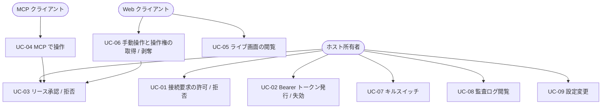
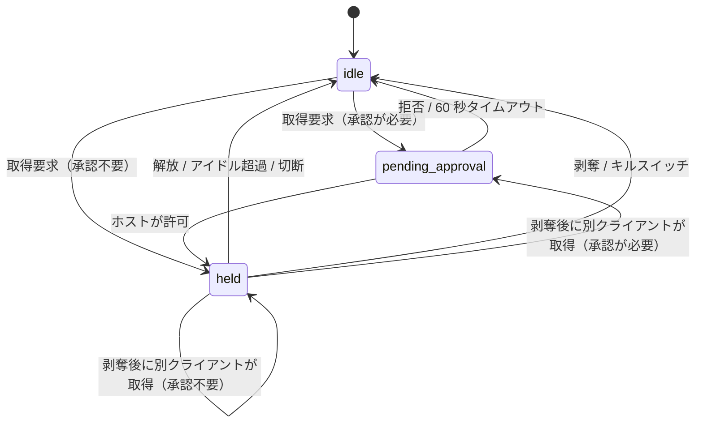
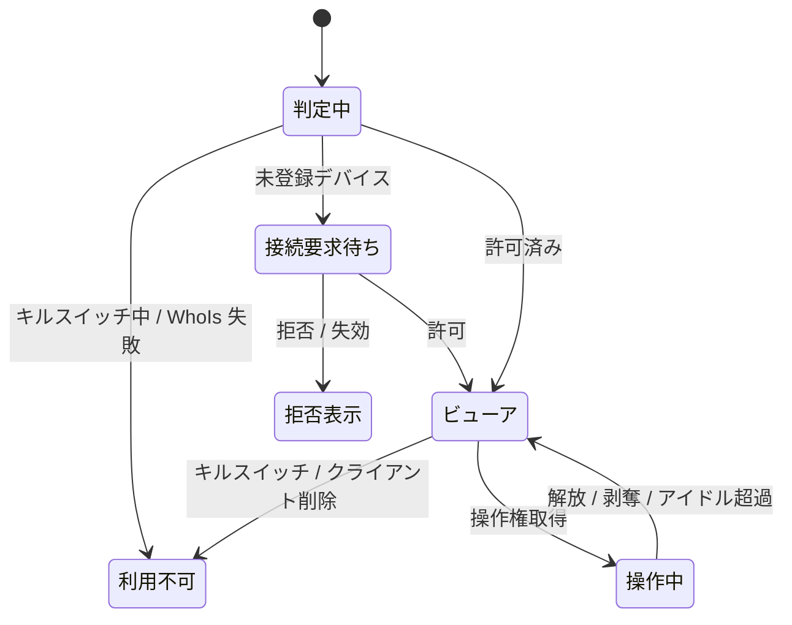

# 機能要件

対象 OS は Windows のみ。全体像は [プロジェクト概要](../overview.md) を参照。

## アクターとユースケース

| アクター | 説明 |
|---------|------|
| ホスト所有者 | ホスト PC を持つ本人。ホスト GUI で承認・設定・キルスイッチ操作を行う |
| MCP クライアント | tailnet 上の端末で動く Claude 等。Bearer トークンで MCP を呼ぶ |
| Web クライアント | tailnet 上の端末のブラウザ。Web UI で画面を見て手動操作する |

| ID | ユースケース | 主アクター | 概要 |
|----|------------|-----------|------|
| UC-01 | 接続要求の許可 / 拒否 | ホスト所有者 | 未登録のデバイスからの接続が「接続要求」として GUI に出る。許可するとクライアントとして登録される |
| UC-02 | Bearer トークン発行 / 失効 | ホスト所有者 | MCP 用トークンを GUI で発行（一度だけ表示）し、失効できる |
| UC-03 | リース承認 / 拒否 | ホスト所有者 | クライアントの承認モードに従い、操作リース取得時に承認ダイアログを出す |
| UC-04 | MCP で操作 | MCP クライアント | screenshot / mouse / keyboard などのツールでホストを操作する |
| UC-05 | ライブ画面の閲覧 | Web クライアント | ブラウザでホスト画面をライブ表示する（複数同時可） |
| UC-06 | 手動操作と操作権の取得 / 剥奪 | Web クライアント | 操作権を取得して手動操作する。AI が保持中なら強制剥奪できる |
| UC-07 | キルスイッチ | ホスト所有者 | 全リース剥奪・全接続切断・受付停止を即時実行する |
| UC-08 | 監査ログ閲覧 | ホスト所有者 | 全操作の記録を縮小スクリーンショット付きで確認する |
| UC-09 | 設定変更 | ホスト所有者 | ポート、ホットキー、画質、承認モード、保持期間などを変更する |

## 機能一覧

優先度: M1 = Windows + MCP 最小ツール、M2 = Web UI・排他リース、M3 = 承認・オーバーレイ・監査強化（[マイルストーン](../overview.md#マイルストーン--リリース計画)）。

### 接続・認証・認可（FR-A）

| ID | 要件 | 優先度 |
|----|------|--------|
| FR-A01 | アプリはホストの `tailscaled` が持つ tailnet IP（IPv4 / IPv6）のみで Listen し、`0.0.0.0` では Listen しない | M1 |
| FR-A02 | `tailscaled` の状態（起動・ログイン済み・tailnet IP の有無）を監視し、IP の変化に追従して Listen を張り直す。利用不可の間はサーバーを停止し、GUI に理由を表示する | M1 |
| FR-A03 | 全リクエストで接続元 IP を LocalAPI の WhoIs で解決し、ユーザー（ログイン名）とデバイス（node ID）を得る。WhoIs に失敗した接続は拒否する | M1 |
| FR-A04 | **クライアント**を「tailnet デバイス（node ID）+ ユーザー」で識別する。Web UI は許可リストに載るクライアントのみ利用できる | M1 |
| FR-A05 | MCP エンドポイントは、許可リストに載るクライアント **かつ** そのクライアントに紐づく有効な Bearer トークンを必須とする（どちらか欠けても拒否）。トークンは発行先クライアントの node ID 以外からは使えない | M1 |
| FR-A06 | 未登録デバイスからの接続は 403 を返し、同時に「接続要求」を 1 デバイス 1 件に集約して GUI に表示する。許可でクライアント登録、拒否で当該要求を破棄する。保留は 24 時間で失効する | M1 |
| FR-A07 | 接続要求の作成にはレート制限をかけ（1 分あたり全体で 10 件まで、超過分は GUI に出さず記録のみ）、GUI への通知スパムを防ぐ | M1 |
| FR-A08 | Bearer トークンは GUI から発行する。平文は発行時に一度だけ表示し、DB にはハッシュのみ保存する。有効期限は発行時に指定でき（既定 90 日）、いつでも失効できる | M1 |
| FR-A09 | クライアントは個別に Web / MCP の利用可否を切り替えられ、削除（許可リストから除外）できる。削除・無効化したクライアントのセッションは即時切断する | M1 |

### 操作リース（FR-L）

| ID | 要件 | 優先度 |
|----|------|--------|
| FR-L01 | 入力操作（マウス・キーボード・フォーカス変更・クリップボード・UI ツリー取得）には**操作リース**が必要。リースは同時に 1 セッションのみ保持できる | M1 |
| FR-L02 | 閲覧系（screenshot、ライブ画面）はリース不要で、許可済みクライアントの複数セッションが同時に利用できる | M1 |
| FR-L03 | リースの状態は `idle → pending_approval → held → idle` と遷移する。他者の保持中に取得を試みると `lease_held_by_other` エラーとなる（待機はしない） | M1 |
| FR-L04 | MCP の操作系ツールは、リース未保持なら暗黙にリース取得を試みる。明示的な `acquire_control` / `release_control` も提供する | M1 |
| FR-L05 | リースはアイドルタイムアウト（既定 5 分、設定可）、セッション切断、明示解放、剥奪、キルスイッチのいずれかで解放される | M1 |
| FR-L06 | Web クライアントとホスト所有者は、他者保持中のリースを強制剥奪できる。剥奪された側の以後の操作は `lease_revoked` を返す。剥奪後に自身が取得する場合は自身の承認モードが適用される | M2 |
| FR-L07 | リース取得時にクライアントの承認モード（常時承認 / 初回のみ承認 / 自動許可）を適用する。承認待ちは 60 秒でタイムアウトし拒否扱い（`approval_timeout`）とする。「初回のみ承認」は一度承認されたクライアントに対し以後の承認を省略し、クライアント設定で取り消せる。新規クライアントの既定は「常時承認」 | M3 |

### MCP ツール（FR-M）

トランスポートは Streamable HTTP（`/mcp`）。座標系の規約は後述。

| ID | ツール | 引数 | 戻り値 | リース |
|----|-------|------|--------|-------|
| FR-M01 | `get_screen_info` | なし | モニター一覧（index、名称、プライマリか、物理サイズ、原点、DPI スケール、スクリーンショット縮小率） | 不要 |
| FR-M02 | `screenshot` | `monitor?`（既定: プライマリ）、`format?`（`png` 既定 / `jpeg`） | 画像（縮小済み）とメタ情報（元サイズ、縮小後サイズ、縮小率、モニター） | 不要 |
| FR-M03 | `cursor_position` | なし | カーソル座標（縮小座標系）とモニター | 不要 |
| FR-M04 | `mouse_move` | `x`, `y`, `monitor?` | OK | 必要 |
| FR-M05 | `click` | `x?`, `y?`（省略時は現在位置）, `button`（left / right / middle）, `count`（1〜3）, `modifiers?`, `monitor?` | OK | 必要 |
| FR-M06 | `drag` | `from{x,y}`, `to{x,y}`, `button?`, `monitor?` | OK | 必要 |
| FR-M07 | `scroll` | `x`, `y`, `direction`（up / down / left / right）, `amount`（ノッチ数）, `monitor?` | OK | 必要 |
| FR-M08 | `key` | `keys`（例: `ctrl+shift+t`、`Enter`） | OK | 必要 |
| FR-M09 | `type` | `text`（Unicode 全般。日本語を含む） | OK | 必要 |
| FR-M10 | `wait` | `ms`（上限 10,000） | OK | 不要 |
| FR-M11 | `list_windows` | なし | ウィンドウ一覧（id、タイトル、プロセス名、PID、矩形、モニター、前面か、最小化か、管理者権限か） | 不要 |
| FR-M12 | `focus_window` | `id` | OK | 必要 |
| FR-M13 | `clipboard_read` / `clipboard_write` | `text`（書き込み時） | テキスト（読み取り時） | 必要 |
| FR-M14 | `get_ui_tree` | `window_id?`, `max_depth?`（既定 5）, `max_nodes?`（既定 500） | UI Automation ツリー（role、name、value、矩形、有効状態、ノード id）。パスワード欄の値は含めない | 必要 |
| FR-M15 | `acquire_control` / `release_control` / `get_control_status` | なし | リース状態（保持者、残りアイドル時間など） | 不要（取得自体が対象） |

**座標系の規約（FR-M16）**

- MCP のすべての座標は「縮小スクリーンショット座標」で指定する。縮小率はモニターごとに、`min(1, 最大辺上限 ÷ モニター物理の長辺)` で**決定的に**決まる（スクリーンショットの履歴に依存しない）。最大辺上限は設定値（既定 1568 px）
- サーバーは縮小座標を `round(x ÷ 縮小率)` でモニターの物理ピクセルへ変換し、モニターの原点を加算する
- 範囲外の座標は `invalid_coordinates`

**エラー（FR-M17）**

| コード | 条件 |
|--------|------|
| `lease_required` | 操作系ツールを、リース無しでかつ暗黙取得できない状態で呼んだ |
| `lease_held_by_other` | 他のセッションがリースを保持している |
| `lease_revoked` | 自身のリースが剥奪された |
| `approval_denied` / `approval_timeout` | ホストが拒否した / 60 秒で応答が無かった |
| `kill_switch_active` | キルスイッチで受付停止中 |
| `invalid_coordinates` / `invalid_argument` | 引数が不正 |
| `window_not_found` | `focus_window` / `get_ui_tree` の対象が存在しない |
| `input_blocked` | 管理者権限ウィンドウなど OS 制約で入力できない（UIPI） |
| `desktop_unavailable` | ロック画面・UAC セキュアデスクトップ等でキャプチャ・入力できない |

### Web UI（FR-W）

| ID | 要件 | 優先度 |
|----|------|--------|
| FR-W01 | 許可済みクライアントがブラウザで開くと、ホスト画面をライブ表示する。複数ブラウザが同時に閲覧できる | M2 |
| FR-W02 | 未登録デバイスで開くと、接続要求を送信した旨と待機メッセージを表示する（FR-A06）。拒否・失効時はその旨を表示する | M2 |
| FR-W03 | 画面は WebSocket 上の JPEG 差分フレーム（変化したタイルのみ）で配信する。変更の無い領域は送らない | M2 |
| FR-W04 | モニター選択（マルチディスプレイ）。選択はブラウザセッションごとの設定 | M2 |
| FR-W05 | 画質（JPEG 品質）とフレームレートの手動調整（スライダー。自動調整は行わない）。既定 品質 70、10 fps | M2 |
| FR-W06 | 操作権を持つ間、マウス（移動・クリック・ドラッグ・ホイール）とキーボード入力（特殊キー含む）をホストに送れる。ブラウザが奪う OS ショートカット（例: `Ctrl+W`）は専用の送信メニューから送る | M2 |
| FR-W07 | クリップボード同期。Web UI は HTTP（非セキュアコンテキスト）で提供するため `navigator.clipboard` は使わない。**ブラウザ→ホスト**: 専用入力欄へ貼り付け（貼り付けイベント）または入力したテキストを「送信」でホストのクリップボードに設定する。**ホスト→ブラウザ**: 「ホストのクリップボードを取得」で内容を表示欄に出し、利用者が手動でコピーする。いずれもテキストのみ、操作権が必要 | M2 |
| FR-W08 | 操作権の取得 / 解放 / 強制剥奪ボタンを表示し、現在の保持者（クライアント名・種別）と状態を常に表示する。UI から Ctrl+Alt+Del は送れない旨を明記する | M2 |
| FR-W09 | 閲覧者がいないときはキャプチャを停止する | M2 |

### ホスト GUI・安全機構（FR-H）

| ID | 要件 | 優先度 |
|----|------|--------|
| FR-H01 | Wails アプリはタスクトレイに常駐し、ウィンドウを閉じても終了しない。多重起動は 1 インスタンスに制限し、ログオン時の自動起動を設定できる | M1 |
| FR-H02 | **ダッシュボード**: サーバー状態（tailnet IP、ポート、tailscaled 状態）、接続中セッション一覧、現在のリース保持者とリース強制剥奪ボタン、キルスイッチボタン | M1 |
| FR-H03 | **接続要求**画面（許可 / 拒否）とトレイ通知。許可時にクライアントの承認モードを選ぶ（既定: 常時承認）。ホスト画面の承認ダイアログはホストの手元でしか操作できないため、所有者が遠隔の Web UI から使うクライアントは「自動許可」にする運用を想定する | M1 |
| FR-H04 | **クライアント管理**画面: 許可リスト、Web / MCP の有効化、承認モード、Bearer トークン発行・失効・有効期限、クライアント削除 | M1 |
| FR-H05 | **承認ダイアログ**: リース取得要求ごとに、クライアント名・種別を表示して許可 / 拒否（60 秒でタイムアウトして拒否） | M3 |
| FR-H06 | **キルスイッチ**: トレイメニュー・ダッシュボードボタン・グローバルホットキー（既定 `Ctrl+Alt+Shift+K`、変更可）で発動する。全リース剥奪、全 MCP・WebSocket セッション切断、受付停止（`kill_switch_active`）を行い、ホスト所有者が GUI で明示的に解除するまで再開しない | M1 |
| FR-H07 | **操作中オーバーレイ**: リース保持中、画面の全モニターに最前面・クリック透過の枠と「操作中: <クライアント名>」を表示する。オーバーレイは画面キャプチャ（スクリーンショット・ライブ配信）に写さない | M3 |
| FR-H08 | **監査ログ**画面（FR-AU 参照）と**設定**画面（FR-S 参照） | M3 |
| FR-H09 | **更新**: GitHub Releases の新版を定期確認し、署名検証（[NFR-S10](non-functional.md)）に成功した更新を通知する。適用はホスト GUI の確認後（既定）に行い、リース保持中・接続中は適用しない。設定で「アイドル時に自動適用」へ切り替えられる | M3 |

### 監査ログ（FR-AU）

| ID | 要件 | 優先度 |
|----|------|--------|
| FR-AU01 | 以下をすべて記録する: 接続要求の作成・許可・拒否、認証失敗、トークン発行・失効、リースのライフサイクル（取得要求・承認・拒否・解放・剥奪）、MCP ツール呼び出し（ツール名・引数・結果・所要時間）、Web UI からの入力操作、キルスイッチ発動・解除、設定変更 | M3 |
| FR-AU02 | 操作系ツール・Web UI 入力の直後に、縮小スクリーンショット（長辺 320 px、JPEG 品質 60）を保存できる。保存の有無は設定で切り替える（既定: 保存する） | M3 |
| FR-AU03 | `type` のテキスト本文とクリップボードの内容は既定では記録せず、文字数のみ記録する。設定で本文の記録を有効にできる | M3 |
| FR-AU04 | 保持期間（既定 30 日）とサムネイル総容量の上限（既定 1 GiB）を設定でき、超過分は古い順に削除する | M3 |
| FR-AU05 | 一覧は日時・クライアント・種別・結果で絞り込めて、1 件ごとに詳細（引数・サムネイル）を閲覧できる | M3 |

### 設定（FR-S）

| ID | 設定 | 既定値 | 優先度 |
|----|------|--------|--------|
| FR-S01 | Listen ポート | 8765 | M1 |
| FR-S02 | キルスイッチのホットキー | `Ctrl+Alt+Shift+K` | M1 |
| FR-S03 | スクリーンショット最大辺 | 1568 px | M1 |
| FR-S04 | リースのアイドルタイムアウト | 5 分 | M1 |
| FR-S05 | クライアント別承認モード | 常時承認 | M3 |
| FR-S06 | Web UI の既定品質 / FPS | 70 / 10 fps | M2 |
| FR-S07 | 監査ログ（サムネイル保存、本文記録、保持期間、容量上限） | FR-AU02〜04 の既定 | M3 |
| FR-S08 | ログオン時の自動起動 | 無効 | M1 |
| FR-S09 | 更新の適用方法（ホスト確認 / アイドル時に自動適用） | ホスト確認 | M3 |

## Windows 固有の制約（仕様上の扱い）

| 制約 | 扱い |
|------|------|
| UIPI: 管理者権限のウィンドウには通常権限プロセスから入力できない | `input_blocked` を返す。初期スコープは通常権限での動作のみ保証する |
| ロック画面・UAC セキュアデスクトップ・Session 0 | 対象外。`desktop_unavailable` を返す |
| Ctrl+Alt+Del（SAS）は SendInput で送れない | Web UI でも送信不可と表示する |
| ブラウザが先取りするショートカット | 専用の送信メニューで補う（FR-W06） |

## 改訂履歴

| 版 | 日付 | 変更内容 | 変更理由 |
|---|------|---------|---------|
| 1.0 | 2026-10-28 | 初版作成 | — |
| 1.1 | 2026-10-28 | FR-W07 を HTTP 前提に変更、FR-H03 に承認モード選択を追加、FR-H09・FR-S09（更新）を追加 | 非機能要件の決定（HTTP のみ、自動更新）との整合 |
| 1.2 | 2026-10-28 | FR-W03・FR-W05・FR-AU02 の画像形式を WebP から JPEG に変更 | アーキテクチャ決定（純 Go・cgo なし）との整合 |
